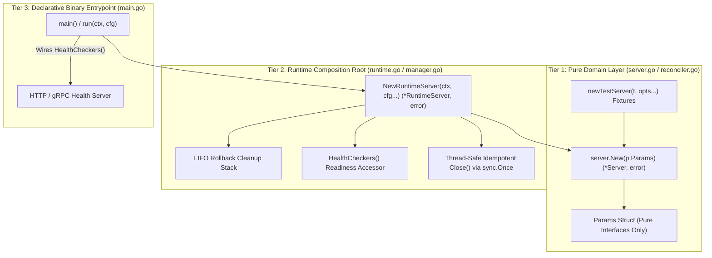

# Go (Golang) Guidelines

This document defines coding standards and conventions for Go development across the codebase.

---

## 1. Style & Conventions
- **Idiomatic Go Style Guide**: Strictly follow standard Go conventions and Effective Go style recommendations.
- **Simplicity & Readability**: Keep Go code clean, explicit, and idiomatic. Avoid unnecessary reflection or overly abstract abstractions.

## 2. Interface Design
- **Small, Focused Interfaces**: Keep interfaces small and decoupled (typically 1–3 methods). Define interfaces where they are consumed rather than where they are implemented.
- **Accept Interfaces, Return Structs**: Functions and constructors should accept interface parameters and return concrete struct types wherever practical.

## 3. Error Handling & Formatting
- **Explicit Error Checks**: Never ignore returned errors. Handle error branches immediately using early return guard clauses.
- **Proper Error Wrapping**: Wrap lower-level errors with operational context using `fmt.Errorf("failed to execute step: %w", err)` to preserve causality chains.
- **Formatting Rules**: Error strings must begin with a lowercase letter and must omit trailing punctuation.

## 4. Concurrency Safety
- **Goroutine Lifecycle Management**: Always govern goroutine lifecycles using `context.Context` cancellation, `sync.WaitGroup`, or worker channels to prevent goroutine leaks.
- **Data Race Prevention**: Protect shared mutable state with `sync.Mutex` or `sync.RWMutex`. Verify concurrent routines with the `-race` detector enabled.

## 5. Table-Driven Testing & Declarative Assertions
- **Table-Driven Tests**: Standardize unit test suites using Go table-driven patterns (`tests := []struct{ name string; ... }{...}`).
- **Subtest Execution**: Execute subtests using `t.Run(tt.name, func(t *testing.T) { ... })` to ensure clear failure reporting and isolated execution.
- **Declarative `want` Assertions over Chained Field Checks**: Avoid chained imperative field inequality checks (e.g., `if got.FieldA != "a" || got.FieldB != "b" { t.Errorf(...) }`) unless you have a very good reason (such as selectively checking non-deterministic timestamps, randomly generated IDs, or unexported fields). In all standard cases, declare an explicit `want` expectation struct or Protobuf object and compare using:
  - `cmp.Diff(tt.want, got)` for standard Go structs.
  - `proto.Equal(got, tt.want)` or `cmp.Diff(tt.want, got, protocmp.Transform())` for Protobuf messages.
  - `cmp.Diff(tt.want, got)` for primitive maps/slices (prefer importing `cmp` over using `reflect.DeepEqual` to ensure actionable diffs and avoid nil-slice comparison pitfalls).
  This ensures test failures produce actionable, line-by-line diffs (`-want +got`) and verifies complete structural contracts rather than fragile subsets of fields.
- **Baseline Fixtures & Targeted Mutations (`prototest.Modify`)**: Follow baseline fixture policies in [Core Engineering Standards](../core_engineering.md#4-high-fidelity-test-doubles--decoupling). When constructing Protobuf test objects in Go unit tests, check for existing baseline fixtures (e.g., `baseReq`, `baseWorkUnit`) and modify them using `prototest.Modify` rather than building raw, verbose struct literals. This keeps test suites DRY, readable, and consistent.
- **Centralize Common Test Utilities**: Shared test and proto utilities must be centralized in global packages (e.g., `prototest.Modify` in `//internal/prototest`) per [Core Engineering Standards](../core_engineering.md#4-high-fidelity-test-doubles--decoupling).

## 6. Go Dependencies / Bazel
- Always inspect proto package `BUILD.bazel` to verify exact `go_proto_library` target name (typically ending in `_go_proto`) before adding Bazel dependencies.

## 7. Go CLI Entrypoints & Exit Cleanups
- **Graceful Execution Pattern**: NEVER call `os.Exit()` directly inside `main()` when `defer` statements (e.g. database handles, socket cleanups) are registered. Standardize on the `os.Exit(run())` pattern where `run() int` returns the exit code after all deferred cleanups execute.
- **Zero-Value Flag Defaults for Environment Fallbacks**: When CLI flags override environment variable fallbacks, set CLI flag defaults to zero-values (`0`, `""`) to accurately distinguish explicit CLI overrides from environment variable defaults.

## 8. Go Map Safety, Mutability & Pointer Isolation
- **Map Pointer Isolation**: NEVER assign the same map reference to multiple struct fields or nested objects (e.g., `JobTemplateSpec.ObjectMeta.Labels` and `PodTemplateSpec.ObjectMeta.Labels`). Construct a shallow copy for each sub-struct:
  ```go
  podLabels := make(map[string]string, len(labels))
  for k, v := range labels {
      podLabels[k] = v
  }
  ```
- **Pre-allocating Map Capacity**: Specify initial capacity `make(map[K]V, capacity)` whenever map entry counts are known to prevent runtime re-allocations.
- **Deterministic Map Iteration**: Map iteration in Go is non-deterministic. Always sort slice outputs derived from map keys prior to serialization or return.

## 9. Context Safety in `defer` Cleanups & Shared Resource Rebuilds
- **Fresh Cleanup Context**: Deferred cleanup functions (`Teardown`, `Close`, container termination) MUST NOT pass a parent context (`ctx`) that might already be canceled or timed out. Wrap the context creation and cleanup call inside a deferred closure so the timeout begins when cleanup actually starts:
  ```go
  defer func() {
      cleanupCtx, cancel := context.WithTimeout(context.Background(), 10*time.Second)
      defer cancel()
      c.Terminate(cleanupCtx)
  }()
  ```
- **Detached Context for Shared Initializers & Rebuilds (`context.WithoutCancel`)**: Operations that initialize, refresh, or hot-swap a **process-scoped shared resource or cache** (such as `singleflight.Group` callbacks or mutex-serialized connection/cache rebuilds whose result is stored on a shared struct for subsequent requests) MUST detach from the triggering caller's or readiness probe's cancellation using `context.WithTimeout(context.WithoutCancel(ctx), timeout)` (always calling the returned `cancel` function, typically via `defer`, to prevent context leaks) so a short-lived caller deadline cannot abort a shared dial or cache refresh. Per-request queries, RPCs, and health pings on an already-established handle MUST NOT use `context.WithoutCancel` and MUST propagate `ctx` directly.

## 10. Two-Tier Service Constructor & Runtime Composition Root Architecture
To enable high-fidelity, decoupled unit testing without bloated mock setups or cloud SDK coupling, all Go gRPC/HTTP services and controllers MUST follow the **Two-Tier Constructor & Composition Root Pattern**:



### 1. Tier 1: Pure Domain Constructor (`server.New(p Params) (*Server, error)`)
- **Interface-Only `Params` Struct**: Accepts a `Params` parameter object containing **pure domain interfaces** (`storage.Storage`, `auth.AuthorizerInterface`, `taskqueue.Client`).
- **Fail-Fast Dependency Validation**: Validates all required dependencies on initialization and returns descriptive errors on nil/missing parameters (https://google.github.io/styleguide/go/decisions#dont-panic). NEVER panic in constructors.
- **Zero Cloud SDK Instantiation**: Never instantiate concrete cloud SDKs (Spanner, Redis, K8s, Cloud Identity) or perform external I/O directly in `server.New`.
- **Ergonomic Test Fixtures (`newTestServer(t, opts...)`)**: Unit tests inject fast in-memory fakes or doubles via functional test fixtures with zero cloud SDK overhead.

### 2. Tier 2: Runtime Composition Root (`server.NewRuntimeServer(ctx, cfg) (*RuntimeServer, error)`)
- **Environment-Neutral Naming (No `Prod` Suffixes)**: NEVER name composition roots `ProdServer` or `NewProd`. The term "Prod" is overloaded with deployment environment semantics and causes confusion because this composition root is used whenever running the live server binary (as opposed to unit-test fakes). Use explicit, environment-neutral names: `RuntimeServer`, `NewRuntimeServer`, `LiveServer`, or `NewManager`.
- **LIFO Rollback Cleanup Stack**: When instantiating multi-step cloud infrastructure (Spanner, Redis, K8s clients, OAuth verifiers), track cleanups in a LIFO slice (`var cleanups []func() error`) with an error-triggered deferred rollback:
  ```go
  var cleanups []func() error
  defer func() {
      if retErr != nil {
          for i := len(cleanups) - 1; i >= 0; i-- {
              _ = cleanups[i]()
          }
      }
  }()
  ```
- **Thread-Safe Idempotent Teardown (`Close() error`)**: Protect `Close()` using `sync.Once` and `errors.Join` across sub-cleanups.
- **Encapsulated Readiness & Probes (`HealthCheckers()`)**: Expose health checking interfaces from `RuntimeServer` to allow `main.go` to wire HTTP `/readyz` or gRPC health checks without leaking raw database or cloud client handles.

### 3. Tier 3: Minimal Binary Entrypoint (`main.go` / `run()`)
- `main()` and `run(ctx, cfg) error` act strictly as the outer process bootstrapper: load configuration, invoke `NewRuntimeServer`, wire `HealthCheckers()` into HTTP/gRPC multiplexers, set up OS signal traps, and coordinate graceful shutdown.
- **End-to-End Test-Seam Forwarding**: When an entrypoint helper accepts an injected interface or dependency struct for testing (e.g., `initDataEngineWithGetter(ctx, cfg, customGetter)` or `optionalGetter ...ComponentGetter`), it MUST forward that injected dependency through **all** downstream resolver, dialer, and readiness closures rather than only the initial startup check. Avoid using `sync.Once` for fallible client initialization to work around uninjected secondary clients (as `sync.Once` permanently caches transient init errors); instead, expose the collaborator in the dependency seam or guard conditional on-demand initialization with a retryable mutex check.

## 11. Integration Testing & Testcontainers Best Practices
- **Host File Mount Permissions**: Call `os.Chmod(path, 0644)` on temporary host files mounted into Docker containers so non-root container users (e.g. `clickhouse`) have read access.
- **Shared Container Networks**: Multi-container integration tests requiring inter-service resolution MUST create and attach a shared bridge network (`testcontainers.NewDockerNetwork(ctx, ...)`).
- **Bazel Runfiles & Local Tag**: Integration tests reading repo files MUST declare `data` dependencies in `BUILD.bazel`, resolve runfiles using the official `bazel.Runfile(path)` helper from `github.com/bazelbuild/rules_go/go/tools/bazel` (or `os.Getenv("TEST_SRCDIR")`), and set `tags = ["local"]`.
- **Status Error Wrapping Integrity**: Preserve gRPC status error constructors (`status.Error(codes.Internal, ...)` / `status.Errorf(...)` from `google.golang.org/grpc/status` or package-level sentinel error variables from `internal/grpcerr`). Replacing status error wrappers with generic `fmt.Errorf` breaks upstream RPC status code contracts.
- **Compile-Time Interface Assertions**: All concrete repository implementations MUST include explicit compile-time interface assertions:
  ```go
  var _ storage.WorkUnitStore = (*Repository)(nil)
  ```

## 12. Storage Drivers, Snapshot Isolation & Logging Conventions
- **Multi-Table Read Transaction Snapshot Isolation**: Operations that query both live entity rows and associated historical snapshot tables (e.g. `ResolveComponentSnapshot`) **MUST** execute within a single `ReadOnlyTransaction` snapshot to guarantee atomic point-in-time isolation across all participating tables.
- **Defensive Snapshot State Isolation**: When cloning live records to construct historical snapshots, mutable status fields (e.g. `rec.Status`) **MUST** be explicitly reset to `nil` before unmarshaling snapshot byte payloads. In Go Protobuf, `proto.Unmarshal` merges fields into existing non-nil messages rather than overwriting them entirely; resetting ensures that missing or empty optional payloads in historical snapshots never retain or leak merged fields from the current generation clone.
- **Fallback Logging Convention**: In server initialization entrypoints (`main.go` / `run()`), fallback instantiations to in-memory test doubles (e.g. `MemoryStore` when a primary `spanner.Client` is nil) **MUST** log at warning level (`logging.Warn(ctx, ...)`), rather than `logging.Info`, to maintain operational visibility in production runtime environments.


