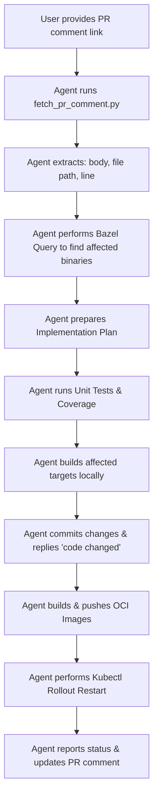

# PR Comment-Driven Development Workflow

This document proposes a structured agent workflow that automates the process of addressing GitHub Pull Request comments. 



---

## Guidelines for Using CLI Tools

When invoking helper tools under `tools/` (e.g. `fetch_pr_comment.py`, `reply_pr_comment.py`, `build_oci.py`):
1. **Do not read tool source code**: You should not open or read the Python source code of these tools.
2. **Use `--help`**: To learn about the tool's usage, options, and parameters, run it with the `--help` flag (e.g. `./tools/fetch_pr_comment.py --help`).
3. **Parse Structured Output & Handle Errors**: All tools output structured JSON. Check the process exit code:
   - **Exit code 0 (Success)**: The requested data is in the `"result"` field of the stdout JSON.
   - **Exit code 1 (Handled Error)**: Read `"message"` and `"instruction"` from the JSON output. Follow the `"instruction"` step-by-step to fix the input, credentials, or environment.
   - **Exit code 2 (Unhandled Error)**: The tool encountered an unexpected bug. Inspect the `"message"` and `"traceback"` fields to analyze the cause.

4. **Shell & Payload Safety**: When running helper scripts or handling payloads containing Markdown/code formatting, execute standalone `.py` script files or pass arguments via script parameters. Avoid double-quoted inline commands (`python3 -c "..."`).


---

## 1. Input & Comment Details Fetching

The agent accepts a comment link. The helper script `tools/fetch_pr_comment.py` makes a call to the GitHub API (using the `GITHUB_TOKEN` environment variable if repository access requires authentication) to retrieve the raw comment context.

### Execution Command
```bash
./tools/fetch_pr_comment.py "<github_comment_url>"
```

### Result Schema
```json
{
  "type": "review_comment",
  "comment_id": 12345678,
  "author": "reviewer_username",
  "body": "Comment text describing the request (e.g., 'Refactor this to avoid nested if-else checks')",
  "file_path": "pkg/auth/oauth2/handlers.go",
  "line": 150,
  "diff_hunk": "@@ -148,5 +148,8 @@...",
  "commit_id": "a1b2c3d4e5f6..."
}
```

---

## 2. Dependency Mapping & Impact Analysis

To make the workflow precise, the agent must figure out which Bazel binaries and Kubernetes deployments are impacted by the changed file.

### Bazel Package Dependency Mapping
The agent runs `bazel query` to discover all `go_binary` targets that transitively depend on the modified package:

```bash
# 1. Identify the package of the modified file
# E.g. file_path = "pkg/auth/oauth2/handlers.go" -> package //pkg/auth/oauth2

# 2. Query all binaries depending on it
bazel query "kind(go_binary, rdeps(//..., //pkg/auth/oauth2))"
```

*Example Output:*
- `//cmd/xid_service:xid_service`
- `//cmd/experiment_state_server:experiment_state_server`

### Mapping Binaries to GKE Deployments
Each `go_binary` mapped above is associated with an OCI image builder and GKE deployment:

| Bazel Target | Push Command Target | Helm Template File | GKE Deployment Name |
| :--- | :--- | :--- | :--- |
| `//cmd/xid_service:xid_service` | `//cmd/xid_service:xid_service_image_push` | `deploy/helm/templates/xid/deployment.yaml` | `xid-service-deployment` |
| `//cmd/experiment_state_server` | `//cmd/experiment_state_server:ess_image_push` | `deploy/helm/templates/ess/deployment.yaml` | `experiment-state-server-deployment` |
| `//cmd/actuator:actuator` | `//cmd/actuator:actuator_image_push` | `deploy/helm/templates/actuator/deployment.yaml` | `actuator-deployment` |
| `//cmd/reconciler:reconciler` | `//cmd/reconciler:reconciler_image_push` | `deploy/helm/templates/reconciler/deployment.yaml` | `reconciler-deployment` |
| `//cmd/log_monitor:log_monitor` | `//cmd/log_monitor:log_monitor_image_push` | N/A | N/A |
| `//cmd/ui` (Frontend TS/HTML) | `//cmd/ui:ui_image_push` | `deploy/helm/templates/ess/ui-deployment.yaml` | `ui-deployment` |

---

## 3. Implementation Plan Preparation

Based on the parsed review comment and impacted targets, the agent creates a draft implementation plan for your review. It will format the plan as a Markdown artifact in the brain folder:

- **Analysis**: Visual code excerpt and summary of the reviewer's concern.
- **Proposed Code Changes**: Target file path, exact lines to modify, and a git diff style code snippet.
- **Affected Components list**: Which binaries and deployments need to be verified.
- **Execution steps**: A sequence of commands to verify and deploy.

---

## 4. Test Verification & Code Coverage Check

To verify code correctness, the agent runs all relevant unit tests and measures code coverage.

### Run Unit Tests
```bash
# Run unit tests for the affected package
bazel test //pkg/auth/oauth2/...
```

### Check Coverage
To verify test coverage, the agent runs:
```bash
bazel coverage --combined_report=lcov //pkg/auth/oauth2/...
```
The output coverage file is generated under `bazel-out/_coverage/_coverage_report.dat`.
The agent will parse this file (or generate a summary) to report the package test coverage percentage and point out any lines missing tests.

---

## 5. Local Commit & GitHub Notification (On Success)

Once local unit tests pass and building the affected binary targets succeeds, the agent commits the code to the current branch and replies to the reviewer's comment on GitHub.

### Build Targets Locally
Before committing or deploying, verify that the affected binaries build successfully:
```bash
bazel build //cmd/xid_service:xid_service
```

### Git Commit to Current Branch
The agent stages all changes and commits them with a message that includes a description of the changes and the URL of the original comment:
```bash
git add .
git commit -m "Refactor: address review comment

Comment link: <github_comment_url>"
```

### Post GitHub Comment Notification
The agent runs the helper script `tools/reply_pr_comment.py` to notify the reviewer that the changes have been made:
```bash
export GITHUB_TOKEN="your_github_token"
./tools/reply_pr_comment.py "<github_comment_url>" "code changed"
```

### Usage Telemetry Tracking
When `tools/reply_pr_comment.py` successfully posts a reply, it appends a hidden HTML comment block containing public usage metadata (authenticated GitHub user, comment ID, PR number, and UTC timestamp) to the comment body:
```html
<!-- xmc-telemetry: {"git_username": "Chad", "date": "2026-06-22", "time": "12:00:00 UTC", "pr_number": "29", "comment_id": 1234} -->
```

To extract this telemetry and output it as a raw JSON dataset, run:
```bash
./tools/extract_telemetry.py <owner> <repo> [--since <ISO_DATE>]
```

---

## 6. Build, Push, and GKE Redeployment

Using the `.env` configuration file, the agent updates the deployment environment.

### Target Environment (Extracted from `.env`)
- **GCP Project ID**: `xmc-test-project-6`
- **GKE Cluster**: `xmc-cttest8d-cttest8e`
- **GCP Region**: `europe-central2`
- **K8S Namespace**: `xmc`
- **Artifact Registry Target**: `us-docker.pkg.dev/xmc-test-project-6/xmc`

### Rebuild and Push Containers
For each affected binary (e.g. `xid_service`), the agent sets up the environment variables and runs the push script:
```bash
# Set build environment variables
export XMC_ACR_TARGET="us-docker.pkg.dev/xmc-test-project-6/xmc"
export XMC_ENV="dev"

# Build and push the container image to GCP Artifact Registry
bazel run //cmd/xid_service:xid_service_image_push
```

### Rollout Restart in GKE Cluster
The agent initiates a rolling update to download the newly pushed image (tagged `:latest`):

```bash
# 1. Authenticate to the GKE Cluster
gcloud container clusters get-credentials xmc-cttest8d-cttest8e \
    --region europe-central2 \
    --project xmc-test-project-6

# 2. Restart the deployment to pick up the updated container image
kubectl rollout restart deployment/xid-service-deployment -n xmc

# 3. Monitor rollout status
kubectl rollout status deployment/xid-service-deployment -n xmc
```

---

## 7. Workflow Example

Here is a step-by-step example of how you can invoke this agent:

1. **You ask**:
   > Fix PR comment: `https://github.com/google/xmc/pull/15#discussion_r124892`

2. **The agent executes**:
   - Downloads comment content: `"Move localhost IP checks to a shared helper"`
   - Identifies code location: `pkg/auth/oauth2/handlers.go:120`
   - Runs `bazel query` and maps changes to `//cmd/xid_service` and `//cmd/experiment_state_server`.
   - Proposes refactored code.

3. **You approve the plan**.
4. **The agent executes**:
   - Edits the files.
   - Runs unit tests and coverage calculations.
   - Builds the affected targets locally.
   - Commits changes to the branch with the comment URL.
   - Posts a reply comment "code changed" to the GitHub PR comment.
   - Pushes updated OCI containers via `bazel run //cmd/xid_service:xid_service_image_push`.
   - Restarts GKE pods: `kubectl rollout restart deployment/xid-service-deployment -n xmc`.
   - Replies to the conversation thread with the test outputs and confirmation of successful rollout.
