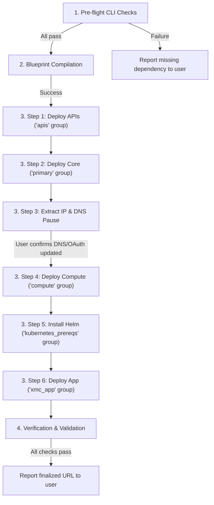

# Deploy XMC Workflow

This skill guides the agent through deploying the XManager on Cloud (XMC) infrastructure using the Cluster Toolkit v2 blueprint. It handles validation of local CLI dependencies (pre-flight checks), sequential deployment of resource groups, pausing for manual DNS updates, and automated verification of Kubernetes readiness.



---

## 1. Pre-flight CLI Checks

Before running any compilation or deployment steps, verify that all necessary CLI tools are installed and operational:

| CLI Tool | Verification Command | Expected Successful Outcome |
| :--- | :--- | :--- |
| **`gcloud`** | `gcloud --version` | Prints Google Cloud SDK version info |
| **`kubectl`** | `kubectl version --client` | Prints Kubernetes client version |
| **`helm`** | `helm version` | Prints Helm client version |
| **`terraform`** | `terraform --version` | Prints Terraform version (minimum 1.12.2) |
| **`ghpc`** | `./cluster-toolkit/ghpc --version` | Prints gcluster/ghpc tool version |

> [!CAUTION]
> **Check Action**: If any check fails (command not found or returns error):
> 1. **Stop execution immediately**.
> 2. Alert the user about the missing/broken CLI dependency.
> 3. Provide installation instructions and do not proceed.

---

## 2. Blueprint Compilation

The blueprint relies on local Helm charts, database migrations, and proto descriptors.

### Step 1: Compile the Blueprint
Compile the blueprint, specifying the overrides config file (e.g., `deploy/ctk_v2/xmanager-cloud-deployment.yaml`) using the `-d` flag. If the user hasn't specified the overrides file, look for files in `deploy/ctk_v2/` matching `*deployment.yaml`.

```bash
./cluster-toolkit/ghpc create deploy/ctk_v2/xmanager-cloud.yaml -d <deployment_config_path> -o ctk-out -l WARNING -w --force
```

Confirm that compilation completes successfully and generates the deployment folder named after your `<deployment_name>` inside `ctk-out/` containing the Terraform workspaces.

---

## 3. Step-by-Step Deployment

Deploy the blueprint groups sequentially to allow monitoring and manual intervention.

### Step 1: Enable APIs (`apis` group)
```bash
./cluster-toolkit/ghpc deploy ctk-out/<deployment_name> --only apis --auto-approve
```

### Step 2: Deploy Core Infrastructure & IP (`primary` group)
```bash
./cluster-toolkit/ghpc deploy ctk-out/<deployment_name> --only primary --auto-approve
```

### Step 3: DNS Pause & IP Mapping
1. **Extract static Gateway IP**:
   Identify the environment name (e.g. `xmcv2`) and GCP project ID from the deployment config. Retrieve the Gateway IP address:
   ```bash
   gcloud compute addresses describe xmc-gateway-static-ip-<environment> --global --project=<project_id> --format='value(address)'
   ```

2. **User Action Request & Pause**:
   Present the following instruction and **stop execution** until the user confirms DNS and OAuth configuration are complete:

   > [!IMPORTANT]
   > **Manual Configuration Required**
   >
   > 1. **DNS Routing Configuration**:
   >    Please configure the following A records in your authoritative DNS project for the Gateway IP **`<GATEWAY_IP>`**:
   >
   >    | Record Type | Hostname | Target IP |
   >    |:---:|---|---|
   >    | **A** | `<environment>.example.com` | `<GATEWAY_IP>` |
   >    | **A** | `api.<environment>.example.com` | `<GATEWAY_IP>` |
   >    | **A** | `grpc.<environment>.example.com` | `<GATEWAY_IP>` |
   >
   > 2. **OAuth Authorized Redirect URI**:
   >    Ensure the following Redirect URI is added to your Google Cloud Console OAuth Web Client ID config:
   >    * **`https://<environment>.example.com/api/callback`**
   >
   > Once these DNS records are created and the redirect URI is registered in the GCP console, reply to this conversation to proceed with the remaining deployment steps.

3. **Stop executing tools** and wait for the user to confirm.

### Step 4: Deploy GKE Cluster & Node Pools (`compute` group)
```bash
./cluster-toolkit/ghpc deploy ctk-out/<deployment_name> --only compute --auto-approve
```

### Step 4.5: Enable GKE Gateway API standard channel
Since GKE has Gateway API disabled by default, you must enable it on the newly created GKE cluster before deploying the application (which relies on `Gateway` and `HTTPRoute` resources). Run:

```bash
gcloud container clusters update <cluster_name> \
    --gateway-api=standard \
    --region=<region> \
    --project=<project_id>
```
> [!NOTE]
> The default `<cluster_name>` format is `xmc-<deployment_name>-<environment>`.

### Step 5: Install GKE System Helm Charts (`kubernetes_prereqs` group)
```bash
./cluster-toolkit/ghpc deploy ctk-out/<deployment_name> --only kubernetes_prereqs --auto-approve
```

### Step 6: Build and Push XMC Service Images
Before deploying the application Helm chart, build and push all 6 service Docker images to GCP Artifact Registry. You must set the project's target registry and environment variables:

```bash
export XMC_ACR_TARGET="us-docker.pkg.dev/<project_id>/<xmc_registry_name>"
export XMC_ENV="<environment>"

bazel run //cmd/actuator:actuator_image_push
bazel run //cmd/experiment_state_server:experiment_state_server_image_push
bazel run //cmd/log_monitor:log_monitor_image_push
bazel run //cmd/reconciler:reconciler_image_push
bazel run //cmd/ui:ui_image_push
bazel run //cmd/xid_service:xid_service_image_push
```

### Step 7: Deploy XMC Application (`xmc_app` group)
```bash
./cluster-toolkit/ghpc deploy ctk-out/<deployment_name> --only xmc_app --auto-approve
```

---

## 4. Verification and Validation

Verify the health, certificate readiness, and routing of the environment:

### Step 1: Run Verification Script
```bash
./deploy/ctk_v2/verify_xmc.sh
```

### Step 2: Gateway Status Check
Poll until the GKE Gateway status reports `Programmed: True`:
```bash
kubectl get gateway xmc-gateway -n xmc -o jsonpath='{.status.conditions[?(@.type=="Programmed")].status}'
```

### Step 3: GTS Certificate Check
Poll until the Google-managed certificate state reports `ACTIVE`:
```bash
gcloud certificate-manager certificates describe xmc-cert-<environment> --project=<project_id> --format='value(managed.state)'
```

> [!TIP]
> Once all checks pass, report the finalized deployment URL (e.g. `https://<environment>.example.com`) to the user.
