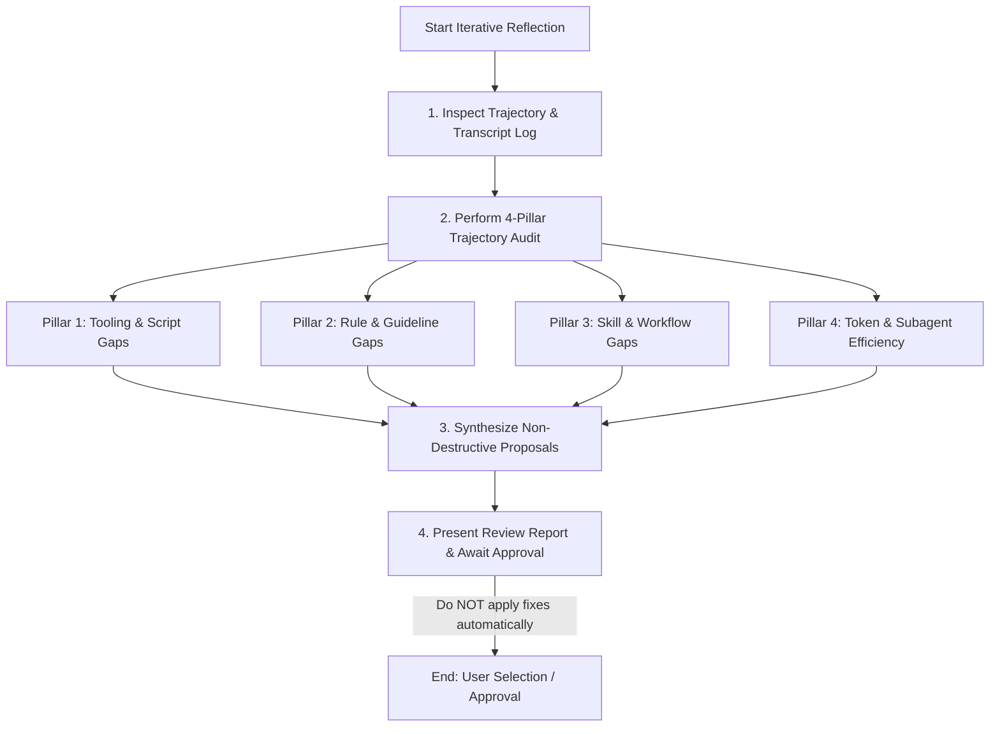

# Iterative Reflection & Meta-Learning Workflow

This skill provides a systematic retrospective workflow to evaluate an agent's recent thought history and tool execution trajectory. It identifies friction, inefficiencies, rule gaps, and missing scripts, and formulates non-destructive improvement proposals.

> [!IMPORTANT]
> **Safety Guardrail**: Never apply file modifications, rule updates, or script additions automatically during reflection. Always present proposals to the user for explicit review and feedback first.

---

## 1. Inspect Trajectory & Transcript Log

1. **Locate Active Transcript**:
   - Access the session transcript at `<appDataDir>/brain/<conversation-id>/.system_generated/logs/transcript.jsonl` (or inspect recent thought history and tool executions).
2. **Review Execution Flow**:
   - Scan step index, tool calls, tool responses, retries, and errors.
   - Look for patterns of hesitation, trial-and-error, command re-runs, missing permissions, or unexpected tool outputs.

---

## 2. 4-Pillar Trajectory Audit

Evaluate the trajectory across the following four dimensions:

### Pillar 1: Tooling & Automation Gaps (Helper Scripts)
- **Signal**: Did the agent write complex, multi-step shell logic, custom python one-liners, or manual regex filtering directly inside commands or chat responses?
- **Action**: Identify opportunities to extract procedural logic into dedicated, testable Python scripts in `tools/` (adhering to [.agents/rules/skills_and_automation.md](file://.agents/rules/skills_and_automation.md#1-extracting-complex-logic-to-executable-python-scripts)).

### Pillar 2: Rule & Guideline Gaps (`.agents/rules/`)
- **Signal**: Did the agent wander, make incorrect assumptions about code structure, use incorrect search tools (e.g. grep vs code_search), or violate style guidelines?
- **Action**: Formulate exact rule additions or modifications in `.agents/rules/` to prevent future agents from making similar missteps.

### Pillar 3: Skill & Workflow Gaps (`.agents/skills/`)
- **Signal**: Was the overall task a recurring, multi-step engineering playbook (e.g. deployment, complex bug triage, PR response) that lacked step-by-step guidance?
- **Action**: Propose a new skill definition (`SKILL.md`) outlining the standardized workflow.

### Pillar 4: Token & Subagent Efficiency
- **Signal**: Did the agent read massive files unnecessarily, dump large log outputs into prompt memory, or perform heavy search tasks directly instead of delegating?
- **Action**: Recommend subagent delegation (e.g. to `research-google` or `self`) or tool usage adjustments to preserve context window.

---

## 3. Formulate Improvement Proposals

Structure all findings into a clean, actionable report using the following standard template:

### 📊 Retrospective Summary
- **Primary Task**: Short summary of what was implemented.
- **Trajectory Health**: Smooth / Minor Friction / Significant Friction.
- **Estimated Optimization Potential**: (High / Medium / Low savings in turns & tokens).

### 💡 Proposed Enhancements

| Category | Component | Current Friction | Proposed Fix / Enhancement | Impact |
| :--- | :--- | :--- | :--- | :--- |
| **Tool / Script** | `tools/...` | Repetitive manual parsing | Create python script `tools/parse_x.py` | Reduces turns by 3-5 |
| **Rule** | `.agents/rules/...` | Agent searched wrong path | Add explicit directory location rule | Prevents path wandering |
| **Skill** | `.agents/skills/...` | Workflow lacked step sequence | Create `SKILL.md` for workflow | Standardizes multi-step process |
| **Efficiency** | Prompt / Context | Dumped 500 lines of logs | Use grep filtering / subagent | Saves ~10k prompt tokens |

---

## 4. Present Report & Await User Feedback

Present the report in markdown to the user with standard markdown formatting and clickable links to affected files.

End the turn by asking the user which proposed fixes (if any) they would like you to implement.
