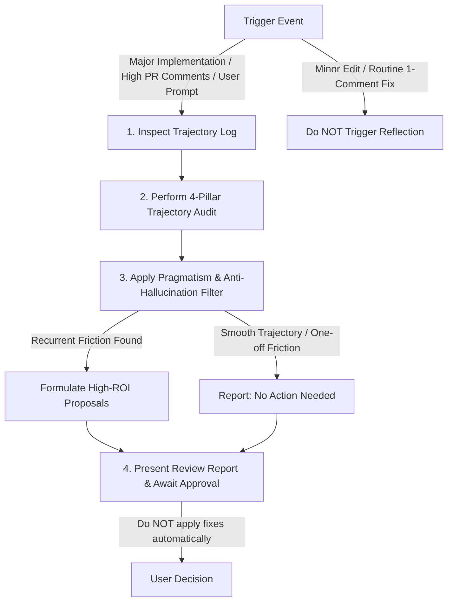

# Iterative Reflection & Meta-Learning Workflow

This skill provides a systematic retrospective workflow to evaluate an agent's recent thought history and tool execution trajectory. It identifies friction, inefficiencies, rule gaps, and missing scripts, and formulates non-destructive, high-ROI improvement proposals.

> [!IMPORTANT]
> **Safety & Pragmatism Guardrails**:
> 1. **Do NOT Hallucinate Issues**: A valid and expected outcome of reflection is **"No optimizations recommended"**. Do not invent artificial problems for smooth or one-off tasks.
> 2. **Proposals Before Edits**: Never apply file modifications, rule updates, or script additions automatically. Always present proposals to the user for explicit review first.

---

## 1. Trigger Criteria

Run this skill **only** when one of the following conditions is met:
- **Explicit User Prompt**: The user asks for a retrospective, prompt audit, or performance reflection.
- **Major Task Completion**: Completion of a complex, multi-step feature or architectural refactor.
- **High PR Comment Volume**: Resolving a Pull Request with high review comment volume (>3-5 comments or multiple review iterations), indicating friction or missing rule clarity.

> [!CAUTION]
> **Do NOT Trigger For**: Routine minor edits, simple single-line fixes, or 1-comment PR updates. Avoid over-eager reflection that adds token bloat for simple tasks.

---

## 2. 4-Pillar Trajectory Audit

Evaluate session logs (`transcript.jsonl`) across four key dimensions:

### Pillar 1: Tooling & Automation Gaps (Helper Scripts)
- **Signal**: Did the agent write complex shell logic, custom python one-liners, or manual regex filtering directly inside commands or chat responses?
- **Action**: Identify opportunities to extract procedural logic into testable Python scripts in `tools/` (per [.agents/rules/skills_and_automation.md](file://.agents/rules/skills_and_automation.md#1-extracting-complex-logic-to-executable-python-scripts)).

### Pillar 2: Rule & Guideline Gaps (`.agents/rules/`)
- **Signal**: Did review comments or agent trajectory show wrong assumptions, path wandering, or style guideline violations?
- **Action**: Formulate exact rule additions in `.agents/rules/` to prevent future missteps.

### Pillar 3: Skill & Workflow Gaps (`.agents/skills/`)
- **Signal**: Was the overall task a recurring engineering playbook that lacked step-by-step guidance?
- **Action**: Propose a new skill definition (`SKILL.md`) outlining the standardized workflow.

### Pillar 4: Token & Subagent Efficiency
- **Signal**: Did the agent read massive files unnecessarily, dump raw logs into prompt memory, or fail to delegate heavy search tasks to worker subagents?
- **Action**: Recommend subagent delegation (e.g., `research-google` or `self`) or tool usage adjustments.

---

## 3. Pragmatism & Anti-Hallucination Filter

Before adding any item to the proposed enhancements list, pass it through these checks:

1. **Recurrence Check**: Is this friction likely to happen again in future tasks, or was it a unique, one-off edge case? (If one-off, omit it).
2. **ROI Check**: Will the proposed rule/tool save more agent turns and token overhead than the cost of maintaining it? (If low ROI, omit it).
3. **Zero-Friction Result**: If no systemic improvements are identified, state clearly:
   > *"Trajectory was optimal. No permanent rule or tool modifications recommended for this task."*

---

## 4. Formulate Report & Await Approval

Structure findings into a clean report:

### 📊 Retrospective Summary
- **Primary Task**: Short summary of what was implemented or reviewed.
- **Trigger Reason**: Major Implementation / High PR Comment Volume / User Request.
- **Trajectory Health**: Smooth / Minor Friction / Significant Friction.
- **Optimization Recommendation**: Actionable Enhancements Proposed OR No Action Needed (One-Off / Optimal).

### 💡 Proposed Enhancements (If Applicable)

| Category | Component | Current Friction | Proposed Fix / Enhancement | Impact |
| :--- | :--- | :--- | :--- | :--- |
| **Tool / Script** | `tools/...` | Repetitive manual parsing | Create python script `tools/parse_x.py` | Saves 3-5 turns |
| **Rule** | `.agents/rules/...` | Reviewer caught missing style | Add rule to `.agents/rules/...` | Prevents PR feedback |

End by presenting the report in markdown with clickable file links and awaiting user feedback before taking any action.
