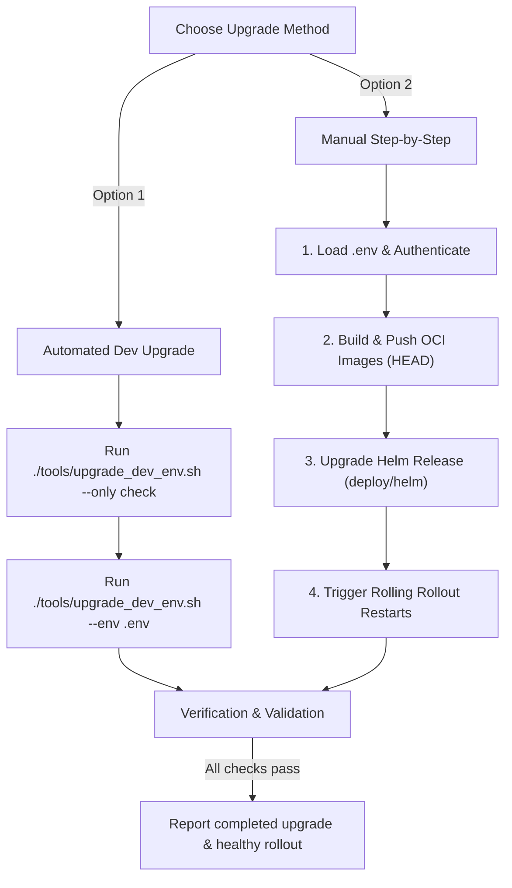

# Upgrade XMC Environment Workflow

This skill guides the agent through upgrading an existing deployed XManager on Cloud (XMC) environment on Google Kubernetes Engine (GKE) so that it runs the latest code from the current local repository branch (`HEAD`), leveraging the local `.env` configuration file in the repository root.

> [!IMPORTANT]
> **Enforced Choice Prompt**:
> Before executing any checks, image pushes, or upgrade commands, you **MUST ask the user** to choose their preferred upgrade method:
> *   **Option 1: Automated Dev Upgrade**: Uses the `./tools/upgrade_dev_env.sh --env .env` script to automate all steps end-to-end.
> *   **Option 2: Manual Step-by-Step Upgrade**: Manually executes each step (`gcloud` auth, `bazel run` image pushes, `helm upgrade`, and `kubectl rollout restart`).
>
> Stop execution and wait for the user to respond with their selection. Do not proceed to any other section of this workflow without their explicit choice.



---

## 1. Pre-flight CLI Checks

Before running any upgrade step, verify that the required CLI tools are installed and operational:

| CLI Tool | Verification Command | Expected Successful Outcome |
| :--- | :--- | :--- |
| **`gcloud`** | `gcloud --version` | Prints Google Cloud SDK version info |
| **`kubectl`** | `kubectl version --client` | Prints Kubernetes client version |
| **`helm`** | `helm version` | Prints Helm client version |
| **`bazel`** | `bazel --version` | Prints Bazel version |

> [!CAUTION]
> **Check Action**: If any check fails (command not found or returns error):
> 1. **Stop execution immediately**.
> 2. Alert the user about the missing/broken CLI dependency.
> 3. Provide installation instructions and do not proceed.

---

## 2. Option 1: Automated Dev Upgrade (`upgrade_dev_env.sh`)

Use the automated upgrade tool (`./tools/upgrade_dev_env.sh`) to execute the environment upgrade end-to-end using your `.env` file in the repository root.

### Step 1: Run Configuration & Authentication Checks
Validate configuration in `.env`, authenticate with Google Cloud and GKE, and verify that the target Kubernetes namespace exists:
```bash
./tools/upgrade_dev_env.sh --env .env --only check
```

### Step 2: Execute End-to-End Upgrade
Run the full upgrade pipeline (pre-flight checks, building & pushing all 6 microservice container images from current branch `HEAD`, upgrading Helm templates, restarting deployments, and verifying rollout health):
```bash
./tools/upgrade_dev_env.sh --env .env
```

### Step 3: Resuming or Running Specific Steps
To resume from a failed phase (`check`, `images`, `app`, `verify`):
```bash
./tools/upgrade_dev_env.sh --env .env --start-from <failed_step>
```

To execute **only** one specific step (for example, only rebuilding and pushing images or only restarting/upgrading application workloads):
```bash
./tools/upgrade_dev_env.sh --env .env --only <step>
```
*Valid steps: `check`, `images`, `app`, `verify`*

---

## 3. Option 2: Manual Step-by-Step Upgrade

Execute the upgrade sequence manually to monitor individual commands and service updates.

### Step 1: Load Environment & Authenticate
Ensure parameters are sourced from `.env` in the repository root (`PROJECT_ID`, `GKE_CLUSTER`, `GCP_REGION`, `K8S_NAMESPACE`, `XMC_ACR_TARGET`):
```bash
set -a
source .env
set +a

gcloud config set project "$PROJECT_ID"
gcloud container clusters get-credentials "$GKE_CLUSTER" --region="${GCP_REGION:-us-central1}" --project="$PROJECT_ID"
```

### Step 2: Rebuild & Push All 6 Service Container Images
Export the target registry (`XMC_ACR_TARGET`) and environment name (`XMC_ENV`) and push updated container images compiled from your current branch code:
```bash
export XMC_ACR_TARGET="${XMC_ACR_TARGET:-us-docker.pkg.dev/${PROJECT_ID}/xmc}"
export XMC_ENV="${XMANAGER_ENV:-dev}"

bazel run //cmd/actuator:actuator_image_push
bazel run //cmd/experiment_state_server:experiment_state_server_image_push
bazel run //cmd/log_monitor:log_monitor_image_push
bazel run //cmd/reconciler:reconciler_image_push
bazel run //cmd/ui:ui_image_push
bazel run //cmd/xid_service:xid_service_image_push
```

### Step 3: Upgrade Kubernetes Application Workloads
1. **Upgrade Helm Chart Templates** (if deployed via `./deploy/helm`):
   ```bash
   helm upgrade xmc ./deploy/helm -n "${K8S_NAMESPACE:-xmc}" --reuse-values
   ```
2. **Perform Rolling Rollout Restart**:
   Trigger a rolling rollout restart across all XMC service deployments so pods immediately pull and run the newly pushed container images (`:latest`):
   ```bash
   for deploy in actuator experiment-state-server log-monitor reconciler ui xid-service; do
     kubectl rollout restart deployment/"$deploy" -n "${K8S_NAMESPACE:-xmc}"
   done
   ```

---

## 4. Verification and Validation

After triggering rolling rollout restarts, verify that all pods have restarted cleanly and are passing readiness probes:

### Step 1: Wait for Rollout Status
Verify each deployment rollout completes successfully:
```bash
for deploy in actuator experiment-state-server log-monitor reconciler ui xid-service; do
  kubectl rollout status deployment/"$deploy" -n "${K8S_NAMESPACE:-xmc}" --timeout=300s
done
```

### Step 2: Verify Gateway Readiness
Confirm that the GKE Gateway resource is in the `Programmed: True` state:
```bash
kubectl get gateway xmc-gateway -n "${K8S_NAMESPACE:-xmc}"
```

> [!TIP]
> Once all deployments report successful rollout completion and pods report `1/1 Running`, confirm to the user that the XMC environment upgrade is complete and running the current branch state.
