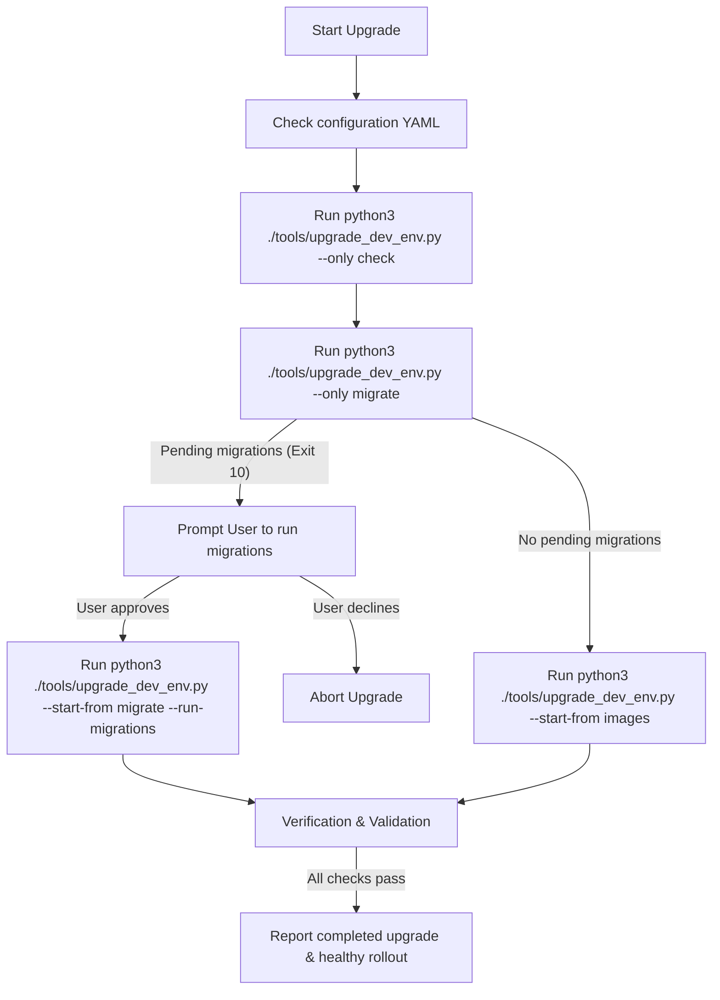

# Upgrade XMC Environment Workflow

This skill guides the agent through upgrading an existing deployed XManager on Cloud (XMC) environment on Google Kubernetes Engine (GKE) so that it runs the latest code from the current local repository branch (`HEAD`), leveraging the deployment configuration YAML file.



---

## 1. Pre-flight CLI & Config Checks

### CLI Tool Checks
Before running any upgrade step, verify that the required CLI tools are installed and operational:

| CLI Tool | Verification Command | Expected Successful Outcome |
| :--- | :--- | :--- |
| **`gcloud`** | `gcloud --version` | Prints Google Cloud SDK version info |
| **`kubectl`** | `kubectl version --client` | Prints Kubernetes client version |
| **`helm`** | `helm version` | Prints Helm client version |
| **`bazel`** | `bazel --version` | Prints Bazel version |

> [!CAUTION]
> **Check Action**: If any CLI check fails (command not found or returns error):
> 1. **Stop execution immediately**.
> 2. Alert the user about the missing/broken CLI dependency.
> 3. Provide installation instructions and do not proceed.

### Configuration File Verification (YAML)
Verify that the deployment configuration YAML file exists. By default, the script looks for `deploy/ctk_v2/xmanager-cloud-deployment.yaml`.

If you need to use a custom configuration file, you must pass it using the `--config` (or `-c`) flag.

You can optionally define environment variable overrides (e.g., `PROJECT_ID`, `K8S_NAMESPACE`, `XMANAGER_ENV`) in your active shell before running the script to bypass values defined in the YAML configuration. You can copy `.env.example` to `.env` and export them: `set -o allexport; source .env; set +o allexport`.

If no configuration file is found at the default path:
1. **Search for alternatives**: Check if there are any other `*-deployment.yaml` files in `deploy/ctk_v2/`.
2. **Handle missing config**:
   - If other configuration files are found, ask the user which one they want to use and run the script with `--config <path>`.
   - If no configuration files are found, **stop execution** and instruct the user to create a deployment configuration (referring to `INSTALL.md` or the `deploy_xmc` skill) before upgrading.

---

## 2. Automated Dev Upgrade (`upgrade_dev_env.py`)

Use the automated upgrade tool (`python3 ./tools/upgrade_dev_env.py`) to execute the environment upgrade.

> [!IMPORTANT]
> **Virtual Environment Requirement**: All Python upgrade and verification scripts under `tools/` and `deploy/` require a Python virtual environment created using **Python 3.13.14**. Before running `upgrade_dev_env.py` or `verify_xmc.py`, ensure the virtual environment is initialized and activated:
> ```bash
> python3.13 -m venv ./tools/venv
> source ./tools/venv/bin/activate
> pip install -r ./tools/requirements.txt
> ```

### Step 1: Run Configuration & Authentication Checks
Validate configuration in YAML, authenticate with Google Cloud and GKE, and verify that the target Kubernetes namespace exists:
```bash
python3 ./tools/upgrade_dev_env.py --only check
```

### Step 2: Check for Pending Database Migrations
Verify if there are any pending Spanner database migrations:
```bash
python3 ./tools/upgrade_dev_env.py --only migrate
```

> [!IMPORTANT]
> **Migration Decision**:
> *   **If the command succeeds (Exit 0)**: No pending migrations are found. Proceed to Step 3.
> *   **If the command exits with code 10**: Pending migrations were detected.
>     1.  **Stop execution** and communicate the pending migrations status to the user.
>     2.  **Ask the user** if they want to run the pending migrations.
>     3.  **If user says YES**: Proceed to Step 3 and append `--run-migrations` flag to the command.
>     4.  **If user says NO**: Abort the upgrade workflow and report to the user that upgrade was cancelled due to declined migrations.

### Step 3: Execute Upgrade
If no migrations were pending, or if the user approved running migrations:

*   **Case A: No pending migrations**:
    Run the upgrade starting from the `images` step (skipping migration step):
    ```bash
    python3 ./tools/upgrade_dev_env.py --start-from images
    ```
*   **Case B: User approved migrations**:
    Run the upgrade starting from `migrate` step and authorize migration execution:
    ```bash
    python3 ./tools/upgrade_dev_env.py --start-from migrate --run-migrations
    ```

### Resuming or Running Specific Steps (Advanced / Troubleshooting)
If the upgrade fails at a specific phase, or if you need to rerun a specific part of the workflow:

*   **Resume from a specific step**: To resume from a failed phase (`check`, `migrate`, `images`, `app`, `restart`, `verify`):
    ```bash
    python3 ./tools/upgrade_dev_env.py --start-from <failed_step>
    ```
*   **Execute a single step**: To execute **only** one specific step:
    ```bash
    python3 ./tools/upgrade_dev_env.py --only <step>
    ```
    *Valid steps: `check`, `migrate`, `images`, `app`, `restart`, `verify`*


## 4. Verification and Validation

Ensure the virtual environment created with Python 3.13.14 is activated, then run the verification script from the repository root to verify that all upgraded pods are running and endpoints respond correctly:

```bash
ENVIRONMENT="${XMANAGER_ENV:-dev}" REGION="${GCP_REGION:-us-central1}" PROJECT_ID="$PROJECT_ID" python3 ./deploy/ctk_v2/verify_xmc.py
```

> [!TIP]
> Once the verification script reports that all pods are healthy and services are ready, confirm to the user that the XMC environment upgrade is complete and running the current branch state.

