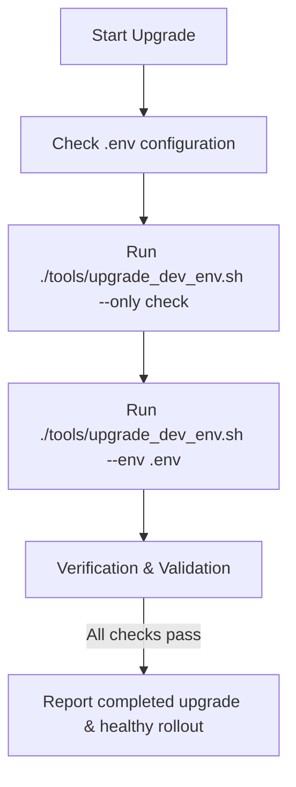

# Upgrade XMC Environment Workflow

This skill guides the agent through upgrading an existing deployed XManager on Cloud (XMC) environment on Google Kubernetes Engine (GKE) so that it runs the latest code from the current local repository branch (`HEAD`), leveraging the local `.env` configuration file in the repository root.



---

## 1. Pre-flight CLI & Config Checks

### CLI Tool Checks
Before running any upgrade step, verify that the required CLI tools are installed and operational:

| CLI Tool | Verification Command | Expected Successful Outcome |
| :--- | :--- | :--- |
| **`gcloud`** | `gcloud --version` | Prints Google Cloud SDK version info |
| **`kubectl`** | `kubectl version --client` | Prints Kubernetes client version |
| **`helm`** | `helm version` | Prints Helm client version |
| **`bazel`** | `bazel --version` | Prints Bazel version |

> [!CAUTION]
> **Check Action**: If any CLI check fails (command not found or returns error):
> 1. **Stop execution immediately**.
> 2. Alert the user about the missing/broken CLI dependency.
> 3. Provide installation instructions and do not proceed.

### Configuration File Verification (.env)
Check if the `.env` file exists in the repository root.

If the `.env` file **does not exist**:
1. **Gather Context**:
   - Run `gcloud config list` to find the active GCP project ID.
   - Run `gcloud container clusters list` to find available GKE clusters.
   - Run `kubectl config current-context` to find the current active GKE cluster context.
   - Run `helm list -A` to discover active Helm releases and namespaces.
   - Run `gcloud iam service-accounts list` to find the service accounts in the project.
2. **Propose Proposed Values**:
   - Draft a proposed `.env` configuration file using the discovered project ID, GKE cluster name, region, namespace, environment name, active Helm release name, and OAuth client SA details.
3. **Prompt User**:
   - Stop execution, explicitly inform the user that the `.env` configuration file is missing, and present the proposed configuration content.
   - Ask the user if they would like you to automatically create the `.env` file with these proposed values. Do not proceed until you have received confirmation.

---

## 2. Automated Dev Upgrade (`upgrade_dev_env.sh`)

Use the automated upgrade tool (`./tools/upgrade_dev_env.sh`) to execute the environment upgrade end-to-end using your `.env` file in the repository root.

### Step 1: Run Configuration & Authentication Checks
Validate configuration in `.env`, authenticate with Google Cloud and GKE, and verify that the target Kubernetes namespace exists:
```bash
./tools/upgrade_dev_env.sh --env .env --only check
```

### Step 2: Execute End-to-End Upgrade
Run the full upgrade pipeline (pre-flight checks, building & pushing all 6 microservice container images from current branch `HEAD`, upgrading Helm templates, restarting deployments, and verifying rollout health):
```bash
./tools/upgrade_dev_env.sh --env .env
```

### Step 3: Resuming or Running Specific Steps
To resume from a failed phase (`check`, `images`, `app`, `verify`):
```bash
./tools/upgrade_dev_env.sh --env .env --start-from <failed_step>
```

To execute **only** one specific step (for example, only rebuilding and pushing images or only restarting/upgrading application workloads):
```bash
./tools/upgrade_dev_env.sh --env .env --only <step>
```
*Valid steps: `check`, `images`, `app`, `verify`*


## 4. Verification and Validation

After triggering rolling rollout restarts, verify that all pods have restarted cleanly and are passing readiness probes:

### Step 1: Run Verification Script
Run the verification script from the repository root:
```bash
ENVIRONMENT="${XMANAGER_ENV:-dev}" REGION="${GCP_REGION:-us-central1}" PROJECT_ID="$PROJECT_ID" ./deploy/ctk_v2/verify_xmc.sh
```

### Step 2: Wait for Rollout Status
Verify each deployment rollout completes successfully:
```bash
for deploy in actuator experiment-state-server log-monitor reconciler ui xid-service; do
  kubectl rollout status deployment/"$deploy" -n "${K8S_NAMESPACE:-xmc}" --timeout=300s
done
```

### Step 3: Verify Gateway Readiness
Confirm that the GKE Gateway resource is in the `Programmed: True` state:
```bash
kubectl get gateway xmc-gateway -n "${K8S_NAMESPACE:-xmc}"
```

### Step 4: Verify Service Health Checklist
Query the status of active deployments and print a clean checklist verifying that all requested replicas are running and healthy (readyReplicas equals replicas):
```bash
for deploy in actuator experiment-state-server log-monitor reconciler ui xid-service; do
  # query replicas vs readyReplicas
  replicas=$(kubectl get deployment "$deploy" -n "${K8S_NAMESPACE:-xmc}" -o jsonpath='{.spec.replicas}' 2>/dev/null)
  ready_replicas=$(kubectl get deployment "$deploy" -n "${K8S_NAMESPACE:-xmc}" -o jsonpath='{.status.readyReplicas}' 2>/dev/null)
  if [[ -n "$replicas" ]]; then
    echo "Service $deploy health: $ready_replicas/$replicas pods ready"
  fi
done
```

> [!TIP]
> Once all deployments report successful rollout completion and pods report `1/1 Running`, confirm to the user that the XMC environment upgrade is complete and running the current branch state.

