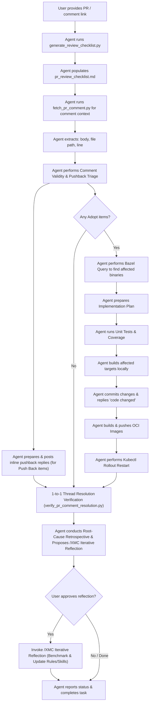

# PR Comment-Driven Development Workflow

This document defines a structured agent workflow that automates the process of addressing GitHub Pull Request comments while enforcing comment integrity, programmatic enumeration, and 1-to-1 thread resolution verification.



> [!IMPORTANT]
> All execution steps in this skill MUST strictly adhere to the mandatory [PR Review & Inspection Guidelines](../../rules/pr_review_guidelines.md), [Skills & Automation Guidelines](../../rules/skills_and_automation.md), and [Core Engineering Standards](../../rules/core_engineering.md).

---

## Guidelines for Using CLI Tools

When invoking helper tools under `tools/` (e.g. `tools/pr_review/generate_review_checklist.py`, `tools/pr_review/fetch_pr_comment.py`, `tools/pr_review/reply_pr_comment.py`, `tools/pr_review/review_threads.py`, `tools/common/build_oci.py`):
1. **Do not read tool source code**: Do not open or read the Python source code of helper tools. Refer to [Skills & Automation Guidelines](../../rules/skills_and_automation.md#5-helper-tool-execution-policy--safety-constraints).
2. **Use `--help`**: To learn about the tool's usage, options, and parameters, run it with the `--help` flag (e.g. `./tools/pr_review/fetch_pr_comment.py --help`).
3. **Parse Structured Output & Handle Errors**: All tools output structured JSON; check the exit code per [Helper Tool Exit Codes](../../AGENTS.md#universal-architectural-principles).
4. **Shell & Payload Safety**: Execute standalone `.py` script files or pass arguments via script parameters. Avoid double-quoted inline commands (`python3 -c "..."`).
   - **Backtick Safety**: When passing reply messages containing backticks (e.g. markdown code spans), avoid double-quoted string arguments in bash. Use `--message-file` (or `-f`) to safely read the reply message from a file instead.


---

## 1. Automated Review Checklist Generation

When addressing PR review feedback or starting a review pass on a Pull Request, the agent first generates a checklist of all unresolved comments directly from the GitHub API.

### When to Call
- **PR Review Start**: Call immediately when beginning to process review comments on a PR.
- **Review Pass Check**: Call during post-PR creation checks or whenever an updated checklist of unresolved comments is needed.

### Execution Command
```bash
./tools/pr_review/generate_review_checklist.py <owner> <repo> <pr_number> [-o pr_review_checklist.md]
```

### Result Output Schema
```json
{
  "status": "success",
  "result": {
    "owner": "google",
    "repo": "xmc",
    "pr_number": 145,
    "output_file": "pr_review_checklist.md",
    "unresolved_comment_count": 3
  }
}
```
This generates `pr_review_checklist.md` in the workspace populated with interactive `- [ ]` checkboxes for each unresolved comment.

---

## 2. Input & Comment Details Fetching

The agent accepts a comment link or PR number. The helper script `tools/pr_review/fetch_pr_comment.py` or GitHub API queries retrieve the raw comment context.

### Execution Command
```bash
./tools/pr_review/fetch_pr_comment.py "<github_comment_url>"
```

### Result Schema
```json
{
  "type": "review_comment",
  "comment_id": 12345678,
  "author": "reviewer_username",
  "body": "Comment text describing the request (e.g., 'Refactor this to avoid nested if-else checks')",
  "file_path": "pkg/auth/oauth2/handlers.go",
  "line": 150,
  "diff_hunk": "@@ -148,5 +148,8 @@...",
  "commit_id": "a1b2c3d4e5f6..."
}
```

---

## 2.5. Comment Validity & Pushback Triage (Mandatory Before Planning Edits)

Before planning code changes for any review comment (human or automated review bot), the agent MUST critically verify each comment against the actual source tree, `.agents/rules/` (especially language guidelines matching the modified file extension, such as [Go Guidelines](../../rules/languages/golang.md)), and PR scope / diff-size limits (`./tools/analyze_diff_size.py`). Never blindly assume a review suggestion is valid.

Classify every unresolved comment into one of three dispositions:
1. **`Adopt (Valid Fix)`**: The comment identifies a genuine bug, race condition, rule violation, or clean improvement within PR scope. Plan the code edit and unit test verification.
2. **`Push Back (Rule / Technical Conflict)`**: Adopting the suggestion would violate an existing repository rule (for example, [Go Guidelines §9](../../rules/languages/golang.md#9-context-safety-in-defer-cleanups--error-branches) requiring `context.Background()` with a bounded timeout for post-failure diagnostics, `defer`, or `t.Cleanup` paths when the parent `ctx` is already expired/canceled) or break runtime behavior/existing architecture. Do **not** modify the code; instead, prepare a concise, respectful inline technical pushback reply citing the governing rule or execution trace.
3. **`Push Back / Defer (Scope Creep or Diff-Size Breach)`**: Adopting the suggestion requires out-of-scope production refactoring in a focused/test PR or pushes the diff past `./tools/analyze_diff_size.py` thresholds. Propose an inline reply explaining why the change is deferred to a dedicated follow-up PR.

---

## 3. Dependency Mapping & Impact Analysis

To make the workflow precise, the agent must figure out which Bazel binaries and Kubernetes deployments are impacted by the changed file.

### Bazel Package Dependency Mapping
The agent runs `bazel query` to discover all `go_binary` targets that transitively depend on the modified package:

```bash
# 1. Identify the package of the modified file
# E.g. file_path = "pkg/auth/oauth2/handlers.go" -> package //pkg/auth/oauth2

# 2. Query all binaries depending on it
bazel query "kind(go_binary, rdeps(//..., //pkg/auth/oauth2))"
```

*Example Output:*
- `//cmd/xid_service:xid_service`
- `//cmd/experiment_state_server:experiment_state_server`

### Mapping Binaries to GKE Deployments
Each `go_binary` mapped above is associated with an OCI image builder and GKE deployment:

| Bazel Target | Push Command Target | Helm Template File | GKE Deployment Name |
| :--- | :--- | :--- | :--- |
| `//cmd/xid_service:xid_service` | `//cmd/xid_service:xid_service_image_push` | `deploy/helm/templates/xid/deployment.yaml` | `xid-service-deployment` |
| `//cmd/experiment_state_server` | `//cmd/experiment_state_server:experiment_state_server_image_push` | `deploy/helm/templates/ess/deployment.yaml` | `experiment-state-server-deployment` |
| `//cmd/actuator:actuator` | `//cmd/actuator:actuator_image_push` | `deploy/helm/templates/actuator/deployment.yaml` | `actuator-deployment` |
| `//cmd/reconciler:reconciler` | `//cmd/reconciler:reconciler_image_push` | `deploy/helm/templates/reconciler/deployment.yaml` | `reconciler-deployment` |
| `//cmd/log_monitor:log_monitor` | `//cmd/log_monitor:log_monitor_image_push` | N/A | N/A |
| `//cmd/ui` (Frontend TS/HTML) | `//cmd/ui:ui_image_push` | `deploy/helm/templates/ess/ui-deployment.yaml` | `ui-deployment` |
| `//cmd/health_service:health_service` | `//cmd/health_service:health_service_image_push` | `deploy/helm/templates/health-service/deployment.yaml` | `health-service-deployment` |
| `//cmd/rod_data_provider:rod_data_provider` | `//cmd/rod_data_provider:rod_data_provider_image_push` | `deploy/helm/templates/rod/deployment.yaml` | `rod-data-provider-deployment` |

---

## 4. Implementation Plan Preparation

Based on the parsed review comments, validity triage, and impacted targets, the agent creates a draft implementation plan (e.g., `pr_comment_resolution_plan.md`) for user review:

- **Comment Validity & Pushback Triage Table**: A summary table (`Comment ID | Summary | Disposition (Adopt / Push Back / Defer) | Technical Rationale`) classifying every comment per [Section 2.5](#25-comment-validity--pushback-triage-mandatory-before-planning-edits).
- **Analysis**: Visual code excerpt and summary of the reviewer's concern.
- **Proposed Resolution (Code Changes vs. Inline Pushback Reply)**: For `Adopt` items, specify target file path, exact lines to modify, and a git diff style code snippet. For `Push Back` items, state explicitly that no code change will be made and draft the exact technical rationale reply to be posted via `./tools/pr_review/reply_pr_comment.py`.
- **Affected Components list**: Which binaries and deployments need to be verified (for `Adopt` items).
- **Execution steps**: A sequence of commands to verify, commit, reply, and deploy.

---

## 5. Test Verification & Code Coverage Check

To verify code correctness, the agent runs all affected unit tests (including reverse dependencies) and measures code coverage.

### Run Affected Unit Tests
```bash
# Run all Bazel unit tests affected by the branch changes (also executed by ./.githooks/pre-commit)
python3 ./tools/run_affected_tests.py
```

### Check Coverage
To verify test coverage, the agent runs:
```bash
bazel coverage --combined_report=lcov //pkg/auth/oauth2/...
```
The output coverage file is generated under `bazel-out/_coverage/_coverage_report.dat`.
The agent will parse this file (or generate a summary) to report the package test coverage percentage and point out any lines missing tests.

---

## 6. Local Commit & GitHub Notification (On Success)

Execution in this phase branches based on each comment's disposition from [Section 2.5](#25-comment-validity--pushback-triage-mandatory-before-planning-edits):

- **For `Adopt (Valid Fix)` items**: Once local unit tests pass, build the affected binary targets locally, commit the changes as a distinct follow-up commit, and post an inline reply summarizing the fix and commit SHA.
- **For `Push Back` / `Defer` items**: Bypass local builds and `git commit` (if a batch contains zero `Adopt` items, no commit is created) and proceed directly to [Post GitHub Comment Notification](#post-github-comment-notification) to post the technical rationale drafted in Section 4.

### Build Targets Locally (`Adopt` Items Only)
Before committing or deploying, verify that the affected binaries build successfully:
```bash
bazel build //cmd/xid_service:xid_service
```

### Git Commit to Current Branch (`Adopt` Items Only)
The agent stages all changes and commits them as a new, distinct follow-up commit with a message that includes a description of the changes and the URL of the original comment:
```bash
git add .
git commit -m "<type>(<scope>): address review comment

Comment link: <github_comment_url>"
git push origin HEAD
```

> [!CAUTION]
> **Strict Prohibition of Force-Pushing on Active PRs**:
> NEVER use `git commit --amend` or `git push --force` (`-f`) when addressing review comments on an active PR branch.
> Always append distinct follow-up commits so reviewers can inspect incremental diffs via GitHub's **"Changes since last review"** view. Squashing happens automatically at merge time via GitHub's "Squash and merge" feature, NEVER during active review rounds.

### Reconcile Live PR Description & Tradeoffs (`Adopt` Items Only)
After pushing follow-up commits, compare `gh pr view <pr_number> --json title,body,baseRefName` against `git diff origin/<baseRefName>...HEAD` (fetching `origin <baseRefName>` first if needed, e.g., on stacked `gh-stack` PRs). Whenever review fixes change behavior, touched packages, or surface a load-bearing architectural tradeoff (for example, keeping filtering client-side or deferring a schema migration), update the `Motivation & Context`, `Key Changes`, and `Assumptions` sections via [`./tools/pr_review/update_pr_description.py`](../../../tools/pr_review/update_pr_description.py) after presenting the updated preview for confirmation per [XMC Create PR §4](../xmc_create_pr/SKILL.md#4-pr-description-updates-via-helper-tool).

### Verify CI on the Pushed Commit (`Adopt` Items Only)
After the [CI wait buffer](../xmc_create_pr/SKILL.md#5-ci-wait-buffer-period), block on CI for the new head commit with the helper tool instead of polling bare `gh pr checks` (which exits `8` while checks are pending):
```bash
./tools/pr_review/wait_for_ci.py <pr_number>
```
Exit `0` means all checks passed; on exit `1`, triage `failed_checks` and their bounded `log_tail` fields from its error JSON rather than fetching full CI logs.

### Post GitHub Comment Notification
The agent runs the helper script `tools/pr_review/reply_pr_comment.py` to reply to each comment according to its disposition (a code fix summary and commit SHA for `Adopt` items, or the technical pushback / deferral rationale drafted in Section 4 for `Push Back` / `Defer` items):
```bash
export GITHUB_TOKEN="your_github_token"
./tools/pr_review/reply_pr_comment.py "<github_comment_url>" "code changed"
```

When the reply contains backticks or multi-line rationale (such as a `Push Back` / `Defer` technical explanation or a detailed fix summary), pass a file containing the message via `--message-file` (or `-f`):
```bash
cat << 'EOF' > reply_message.txt
Addressed review comment for `handlers.go` (or technical pushback rationale from Section 4).
EOF
./tools/pr_review/reply_pr_comment.py "<github_comment_url>" --message-file reply_message.txt
```

> [!WARNING]
> **Backtick Subshell Command Safety**: Avoid passing double-quoted strings containing backticks (`` ` ``) directly on the command line (e.g. `./tools/pr_review/reply_pr_comment.py "<url>" "Fixed `func_name()`"`). Bash evaluates backticks in double-quoted strings as subshell commands prior to executing python, causing unwanted command execution or syntax errors. Always use `--message-file` (or `-f`) when the reply message contains backticks or markdown code formatting.

### Resolve Review Threads
For `Adopt` items, pass `--resolve` so the tool resolves the comment's review thread right after posting the reply (via `github_utils.resolve_review_thread`). Leave `Push Back` / `Defer` threads unresolved so the reviewer can adjudicate, unless the user instructs otherwise:
```bash
./tools/pr_review/reply_pr_comment.py "<github_comment_url>" --message-file reply_message.txt --resolve
```

If `--resolve` fails after the reply was posted, the tool exits with a handled error carrying the `reply_id`; do NOT re-post the reply, retry resolution only.

To audit thread state or batch-resolve threads you have already replied to, use `tools/pr_review/review_threads.py` (it paginates and identifies your replies via the authenticated `gh` / `GITHUB_TOKEN` user):
```bash
# List threads: thread_id, path:line, is_resolved, replied_by_me, first-comment snippet
./tools/pr_review/review_threads.py list <owner> <repo> <pr_number> --unresolved-only

# Preview, then resolve only unresolved threads that have a reply from you
./tools/pr_review/review_threads.py resolve-replied <owner> <repo> <pr_number> --dry-run
./tools/pr_review/review_threads.py resolve-replied <owner> <repo> <pr_number>
```

> [!IMPORTANT]
> Do NOT hand-write `gh api graphql` `resolveReviewThread` loops. Always run `resolve-replied --dry-run` first and confirm the candidate list matches the threads you intend to resolve (e.g. it excludes `Push Back` replies you want left open).

### Usage Telemetry Tracking
When `tools/pr_review/reply_pr_comment.py` successfully posts a reply, it appends a hidden HTML comment block containing public usage metadata (authenticated GitHub user, comment ID, PR number, and UTC timestamp) to the comment body:
```html
<!-- xmc-telemetry: {"git_username": "Chad", "date": "2026-06-22", "time": "12:00:00 UTC", "pr_number": "29", "comment_id": 1234} -->
```

To extract this telemetry and output it as a raw JSON dataset, run:
```bash
./tools/benchmark/extract_telemetry.py <owner> <repo> [--since <ISO_DATE>]
```

---

## 7. Build, Push, and GKE Redeployment

Using the `.env` configuration file, the agent updates the deployment environment.

### Target Environment (Extracted from `.env`)
- **GCP Project ID**: `xmc-test-project-6`
- **GKE Cluster**: `xmc-cttest8d-cttest8e`
- **GCP Region**: `europe-central2`
- **K8S Namespace**: `xmc`
- **Artifact Registry Target**: `us-docker.pkg.dev/xmc-test-project-6/xmc`

### Rebuild and Push Containers
For each affected binary (e.g. `xid_service`), the agent sets up the environment variables and runs the push script:
```bash
# Set build environment variables
export XMC_ACR_TARGET="us-docker.pkg.dev/xmc-test-project-6/xmc"
export XMC_ENV="dev"

# Build and push the container image to GCP Artifact Registry
bazel run //cmd/xid_service:xid_service_image_push
```

### Rollout Restart in GKE Cluster
The agent initiates a rolling update to download the newly pushed image (tagged `:latest`):

```bash
# 1. Authenticate to the GKE Cluster
gcloud container clusters get-credentials xmc-cttest8d-cttest8e \
    --region europe-central2 \
    --project xmc-test-project-6

# 2. Restart the deployment to pick up the updated container image
kubectl rollout restart deployment/xid-service-deployment -n xmc

# 3. Monitor rollout status
kubectl rollout status deployment/xid-service-deployment -n xmc
```

---

## 8. 1-to-1 Thread Resolution Verification

Before marking the PR review task as complete:
1. Run `./tools/pr_review/verify_pr_comment_resolution.py <owner> <repo> <pull_number> <path_to_checklist_file>` to programmatically verify that 100% of comment IDs from the checklist have received dedicated inline replies.
2. Confirm that every single comment ID from the consolidated checklist artifact has received a dedicated inline response or resolution.
3. Update the checklist artifact status for each item to `[x] Resolved`.

---

## 9. Root-Cause Retrospective & Iterative Reflection Proposal

Whenever review comments (from human reviewers or automated review bots) are addressed and verified, the agent must not merely "fix and forget". The agent performs a fast root-cause classification on why the initial PR implementation missed the expected standard and proposes invoking the [Iterative Reflection Skill](../xmc_iterative_reflection/SKILL.md).

### Root-Cause Classification Framework
Classify each addressed review comment into one of three categories:
1. **Rule & Guideline Gap (`.agents/rules/`)**: The codebase guidelines lacked an explicit rule, style constraint, or invariant (e.g., missing error wrapping convention, naming convention, or mock contract).
2. **Tooling & Automation Gap (`tools/`)**: The feedback could have been caught mechanically before PR submission by a script, linter, or pre-commit hook (e.g., missing parameter validation, formatting check, or test coverage threshold).
3. **Skill & Workflow Gap (`.agents/skills/`)**: The development workflow playbook lacked a necessary pre-PR inspection step or verification phase.

### Presenting the Retrospective Proposal
At the end of the comment resolution report, present a structured proposal table and ask the user if they wish to trigger iterative reflection:

```markdown
### 🔄 PR Comment Retrospective & Meta-Learning Proposal

| Comment ID | Reviewer Feedback Summary | Root-Cause Category | Proposed Rule / Tool Enhancement |
| :--- | :--- | :--- | :--- |
| #1234 | "Wrap internal errors with `%w`" | Rule Gap (`.agents/rules/languages/golang.md`) | Add explicit Go error wrapping rule |
| #1235 | "Missing unit test for helper function" | Skill Gap (`.agents/skills/xmc_feature_development/SKILL.md`) | Enforce 1-to-1 helper unit test check |

> Would you like to invoke `/XMC Iterative Reflection` to analyze these root causes, benchmark candidate rule updates with `/XMC Trajectory Comparison`, and open a dedicated improvement PR?
```

If the user approves, proceed to invoke the [XMC Iterative Reflection Skill](../xmc_iterative_reflection/SKILL.md).

---

## 10. Workflow Example

Here is a step-by-step example of how you can invoke this agent:

1. **You ask**:
   > Fix PR comments for: `https://github.com/google/xmc/pull/15`

2. **The agent executes**:
   - Runs programmatic enumeration via `gh api repos/google/xmc/pulls/15/comments` + Python parsing.
   - Extracts 100% of open threads (e.g., 3 comments total).
   - Creates Consolidated Review Checklist Artifact and verifies item count (3 threads).
   - Identifies code locations and runs `bazel query` to map changes to `//cmd/xid_service` and `//cmd/experiment_state_server`.
   - Proposes refactored code plan.

3. **You approve the plan**.
4. **The agent executes**:
   - Edits the files.
   - Runs unit tests and coverage calculations.
   - Builds the affected targets locally.
   - Commits changes to the branch.
   - Posts reply comments for each comment ID on GitHub.
   - Pushes updated OCI containers via `bazel run //cmd/xid_service:xid_service_image_push`.
   - Restarts GKE pods: `kubectl rollout restart deployment/xid-service-deployment -n xmc`.
   - Programmatically verifies 1-to-1 thread resolution for all comment IDs against the checklist.
   - Updates checklist artifact and replies with test outputs and rollout status confirmation.
   - **Presents PR Comment Retrospective table** and proposes invoking `/XMC Iterative Reflection` to codify learnings into `.agents/rules/` and prevent future review feedback.
