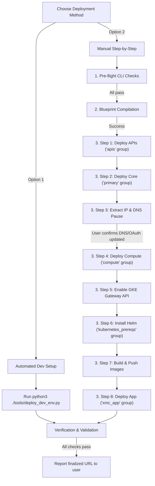

# Deploy XMC Workflow

This skill guides the agent through deploying the XManager on Cloud (XMC) infrastructure using the Cluster Toolkit v2 blueprint.

> [!IMPORTANT]
> All execution steps in this skill MUST strictly adhere to the policy rules defined in [Skills & Automation Guidelines](../../rules/skills_and_automation.md) and [Core Engineering Standards](../../rules/core_engineering.md).

> [!IMPORTANT]
> **Enforced Choice Prompt**:
> Before executing any checks, compilation, or deployment commands, you **MUST ask the user** to choose their preferred deployment method:
> *   **Option 1: Automated Dev Setup**: Uses the `python3 ./tools/deploy_dev_env.py` script to automate all steps.
> *   **Option 2: Manual Step-by-Step Deployment**: Manually compiles and deploys each group using `gcluster`.
>
> Stop execution and wait for the user to respond with their selection. Do not proceed to any other section of this workflow without their explicit choice.



---

## 1. Pre-flight CLI Checks

Before running any compilation or deployment steps, verify that all necessary CLI tools are installed and operational:

| CLI Tool | Verification Command | Expected Successful Outcome |
| :--- | :--- | :--- |
| **`gcloud`** | `gcloud --version` | Prints Google Cloud SDK version info |
| **`kubectl`** | `kubectl version --client` | Prints Kubernetes client version |
| **`helm`** | `helm version` | Prints Helm client version |
| **`terraform`** | `terraform --version` | Prints Terraform version (minimum 1.12.2) |
| **`bazel`** | `bazel --version` | Prints Bazel version |
| **`gcluster`** | `./cluster-toolkit/gcluster --version` | Prints gcluster tool version |

> [!CAUTION]
> **Check Action**: If any check fails (command not found or returns error):
> 1. **Stop execution immediately**.
> 2. Alert the user about the missing/broken CLI dependency.
> 3. Provide installation instructions and do not proceed.

---

## 2. Option 1: Automated Dev Setup (deploy_dev_env.py)

Use the automated script to execute the deployment end-to-end. The script handles registry credentials config (`gcloud auth configure-docker`), code compilation, GKE setup, and app deployment.

> [!IMPORTANT]
> **Enforced DNS Parameters Check**:
> If the user chose Option 1:
> 1. **Check context/history**: Check if the user has already provided the GCP project ID hosting the DNS zone and the Cloud DNS Managed Zone name.
> 2. **Explicitly ask the user**: If these are not specified, **you MUST stop execution and ask the user directly** to provide:
>    *   **DNS Project ID** (the GCP project hosting the DNS zone)
>    *   **DNS Managed Zone Name** (the name of the Cloud DNS managed zone)
> 3. Do not attempt to guess. Wait for the user to provide them.

### Step 1: Check configurations
Always run the checks first to validate active GCP project alignment and CLI tools:
```bash
python3 ./tools/deploy_dev_env.py \
  --config <deployment_config_path> \
  --dns-project <dns_project_id> \
  --dns-zone <dns_managed_zone_name> \
  --only check
```

### Step 2: Deploy
Run the automated deployment script by providing the DNS project and zone details:
```bash
python3 ./tools/deploy_dev_env.py \
  --config <deployment_config_path> \
  --dns-project <dns_project_id> \
  --dns-zone <dns_managed_zone_name>
```

### Step 3: Resuming or Running Specific Steps
To resume from a failed step, run:
```bash
python3 ./tools/deploy_dev_env.py \
  --config <deployment_config_path> \
  --dns-project <dns_project_id> \
  --dns-zone <dns_managed_zone_name> \
  --start-from <failed_step>
```

To run **only** a single specific step (e.g. rebuild/push images or run verify tests), run:
```bash
python3 ./tools/deploy_dev_env.py \
  --config <deployment_config_path> \
  --dns-project <dns_project_id> \
  --dns-zone <dns_managed_zone_name> \
  --only <step>
```
*Valid steps: `check`, `compile`, `images`, `apis`, `primary`, `compute`, `gateway-api`, `prereqs`, `app`, `verify`*

---

## 3. Option 2: Manual Step-by-Step Deployment

Deploy the blueprint groups sequentially to allow monitoring and manual intervention.

### Step 1: Compile the Blueprint
Compile the blueprint, specifying the overrides config file (e.g., `deploy/ctk_v2/xmanager-cloud-deployment.yaml`) using the `-d` flag. If the user hasn't specified the overrides file, look for files in `deploy/ctk_v2/` matching `*deployment.yaml`.

```bash
./cluster-toolkit/gcluster create deploy/ctk_v2/xmanager-cloud.yaml -d <deployment_config_path> -o ctk-out -l WARNING -w --force
```

Confirm that compilation completes successfully and generates the deployment folder named after your `<deployment_name>` inside `ctk-out/` containing the Terraform workspaces.

### Step 2: Enable APIs (`apis` group)
```bash
./cluster-toolkit/gcluster deploy ctk-out/<deployment_name> --only apis --auto-approve
```

### Step 3: Deploy Core Infrastructure & IP (`primary` group)
```bash
./cluster-toolkit/gcluster deploy ctk-out/<deployment_name> --only primary --auto-approve
```

### Step 4: DNS Pause & IP Mapping
1. **Extract static Gateway IP**:
   Identify the environment name (e.g. `xmcv2`) and GCP project ID from the deployment config. Retrieve the Gateway IP address:
   ```bash
   gcloud compute addresses describe xmc-gateway-static-ip-<environment> --global --project=<project_id> --format='value(address)'
   ```

2. **User Action Request & Pause**:
   Present the following instruction and **stop execution** until the user confirms DNS and OAuth configuration are complete:

   > [!IMPORTANT]
   > **Manual Configuration Required**
   >
   > 1. **DNS Routing Configuration**:
   >    Please configure the following A records in your authoritative DNS project for the Gateway IP **`<GATEWAY_IP>`**:
   >
   >    | Record Type | Hostname | Target IP |
   >    |:---:|---|---|
   >    | **A** | `<environment>.example.com` | `<GATEWAY_IP>` |
   >    | **A** | `api.<environment>.example.com` | `<GATEWAY_IP>` |
   >    | **A** | `grpc.<environment>.example.com` | `<GATEWAY_IP>` |
   >
   > 2. **OAuth Authorized Redirect URI**:
   >    Ensure the following Redirect URI is added to your Google Cloud Console OAuth Web Client ID config:
   >    * **`https://<environment>.example.com/api/callback`**
   >
   > Once these DNS records are created and the redirect URI is registered in the GCP console, reply to this conversation to proceed with the remaining deployment steps.

3. **Stop executing tools** and wait for the user to confirm.

### Step 5: Deploy GKE Cluster & Node Pools (`compute` group)
```bash
./cluster-toolkit/gcluster deploy ctk-out/<deployment_name> --only compute --auto-approve
```

### Step 6: Enable GKE Gateway API standard channel
Since GKE has Gateway API disabled by default, you must enable it on the newly created GKE cluster before deploying the application (which relies on `Gateway` and `HTTPRoute` resources). Run:

```bash
gcloud container clusters update <cluster_name> \
    --gateway-api=standard \
    --region=<region> \
    --project=<project_id>
```
> [!NOTE]
> The default `<cluster_name>` format is `xmc-<deployment_name>-<environment>`.

### Step 7: Install GKE System Helm Charts (`kubernetes_prereqs` group)
```bash
./cluster-toolkit/gcluster deploy ctk-out/<deployment_name> --only kubernetes_prereqs --auto-approve
```

### Step 8: Build and Push XMC Service Images
Before deploying the application Helm chart, build and push all service Docker images to GCP Artifact Registry. You must set the project's target registry and environment variables:

```bash
export XMC_ACR_TARGET="us-docker.pkg.dev/<project_id>/<xmc_registry_name>"
export XMC_ENV="<environment>"

bazel run //cmd/actuator:actuator_image_push
bazel run //cmd/experiment_state_server:experiment_state_server_image_push
bazel run //cmd/log_monitor:log_monitor_image_push
bazel run //cmd/reconciler:reconciler_image_push
bazel run //cmd/ui:ui_image_push
bazel run //cmd/xid_service:xid_service_image_push
bazel run //cmd/health_service:health_service_image_push
bazel run //cmd/rod_data_provider:rod_data_provider_image_push
```

### Step 9: Deploy XMC Application (`xmc_app` group)
```bash
./cluster-toolkit/gcluster deploy ctk-out/<deployment_name> --only xmc_app --auto-approve
```

---

## 4. Verification and Validation

Verify the health, certificate readiness, and routing of the environment:

### Step 1: Run Verification Script
Ensure the Python virtual environment is activated, then run:
```bash
python3 ./deploy/ctk_v2/verify_xmc.py
```

### Step 2: Gateway Status Check
Poll until the GKE Gateway status reports `Programmed: True`:
```bash
kubectl get gateway xmc-gateway -n xmc -o jsonpath='{.status.conditions[?(@.type=="Programmed")].status}'
```

### Step 3: GTS Certificate Check
Poll until the Google-managed certificate state reports `ACTIVE`:
```bash
gcloud certificate-manager certificates describe xmc-cert-<environment> --project=<project_id> --format='value(managed.state)'
```

> [!TIP]
> Once all checks pass, report the finalized deployment URL (e.g. `https://<environment>.example.com`) to the user.
