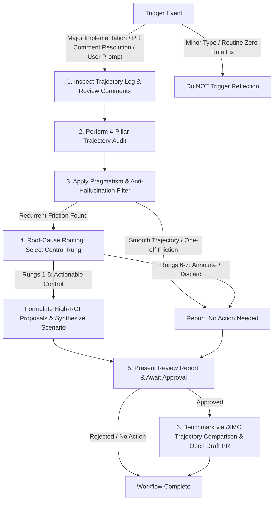

# Iterative Reflection & Meta-Learning Workflow

This skill provides a systematic retrospective workflow to evaluate an agent's recent thought history, tool execution trajectory, and PR review comments. It identifies friction, inefficiencies, rule gaps, and missing scripts, and formulates non-destructive, high-ROI improvement proposals.

> [!IMPORTANT]
> **Safety & Pragmatism Guardrails**:
> 1. **Do NOT Hallucinate Issues**: A valid and expected outcome of reflection is **"No optimizations recommended"**. Do not invent artificial problems for smooth or one-off tasks.
> 2. **Proposals Before Edits**: Never apply file modifications, rule updates, or script additions automatically. Always present proposals to the user for explicit review first.

---

## 1. Trigger Criteria

Run this skill when one of the following conditions is met:
- **Explicit User Prompt**: The user asks for a retrospective, prompt audit, or performance reflection.
- **PR Review Comment Resolution**: Resolving PR review comments (from human reviewers or automated review bots) via [XMC Address PR Comment](../xmc_address_pr_comment/SKILL.md), diagnosing why the initial submission lacked this quality and codifying missing rules or validation tooling.
- **Major Task Completion**: Completion of a complex, multi-step feature or architectural refactor.
- **High PR Comment Volume**: Resolving a Pull Request with high review comment volume (>3-5 comments or multiple review iterations), indicating friction or missing rule clarity.

> [!CAUTION]
> **Do NOT Trigger For**: Routine minor edits or trivial typo fixes where no underlying guideline or structural invariant was violated. Avoid over-eager reflection that adds token bloat for trivial tasks.

---

## 2. 4-Pillar Trajectory Audit

Evaluate session logs (`transcript.jsonl`) across four key dimensions. These pillars **detect
friction only** — they do not determine the fix. Every surviving finding is assigned a destination
in [Section 4: Root-Cause Routing](#4-root-cause-routing).

### Missing Transcript Fallback Protocol
If `transcript.jsonl` for a conversation ID is unindexed or missing from local disk:
1. **Audit Git History**: Run `git log --all --grep="<CONV_ID>" --stat -p` to inspect committed changes, review comments, and PR metadata.
2. **Audit Workspace Worktrees & Reflog**: Inspect active agent worktree locations (`git worktree list`) and check `git reflog --all`.
3. **Execute Helper Inspection**: Run `python3 tools/inspect_session.py --conv_id <CONV_ID>` to parse available git metadata and task logs cleanly without unconstrained filesystem traversals.

### Pillar 1: Tooling & Automation Gaps
- **Signal**: Did the agent write complex shell logic, custom python one-liners, or manual regex filtering directly inside commands or chat responses?

### Pillar 2: Rule & Guideline Gaps
- **Signal**: Did review comments or agent trajectory show wrong assumptions, path wandering, or style guideline violations?
- **PR Review Comment Tracing**: When triggered following PR comment resolutions, trace each comment back to the missing guideline, convention, or structural invariant. Diagnose why the initial implementation was not created with higher quality.

### Pillar 3: Skill & Workflow Gaps
- **Signal**: Was the overall task a recurring engineering playbook that lacked step-by-step guidance?

### Pillar 4: Token & Subagent Efficiency
- **Signal**: Did the agent read massive files unnecessarily, dump raw logs into prompt memory, or fail to delegate heavy search tasks to worker subagents?
- **Action**: Recommend subagent delegation (e.g., `research-google` or `self`) or tool usage adjustments. This pillar is advisory by nature and does not pass through the control ladder.

---

## 3. Pragmatism & Anti-Hallucination Filter

Before adding any item to the proposed enhancements list, pass it through these checks:

1. **Recurrence Check**: Is this friction likely to happen again in future tasks, or was it a unique, one-off edge case? (If one-off, omit it).
2. **ROI Check**: Will the proposed rule/tool save more agent turns and token overhead than the cost of maintaining it? (If low ROI, omit it).
3. **Zero-Friction Result**: If trajectory was smooth or friction was a one-off case, allow a pragmatic "No Action Needed" outcome.

---

## 4. Root-Cause Routing

Each finding that survives the pragmatism filter MUST be assigned a destination before any fix is
drafted. First trace the causal chain across **both** definition and consumption sites, then apply
the control ladder defined in
[Rule Authoring Standards](../../rules/rule_authoring_standards.md#1-root-cause-routing-the-control-ladder):

| Rung | Control | Destination |
| :--- | :--- | :--- |
| 1 | Eliminate | Shared API, SDK, or type-definition fix for all callers (separate PR) |
| 2 | Automate | Lint rule or CI gate |
| 3 | Tool | Helper script in `tools/` |
| 4 | Route | [`AGENTS.md`](../../AGENTS.md) routing matrices or rule relocation |
| 5 | Document | New prose rule or skill |
| 6 | Annotate | Scoped suppression with a stated reason |
| 7 | Discard | No change |

> [!IMPORTANT]
> Apply the [Lint-First Test](../../rules/rule_authoring_standards.md#3-rung-2-the-lint-first-test):
> if the finding is a mechanically checkable invariant, it MUST become a lint rule rather than prose.
> Fixing one call site in the active PR is ordinary review work, not rung 1 — it does not excuse
> skipping the rung-2 gate that stops the next caller from repeating the pattern. Selecting rung 5
> requires recording why rungs 1–4 do not apply.

Findings originating from an automated review bot must pass the two-step
[false-positive check](../../rules/rule_authoring_standards.md#non-ladder-branch-external-tooling-false-positives):
confirm the claim is false, **and** trace why the tool was misled. If a shared surface or missing
typecheck/lint gate under our control made the code ambiguous to static analysis, that ambiguity is a
rung 1 or rung 2 finding in its own right; only when the chain terminates outside our control does it
discard, and a bot's misunderstanding is never grounds for a prose rule or an inline comment addressed
to the bot.

---

## 5. Formulate Report & Await Approval

Structure findings into a clean report:

### 📊 Retrospective Summary
- **Primary Task**: Short summary of what was implemented or reviewed.
- **Trigger Reason**: Major Implementation / High PR Comment Volume / PR Comment Resolution / User Request.
- **Trajectory Health**: Smooth / Minor Friction / Significant Friction.
- **Outcome**: Actionable Enhancements Proposed OR No Action Needed (Trajectory Optimal / One-off).

### 💡 Proposed Enhancements (If Applicable)

| Rung | Component | Current Friction / Review Feedback | Proposed Fix / Enhancement | Why Not a Stronger Rung | Impact |
| :--- | :--- | :--- | :--- | :--- | :--- |
| **2 Automate** | `pyproject.toml` | Reviewer caught a banned call pattern | Enable the corresponding lint code with a rationale comment | n/a — strongest applicable | Blocks the class at commit time |
| **3 Tool** | `tools/...` | Repetitive manual parsing | Create python script `tools/parse_x.py` | Procedure, not a checkable invariant | Saves 3-5 turns |
| **5 Document** | `.agents/rules/...` | Reviewer caught a convention gap | Amend the existing bullet in `.agents/rules/...` | Not mechanically checkable; no API fix available | Prevents PR feedback |

The `Why Not a Stronger Rung` column is mandatory for every rung-5 row.

End by presenting the report in markdown with clickable file links and awaiting user feedback before taking any action.

---

## 6. Validation Handshake & Draft PR Creation

When the user approves candidate rule, skill, or tooling enhancements:

### Step 1: Synthesize Benchmark Scenario Prompt
Formulate a realistic test scenario prompt reproducing the conditions where the previous agent made the mistake or received review feedback.

### Step 2: Propose Trajectory Comparison Benchmark
Propose running [XMC Trajectory Comparison](../xmc_trajectory_comparison/SKILL.md) to empirically validate the new rule before opening a remote PR:
> *"Candidate rule drafted on branch `docs/rules-update-...`. Before opening a Draft PR, would you like to run `/XMC Trajectory Comparison` to benchmark this candidate rule against baseline on the test prompt: '[test prompt]'?"*

### Step 3: Dual Subagent Benchmark & Scorecard
- If approved, invoke [XMC Trajectory Comparison](../xmc_trajectory_comparison/SKILL.md).
- The benchmark runs dual subagents (Baseline vs. Candidate on clean worktrees), compares trajectories via `tools/compare_trajectories.py`, and generates the benchmark artifact `/tmp/benchmark_report_<branch>.md`.

### Step 4: Draft PR Creation with Auto-Embedded Benchmark
1. **Isolated Subagent Workspace (Preferred)**:
   - Launch a worker subagent with `Workspace: "branch"`.
   - **Clean Head Checkout**: The subagent MUST start by fetching and creating its dedicated branch directly from clean `origin/main` (e.g., `git fetch origin && git checkout -b docs/rules-update-... origin/main`). This ensures the reflection PR contains strictly rule/tooling enhancements and never mixes scope with the parent agent's active feature branch.
   - Follow [XMC Create PR](../xmc_create_pr/SKILL.md): `xmc_create_pr` auto-detects `/tmp/benchmark_report_<branch>.md` and embeds the empirical A/B benchmark scorecard into `pr_body.md` under `🧪 Trajectory & Outcome Benchmark Results`.
   - Obtain user confirmation and open a Draft PR (`gh pr create --draft`).
   - The primary agent's active worktree remains 100% untouched and safe from branch switching conflicts.

2. **Single-Workspace Fallback (Safeguard)**:
   - If subagent workspace isolation is unavailable in the execution environment, **do NOT perform local Git branch manipulations, stashing, or multi-PR switches** in the active worktree.
   - Present the proposed changes directly in the chat or artifact summary for user review to prevent workspace corruption.

