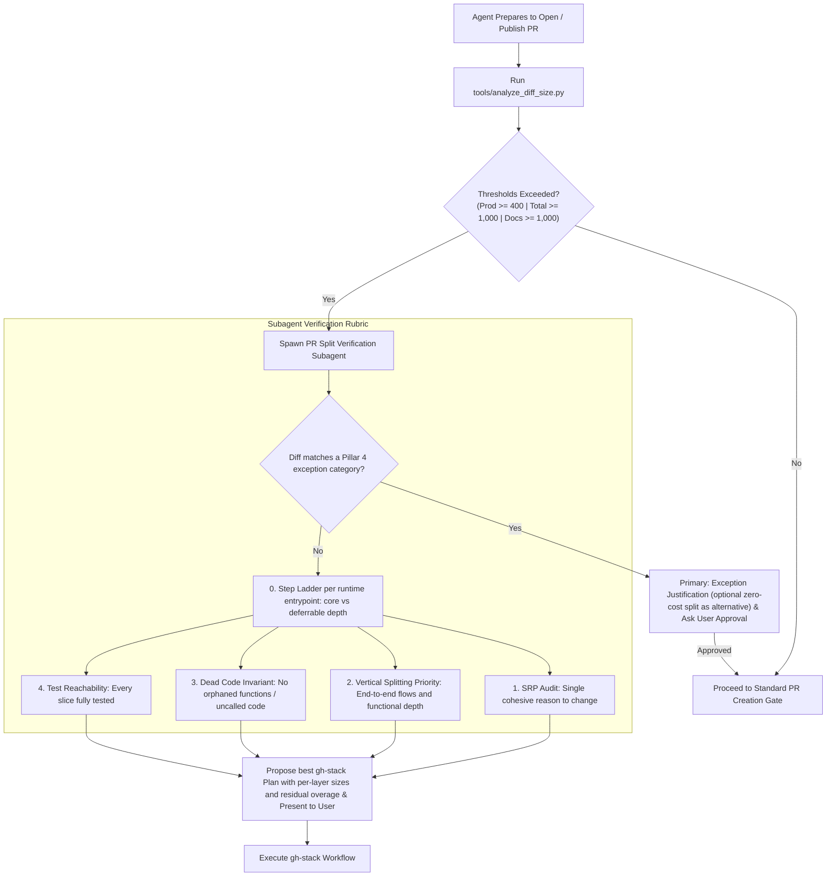

# PR Sizing & Vertical Split Verification Playbook

This skill defines the multi-agent workflow for analyzing large diffs before Pull Request creation, ensuring that complex changes are decomposed into clean, vertical slices with zero dead code and high-fidelity test reachability.

> [!IMPORTANT]
> All execution steps in this skill MUST strictly adhere to the policy rules defined in [GitHub Authoring & PR Creation Standards](../../rules/github_authoring_and_prs.md), [Core Engineering Standards](../../rules/core_engineering.md), and [gh-stack Skill](conversation://skills/gh-stack).

---

## Architecture & Workflow Overview



---

## 1. Diff Sizing & Threshold Evaluation

Before requesting user confirmation to open a PR (`gh pr create`), the agent MUST evaluate the proposed diff size using `tools/analyze_diff_size.py`:

```bash
./tools/analyze_diff_size.py --base-ref origin/main...
```

### Sizing Criteria & Thresholds

| Category | Threshold | Measurement Rule |
| :--- | :--- | :--- |
| **Production Code** | **$\ge 400$ lines** | Added + modified lines across production files (`.go`, `.py`, `.ts`, `.js`, `.ng.html`, `.html`, `.scss`, `.css`, `.yaml`, `.tf`, `.proto`). |
| **Total Code (Prod + Tests)** | **$\ge 1,000$ lines** | Combined production and test code (`*_test.go`, `*_test.py`, `*.spec.ts`, `test/**`). |
| **Documentation / Markdown** | **$\ge 1,000$ lines** | Markdown files (`.md`, `.markdown`, `.rst`, `docs/**`). Excluded from code calculations. |
| **Generated Code & Lockfiles** | *Ignored* | Automatically excluded (`*.pb.go`, `package-lock.json`, `MODULE.bazel.lock`, `go.sum`). |

If `should_trigger_split_verifier` is `true`, the agent **must not** open a monolithic PR directly. Instead, proceed to Section 2.

---

## 2. Launching the PR Split Verification Subagent

Spawn a dedicated `self` subagent to audit the change set and design a vertical splitting strategy:

```markdown
Role: PR Split & Architecture Verifier
Prompt:
You are an expert Google Staff Software Engineer and Architect reviewing a proposed diff exceeding the repository sizing threshold.

Current Diff Summary:
- Production Lines: <prod_lines>
- Test Lines: <test_lines>
- Documentation Lines: <doc_lines>
- Exceeded Reasons: <exceeded_reasons>

Touchpoint Files:
<list_of_files>

Entrypoints (function bodies or file:symbol paths of every new or extended handler, reconcile loop, consumer, CLI, or driver):
<entrypoint_bodies_or_paths>

Your Task:
1. Conduct a strict Single Responsibility Principle (SRP) audit of the changes.
2. Before the Step Ladder, check Pillar 4; if it matches, skip the Step Ladder and steps 3–5 (you may still offer an optional zero-cost split along existing commit or domain boundaries) and go to step 6. Otherwise, for every entrypoint above, produce the Step Ladder table FIRST (ordered steps, core vs deferrable depth, assigned slice) per Pillar 2 "Progressive Entrypoint Depth (Step Ladder)".
3. Then derive your own split candidates. Prioritize VERTICAL SPLITS (by end-to-end user flow or functional depth) over horizontal architectural layers (DB vs API vs UI).
4. Verify the Dead Code & Reachability Invariant: Intermediate PRs MUST NOT introduce dead, uncalled, or unreachable code (disclosed stepping stones are allowed). Every slice must be independently tested via unit/integration/E2E tests.
5. Produce your best split as a concrete `gh-stack` execution plan with branch names, commit messages, file allocations, and measured production/test lines per layer, plus any residual overage.
6. Recommend EXCEPTION only if the diff matches a Pillar 4 category; state which one.
```

The parent MUST NOT pre-list or suggest split candidates in this prompt; the verifier derives them from the Step Ladder.

---

## 3. Vertical Splitting Rubric & Invariants

The verification subagent must evaluate the diff against the following four core criteria:

### Pillar 1: Vertical Slices over Horizontal Layers
* **Vertical Slicing (Mandated Priority)**: Deconstruct work by end-to-end user capabilities. Each layer in the stack contains schema/model changes, backend logic, API endpoints, and tests required for that specific capability.
* **Horizontal Slicing (Forbidden Anti-Pattern)**: Splitting by architectural tiers (e.g., PR 1 = All database tables, PR 2 = All business logic, PR 3 = All HTTP handlers). This violates reachability and leaves uncalled code in trunk.

### Pillar 2: Dead Code & Test Reachability Invariant
* **Production Caller Required**: Every intermediate or standalone PR merged to `main` MUST have an active production call site. Submitting uncalled helpers, orphaned utilities, or unused classes (even with 100% unit tests in a planned stack) is prohibited because stacks can stall or change, leaving dead code in `main`.
* **Standalone Entrypoint Exception**: Self-contained executable entrypoints (such as scaffolding a new CLI tool under `cmd/`, a new service binary, or a standalone utility under `tools/`) are permitted without external callers because they are directly runnable and testable on their own.
* **Progressive Entrypoint Depth (Step Ladder)**: Decompose oversized work by functional depth rather than by structural layers. When a diff adds or extends **any entrypoint** (RPC/HTTP handler, controller reconcile loop, queue consumer, CLI, binary, or large driver), agents MUST NOT treat it as an indivisible monolithic exception. The ladder covers only runtime entrypoints whose behavior the diff adds or changes; build files, lint/ESLint configs, type declarations, and bootstrap imports are not entrypoints. Skip it when the diff matches a Pillar 4 category. Build a **Step Ladder** table before proposing candidates:
  1. List the entrypoint's ordered steps, e.g. authn → authz → input safety → type/state checks → full validation → assembly/enrichment → persistence → primary side effect → partial-failure recovery → performance optimizations (bulk writes, caching, pipelining).
  2. Classify each step as *core* (authn/authz, minimal input safety, persistence, primary side effect) or *deferrable depth* (full validation, assembly/enrichment, partial-failure recovery, retries, performance optimizations). Deferrable depth is the default: reclassifying one as core requires naming the never-deferrable category (authn/authz, data integrity, secrets) it falls under. "Weaker intermediate state" or "correctness regression" is not a valid reason when Intermediate-Layer Contract condition (a) holds.
  3. Assign each step to a slice. Slice 1 is the smallest callable path; each later slice adds depth and stays end-to-end callable and tested, with zero dead code in trunk. For example, a batch-create RPC handler can ship as Slice 1: authn/authz + minimal checks + per-row insert; Slice 2: full validation; Slice 3: partial-failure recovery; Slice 4: a single bulk write.
* **Intermediate-Layer Contract**: Behavioral contracts (full validation, failure parity, performance targets) bind the stack **tip**, not each layer. An intermediate layer may lack deferrable depth when (a) the feature is unlaunched, flagged, or EXPERIMENTAL, or the entrypoint is restricted to a trusted caller, **and** (b) its PR body lists every gap and the layer that closes it. Never deferrable: authentication and authorization, data-integrity invariants (IDs, constraints, schema migrations), and secret handling.
* **Stepping Stones Are Not Dead Code**: Called, tested code that a later slice of the same stack replaces (up to about 20 production lines, e.g. a per-row insert loop later replaced by a bulk write) is allowed. Disclose each stepping stone and its replacing layer in the PR body. Rejecting a disclosed stepping stone of ≤20 lines as "throwaway" or "churn" is not allowed.
* **End-to-End Testability**: Each slice must pass local test matrices (`bazel test //...`) and include dedicated unit/integration tests exercising the new functionality.

### Pillar 3: Documentation & Rule Modularity (for Markdown diffs)
* When documentation or agent rules exceed 1,000 lines, decompose them across separate PRs by **Domain / Topic / Lifecycle Phase** (e.g. Core Architecture Rules in PR 1, PR Lifecycle in PR 2, Language Guidelines in PR 3).
* Ensure relative markdown links and cross-references remain valid in each intermediate layer.

### Pillar 4: Exceptions & Justification Criteria
A diff exceeding thresholds is acceptable only under strict architectural exceptions:
1. **Mechanical Automated Migrations**: Bulk automated renames, import path adjustments, or API deprecation removals.
2. **Monolithic Code Deletions**: Removing obsolete packages, unused services, or deprecated features.
3. **Atomic Single-Document Specs**: A single unified design doc or RFC where splitting would destroy narrative flow.

---

## 4. Constructing the `gh-stack` Plan

When the subagent determines that a diff can be split, format the plan using the [`gh-stack`](conversation://skills/gh-stack) conventions:

```markdown
### Proposed Vertical PR Stack (via `gh-stack`)

```
(main) <- feat/layer-1-core-slice <- feat/layer-2-extended-flow
```

#### Layer 1: `<prefix>/<layer-1-name>` (Base Slice)
- **Scope**: <Concise summary of minimal vertical flow>
- **Files**:
  - `pkg/domain/model.go`
  - `pkg/domain/handler.go`
  - `pkg/domain/handler_test.go`
- **Reachability & Verification**: <How this layer is tested/reachable without dead code>

#### Layer 2: `<prefix>/<layer-2-name>` (Upstack Slice)
- **Scope**: <Concise summary of dependent capability>
- **Files**:
  - `pkg/controller/reconciler.go`
  - `pkg/controller/reconciler_test.go`
  - `test/e2e/workflow_test.go`
- **Reachability & Verification**: <How this layer builds upon Layer 1>
```

---

## 5. User Confirmation & Decision Gate

Present the subagent's findings to the user. Do NOT split branches or open PRs without user confirmation:

### Scenario A: Split Recommended
> *"The proposed changes total **<total_code_lines> lines** (Production: <prod_lines>, Tests: <test_lines>), exceeding the PR sizing threshold.*
> 
> *The PR Split Verification Subagent recommends splitting this change into **<N> vertical slices** using `gh-stack`:*
> 
> *[Embed gh-stack Plan from Section 4]*
> 
> *Shall I proceed with creating this stacked PR structure using `gh-stack`? (Y/n)"*

If no split brings every layer under threshold, still present Scenario A with the best split, the measured sizes per layer, and the residual overage for the user to accept.

### Scenario B: Exception Justification
Valid **only** when the diff matches a Pillar 4 category. Otherwise use Scenario A. When it matches, Scenario B is the primary outcome; a zero-cost split along existing commit or domain boundaries may be appended after it, labeled as an optional alternative.

> *"The proposed changes total **<total_code_lines> lines**, exceeding the PR sizing threshold.*
> 
> *The PR Split Verification Subagent evaluated the diff and determined it is an **atomic change exception**:*
> - **Pillar 4 Category**: <Mechanical automated migration / monolithic deletion / atomic single-document spec>
> - **Reason**: <Technical justification, e.g., mechanical refactor / atomic schema migration>
> - **Risk Assessment**: <Why splitting would introduce intermediate broken states or dead code>
> 
> *Shall I proceed with opening this as a single Pull Request? (Y/n)"*
