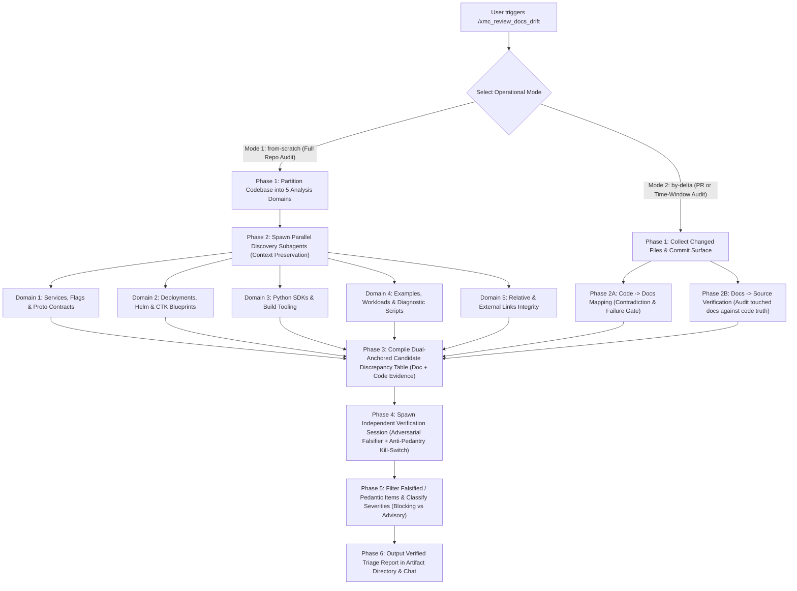

# Documentation Drift Review Playbook (`/xmc_review_docs_drift`)

This skill detects, verifies, and reports documentation drift between the authoritative source code of the XManager on Cloud (XMC) platform and all documentation files in the repository.

> [!IMPORTANT]
> All execution steps in this skill MUST strictly adhere to the mandatory policy rules defined in:
> - [Core Engineering Standards](../../rules/core_engineering.md)
> - [Markdown Documentation Guidelines](../../rules/languages/markdown.md)
> - [Skills & Automation Guidelines](../../rules/skills_and_automation.md) (Subagent Delegation & Context Preservation)
> - [Architectural Contracts & Invariants](../../rules/architectural_contracts.md)

---

## Architecture & Operational Modes

---

## Navigation Instruments

To prevent hallucination, attentional bias, and context bloat, agents executing this skill must navigate using two primary instruments:

1. **Repository Rules & Standards ([Markdown Documentation Guidelines](../../rules/languages/markdown.md) & [Core Engineering Guidelines](../../AGENTS.md))**:
   - Owns documentation rules: canonical home (one home per fact), link-don't-summarize, no PR-status prose (e.g., "PR #123 adds..."), no broken relative links, and [Open-Source Compliance & Prohibited Internal Links](../../rules/languages/markdown.md#1-markdown-formatting--structure).
2. **XMC Documentation Topography Registry & Guide ([`references/xmc_docs_topography_map.json`](references/xmc_docs_topography_map.json) & [`references/xmc_docs_topography_and_map.md`](references/xmc_docs_topography_and_map.md))**:
   - [`references/xmc_docs_topography_map.json`](references/xmc_docs_topography_map.json) owns the canonical machine-readable **Code-to-Docs Mapping Matrix (`quadrants`)**—explicitly splitting mapped docs by audit strictness into **`reference_doc_patterns` (Component Reference Manuals)** vs **`orientation_doc_patterns` (Orientation / Overview / Architecture Docs)**—and the **Identifier Sources Registry (`identifier_sources`)**.
   - [`references/xmc_docs_topography_and_map.md`](references/xmc_docs_topography_and_map.md) owns the **Known Drift Magnets** (ClickHouse charts, Helm tables, relative link depth changes, CTK v1 vs v2 renames) and the **Testable Assertion Verification Rubric**.
   - Validated continuously against `git ls-files` by [`tools/lint/check_docs_topography_map.py`](../../../tools/lint/check_docs_topography_map.py) (enforcing zero dead map entries, zero unmapped `.md` files, and zero unmapped component directories).

---

## Anti-Pedantry Contract: What Is NOT Documentation Drift

Both discovery subagents (Phase 2) and the independent verification session (Phase 4) MUST enforce this contract. Documentation exists to orient engineers and provide accurate reference contracts—not to mirror every line of source code. **NEVER flag any of the following 7 patterns as documentation drift:**

1. **Non-Exhaustive Examples & Quickstarts Omitting Optional Flags / Env Vars**:
   - Sample CLI invocations, `kubectl` snippets, and quickstart walkthroughs intentionally show only the flags relevant to that scenario (e.g., omitting optional tuning flags or secondary env vars like in `CAND-39`, `CAND-40`, `CAND-41`). An example is ONLY drift if the command as written fails, uses a nonexistent/renamed flag, or produces the wrong result.
2. **Conceptual Architecture & Mermaid Diagram Simplifications**:
   - High-level architecture prose and Mermaid flowcharts intentionally abstract away internal middleware, retry loops, helper packages, or secondary telemetry edges (e.g., `CAND-28`). Do not demand that conceptual diagrams depict every internal struct or call hop unless the diagram states a factually false relationship.
3. **Internal Files & Helper Modules Omitted from High-Level Directory Trees**:
   - ASCII directory trees in `README.md` or architecture docs illustrate key entrypoints and layout structure, not an exhaustive `find .` output (e.g., omitting internal helper `.py` or `_test.go` files as in `CAND-42`). Only flag a directory tree entry if a path explicitly listed in the tree was deleted, moved, or renamed.
4. **Parenthetical / Illustrative Lists (`"e.g."`, `"such as"`, `"including"`, `"for example"`)**:
   - Non-exhaustive lists introduced by `"e.g."`, `"such as"`, or `"including"` (e.g., `CAND-32`) are illustrative by definition. Never flag them for omitting additional members unless one of the explicitly named items no longer exists or is false.
5. **Internal Implementation Details Not Exposed to Users or Operators**:
   - Unexported Go types/functions, private Python helpers (`_helper`), internal test doubles, or internal code refactorings that do not alter any CLI flag, environment variable, API/proto contract, Helm value, or user-visible behavior.
6. **Cross-Level Detail Leakage (`orientation_doc_patterns` vs `reference_doc_patterns`)**:
   - Never demand that low-level service flags (`cmd/<service>/`), component-specific environment variables, or deep package internals be duplicated in high-level orientation docs (`README.md`, `INSTALL.md`, `docs/architecture/*.md`). High-level orientation docs (`orientation_doc_patterns`) are audited **only** for broken links, deleted paths, and direct factual contradictions—never for parameter completeness.
7. **Pure Wording, Formatting, or Stylistic Preferences**:
   - If the existing documentation prose is factually accurate and unambiguous, never file a candidate merely to rephrase, reorder, or stylistically polish the text.

---

## Mode 1: From Scratch (`from-scratch` / Full Audit)

Use this mode for comprehensive repository health checks, milestone reviews, or addressing systemic docs debt.

### Phase 1: Enumerate Tracked Repository Docs & Exclude Build Artifacts
First, run `python3 tools/lint/check_docs_topography_map.py` to confirm the Topography Map is in 100% bi-directional sync with `git ls-files`. To prevent false positives from git-ignored or untracked local directories, always enumerate the target documentation surface via `git ls-files '*.md'`:
- **Excluded / Git-Ignored Paths**: `ctk-out/`, `cluster-toolkit/`, `xmc-v2/`, `node_modules/`, `.terraform/`, `.venv/`, `.venv_e2e/`, `venv_e2e/`, `.git/`, `.angular/`, `.pytest_cache/`, `bazel-*/`, `pr_review_checklist*.md`.
- **Target Documentation Surface** (`git ls-files '*.md'`):
  - **Component Reference Manuals (`reference_doc_patterns`)** — audited for both factual accuracy and explicit Reference Table completeness:
    - Component & service manuals: `cmd/**/README.md`, `pkg/**/README.md`, `internal/**/README.md`, `internal/storage/AGENTS.md`.
    - Deployment & chart manuals: `deploy/ctk_v2/README.md`, `deploy/local/README.md`, `deploy/cli/README.md`, `deploy/ci/README.md`, `deploy/helm/README.md`, `deploy/profiles/**/README.md`, `deploy/addons/**/README.md`.
    - SDK, example & tool manuals: `sdks/python/**/README.md`, `examples/**/README.md`, `tools/**/README.md`, `test/**/README.md`.
    - Multi-agent rules & skills: `.agents/rules/**/*.md`, `.agents/skills/**/*.md`.
  - **Orientation / Overview / Architecture Docs (`orientation_doc_patterns`)** — audited strictly for broken links, deleted paths, and direct factual contradictions:
    - Root documents: `README.md`, `INSTALL.md`, `CONTRIBUTING.md`, `ABSENCE.md`.
    - Architecture, design & flow overviews: `docs/**/*.md`, `tools/README.md`, `.github/**/*.md`, `.agents/AGENTS.md`.

### Phase 2: Parallel Discovery Subagent Sweep (Context Preservation Gate)
Per [Skills & Automation Guidelines](../../rules/skills_and_automation.md#4-subagent-delegation-guidelines), running a full-repository audit inside the primary coordinator conversation will exhaust context memory. The coordinator MUST partition the initial discovery sweep into 5 domains and spawn worker subagents (`invoke_subagent` or `run_workflow` `parallel(...)` with `type_name="research-google"`).

Every discovery subagent MUST adhere to the **Anti-Pedantry Contract** above and record both the exact **Documentation Location + Verbatim Claim** and the **Code Location + Verbatim Evidence** for every candidate discrepancy it finds:

#### Subagent 1: Control Plane Services, Flags & API Contracts
- **Scope**: `cmd/`, `pkg/`, `internal/`, `api/protos/` vs `cmd/**/README.md`, `docs/architecture/`, `docs/design/`, `docs/flows/`.
- **Verifications**:
  1. CLI Flags: Verify all flags documented in service READMEs exist in `cmd/<service>/main.go` with exact names and default values, and check whether explicit CLI flag reference tables in `cmd/**/README.md` omit required/user-facing flags.
  2. Environment Variables: Cross-check every environment variable mentioned in service docs against `os.Getenv` / `os.LookupEnv` in Go packages.
  3. Default Network Ports: Verify documented gRPC (`50051`), HTTP (`8080`, `8123`), and metrics ports against service server setups.
  4. Protobuf Contracts: Ensure message names, fields, and RPC endpoints described in flow docs (`docs/flows/`) match active `.proto` definitions in `api/protos/`.

#### Subagent 2: Deployments, Blueprints, Helm & Infrastructure
- **Scope**: `deploy/ctk_v2/`, `deploy/helm/`, `deploy/profiles/`, `deploy/addons/` vs `INSTALL.md`, `deploy/**/README.md`.
- **Verifications**:
  1. Helm Parameters: Cross-check parameter tables in `deploy/helm/README.md` and `deploy/profiles/**/README.md` against actual keys and defaults in `values.yaml`.
  2. Cluster Toolkit Blueprints: Verify blueprint variables in `deploy/ctk_v2/xmanager-cloud.yaml` and `deploy/ctk_v2/xmc-deployment-template.yaml` against installation guides in `INSTALL.md` and `deploy/ctk_v2/README.md`.
  3. Addons & Profiles: Verify that documented Helm commands in `deploy/addons/**/README.md` reference valid, existing manifests and parameters.
  4. Legacy CTK Paths: Verify that no doc references obsolete CTK v1 paths (`deploy/ctk_v1`).

#### Subagent 3: Python SDKs & Build Tooling
- **Scope**: `sdks/python/xmc/`, `sdks/python/xdash/`, `pyproject.toml`, `MODULE.bazel`, `go.mod` vs SDK READMEs, `docs/developer.md`, `README.md`.
- **Verifications**:
  1. SDK API Signatures: Verify that documented SDK functions (e.g., `xmc.init()`, `xmc.log_metric()`, `xdash.Dashboard`) match actual Python exports in `sdks/python/xmc/` and `sdks/python/xdash/`.
  2. Setup Instructions: Verify editable install commands (`pip install -e sdks/python/xmc`), poetry/uv/pip requirements, and Python version compatibility (Python 3.10+ / 3.14+).
  3. Bazel Targets: Confirm that documented test and build targets in `docs/developer.md` exist in `BUILD.bazel` files.

#### Subagent 4: Examples, Workloads & Diagnostic Scripts
- **Scope**: `examples/**`, `tools/**`, `scripts/**` vs `examples/**/README.md`, `tools/**/README.md`.
- **Verifications**:
  1. Example Worker Alignment: Compare environment variables in `worker.env` against what `worker.py` reads and `launch.py` injects.
  2. Container Images: Confirm example image references (e.g. `us-docker.pkg.dev/...`) match `Dockerfile` definitions.
  3. Diagnostic Tools: Ensure documented flags for `tools/xmc-diag/` and release scripts match active CLI arguments.

#### Subagent 5: Hyperlinks, External Integrations & Open-Source Compliance
- **Scope**: All repository Markdown files (excluding build dirs).
- **Verifications**:
  1. Relative File Links: Every relative Markdown link (e.g., `[Topography Map](references/xmc_docs_topography_and_map.md)`) must resolve to a valid existing file on the filesystem. Check relative path depth (`../`).
  2. Heading Anchor Slugs: Verify that links pointing to `#anchor-slugs` point to existing headings in the target document.
  3. External URLs: Mechanically probe external URLs, specifically targeting third-party Helm repositories (e.g., ClickHouse / ClickStack chart repos), documentation links, and upstream tools. Flag HTTP 404, 403, DNS resolution failures, or repository redirect changes.
  4. Open-Source Link Compliance: Enforce [Open-Source Compliance & Prohibited Internal Links](../../rules/languages/markdown.md#1-markdown-formatting--structure) — flag any prohibited internal links in public documentation files.

---

## Mode 2: By a Delta (`by-delta` / PR or Time-Window Audit)

Use this mode during pull request reviews, before merge, or for periodic delta audits over a specific commit or time window.

### Phase 1: Determine the Delta Surface
1. **Identify the Range**:
   - Single PR: `gh pr diff <pr_number>` or branch comparison `git diff --stat origin/main...HEAD`.
   - Time window: `git log --since="<date>" --until="<date>" --name-only --pretty=format:"" origin/main`.
   - Merged PRs in window: `gh pr list --state merged --search "merged:>=YYYY-MM-DD" --json number,title,files`.
2. **Classify Changed Files**:
   - **Source Code Changed?** Map to affected documentation via [`references/xmc_docs_topography_map.json`](references/xmc_docs_topography_map.json) and the [Topography Guide](references/xmc_docs_topography_and_map.md) (Direction 1).
   - **Documentation Changed?** Verify new claims against source code at HEAD (Direction 2).

### Phase 2A: Direction 1 — Code → Docs Audit (Contradiction & Failure Gate)
For every modified source file:
1. Locate its mapped `reference_doc_patterns` and `orientation_doc_patterns` using [`references/xmc_docs_topography_map.json`](references/xmc_docs_topography_map.json).
2. **Apply the Mandatory Contradiction & Failure Gate**: A code change ONLY triggers a documentation drift candidate if at least one of the following holds:
   - **(a) Direct Contradiction / Broken Execution**: The code change makes an existing documented claim, default value, CLI command, API/Protobuf contract, Helm parameter, or file path in a mapped doc **actively false or broken**; OR
   - **(b) Exhaustive Reference Table Gap**: The code change adds, removes, or renames a user-facing CLI flag, environment variable, or configuration parameter in a component whose own **Component Reference Manual** (`reference_doc_patterns`, such as `cmd/<service>/README.md` or `deploy/helm/README.md`) already maintains an **explicit, exhaustive Reference Table** for those parameters, and that table was not updated.
3. **Mandatory Non-Escalation**: If neither **(a)** nor **(b)** holds (for example, an internal refactoring, a new helper file not listed in a high-level directory tree, or a new optional flag not shown in a quickstart command snippet or `orientation_doc_patterns` overview), **DO NOT** file a candidate discrepancy.

### Phase 2B: Direction 2 — Docs → Source & Rules Audit
For every documentation file touched in the delta:
1. **Verify Against Code Truth**: Every identifier, command, flag, default value, or path in the updated prose must match the actual source code at HEAD.
2. **Verify Repository Rules**:
   - **Canonical Home**: Does the text duplicate another page instead of linking?
   - **No PR-Status Prose**: Docs must describe the system as it is on `main`. Sentences like *"PR #123 adds..."* or *"Currently proposing..."* rot immediately and are forbidden.
   - **Broken Links**: Ensure no newly introduced relative links or external URLs are broken.
   - **Open-Source Link Compliance**: Verify compliance with [Markdown Documentation Guidelines](../../rules/languages/markdown.md#1-markdown-formatting--structure).

---

## Phase 3: Compile the Dual-Anchored Candidate Discrepancy Table

Before running the verification pass, aggregate all candidate discrepancies from Mode 1 or Mode 2 that pass the **Anti-Pedantry Contract** and **Contradiction & Failure Gate** into a structured **Candidate Discrepancy Table** saved to `${ARTIFACT_DIR:-<appDataDir>/brain/<conv_id>}/docs_drift_candidates.md`.

Every row in the table MUST explicitly point to **both places** (the documentation file:line and the code file:line) along with concrete verbatim evidence from both sides supporting that a discrepancy exists:

| Candidate ID | Category | Doc Location (`file:line`) | Doc Claim (Verbatim Quote / Snippet) | Code Location (`file:line`) | Code Evidence (Verbatim Snippet / Probe Output) | Proposed Severity | Required Action |
| :--- | :--- | :--- | :--- | :--- | :--- | :--- | :--- |
| `CAND-01` | CLI Flags & Defaults | `cmd/xmc_bridge/README.md:59-60` | ``--cms-address \| CMS_ADDRESS \| "localhost:50051"`` | `cmd/xmc_bridge/main.go:97,125,142-144` | ``flag.StringVar(&cfg.CMSAddress, "cms-address", envOr("CMS_ADDRESS", ""), ...)``; `if cfg.CMSAddress == "" { return fmt.Errorf("cms-address must be specified") }` | `[BLOCKING]` | Mark `--cms-address` as required with empty default `""` |

> [!CAUTION]
> **No Unanchored or Single-Sided Claims**:
> Any candidate that omits either the exact `Doc Location` + `Doc Claim` or the exact `Code Location` + `Code Evidence` (e.g., vague assertions without file and line proof) is invalid and must be completed before Phase 4.

---

## Phase 4: Mandatory Second-Pass Independent Verification Session

Once the initial discovery run finishes and `${ARTIFACT_DIR:-<appDataDir>/brain/<conv_id>}/docs_drift_candidates.md` is written, the coordinator MUST spawn a **separate, independent verification session** (via `invoke_subagent` with `TypeName: "research-google"`, or as a dedicated verification stage in `run_workflow` after the discovery agents complete) to audit the candidate list and verify whether each discrepancy is genuinely real and material.

> [!IMPORTANT]
> **Why a Separate Verification Session Is Mandatory**:
> Discovery agents scanning large file sets can misread conditional prose, overlook example overrides, miss fallback wiring in a sibling source file, or over-index on pedantic completeness nits. Spawning a fresh, independent session with clean context and the dual-anchored candidate table eliminates false positives and pedantic noise before reporting to the user.

### 1. Context Provided to the Independent Verifier Session
Pass to the verifier session (or parallel domain verifier slices of $\le 15$ candidates each when the candidate table exceeds 15 items):
1. The path to the dual-anchored Candidate Discrepancy Table (`${ARTIFACT_DIR:-<appDataDir>/brain/<conv_id>}/docs_drift_candidates.md`).
2. The exact repository workspace path (`/usr/local/google/home/janzak/Documents/XMC`) and current `HEAD` commit SHA.
3. Explicit instructions to use `read_file` on **both** the cited `Doc Location` and the cited `Code Location` (never relying on `code_search`, which searches internal Piper rather than the local GitHub repository).

### 2. Verifier Falsification Protocol
For every candidate row (`CAND-01` .. `CAND-N`), the independent verifier session MUST execute this 4-point check using `read_file`:
1. **Verify the Documentation Side (`Doc Location`)**:
   - Read the cited Markdown file around `Doc Location`.
   - Confirm the quoted `Doc Claim` actually appears at those lines and is stated as a current fact (not an explicit hypothetical, historical note, or intentional override example).
2. **Verify the Code Side (`Code Location` & Sibling Files)**:
   - Read the cited source file around `Code Location` (plus any referenced `BUILD.bazel`, Helm `_helpers.tpl`, config loader, or caller file).
   - Confirm that the code genuinely contradicts the documentation claim and that no wrapper script, entrypoint, or fallback satisfies the documented behavior elsewhere.
3. **Materiality & Anti-Pedantry Kill-Switch**:
   - Test the candidate against the **Anti-Pedantry Contract** (7 forbidden nitpick patterns) and the **Contradiction & Failure Gate**:
     - Does the candidate complain that a sample CLI command, quickstart snippet, Mermaid diagram, ASCII directory tree, or `"e.g."` / `"such as"` list is non-exhaustive?
     - Does it demand low-level component flags/env vars be added to an `orientation_doc_patterns` overview (`README.md`, `INSTALL.md`, `docs/**`)?
     - Is it a true-but-trivial observation where the existing doc neither contradicts the code nor causes any user/operator failure, and is not missing from an explicit exhaustive Reference Table in a `reference_doc_patterns` manual?
   - If the answer to any of the above is **YES**, the verifier MUST immediately reject the candidate as **`[FALSIFIED] (Reason: Pedantic / Non-Exhaustive Scope)`**.
4. **Assign an Explicit Verification Verdict**:
   - **`[CONFIRMED]`**: Both the doc claim and code contradiction (or exhaustive Reference Table gap) are verified at the cited locations and pass the Materiality & Anti-Pedantry Kill-Switch. Keep in the final Triage Report.
   - **`[REFINED]`**: The discrepancy is real and material, but the line numbers, file path, severity, or required action needed adjustment. Update the row and keep in the final Triage Report.
   - **`[FALSIFIED]`** (including **`[FALSIFIED] (Reason: Pedantic / Non-Exhaustive Scope)`**): The discrepancy is disproven or rejected by the Anti-Pedantry Kill-Switch. Remove from the active Triage Table and record the falsification proof in the report's `

Falsified / Discarded Candidates
` audit log.

---

## Testable Assertions Evaluation Framework

A testable assertion is any factual claim in documentation that can be proven or falsified by inspecting the codebase or running a deterministic probe:

| Assertion Type | Documentation Claim Example | Falsification Check in Code |
| :--- | :--- | :--- |
| **CLI Flag** | `"--listen-addr :8080"` | Search `flag.StringVar` in `cmd/<service>/main.go`. |
| **Environment Variable** | `"Reads CLICKHOUSE_HOST"` | Search `os.Getenv("CLICKHOUSE_HOST")` across Go / Python packages. |
| **Default Port** | `"Default port is 50051"` | Check server bind address or Helm container ports. |
| **Helm Parameter** | `"Set clickhouse.enabled=true"` | Verify `clickhouse.enabled` exists in `deploy/helm/values.yaml`. |
| **Blueprint Variable** | `"Configure project_id variable"` | Check `vars:` in `deploy/ctk_v2/xmanager-cloud.yaml` and `deploy/ctk_v2/xmc-deployment-template.yaml`. |
| **SDK API Method** | `"Call xmc.init()"` | Check `__all__` in `sdks/python/xmc/__init__.py`. |
| **Relative Path** | `"[Schema](../../../deploy/clickhouse/schema.sql)"` | Check file existence at resolved filesystem path. |
| **External URL** | `"helm repo add clickstack https://..."` | Send HTTP `HEAD` / `GET` request to probe repository availability. |

---

## Severity Classification Rubric

Classify all evaluated candidates into three unambiguous tiers:

### 1. `[BLOCKING]`
Documentation states something demonstrably false, breaks developer workflows, or misleads users/operators into command or deployment failure:
- Broken relative links to architectural files, code files, or manifests.
- Broken external URLs or invalid upstream Helm repository coordinates.
- Incorrect CLI flag names, wrong default values, or renamed environment variables that cause commands or deployments to fail or misbehave.
- Obsolete deployment instructions (e.g., referencing deleted CTK v1 paths or removed Helm charts).
- Violations of [Open-Source Compliance & Prohibited Internal Links](../../rules/languages/markdown.md#1-markdown-formatting--structure).

### 2. `[ADVISORY]`
Material factual inaccuracies in non-executable prose or gaps in explicit, exhaustive Component Reference Tables (`reference_doc_patterns`):
- A user-facing CLI flag, environment variable, or Helm `values.yaml` key is missing from an explicit, exhaustive parameter Reference Table in the component's own `README.md` (`reference_doc_patterns`).
- Factual misstatements in architectural or design prose (e.g., stating an outdated retention period or wrong protocol name) that do not directly break a copy-pasted CLI command.
- Canonical-home / link-don't-summarize violations where a full parameter table is duplicated across multiple files instead of linking to the canonical reference manual.

### 3. `[DISCARD / DO NOT REPORT]`
Pedantic completeness nits, non-exhaustive examples, or stylistic preferences (must be rejected as `[FALSIFIED] (Reason: Pedantic / Non-Exhaustive Scope)` and excluded from the active triage table):
- Sample CLI commands, quickstarts, or tutorials omitting optional flags or secondary environment variables (`CAND-39`, `CAND-40`, `CAND-41`).
- Conceptual Mermaid diagrams or architecture overviews omitting internal helper components or secondary flows (`CAND-28`).
- High-level ASCII directory trees omitting internal helper files (`CAND-42`).
- Illustrative lists using `"e.g."`, `"such as"`, or `"including"` (`CAND-32`).
- Demanding low-level component parameters be duplicated in `orientation_doc_patterns` (`README.md`, `INSTALL.md`, `docs/**`).
- Pure wording, formatting, or typographic preferences where the existing text is factually accurate.

---

## Output Deliverables

The skill must produce two structured deliverables:

### 1. Interactive Triage Summary & Roster in Chat
1. **Subagent & Verifier Session Roster**: A table listing each discovery subagent and the independent Verifier Session(s) with clickable `[<conv_id>](conversation://<conv_id>)` links and confirmed vs. falsified counts.
2. **Verified Discrepancy Triage Table**: A dual-anchored markdown table showing every `[CONFIRMED]` / `[REFINED]` discrepancy with both the **Doc Location + Claim** and the **Code Location + Evidence**:

| ID | Category | Doc Location & Claim | Code Location & Evidence | Verdict & Severity | Required Action |
| :--- | :--- | :--- | :--- | :--- | :--- |
| `DOC-01` | Undefined Helm Repo Alias | `deploy/addons/metrics/clickhouse/README.md:71` ``helm pull clickhouse/clickhouse --version 3.4.0`` | `deploy/addons/metrics/clickhouse/README.md:55` & `deploy/profiles/stable-2026a/components/clickhouse/README.md:53` Line 55 only registers `clickhouse-operator` (`https://docs.altinity.com/clickhouse-operator/`); `clickhouse/` alias is never added (official ClickStack repo is in `stable-2026a`) | `[REFINED]` `[BLOCKING]` | Register the `clickhouse` Helm repo before `helm pull` or align with `stable-2026a` `clickstack/clickstack-operators` |
| `DOC-02` | Broken Relative Link | `docs/design/topologies.md:16` `[deploy/ctk_v1/README.md](../../deploy/ctk_v1/README.md)` | `deploy/ctk_v2/README.md:1` `deploy/ctk_v1/` was removed in the CTK v2 migration | `[CONFIRMED]` `[BLOCKING]` | Update link to `[deploy/ctk_v2/README.md](../../deploy/ctk_v2/README.md)` |
| `DOC-03` | Stale Relative Path | `deploy/profiles/stable-2026a/components/clickhouse/README.md:138` `../../../../pkg/clickhouse/componentconfig/resolver.go` | `pkg/clickhouse/componentconfig/resolver.go:1` Doc is 5 directory levels deep; `../../../../` resolves to `deploy/pkg/...` | `[CONFIRMED]` `[BLOCKING]` | Prepend one `../` (`../../../../../pkg/clickhouse/componentconfig/resolver.go`) |

### 2. Persistent Triage Report in Artifact Directory
Write the complete report to `${ARTIFACT_DIR:-<appDataDir>/brain/<conv_id>}/docs_drift_triage_report.md` containing:
- Executive Summary (mode, scope, total docs inspected, candidate count, confirmed vs. falsified count, blocker/advisory breakdown).
- Subagent & Verifier Session Roster with `conversation://` links.
- Dual-anchored Verified Discrepancy Table with full verbatim doc quotes, code evidence snippets, and suggested diffs.
- Collapsible `

Falsified / Discarded Candidates Audit Log
` documenting any candidate items rejected by the independent verifier session (including items rejected via the Materiality & Anti-Pedantry Kill-Switch) and why.
