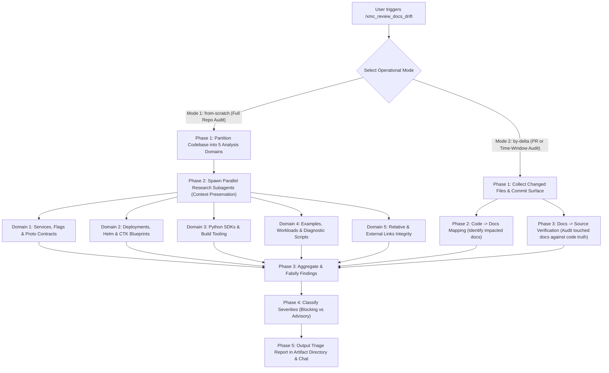

# Documentation Drift Review Playbook (`/xmc_review_docs_drift`)

This skill detects, verifies, and reports documentation drift between the authoritative source code of the XManager on Cloud (XMC) platform and all documentation files in the repository.

> [!IMPORTANT]
> All execution steps in this skill MUST strictly adhere to the mandatory policy rules defined in:
> - [Core Engineering Standards](../../rules/core_engineering.md)
> - [Markdown Documentation Guidelines](../../rules/languages/markdown.md)
> - [Skills & Automation Guidelines](../../rules/skills_and_automation.md) (Subagent Delegation & Context Preservation)
> - [Architectural Contracts & Invariants](../../rules/architectural_contracts.md)

---

## Architecture & Operational Modes

---

## Navigation Instruments

To prevent hallucination, attentional bias, and context bloat, agents executing this skill must navigate using two primary instruments:

1. **Repository Rules & Standards ([Markdown Documentation Guidelines](../../rules/languages/markdown.md) & [Core Engineering Guidelines](../../AGENTS.md))**:
   - Owns documentation rules: canonical home (one home per fact), link-don't-summarize, no PR-status prose (e.g., "PR #123 adds..."), no broken relative links, and [Open-Source Compliance & Prohibited Internal Links](../../rules/languages/markdown.md#1-markdown-formatting--structure).
2. **XMC Documentation Topography Map ([`references/xmc_docs_topography_and_map.md`](references/xmc_docs_topography_and_map.md))**:
   - Owns the **Code-to-Docs Mapping Matrix** (which source paths map to which docs), the **Identifier Sources Registry** (which code files own flags, env vars, ports, schemas), and the **Known Drift Magnets** (ClickHouse charts, Helm tables, relative link depth changes, CTK v1 vs v2 renames).

---

## Mode 1: From Scratch (`from-scratch` / Full Audit)

Use this mode for comprehensive repository health checks, milestone reviews, or addressing systemic docs debt.

### Phase 1: Enumerate Tracked Repository Docs & Exclude Build Artifacts
To prevent false positives from git-ignored or untracked local directories, always enumerate the target documentation surface via `git ls-files '*.md'`:
- **Excluded / Git-Ignored Paths**: `ctk-out/`, `cluster-toolkit/`, `xmc-v2/`, `node_modules/`, `.terraform/`, `.venv/`, `.venv_e2e/`, `venv_e2e/`, `.git/`, `.angular/`, `.pytest_cache/`, `bazel-*/`, `pr_review_checklist*.md`.
- **Target Documentation Surface** (`git ls-files '*.md'`):
  - Root documents: `README.md`, `INSTALL.md`, `CONTRIBUTING.md`, `ABSENCE.md`.
  - Architecture & flow specifications: `docs/**/*.md`.
  - Component & service manuals: `cmd/**/README.md`, `pkg/**/README.md`, `internal/**/README.md`.
  - Deployment & infrastructure manuals: `deploy/**/README.md`.
  - SDK manuals: `sdks/python/**/README.md`.
  - Example walkthroughs: `examples/**/README.md`.
  - Tooling manuals: `tools/**/README.md`, `test/**/README.md`.
  - Multi-agent rules: `.agents/**/*.md`.

### Phase 2: Parallel Subagent Domain Sweep (Context Preservation Gate)
Per [Skills & Automation Guidelines](../../rules/skills_and_automation.md#4-subagent-delegation-guidelines), running a full-repository audit inside the primary coordinator conversation will exhaust context memory. The coordinator MUST partition the audit into 5 domain sweeps and spawn worker subagents (`invoke_subagent` with `TypeName: "research-google"`):

#### Subagent 1: Control Plane Services, Flags & API Contracts
- **Scope**: `cmd/`, `pkg/`, `internal/`, `api/protos/` vs `cmd/**/README.md`, `docs/architecture/`, `docs/design/`, `docs/flows/`.
- **Verifications**:
  1. CLI Flags: Verify all flags documented in service READMEs exist in `cmd/<service>/main.go` with exact names and default values.
  2. Environment Variables: Cross-check every environment variable mentioned in service docs against `os.Getenv` / `os.LookupEnv` in Go packages.
  3. Default Network Ports: Verify documented gRPC (`50051`), HTTP (`8080`, `8123`), and metrics ports against service server setups.
  4. Protobuf Contracts: Ensure message names, fields, and RPC endpoints described in flow docs (`docs/flows/`) match active `.proto` definitions in `api/protos/`.

#### Subagent 2: Deployments, Blueprints, Helm & Infrastructure
- **Scope**: `deploy/ctk_v2/`, `deploy/helm/`, `deploy/profiles/`, `deploy/addons/` vs `INSTALL.md`, `deploy/**/README.md`.
- **Verifications**:
  1. Helm Parameters: Cross-check parameter tables in `deploy/helm/README.md` and `deploy/profiles/**/README.md` against actual keys and defaults in `values.yaml`.
  2. Cluster Toolkit Blueprints: Verify blueprint variables in `deploy/ctk_v2/xmanager-cloud.yaml` and `deploy/ctk_v2/xmc-deployment-template.yaml` against installation guides in `INSTALL.md` and `deploy/ctk_v2/README.md`.
  3. Addons & Profiles: Verify that documented Helm commands in `deploy/addons/**/README.md` reference valid, existing manifests and parameters.
  4. Legacy CTK Paths: Verify that no doc references obsolete CTK v1 paths (`deploy/ctk_v1`).

#### Subagent 3: Python SDKs & Build Tooling
- **Scope**: `sdks/python/xmc/`, `sdks/python/xdash/`, `pyproject.toml`, `MODULE.bazel`, `go.mod` vs SDK READMEs, `docs/developer.md`, `README.md`.
- **Verifications**:
  1. SDK API Signatures: Verify that documented SDK functions (e.g., `xmc.init()`, `xmc.log_metric()`, `xdash.Dashboard`) match actual Python exports in `src/xmc/` and `src/xdash/`.
  2. Setup Instructions: Verify editable install commands (`pip install -e sdks/python/xmc`), poetry/uv/pip requirements, and Python version compatibility (Python 3.10+ / 3.14+).
  3. Bazel Targets: Confirm that documented test and build targets in `docs/developer.md` exist in `BUILD.bazel` files.

#### Subagent 4: Examples, Workloads & Diagnostic Scripts
- **Scope**: `examples/**`, `tools/**`, `scripts/**` vs `examples/**/README.md`, `tools/**/README.md`.
- **Verifications**:
  1. Example Worker Alignment: Compare environment variables in `worker.env` against what `worker.py` reads and `launch.py` injects.
  2. Container Images: Confirm example image references (e.g. `us-docker.pkg.dev/...`) match `Dockerfile` definitions.
  3. Diagnostic Tools: Ensure documented flags for `tools/xmc-diag/` and release scripts match active CLI arguments.

#### Subagent 5: Hyperlinks, External Integrations & Open-Source Compliance
- **Scope**: All repository Markdown files (excluding build dirs).
- **Verifications**:
  1. Relative File Links: Every relative Markdown link (e.g., `[Topography Map](references/xmc_docs_topography_and_map.md)`) must resolve to a valid existing file on the filesystem. Check relative path depth (`../`).
  2. Heading Anchor Slugs: Verify that links pointing to `#anchor-slugs` point to existing headings in the target document.
  3. External URLs: Mechanically probe external URLs, specifically targeting third-party Helm repositories (e.g., ClickHouse / ClickStack chart repos), documentation links, and upstream tools. Flag HTTP 404, 403, DNS resolution failures, or repository redirect changes.
  4. Open-Source Link Compliance: Enforce [Open-Source Compliance & Prohibited Internal Links](../../rules/languages/markdown.md#1-markdown-formatting--structure) — flag any prohibited internal links in public documentation files.

---

## Mode 2: By a Delta (`by-delta` / PR or Time-Window Audit)

Use this mode during pull request reviews, before merge, or for periodic delta audits over a specific commit or time window.

### Phase 1: Determine the Delta Surface
1. **Identify the Range**:
   - Single PR: `gh pr diff <pr_number>` or branch comparison `git diff --stat origin/main...HEAD`.
   - Time window: `git log --since="<date>" --until="<date>" --name-only --pretty=format:"" origin/main`.
   - Merged PRs in window: `gh pr list --state merged --search "merged:>=YYYY-MM-DD" --json number,title,files`.
2. **Classify Changed Files**:
   - **Source Code Changed?** Map to affected documentation via the [Topography Map](references/xmc_docs_topography_and_map.md) (Direction 1).
   - **Documentation Changed?** Verify new claims against source code at HEAD (Direction 2).

### Phase 2: Direction 1 — Code → Docs Audit
For every modified source file:
1. Locate its documented canonical pages using the [Topography Map](references/xmc_docs_topography_and_map.md).
2. Check if the code change modified any **testable assertion**:
   - Did a CLI flag name, type, or default value change?
   - Was an environment variable added, removed, or renamed?
   - Did a default configuration value or port change?
   - Was an API schema or Protobuf contract updated?
   - Was a Helm `values.yaml` key modified?
3. Check the mapped documentation files: Did the PR update the documentation in those exact spots? If not, flag as **Documentation Drift (Missing Update)**.

### Phase 3: Direction 2 — Docs → Source & Rules Audit
For every documentation file touched in the delta:
1. **Verify Against Code Truth**: Every identifier, command, flag, default value, or path in the updated prose must match the actual source code at HEAD.
2. **Verify Repository Rules**:
   - **Canonical Home**: Does the text duplicate another page instead of linking?
   - **No PR-Status Prose**: Docs must describe the system as it is on `main`. Sentences like *"PR #123 adds..."* or *"Currently proposing..."* rot immediately and are forbidden.
   - **Broken Links**: Ensure no newly introduced relative links or external URLs are broken.
   - **Open-Source Link Compliance**: Verify compliance with [Markdown Documentation Guidelines](../../rules/languages/markdown.md#1-markdown-formatting--structure).

---

## Testable Assertions Evaluation Framework

A testable assertion is any factual claim in documentation that can be proven or falsified by inspecting the codebase or running a deterministic probe:

| Assertion Type | Documentation Claim Example | Falsification Check in Code |
| :--- | :--- | :--- |
| **CLI Flag** | `"--listen-addr :8080"` | Search `flag.StringVar` in `cmd/<service>/main.go`. |
| **Environment Variable** | `"Reads CLICKHOUSE_HOST"` | Search `os.Getenv("CLICKHOUSE_HOST")` across Go / Python packages. |
| **Default Port** | `"Default port is 50051"` | Check server bind address or Helm container ports. |
| **Helm Parameter** | `"Set clickhouse.enabled=true"` | Verify `clickhouse.enabled` exists in `deploy/helm/values.yaml`. |
| **Blueprint Variable** | `"Configure project_id variable"` | Check `vars:` in `deploy/ctk_v2/xmanager-cloud.yaml` and `deploy/ctk_v2/xmc-deployment-template.yaml`. |
| **SDK API Method** | `"Call xmc.init()"` | Check `__all__` in `sdks/python/xmc/src/xmc/__init__.py`. |
| **Relative Path** | `"[Schema](../../../deploy/clickhouse/schema.sql)"` | Check file existence at resolved filesystem path. |
| **External URL** | `"helm repo add clickstack https://..."` | Send HTTP `HEAD` / `GET` request to probe repository availability. |

---

## Severity Classification Rubric

Classify all findings into two unambiguous tiers:

### 1. `[BLOCKING]`
Documentation states something demonstrably false, breaks developer workflows, or misleads users:
- Broken relative links to key architectural files or manifests.
- Broken external URLs or invalid upstream Helm repository coordinates.
- Incorrect CLI flag names or renamed environment variables that cause commands or deployments to fail.
- Obsolete deployment instructions (e.g., referencing deleted CTK v1 paths or removed Helm charts).
- Violations of [Open-Source Compliance & Prohibited Internal Links](../../rules/languages/markdown.md#1-markdown-formatting--structure).

### 2. `[ADVISORY]`
Style drift, maintainability issues, or non-fatal discrepancies:
- Parameter documented in prose but omitted from the markdown summary table.
- Link-don't-summarize violations (content duplicated instead of referencing the canonical page).
- Minor typographic inconsistencies in code block examples.
- Drift magnets that are not yet broken but prone to staleness (e.g., hardcoded version numbers).

---

## Output Deliverables

The skill must produce two structured deliverables:

### 1. Interactive Triage Table in Chat
A concise markdown table summarizing all verified findings:

| ID | Category | Doc Location | Source of Truth / Evidence | Severity | Required Action |
| :--- | :--- | :--- | :--- | :--- | :--- |
| `DOC-01` | Broken External Link | `deploy/addons/metrics/clickhouse/README.md:71` | Upstream chart is `clickstack/clickstack`, not `clickhouse/clickhouse` | `[BLOCKING]` | Update command to `helm pull clickstack/clickstack --version <ver>` |
| `DOC-02` | Broken Relative Link | `docs/design/topologies.md:16` | Path `deploy/ctk_v1/` was deleted in CTK v2 migration | `[BLOCKING]` | Update link to point to `deploy/ctk_v2/README.md` |
| `DOC-03` | Stale Relative Path | `deploy/profiles/stable-2026a/components/clickhouse/README.md:138` | Target path requires 5 levels of traversal (`../../../../../`) | `[BLOCKING]` | Fix relative path depth to resolver.go |

### 2. Persistent Triage Report in Artifact Directory
Write the complete report to `${ARTIFACT_DIR:-<appDataDir>/brain/<conv_id>}/docs_drift_triage_report.md` containing:
- Executive Summary (mode, scope, total docs inspected, total assertions checked, blocker/advisory counts).
- Comprehensive findings breakdown with complete reproduction steps and suggested diffs.
- Recommended PR patches or follow-up issue backlog.
