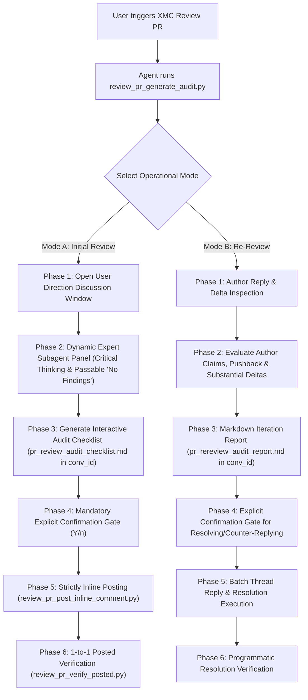

# Interactive Pull Request Review Playbook

This skill provides an end-to-end multi-agent workflow for conducting comprehensive, collaborative, rule-backed reviews of GitHub Pull Requests.

> [!IMPORTANT]
> All execution steps in this skill MUST strictly adhere to the mandatory policy rules defined in [PR Review Guidelines](../../rules/pr_review_guidelines.md), [Core Engineering Standards](../../rules/core_engineering.md), [Skills & Automation Guidelines](../../rules/skills_and_automation.md), and file-extension language guidelines under `rules/languages/`.

---

## Architecture & Workflow Overview



---

## Guidelines for Using Helper CLI Tools (`tools/review_pr_*.py`)

When invoking helper CLI scripts under `tools/` (`review_pr_generate_audit.py`, `review_pr_post_inline_comment.py`, `review_pr_verify_posted.py`):
1. **Do not read tool source code**: Refer to [Skills & Automation Guidelines](../../rules/skills_and_automation.md#5-helper-tool-execution-policy--safety-constraints).
2. **Inspect parameters via `--help`**: Run tools with `--help` to inspect parameter schemas and usage flags.
3. **Parse Structured JSON Output**: Tools output structured JSON with exit code 0 for success, 1 for handled errors, and 2 for unhandled errors.
4. **Store Artifacts strictly inside Conversation Directory (`--conv-id`)**: All generated markdown audit checklists and reports must default to the conversation artifact directory (`<appDataDir>/brain/<conv_id>/`) rather than the workspace root to prevent accidental git repository commits.
5. **Arbitrary Long Comment File Safety (`-f` / `--message-file`)**: Always write proposed inline review comments containing markdown diff blocks or detailed explanations to a file and pass `-f message_file.md` to prevent bash escaping errors or length truncation.

---

## Mode A: Initial PR Review & Collaborative Scoping

### Phase 1: Open User Direction Discussion Window ("Where should I look?")

Before launching deep code analysis or subagent review panels, the agent must inspect basic PR metadata and open an interactive dialogue with the reviewer:

1. **Run Initial Audit Script**:
   ```bash
   python3 tools/review_pr_generate_audit.py <owner> <repo> <pr_number> --mode initial --conv-id <conversation_id>
   ```
   *This fetches PR details, diff file touchpoints, extracts Buganizer (`b/12345`) or issue references from the description, indexes existing inline comments for deduplication, and creates `pr_review_audit_checklist.md` inside `<appDataDir>/brain/<conv_id>/`.*

2. **Present Scoping Summary & Open Direction Window**:
   Display PR metadata, touched package matrix, task references, and ask the user for guidance **before launching subagent reviews**:
   > *"I have fetched metadata for PR #<pr_number>: **<Title>**.*
   > *- **Base ← Head**: `<base>` ← `<head>` (`<sha>`)*
   > *- **Referenced Tasks/Bugs**: `<bug_references>`*
   > *- **Modified Packages**: `pkg/auth`, `cmd/xid_service`, etc.*
   > *- **Existing Inline Threads Indexed**: <count> threads (deduplication active)*
   > 
   > *Before I launch our expert review panel, please let me know:*
   > 1. *Are there specific subsystems, security boundaries, or edge cases you want the review panel to focus on?*
   > 2. *Do you have initial inline feedback or direction where you'd like me to look?*
   > 3. *Should I give special attention to API / configuration contract compatibility?"*

---

### Phase 2: Dynamic Expert Subagent Panel & Rule Alignment

Once the user provides initial directional guidance (or confirms to proceed), the Main Orchestrator dynamically spawns specialized worker subagents (`invoke_subagent`) tailored to the modified file types.

#### Tailored Panel Generation
The Main Orchestrator must critically analyze the PR contents, modified file types, architecture impact, and user feedback from Phase 1 to **dynamically formulate a tailored review panel of subagents**. Do NOT use a hardcoded list of subagents for every PR—rather, synthesize roles that fit the specific pull request. 

- **Mandatory Subagent**: The review panel MUST always include a dedicated **`PR Description & Task Reference Reconciliation Specialist`**, tasked with evaluating whether the actual git diff matches what the PR title and description claim to do, and verifying that referenced Buganizer tasks (`b/XXXXX`), issue links, or design specs are fulfilled.
- **Dynamic Domain Subagents (Synthesized by Agent)**: Subagents must NOT concentrate solely on line-by-line code mechanics. When main dependency pillars, workload orchestrators, or scheduling subsystems are touched, the agent should dynamically craft specialized domain expert subagent roles (1–3 roles with tightly scoped prompts). Examples include (but are not limited to):
  * *Example (Scheduling & Workload Dependency Pillar)*: `Kueue Expert / Subsystem Specialist` auditing `ClusterQueue`, `LocalQueue`, Workunit resource reservation, quota enforcement, preemptor interaction, and Kueue CRD updates whenever scheduling or workload actuation is touched.
  * *Example (Kubernetes Infrastructure Pillar)*: `Kubernetes (K8s) Expert Specialist` evaluating controller-runtime reconciler loops, informer cache synchronization, RBAC ClusterRole permissions, pod disruption budgets, and GKE lifecycle behavior whenever K8s resources, CRDs, or Helm charts are touched.
  * *Example (Go Backend)*: `Go Concurrency & Interface Safety Reviewer` checking `context.Context` propagation, mutex boundaries, and test double fidelity (`proto.Modify`).
  * *Example (Python Tooling)*: `Python CLI & Shell Injection Security Reviewer` auditing standard library preferences, error handling, and argument escaping.
  * *Example (UI Frontend)*: `Modern Angular Signal & Immutability Reviewer` verifying declarative template patterns and state immutability.
  * *Example (Infrastructure / API)*: `Protobuf & Helm Backward-Compatibility Reviewer` verifying breaking schema or deployment changes.

#### Strict Directives for Subagent Prompting
All expert subagents invoked during Phase 2 MUST receive the following mandatory guidelines:
1. **Critical Thinking Required**: Apply genuine engineering critical thinking. Do not output trivial mechanical formatting comments or stylistic preferences.
2. **"No Findings" is a Passable and Respected Result**: Expressly instruct subagents:
   > *"Returning 'No actionable findings — code cleanly complies with project rules and guidelines' is a valid, high-value engineering conclusion. Do NOT manufacture artificial issues or exaggerate minor stylistic choices just to return findings."*
3. **PR Description & Requirement Audit**: Verify whether code modifications actually achieve what the author stated in the PR title, description, and referenced task definitions.
4. **Strict Inline Deduplication & Already-Resolved Thread Governance**:
   - Inspect the supplied existing comment index (`comments`) and **never generate duplicate inline comments** for problems already raised on the PR.
   - **Already Resolved Threads on GitHub UI (`[RESOLVED ON GITHUB]`)**: Treat threads marked resolved on GitHub as closed engineering decisions. Do NOT re-open or propose duplicate inline comments unless a new commit explicitly regressed that exact file line.

---

### Phase 3: Generate Interactive Audit Checklist Artifact (`pr_review_audit_checklist.md`)

After subagents complete their reviews, the Main Orchestrator synthesizes findings, filters out duplicate/trivial comments, and formats the Interactive Audit Checklist inside `<appDataDir>/brain/<conv_id>/pr_review_audit_checklist.md`.

Each proposed item in `pr_review_audit_checklist.md` must specify:
* **Item ID** (`#1`, `#2`, ...)
* **Status**: `Draft` (default until user confirms)
* **File Path & Line Number** (strictly inline diff locations)
* **Rule Reference** (canonical path, e.g., `core_engineering.md#1-single-responsibility-principle` or `pr_review_guidelines.md#1-code-review--inspection-guidelines`)
* **Priority**: `Blocker` / `Actionable Optimization` / `Clarity Question` / `Nit`
* **Proposed Inline Comment Text** (with concrete git diff block suggestions where applicable)

---

### Phase 4: Mandatory Explicit Confirmation Gate (Zero Unconfirmed Posting)

> [!WARNING]
> **Strict Anti-Jumping Guardrail**: The agent MUST NEVER execute inline comment posting scripts (`review_pr_post_inline_comment.py`) without explicit, affirmative user confirmation in the current conversation turn.

The agent presents the complete proposal table to the user in chat:
> *"I have synthesized our review findings into `pr_review_audit_checklist.md` inside your session folder.*
> 
> | Item | Priority | File & Line | Rule Reference | Summary of Proposed Inline Comment |
> | :--- | :--- | :--- | :--- | :--- |
> | `#1` | Actionable | `pkg/auth/handler.go`:L152 | `core_engineering.md` | Avoid nested if-else with early guard returns |
> | `#2` | Blocker | `cmd/xid_service/main.go`:L88 | `core_engineering.md` | Test constructor bypasses nil double |
> 
> *None of these comments have been posted yet. You can approve all, drop items, or edit proposed text.*
> *Shall I proceed with posting approved inline review comments to PR #<pr_number>? (Y/n / modify #X)"*

---

### Phase 5: Strictly Inline Posting (`review_pr_post_inline_comment.py`)

Comments MUST always be posted inline on specific PR diff lines. Never post generic PR-level spam unless explicitly requested.

For each user-approved item:
1. Write the proposed inline markdown comment to a temporary file (`comment_body.md`).
2. Run the posting script:
   ```bash
   python3 tools/review_pr_post_inline_comment.py <owner> <repo> <pr_number> \
       --commit-id <head_commit_sha> \
       --path <file_path> \
       --line <line_number> \
       -f comment_body.md
   ```

---

### Phase 6: Programmatic 1-to-1 Posted Verification Check

Before completing the review session:
1. Execute programmatic verification against the checklist artifact:
   ```bash
   python3 tools/review_pr_verify_posted.py <owner> <repo> <pr_number> \
       -c <appDataDir>/brain/<conv_id>/pr_review_audit_checklist.md
   ```
2. Verify that 100% of approved initial inline review comments appear on the live GitHub PR diff.
3. Update artifact item statuses to `[x] Posted`.

---

## Mode B: Follow-Up Re-Review & Author Reply Verification Flow

Triggered when reviewing a Pull Request where the author has replied to earlier comments or pushed follow-up commits.

### Phase 1: Pull Author Replies & Diff Deltas
Run the audit generator script in `re-review` mode:
```bash
python3 tools/review_pr_generate_audit.py <owner> <repo> <pr_number> --mode re-review --conv-id <conversation_id>
```
*This generates `pr_rereview_audit_report.md` inside `<appDataDir>/brain/<conv_id>/` indexing every open review thread, original reviewer text, and author response.*

### Phase 2: Evaluate Author Claims, Pushback & Substantial Deltas

For every discussion thread indexed in the audit report, apply critical engineering evaluation across **4 governance buckets**:

1. **Bucket 1: Already Resolved on GitHub UI (`is_resolved == True`)**:
   - **Policy**: **Respect & Skip.** Human reviewer explicitly clicked "Resolve conversation" on GitHub. List in `pr_rereview_audit_report.md` as `[ALREADY RESOLVED ON GITHUB]` requiring **zero action**.
2. **Bucket 2: Author Claims "Applied / Fixed" on Open Thread**:
   - Inspect the latest diff delta (`git diff`) at that line and file path.
   - **Verification**: Verify whether the fix was *actually applied cleanly and correctly* or if it introduced edge-case regressions.
   - **Outcome Classification**:
     * *Verified Fixed*: Mark `<Audit Verification Status: - [x] Verified Fixed>` and propose Recommended Action: `[RESOLVE]` with justification.
     * *Claimed Fixed but Flawed/Incomplete*: Mark `<Audit Verification Status: - [ ] Flawed Fix>` and propose Recommended Action: `[RESPOND: <proposed concrete follow-up diff recommendation>]`.
3. **Bucket 3: Author Pushes Back / Disagrees on Open Thread**:
   - Evaluate the author's argument against [Core Engineering Standards](../../rules/core_engineering.md) and security principles.
   - **Outcome Classification**:
     * *Pushback is Valid*: Propose Recommended Action: `[RESOLVE]` acknowledging the author's design trade-off.
     * *Pushback is Invalid / Missing Context*: Propose Recommended Action: `[RESPOND: <technical rationale & reference to rules>]`.
4. **Bucket 4: Substantial Code Delta Pushed**:
   - If the author refactored major modules or added new code to address comments, spawn a dedicated delta review subagent on the newly modified code.

### Phase 3: Structured Markdown Iteration Report (`pr_rereview_audit_report.md`)

Present all thread verification findings inside `<appDataDir>/brain/<conv_id>/pr_rereview_audit_report.md` with explicit action proposals:

````markdown
### Thread ID `101` (`pkg/auth/handler.go`:L152)
- **Original Reviewer**: *Avoid nested if-else*
- **Author Reply**: *"Applied early guard returns in commit abc1234"*
- **Audit Verification Outcome**: **Verified Applied** (Line 152 now uses clean linear guard clauses per `core_engineering.md`).
- **Proposed Action**: `[RESOLVE]`

---

### Thread ID `102` (`cmd/xid_service/main.go`:L88)
- **Original Reviewer**: *Test double bypasses nil dependency*
- **Author Reply**: *"Pushing back: nil mock is sufficient for unit test"*
- **Audit Verification Outcome**: **Pushback Invalid** (Per `core_engineering.md#4`, test constructors must provide high-fidelity doubles; nil silently disables metric Recorders).
- **Proposed Action**: `[RESPOND]`
- **Proposed Counter-Reply**:
  ```markdown
  While a nil mock avoids compile errors, `GatewayMetrics` recording silently drops metric counters during unit tests (see `core_engineering.md#4`). Please inject `NewTestMetricsRecorder()` so test assertions can verify telemetry recording.
  ```
````

#### Asynchronous User Markdown Iteration Loop
Because the re-review analysis is saved as a markdown document in `<appDataDir>/brain/<conv_id>/pr_rereview_audit_report.md`, **you can edit this file directly in your workspace**—changing proposed actions from `[RESPOND]` to `[RESOLVE]` or tuning counter-reply text—so the agent iterates asynchronously without losing thread state.

### Phase 4: Explicit Confirmation Gate & Batch Action Execution
* The agent asks for explicit confirmation:
  > *"Please inspect `pr_rereview_audit_report.md`. Shall I proceed with posting recommended counter-replies and resolving verified threads on PR #<pr_number>? (Y/n)"*
* For every confirmed thread:
  * If `[RESPOND]`: Invoke `review_pr_post_inline_comment.py <owner> <repo> <pr_number> --in-reply-to <thread_id> -f counter_reply.md`.
  * If `[RESOLVE]`: Update thread status on GitHub and mark item resolved.
* Run programmatic verification check (`review_pr_verify_posted.py`).
