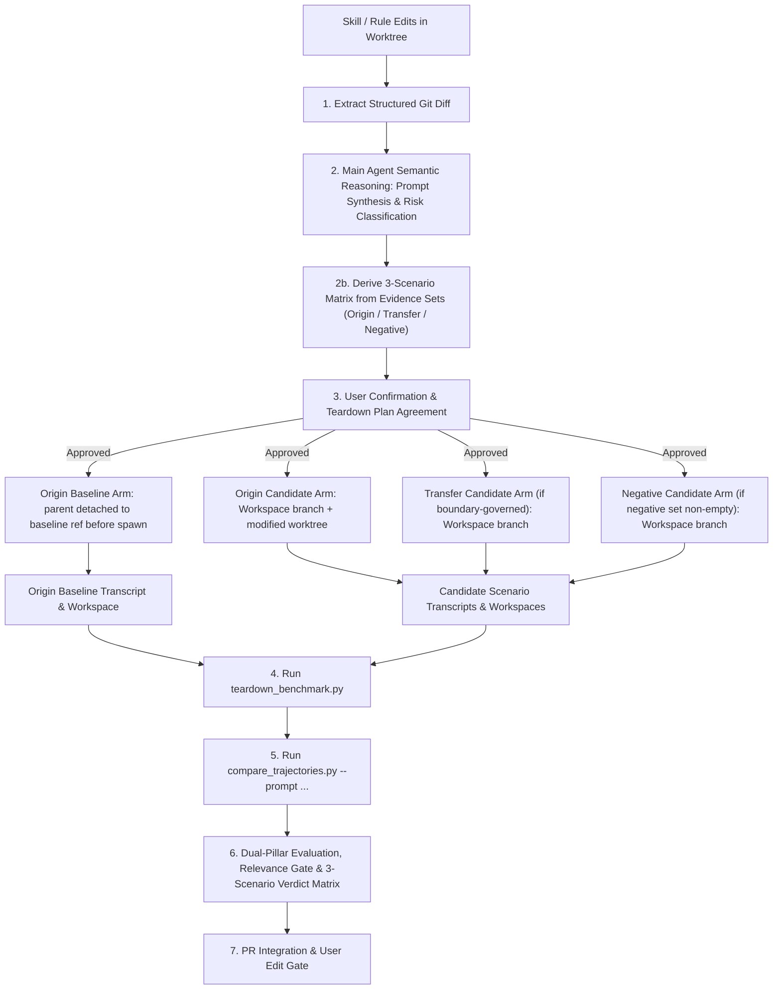

# Skill & Rule Trajectory Comparison Benchmark

This skill provides an automated A/B benchmark workflow to evaluate proposed changes to rules (`.agents/rules/`) or skills (`.agents/skills/`) before committing them. It spawns up to four concurrent worker subagent arms across clean baseline and modified candidate worktrees (`Origin Baseline`, `Origin Candidate`, `Held-out Transfer Candidate`, and `Negative Regression Candidate`), compares execution trajectories and scenario outcomes, and tears down any temporary external resources.



---

## 1. Trigger Criteria

Run this skill when:
- **Iterative Reflection Validation**: You have formulated candidate rule, skill, or tool additions via [XMC Iterative Reflection](../xmc_iterative_reflection/SKILL.md) and want empirical A/B verification before opening a Draft PR.
- **Rule or Skill Authoring**: You have modified or added a rule (`.agents/rules/*.md`) or skill definition (`.agents/skills/*/SKILL.md`) in your working tree and want to verify its efficacy before submitting a PR.
- **Pre-Commit Verification**: You want to test if a rule update prevents past friction without causing new regressions, hallucinated output, or excessive turn count bloat.

---

## 2. Execution Workflow

### Phase 1: Structured Diff Extraction & Agent Synthesis
Commit candidate edits to the candidate branch so child worktrees created by `Workspace: "branch"` (`git worktree add`) receive the committed state, then run `tools/benchmark/analyze_diff_and_synthesize.py` against `<baseline_ref>`:

```bash
python3 tools/benchmark/analyze_diff_and_synthesize.py --target-dir .agents --diff-spec <baseline_ref>
```

The main agent parses the resulting JSON payload (`changed_files`, `added_lines`, `removed_lines`, `category`) and performs semantic reasoning to:
1. **Understand Intent**: Analyze the specific guideline, constraint, or workflow step added or modified.
2. **Synthesize Scenario Prompt** (if not provided by user): Draft a realistic test prompt designed to test whether an agent complies with the new constraint vs. unconstrained behavior.
3. **Assess Side-Effect Risk Tier**:
   - **Tier 1 (Read-Only / Local)**: No external side effects (local code generation, analysis).
   - **Tier 2 (Reversible Remote Artifacts)**: Creates PRs, remote test branches, or draft comments.
   - **Tier 3 (Infrastructure / High-Cost)**: Provisions GKE clusters, GCP resources, or cloud deployments.

> [!WARNING]
> **Ask for the artifact, not the method.** Neither the scenario prompt nor its deliverable spec may
> describe the behaviour the candidate change prescribes. Asking both arms to *"list every file the
> rule should govern and every file it should not"* while the candidate adds positive/negative evidence
> sets makes both arms produce those sets on instruction — the benchmark then measures
> instruction-following, and the arms tie no matter what the rule does. Request the workflow's normal
> output, and let the grading step check whether the prescribed behaviour appeared **unprompted**.
> Reconstruct search and tool behaviour from the transcripts instead of asking arms to self-report it,
> since a request to log searches is itself a nudge to search more.

### Phase 1b: Derive the Scenario Matrix

A single scenario drawn from the incident that motivated the change grades the candidate on its own
training example. It can establish that the change works where it was written, and nothing else — it
is blind to a predicate that is too narrow to reach the rest of its class, and blind to one broad
enough to fire on code it should leave alone.

Run three scenarios instead. They are sourced from the evidence sets that
[Evidence-Based Boundary Derivation](../../rules/rule_authoring_standards.md#5-evidence-based-boundary-derivation)
has already produced, so this costs no additional analysis:

| Scenario | Drawn from | The candidate must… | A failure detects |
| :--- | :--- | :--- | :--- |
| **Origin** | the originating incident | remove the observed friction | the change is ineffective |
| **Held-out transfer** | positive set, excluding the origin | behave the same way on a *different* member | **under-generalization** |
| **Negative regression** | negative set | **not** fire, or exempt the file explicitly | **over-generalization** |

- **Four arms, not six.** Origin needs baseline *and* candidate, to establish both that the friction
  is real and that the change removes it. Transfer and negative are candidate-only: they are graded
  against pre-registered expectations, so a baseline arm would add cost without adding information.
- **Transfer is always available.** The two-positive minimum guarantees a held-out member exists.
  Negative regression is mandatory whenever the negative set is non-empty; an empty negative set on a
  non-trivial change is itself a finding worth surfacing, because a predicate that excludes nothing
  was never falsified.
- **Pre-register each pass predicate before launching.** State it as a mechanical assertion over the
  resulting worktree or transcript — *`examples/xdash_dashboard/create_dashboard_test.py` MUST
  exist* — never as a judgement call such as *"the agent should handle dashboards well"*. A predicate
  written after reading the transcripts will be fitted to them.

> [!NOTE]
> A finding routed to a rung that needs no boundary has no evidence sets to draw on, and benchmarks
> with the origin scenario alone. Record that explicitly in the report rather than leaving the two
> missing scenarios unexplained.

### Phase 2: Risk Tier & Teardown Agreement
If the task involves Tier 2 or Tier 3 side effects, present the teardown contract to the user before launching subagents:
> *"Benchmark will test updates to `XMC Create PR`. Side Effects: Will create 2 temporary test PRs titled `[BENCHMARK TEST]` on remote. Post-benchmark cleanup will execute `gh pr close <PR_URL> --delete-branch`. Proceed with benchmark? (Y/n)"*

### Phase 3: Concurrent Subagent Arm Execution (Up to 4 Arms)

> [!IMPORTANT]
> **A subagent's injected rules must match its own disk state.** `.agents/` content is injected into a
> subagent's system prompt at spawn time, sourced from the **parent** worktree. A `git reset` issued
> *inside* the subagent changes its disk but not its already-injected prompt, so a baseline arm spawned
> from a candidate parent silently receives a summary of the very change under test. Never rely on an
> in-subagent reset to produce a clean baseline.

1. **Origin Baseline Subagent (`1` arm)** — commit all candidate edits to the candidate branch first, then
   park the parent worktree on `<baseline_ref>` *before* spawning. Never stash or leave edits uncommitted:
   `Workspace: "branch"` runs `git worktree add`, which only checks out the **committed** `HEAD` into the
   child worktree (so stashed or unstaged edits would be absent from the Candidate arms), while
   `git switch --detach` carries dirty working-tree files into the Baseline arm.

   ```bash
   test -z "$(git status --porcelain)" || { echo "dirty tree: commit candidate edits first"; exit 1; }
   git switch --detach <baseline_ref>   # parent worktree now matches the baseline
   # → invoke_subagent for the Origin Baseline arm here, with Workspace: "branch"
   git switch -                         # restore candidate branch as soon as invoke_subagent returns
   ```

   - `Workspace`: `"branch"` — the arm's branch is cut from the detached parent, so it starts clean and needs no reset.
   - `Role`: `"Origin Baseline Subagent"`
   - `Prompt`: execute the `origin` scenario prompt. Do **not** instruct a reset or a Turn-1 `.agents/` self-check.
2. **Candidate Subagents (`up to 3` arms in a single `invoke_subagent` call)** — spawn after the parent is
   restored to the committed candidate branch, adhering strictly to context-aware execution bounds (do NOT
   run unrequested test suites for read-only or document summary prompts):
   - **`Origin Candidate Subagent`** (`Workspace: "branch"`): executes the `origin` scenario prompt (always required).
   - **`Held-Out Transfer Candidate Subagent`** (`Workspace: "branch"`): executes the `transfer` scenario prompt on the held-out positive-set member (required whenever boundary derivation applies).
   - **`Negative Regression Candidate Subagent`** (`Workspace: "branch"`): executes the `negative` scenario prompt on the negative-set member (required whenever the negative evidence set is non-empty).

**Orchestrator isolation verification (MUST).** The Baseline batch and Candidate batch are spawned seconds
apart and execute concurrently. Before trusting the results, verify from the orchestrator that every child
worktree sits at its intended ref (`git -C <origin_baseline_worktree> rev-parse HEAD` must match
`<baseline_ref>`, and `git -C <candidate_arm_worktree> rev-parse HEAD` across `origin`, `transfer`, and
`negative` candidate worktrees must match `<candidate_ref>`) and inspect transcripts post-hoc rather than
asking subagents to read `.agents/AGENTS.md` on Turn 1 (which only checks a single file and inflates
turn/token telemetry in `compare_trajectories.py`). Because LLM trajectories are autoregressive and
`compare_trajectories.py` evaluates whole-transcript metrics (`turns`, `est_tokens`), if contamination is
ever detected, discard and re-run the entire affected arm rather than salvaging individual criteria.

### Phase 4: Resource Teardown & Manifest Cleanup
After both subagents complete, run `tools/benchmark/teardown_benchmark.py` to clean up any registered PRs, branches, or temporary manifest items:

```bash
python3 tools/benchmark/teardown_benchmark.py --manifest /tmp/benchmark_manifest_<id>.json
```

### Phase 5: Dual-Pillar Evaluation & Relevance Gate

Write the pre-registered predicates from Phase 1b into an assertion spec — **before** the arms are
launched, so the verdict cannot be fitted to the transcripts afterwards. Each scenario names its
arm's worktree and the predicates that must hold within it:

```json
{
  "origin":   {"workspace": "/path/to/candidate/arm", "assertions": [
                 {"kind": "file_exists", "path": "examples/xdash_dashboard/create_dashboard_test.py"}]},
  "transfer": {"workspace": "/path/to/transfer/arm", "assertions": [
                 {"kind": "file_contains", "path": "pyproject.toml", "pattern": "^\\s*\"SLF001\""}]},
  "negative": {"workspace": "/path/to/negative/arm", "assertions": [
                 {"kind": "file_absent", "path": "examples/chart_artifact_job/training_metrics_test.py"}]}
}
```

Predicate kinds are `file_exists`, `file_absent`, `file_contains`, and `file_omits`; the latter two
take a `pattern` matched as a multiline regex. A scenario passes only when every one of its
assertions passes, and `origin` is mandatory.

Pass the `transcript.jsonl` log file paths from both origin arms to
`tools/benchmark/compare_trajectories.py`, along with the spec:

```bash
python3 tools/benchmark/compare_trajectories.py <baseline_transcript_path> <candidate_transcript_path> \
  --prompt "<test_prompt>" --assertions /tmp/benchmark_assertions.json -o /tmp/trajectory_report.md
```

With `--assertions`, the verdict matrix is derived mechanically and written into the report; without
it, the report carries a placeholder for the agent to fill in by judgement. The spec can also be
evaluated on its own, for instance while iterating on a predicate:

```bash
python3 tools/benchmark/scenario_assertions.py /tmp/benchmark_assertions.json
```

The main agent reviews the output and populates the scorecard using the **Prompt Relevance Gate**:

1. **Target Test Prompt & Context Footprint**: Include prompt text and context window byte/token percentage.
2. **Prompt Relevance Gate**: Ask: *"Were extra turns or tool executions (e.g. running unit tests, extra searches) directly relevant to fulfilling the test prompt?"*
   - **If Relevant** (e.g. prompt modified code): Count test execution as a benefit (`🟢 Candidate`).
   - **If Irrelevant** (e.g. prompt was a documentation summary): Flag extra turns as 🔴 **Unnecessary / Over-Zealous Overhead**, and mark Functional Correctness as `N/A (Irrelevant)`.
3. **Pillar 1: Trajectory Telemetry**: Evaluate turn deltas, tool usage, error steps, and provide qualitative LLM reasoning on metric increases.
4. **Pillar 2: Outcome Quality Evaluation**: Side-by-side output previews & LLM-as-a-Judge Scorecard (Rule adherence, functional correctness, completeness).
5. **🏆 Final Benchmark Verdict**: derive it from the three scenarios rather than from an overall
   impression. A `✅` means that scenario's **pre-registered** predicate held.

   | Origin | Transfer | Negative | Verdict |
   | :---: | :---: | :---: | :--- |
   | ✅ | ✅ | ✅ | **SHIP** |
   | ✅ | ✅ | — | **SHIP (NO NEGATIVE REGRESSION SCENARIO)** — when the negative set was empty, but transfer passed |
   | ✅ | — | — | **SHIP (ORIGIN ONLY - GENERALIZATION UNTESTED)** — when no boundary was needed (no evidence sets), or when transfer/negative was omitted |
   | ✅ | ✅ | ❌ | **OVER-GENERALIZED** — narrow the predicate, or add an explicit rung-6 exception for the negative member |
   | ✅ | ❌ | ✅ | **UNDER-GENERALIZED** — widen the predicate and re-derive the boundary |
   | ✅ | ❌ | — | **UNDER-GENERALIZED** — widen the predicate and re-derive the boundary (negative set was empty) |
   | ✅ | ❌ | ❌ | **WRONG PREDICATE** — return to boundary derivation; the scope is mis-shaped, not merely mis-sized |
   | ❌ | — | — | **REJECTED** — ineffective at the origin, or the finding was misrouted on the control ladder |

   Two qualifiers attach on top of the matrix:
   - **`SHIP WITH RESERVATIONS (NEEDS EFFICIENCY TUNING)`** when the candidate obeyed the change but
     ran tools irrelevant to the prompt, per the Relevance Gate above.
   - A verdict is **void for every criterion named by leaked text** under the Phase 3 contamination
     self-check, whatever the matrix says. Report the voided criteria instead of the verdict.

Save the benchmark markdown snippet to `/tmp/benchmark_report_<branch_name>.md`.

---

## Phase 6: PR Description Integration & User Edit Gate

After completing the Dual-Pillar report:

### Scenario A: PR Already Exists for Active Branch
1. Check if an open PR exists using `gh pr view --json number,url,body`.
2. If found, prepare `updated_pr_body.md` by appending/updating the `## 🧪 Trajectory & Outcome Benchmark Results` section in the PR description.
3. **User Edit Gate**: Present the updated PR body preview to the user and pause:
   > *"Existing PR #<number> detected. I have prepared the updated PR description in `updated_pr_body.md` with the new benchmark findings.*
   > 
   > *[Markdown Preview]*
   > 
   > *Feel free to edit `updated_pr_body.md` directly. Proceed with `./tools/pr_review/update_pr_description.py <number> --body-file updated_pr_body.md`? (Y/n)"*
4. Upon confirmation, execute `./tools/pr_review/update_pr_description.py <number> --body-file updated_pr_body.md`.

### Scenario B: No PR Created Yet
1. Save the benchmark artifact to `/tmp/benchmark_report_<branch_name>.md`.
2. When the user subsequently runs [XMC Create PR](../xmc_create_pr/SKILL.md), it will auto-detect the file, embed the benchmark block into `pr_body.md`, and present the draft to the user for confirmation/edits before opening the PR.
