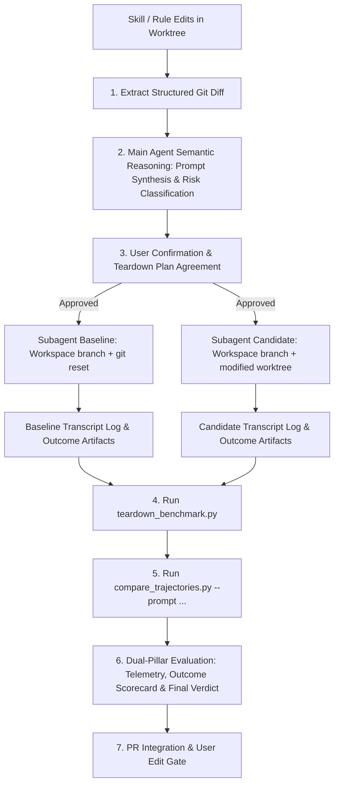

# Skill & Rule Trajectory Comparison Benchmark

This skill provides an automated A/B benchmark workflow to evaluate proposed changes to rules (`.agents/rules/`) or skills (`.agents/skills/`) before committing them. It spawns dual worker subagents to execute a test prompt concurrently across both a clean baseline copy and your modified candidate worktree, compares execution trajectories and output quality, and tears down any temporary external resources.



---

## 1. Trigger Criteria

Run this skill when:
- **Rule or Skill Authoring**: You have modified or added a rule (`.agents/rules/*.md`) or skill definition (`.agents/skills/*/SKILL.md`) in your working tree and want to verify its efficacy before submitting a PR.
- **Pre-Commit Verification**: You want to test if a rule update prevents past friction without causing new regressions, hallucinated output, or excessive turn count bloat.

---

## 2. Execution Workflow

### Phase 1: Structured Diff Extraction & Agent Synthesis
Run `tools/analyze_diff_and_synthesize.py` to extract structured git diff data:

```bash
python3 tools/analyze_diff_and_synthesize.py --target-dir .agents
```

The main agent parses the resulting JSON payload (`changed_files`, `added_lines`, `removed_lines`, `category`) and performs semantic reasoning to:
1. **Understand Intent**: Analyze the specific guideline, constraint, or workflow step added or modified.
2. **Synthesize Scenario Prompt** (if not provided by user): Draft a realistic test prompt designed to test whether an agent complies with the new constraint vs. unconstrained behavior.
3. **Assess Side-Effect Risk Tier**:
   - **Tier 1 (Read-Only / Local)**: No external side effects (local code generation, analysis).
   - **Tier 2 (Reversible Remote Artifacts)**: Creates PRs, remote test branches, or draft comments.
   - **Tier 3 (Infrastructure / High-Cost)**: Provisions GKE clusters, GCP resources, or cloud deployments.

### Phase 2: Risk Tier & Teardown Agreement
If the task involves Tier 2 or Tier 3 side effects, present the teardown contract to the user before launching subagents:
> *"Benchmark will test updates to `XMC Create PR`. Side Effects: Will create 2 temporary test PRs titled `[BENCHMARK TEST]` on remote. Post-benchmark cleanup will execute `gh pr close <PR_URL> --delete-branch`. Proceed with benchmark? (Y/n)"*

### Phase 3: Dual Concurrent Subagent Execution
Invoke two worker subagents concurrently via `invoke_subagent`:

1. **Baseline Subagent**:
   - `Workspace`: `"branch"`
   - `Role`: `"Baseline Subagent"`
   - `Prompt`: Run `git reset --hard HEAD` (or base branch checkout) as the first command to restore clean rules/skills, then execute the target test prompt.
2. **Candidate Subagent**:
   - `Workspace`: `"branch"`
   - `Role`: `"Candidate Subagent"`
   - `Prompt`: Execute the target test prompt directly within the modified worktree context.

### Phase 4: Resource Teardown & Manifest Cleanup
After both subagents complete, run `tools/teardown_benchmark.py` to clean up any registered PRs, branches, or temporary manifest items:

```bash
python3 tools/teardown_benchmark.py --manifest /tmp/benchmark_manifest_<id>.json
```

### Phase 5: Dual-Pillar Evaluation & Scorecard Generation
Pass the `transcript.jsonl` log file paths from both subagents to `tools/compare_trajectories.py`:

```bash
python3 tools/compare_trajectories.py <baseline_transcript_path> <candidate_transcript_path> --prompt "<test_prompt>" -o /tmp/trajectory_report.md
```

The main agent reviews the output and populates all 4 core scorecard sections:
1. **Target Test Prompt**: State the exact prompt scenario evaluated.
2. **Context & Token Footprint**: Report transcript byte size, estimated tokens, and context window footprint percentage.
3. **Pillar 1: Trajectory Telemetry**: Evaluate turn deltas, tool usage, error steps, and provide qualitative LLM reasoning on metric increases.
4. **Pillar 2: Outcome Quality Evaluation**: Side-by-side output previews & LLM-as-a-Judge Scorecard (Rule adherence, functional correctness, completeness).
5. **🏆 Final Benchmark Verdict**: Provide a clear recommendation (`PASSED`, `NEEDS REVIEW`, or `REJECTED`).

Save the benchmark markdown snippet to `/tmp/benchmark_report_<branch_name>.md`.

---

## Phase 6: PR Description Integration & User Edit Gate

After completing the Dual-Pillar report:

### Scenario A: PR Already Exists for Active Branch
1. Check if an open PR exists using `gh pr view --json number,url,body`.
2. If found, prepare `updated_pr_body.md` by appending/updating the `## 🧪 Trajectory & Outcome Benchmark Results` section in the PR description.
3. **User Edit Gate**: Present the updated PR body preview to the user and pause:
   > *"Existing PR #<number> detected. I have prepared the updated PR description in `updated_pr_body.md` with the new benchmark findings.*
   > 
   > *[Markdown Preview]*
   > 
   > *Feel free to edit `updated_pr_body.md` directly. Proceed with `./tools/update_pr_description.py <number> --body-file updated_pr_body.md`? (Y/n)"*
4. Upon confirmation, execute `./tools/update_pr_description.py <number> --body-file updated_pr_body.md`.

### Scenario B: No PR Created Yet
1. Save the benchmark artifact to `/tmp/benchmark_report_<branch_name>.md`.
2. When the user subsequently runs [XMC Create PR](../xmc_create_pr/SKILL.md), it will auto-detect the file, embed the benchmark block into `pr_body.md`, and present the draft to the user for confirmation/edits before opening the PR.
