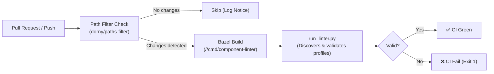

# Run Component Manifest Linter Action (`run-component-linter`)

A composite GitHub Action that executes offline static analysis and pre-flight validation on Component CRD manifests and profile compatibility rules before pull requests are merged.

---

## 1. Overview

This action coordinates Bazel compilation of the [`component-linter`](../../../cmd/component-linter/README.md) CLI binary and executes the repository-wide discovery runner [`tools/components/run_linter.py`](../../../tools/components/README.md) across all configured component profile directories.



---

## 2. Inputs

| Input | Required | Default | Description |
| :--- | :---: | :--- | :--- |
| `scan-roots` | No | `deploy/profiles deploy/components examples/components/profiles` | Space-separated list of root directories to scan for component profiles. |
| `output-format` | No | `text` | Output format: `text` (console summary) or `json` (machine-readable diagnostics). |
| `strict` | No | `false` | When `true`, fails if no component profile targets are found across the scan roots. |

---

## 3. Key Features

- **Selective Execution (Path Filtering)**: Only triggers when relevant paths change (`deploy/profiles/**`, `deploy/components/**`, `examples/components/**`, `api/protos/components/**`, `pkg/components/**`, `cmd/component-linter/**`, `tools/components/**`, `.github/actions/run-component-linter/**`, `.github/workflows/lint.yml`).
- **Bazel Repository Caching**: Caches external Go and Bazel dependencies under `~/.cache/bazel-repo` for fast turnaround times.
- **Fail-Fast Binary Resolution**: Uses `bazel cquery --config=ci` to resolve the executable linter output file directly, avoiding `bazel run` overhead during multi-target scanning.

---

## 4. Workflow Usage Example

Integrated into [`.github/workflows/lint.yml`](../../workflows/lint.yml) (`Code Quality & Linting`):

```yaml
      - name: 'Check Changed Paths'
        uses: 'dorny/paths-filter@v3'
        id: 'changes'
        with:
          filters: |
            components:
              - 'deploy/profiles/**'
              - 'deploy/components/**'
              - 'examples/components/**'
              - 'cmd/component-linter/**'
              - 'tools/components/**'

      - name: 'Run Component Manifest Linter'
        if: steps.changes.outputs.components == 'true'
        uses: './.github/actions/run-component-linter'
```
