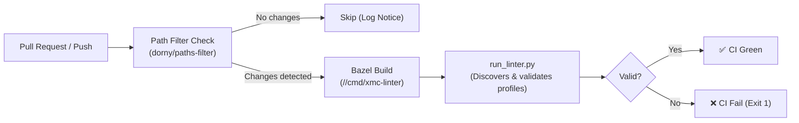

# Run XMC Component Manifest Linter Action (`run-xmc-linter`)

A composite GitHub Action that executes offline static analysis and pre-flight validation on XMC Component CRD manifests and profile compatibility rules before pull requests are merged.

---

## 1. Overview

This action coordinates Bazel compilation of the [`xmc-linter`](../../../cmd/xmc-linter/README.md) CLI binary and executes the repository-wide discovery runner [`tools/components/run_linter.py`](../../../tools/components/README.md) across all configured component profile directories.



---

## 2. Inputs

| Input | Required | Default | Description |
| :--- | :---: | :--- | :--- |
| `scan-roots` | No | `deploy/profiles deploy/components examples/components/profiles` | Space-separated list of root directories to scan for component profiles. |
| `output-format` | No | `text` | Output format: `text` (console summary) or `json` (machine-readable diagnostics). |
| `strict` | No | `false` | When `true`, fails if no component profile targets are found across the scan roots. |

---

## 3. Key Features

- **Selective Execution (Path Filtering)**: Only triggers when relevant paths change (`deploy/profiles/**`, `deploy/components/**`, `examples/components/**`, `api/protos/components/**`, `pkg/components/**`, `cmd/xmc-linter/**`, `tools/components/**`, `.github/actions/run-xmc-linter/**`, `.github/workflows/xmc-lint.yml`).
- **Bazel Repository Caching**: Caches external Go and Bazel dependencies under `~/.cache/bazel-repo` for fast turnaround times.
- **Fail-Fast Binary Resolution**: Uses `bazel cquery --config=ci` to resolve the executable linter output file directly, avoiding `bazel run` overhead during multi-target scanning.

---

## 4. Workflow Usage Example

Refer to [`.github/workflows/xmc-lint.yml`](../../workflows/xmc-lint.yml):

```yaml
name: XMC Component Profiles Linting

on:
  pull_request:
    branches: [main]
  push:
    branches: [main]

jobs:
  lint-components:
    name: Run Component Profiles Linter
    runs-on: ubuntu-latest
    steps:
      - name: Checkout Code
        uses: actions/checkout@v4

      - name: Run Component Manifest Linter
        uses: ./.github/actions/run-xmc-linter
        with:
          strict: 'true'
```
