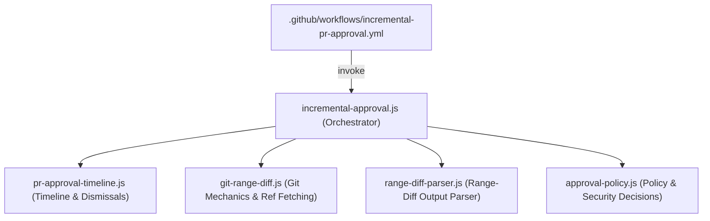
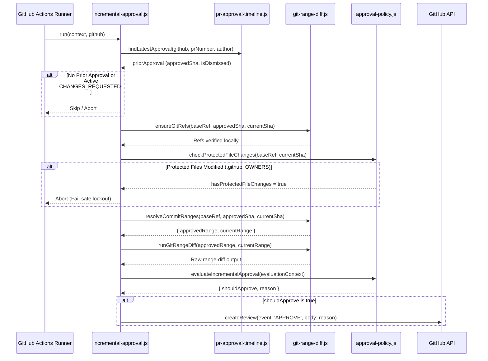

# Incremental PR Approval System

This directory contains the core domain modules and test suites powering the **Incremental PR Approval** workflow in GitHub Actions CI.

---

## 1. Overview & Problem Statement

In repositories with branch protection rules requiring code reviews, GitHub enables:
> *"Dismiss stale pull request approvals when new commits are pushed"*

While essential for security, this policy introduces substantial review fatigue:
- A developer rebases a PR onto `main` to resolve merge conflicts without modifying PR code.
- A developer addresses minor review feedback (e.g., a 2-line typo fix, formatting tweak, or comment clarification).
- Stale dismissal cancels the prior approval, blocking merging until a human reviewer re-inspects and re-approves the PR.

The **Incremental PR Approval** system automates safe re-approval by analyzing the Git range-diff and GitHub timeline events. When changes satisfy strict safety, ownership, and semantic equivalence invariants, `github-actions[bot]` automatically re-approves the pull request.

---

## 2. Architecture & Modular Breakdown

The system is decomposed into focused single-responsibility modules:



### Module Responsibilities

| Module | Primary Responsibility |
| :--- | :--- |
| [`incremental-approval.js`](incremental-approval.js) | **Orchestrator**: Entry point invoked by GitHub Actions. Validates PR context, coordinates timeline querying, Git range-diff calculation, policy evaluation, and submits the GitHub review. Re-exports all public symbols for backwards compatibility. |
| [`pr-approval-timeline.js`](pr-approval-timeline.js) | **Timeline State Machine**: Fetches PR timeline events via GraphQL (with REST fallback). Disambiguates automatic stale-push dismissals from manual human dismissals. Enforces that active `CHANGES_REQUESTED` reviews always block auto-approval. |
| [`git-range-diff.js`](git-range-diff.js) | **Git Subprocess Mechanics**: Proactively fetches missing Git refs (`ensureGitRefs`), detects fast-forward ancestry, computes line deltas, indexes candidate commits using `git patch-id` and commit subjects, and resolves commit ranges for stacked PRs. |
| [`range-diff-parser.js`](range-diff-parser.js) | **Diff Parser**: Parses raw `git range-diff` output. Distinguishes code hunks from commit metadata/commit message hunks, computes added/deleted line deltas, and extracts added commit SHAs. |
| [`approval-policy.js`](approval-policy.js) | **Decision Engine**: Evaluates whether a PR qualify for auto-reapproval (clean rebase vs code owner grace delta). Enforces protected file boundaries, handles absence PR auto-approvals, and manages reviewer assignment logic. |

---

## 3. Approval Qualification Workflow

When a PR receives a push event (`pull_request.synchronize`), the orchestrator executes the following pipeline:



---

## 4. Stacked PRs & Git Patch-ID Correlation

### The Challenge with Stacked PRs
In stacked PR workflows (e.g. PR Layer 2 branched off PR Layer 1):
1. PR Layer 1 gets rebased or amended.
2. PR Layer 2 is rebased onto the new Layer 1 HEAD.
3. Standard `git range-diff origin/${baseRef}..${approvedSha} origin/${baseRef}..${currentSha}` fails because the base branch history was rewritten: previous commits in the base branch have different commit SHAs, causing `git range-diff` to report massive, false-positive deltas.

### The Correlation Mechanism
To handle rebased parent branches seamlessly:
1. **Candidate Indexing**: [`indexApprovedCandidateCommits`](git-range-diff.js) inspects commits in the approved range (capped at the last 30 commits to prevent CI subprocess timeouts) and indexes chronological arrays of candidate SHAs per subject.
2. **Bulk Patch-ID & Subject Fingerprinting**: Computes `git patch-id` values in bulk via `git log -p --no-walk ...shas | git patch-id` to minimize subprocess overhead.
3. **Ancestor Correlation**: [`correlateStackedParentBase`](git-range-diff.js) matches commits between the approved and current branch histories using exact patch-ids and chronological duplicate-safe commit subjects.
4. **Range Scoping**: [`resolveStackedApprovedRange`](git-range-diff.js) dynamically scopes the comparison base to the correlated ancestor, isolating the PR's true changes from parent rebase noise.

---

## 5. Security Invariants & Fail-Safes

The incremental approval system enforces defense-in-depth safety invariants:

### 1. Protected Files Lockout
Any modification touching protected configuration files immediately aborts auto-reapproval:
- `.github/**` (workflows, actions, scripts)
- `OWNERS` / `*/OWNERS`
- Target base branch configuration files

Scoping uses 3-dot diff against the PR's target base branch (`git diff --name-only origin/${baseRef}...${currentSha}`) to prevent false positives when intermediate commits are merged into `origin/main`. If Git commands fail, the check defaults to `hasProtectedFileChanges = true` (fail-safe).

### 2. Tiered Approval Policy
- **Clean Rebase (0 line delta)**: Approved for all authors if code hunks have zero additions and deletions across the rebase.
- **Grace Delta (&le; 10 lines)**: Permitted **only** if the PR author is a designated repository code owner (listed in `OWNERS`). Non-code-owners are strictly limited to clean rebases.
- **Added Commits**: If follow-up commits were appended, each commit is individually inspected for protected file modifications, and line deltas are accumulated into the grace budget.

### 3. Dismissal Integrity (Human vs Bot)
- **Manual Dismissal**: If a human reviewer dismisses an approval or requests changes (`CHANGES_REQUESTED`), the system **never** overrides the human decision.
- **Stale Push Dismissal**: Only reviews dismissed automatically by GitHub on `synchronize` (identified via timeline `ReviewDismissedEvent` with an associated push commit and no human dismissal reason) are eligible for auto-reapproval.
- **No Bot Self-Approvals**: Reviews from `github-actions[bot]` or bot accounts are ignored to prevent recursive self-approval loops.

### 4. Subprocess Isolation & Safety
- All Git operations use `execFileSync` passing arguments as discrete array elements (preventing shell injection).
- Timeouts are strictly enforced via `GIT_EXEC_TIMEOUT_MS` (60 seconds).
- Candidate iterations are capped (`candidates.slice(-30)`) to ensure bounded execution time.
- All helpers explicitly normalize options (`ignoreExitCode: false`) to avoid polymorphic return type mismatches.

---

## 6. Architecture & Tooling Boundaries

It is important to distinguish `.github/scripts/` from the Python tooling in `tools/`:

| Dimension | `.github/scripts/` | `tools/pr_review/` |
| :--- | :--- | :--- |
| **Runtime Environment** | GitHub Actions CI Runner (Node.js) | Developer Workstation / Agent Workspace (Python 3.13+) |
| **Role** | **CI Gatekeeper**: Autonomous decision engine for PR re-approval. | **Developer / Agent Assistant**: Interactive review checklist, inline comment posting, thread replies. |
| **API Focus** | Review state machine, timeline dismissal parsing, `createReview`. | Comment threads, inline diff comments, review checklist verification, PR description editing. |

---

## 7. Local Testing & Verification

The test suite utilizes Node.js built-in test runner (`node:test`) and assertion library (`node:assert`), requiring no third-party dependencies or installations:

```bash
# Run all script tests
node --test .github/scripts/*.test.js

# Run a specific module test suite
node --test .github/scripts/git-range-diff.test.js
node --test .github/scripts/pr-approval-timeline.test.js
node --test .github/scripts/approval-policy.test.js
node --test .github/scripts/range-diff-parser.test.js
node --test .github/scripts/incremental-approval.test.js
```

### Test Standards
- **High-Fidelity Doubles**: Git subprocess and GitHub API mocks accurately emulate exit codes, stdio structures, and GraphQL schema responses.
- **Adversarial Edge Cases**: Test suites cover malformed inputs, unreachable commits, shallow clones, root commits, empty diffs, and unicode/whitespace variations.
