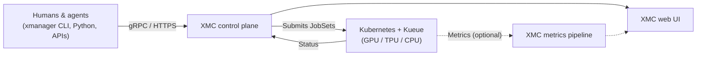

# XManager on Cloud (XMC)

[](LICENSE)

XManager on Cloud (XMC) serves as a central command platform for both human researchers and autonomous agents building AI. Built on the experiment model of Google DeepMind's battle-tested XManager, XMC is designed to operate at scale to boost research velocity across AI labs and enterprise organizations.

## Key capabilities

| Capability | What XMC provides |
| :--- | :--- |
| **Workload execution & agent integration** | Reliable workload launching alongside first-class agent interaction capabilities. |
| **Persistent experiment storage** | High-performance, persistent storage for experiment metadata and research artifacts. |
| **Resource visibility & scheduling** | Out-of-the-box visibility into TPU and GPU availability and scheduling states, with full compatibility and configurable support for Kueue. |
| **Kubernetes-native deployment** | Built on standard Kubernetes primitives (Kueue, JobSet). GKE is the supported, documented target; other Kubernetes environments (other clouds, on-premises) are possible with additional configuration. |
| **Metrics & profiling (optional)** | Training metric streaming with charts and dashboards, and Managed XProf hardware profiles attached to work units. Both are off by default. |

> [!NOTE]
> XMC spans two repositories. This repository holds the XMC services, SDKs, and deployment charts. The Python launcher and `xmanager` CLI that define and submit experiments live in [google-deepmind/xmanager](https://github.com/google-deepmind/xmanager) (see [Getting started](#getting-started) for installation).

## How it works



XMC organizes work around three concepts:

| Concept | What it represents |
| :--- | :--- |
| **Experiment** (`xid`) | A group of related runs, such as a sweep, an ablation, or an RL campaign, with shared priority, metadata, and access control. |
| **WorkUnit** (`wid`) | One trial or training job inside an experiment. Restarting a work unit creates a new execution and keeps earlier attempts in history. |
| **Artifact** (`aid`) | A typed output or link attached to an experiment or work unit: URLs (such as TensorBoard or checkpoint locations), code snapshots, text notes, metric charts, or Managed XProf profiles. |

The [Architecture Overview](docs/architecture/overview.md) and [Execution Model](docs/architecture/execution_model.md) cover the services, the execution lifecycle, and how XMC maps work units to Kueue and JobSet.

## Getting started

You can deploy XMC to GKE or evaluate it locally on KinD in three steps:

1. **Stand up an XMC environment**
   - For GKE deployments, provision a stack with Cluster Toolkit v2 or Terraform and Helm using the [Installation & Deployment Guide](INSTALL.md).
   - For local evaluation, boot a KinD control plane with `python3 tools/dev_env/dev_env.py up` (requires a GCP project for Cloud Spanner, `gcloud`, and `bazel`; see [Local & Hybrid Development](tools/dev_env/README.md)).
2. **Install the XManager launcher and sign in**
   The launcher and `xmanager` CLI come from [google-deepmind/xmanager](https://github.com/google-deepmind/xmanager), published on PyPI:
   ```bash
   pip install 'xmanager>=0.8.5.post1'
   export XMC_DOMAIN=<your-xmc-domain>
   xmanager login
   ```
   When working from a clone of this repository with local protobuf changes or `xdash`, run `python3 deploy/cli/install_xmanager.py` instead (see [CLI Setup](deploy/cli/README.md)).
3. **Run an example workload**
   Launch a multi-WorkUnit job from one of the ready-to-run templates in [`examples/`](examples/):
   - [`examples/simple_job`](examples/simple_job/README.md): multi-WorkUnit CPU/GPU sweep on a Kueue `LocalQueue`.
   - [`examples/multipod_job`](examples/multipod_job/README.md) and [`examples/pathways_job`](examples/pathways_job/README.md): distributed multi-node and Pathways workloads.
   - [`examples/metrics_dashboard_job`](examples/metrics_dashboard_job/README.md) and [`examples/xdash_dashboard`](examples/xdash_dashboard/README.md): live metric streaming and programmatic dashboards.
   - [`examples/managed_xprof_artifact_job`](examples/managed_xprof_artifact_job/README.md): Managed XProf hardware profiling attached to a work unit.
   - [`examples/xmc_lite_job`](examples/xmc_lite_job/README.md): standalone `xm_local.Kubernetes` launch without the XMC server.

Metrics streaming and Managed XProf are optional and off by default. Enable metrics with `enable_metrics` and the Redpanda and ClickHouse add-ons in `deploy/addons/metrics`, and Managed XProf with `managed_xprof_gcs_bucket` (see the [Cluster Toolkit v2 README](deploy/ctk_v2/README.md); Helm installs use `metrics.enabled` and `managedXprofGcsBucket`).

## Documentation

### Operations and usage
- [XManager launcher (`google-deepmind/xmanager`)](https://github.com/google-deepmind/xmanager): Python launch API and `xmanager` CLI that define and submit experiments to XMC.
- [Installation & Deployment Guide](INSTALL.md): Cluster Toolkit v2 blueprints, Terraform and Helm setup, DNS and TLS configuration, upgrades, and the [Component Migration Runbook](docs/migrations/components.md).
- [Authentication & Experiment Access](docs/authentication.md): interactive `xmanager login`, CI service accounts, and experiment ACL sharing.
- [Python Metrics SDK (`xmc`)](sdks/python/xmc/README.md) and [Dashboard SDK (`xdash`)](sdks/python/xdash/README.md): in-job metric logging and dashboard definitions.

### Architecture
- [Architecture Overview](docs/architecture/overview.md): control, execution, telemetry, and component planes, followed by [Component Reference](docs/architecture/components.md), [Execution Model](docs/architecture/execution_model.md), and [Use Cases](docs/architecture/use_cases.md).
- [Main Flows](docs/flows/README.md): sequence walkthroughs for [experiment lifecycle](docs/flows/experiment_lifecycle.md), [work unit actuation](docs/flows/work_unit_lifecycle.md), [reconciliation](docs/flows/reconciliation.md), and [metrics & observability](docs/flows/metrics_and_observability.md).
- [Deployment Topologies](docs/design/topologies.md) and [Gateway Routing Design](docs/design/gateway.md): Cluster Toolkit Blueprint v1 vs v2 layouts, Kubernetes Gateway API routing, OAuth2 session handling, and identity mappings.

### Contributing
- [Contributing Guide](CONTRIBUTING.md): Google CLA requirements, issue templates, and pull request workflow.
- [Local & Hybrid Development](tools/dev_env/README.md): KinD inner loop (`dev_env up`, `dev_env reload`) and hybrid `--remote-k8s` execution.
- [Developer Guide](docs/developer.md), [E2E & UI Testing](tools/nightly_tests/README.md), and [Agent Workflows](docs/agent_workflows.md).
- [CI Runner Infrastructure & Bazel Caching Guide](docs/ci_runner_infrastructure.md): self-hosted GitHub Actions Runner Controller (ARC) runners on GKE, in-cluster Bazel remote cache, and runner migration playbooks.
- Automation scripts under `./tools` and `./deploy` require Python 3.13.14 or newer:
  ```bash
  python3 ./tools/common/setup_venv.py --venv-dir ./tools/venv --requirements ./tools/common/requirements.txt
  ```

## Contact and support

- For questions about XMC, deployment guidance, or [Google Cloud Managed Training Clusters](https://docs.cloud.google.com/gemini-enterprise-agent-platform/machine-learning/training/training-clusters/overview), email [xmanager_cloud@google.com](mailto:xmanager_cloud@google.com) or reach out to your Google Cloud account team.
- File bug reports and feature requests in [GitHub Issues](https://github.com/google/xmc/issues). Self-hosted deployments receive best-effort support without contractual SLAs; for a managed offering with contractual SLAs, see [Google Cloud Managed Training Clusters](https://docs.cloud.google.com/gemini-enterprise-agent-platform/machine-learning/training/training-clusters/overview).
- Report security vulnerabilities privately through [g.co/vulnz](https://g.co/vulnz) rather than in public issues.
- Released under the [Apache 2.0 License](LICENSE).
