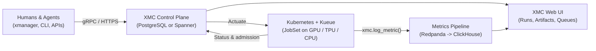

# XManager on Cloud (XMC)

[](LICENSE)

XManager on Cloud (XMC) serves as a central command platform for both human researchers and autonomous agents building AI. Built on Google DeepMind's battle-tested XManager platform, XMC is designed to operate at scale to boost research velocity across AI labs and enterprise organizations.

## Key capabilities

| Capability | What XMC provides |
| :--- | :--- |
| **Workload execution & agent integration** | Reliable workload launching alongside first-class agent interaction capabilities. |
| **Persistent experiment storage** | High-performance, persistent storage for experiment metadata and research artifacts. |
| **Resource visibility & scheduling** | Out-of-the-box visibility into TPU and GPU availability and scheduling states, with full compatibility and configurable support for Kueue. |
| **Multi-cloud & hybrid deployment** | Built natively for Kubernetes, enabling deployment across multi-cloud environments and on-premise clusters. |

## Core components

| Component | Role |
| :--- | :--- |
| **Experiment State Server & XID Service** | Manages shared experiment records and handles access control. |
| **Actuator & Reconciler** | Orchestrates Kubernetes execution and maintains continuous state synchronization. |
| **Ingestion Gateway & Dashboard Service** | Streams metrics and visualizes charts using the `xmc` and `xdash` SDKs. |
| **Web UI & Observability Dashboard** | Includes the Resource Observability Dashboard for real-time tracking. |
| **Component Manager & Agent Skills** | Hosts a catalog of third-party operators and powers specialized skills for autonomous agents. |
| **Workload Launcher** | Acts as an integral client component (currently hosted in a separate [DeepMind repository](https://github.com/google-deepmind/xmanager)). |

Setup is straightforward for both human users and automated agents. It supports deployment on existing clusters as well as alongside new cluster provisioning via Cluster Toolkit integration.

XMC delivers superior accessibility and usability by leveraging Google technology to streamline model development, including advanced hardware profiling tools such as XProf.

> [!NOTE]
> XMC spans two repositories. This repository holds the XMC services, SDKs, and deployment charts. The Python launcher and `xmanager` CLI that define and submit experiments live in [google-deepmind/xmanager](https://github.com/google-deepmind/xmanager) and install with `pip install xmanager`.

## What XMC does



XMC organizes machine learning workloads around four nested resources plus typed artifacts:

| Resource | ID | What it represents |
| :--- | :--- | :--- |
| **Experiment** | `xid` | A user-owned group of related runs (such as a pre-training sweep, ablation, or RL campaign) with shared priority, metadata, and access control. |
| **WorkUnit** | `wid` | One logical trial, training run, or RL job inside an experiment. Humans and agents start, stop, and restart work units. |
| **WorkUnitExecution** | `eid` | One concrete attempt at running a work unit. Stopping or restarting a work unit creates a new execution while keeping prior attempts in history. |
| **JobSet** | K8s object | The single non-restarting Kubernetes `JobSet` admitted by `Kueue` that runs one execution on GPU, TPU, or CPU nodes. |
| **Artifact** | `aid` | A typed output or link attached to an experiment or work unit: checkpoints, datasets, TensorBoard URLs, or Managed XProf profiles. |

When a researcher or agent runs an experiment on XMC, four steps happen end to end:

1. **Submit sweeps in milliseconds**: A Python launch script or agent creates an Experiment (`xid`) and registers one or hundreds of Work Units (`wid`). XMC writes the definitions to PostgreSQL or Spanner and returns right away while the cluster drains the queue asynchronously.
2. **Schedule on Kueue without overwriting history**: The Actuator turns each Work Unit into a `JobSet` in the target `Kueue` `LocalQueue` with its requested accelerators and priority class. Completed work is never silently re-executed, and every restart records a separate `WorkUnitExecution` (`eid`) alongside Kueue admission and pod failure messages.
3. **Stream training metrics without stalling steps**: Inside training containers, the [`xmc` Python SDK](sdks/python/xmc/README.md) (including Keras and PyTorch Lightning autologging) buffers scalars in memory and flushes batches in the background through Redpanda into ClickHouse. Teams compare downsampled loss and reward curves across runs in the web UI or build dashboards as code with [`xdash`](sdks/python/xdash/README.md).
4. **Monitor runs, profiles, and cluster queues in one place**: Humans inspect hyperparameter tables in the web UI and agents query run state over APIs, jump directly to attached checkpoints and Managed XProf profiles, share experiments through ACLs, and check live GPU/TPU quota usage in the Resource Observability Dashboard.

## System boundaries

XMC sits above Kubernetes batch scheduling rather than replacing your cluster scheduler:

| Layer | Components | Responsibility |
| :--- | :--- | :--- |
| **Client, SDKs & agents** | [`xmanager`](https://github.com/google-deepmind/xmanager) launcher and CLI (separate repository), [`xmc`](sdks/python/xmc/README.md), [`xdash`](sdks/python/xdash/README.md), [Agent Skills](docs/agent_workflows.md) | Package and launch experiments from Python or agents, emit training metrics from pods, and define dashboards as code. |
| **Control plane & UI** | Experiment State Server, XID Service, Dashboard Service, Health Service, Web UI | Persist experiments, work units, artifacts, and ACLs; serve gRPC/HTTP APIs and the Angular web console. |
| **Execution & telemetry** | Actuator, Reconciler, Ingestion Gateway, Log Monitor, Component Manager | Create `JobSet` workloads, sync Kueue and pod states back to storage, ingest metrics into ClickHouse, and track third-party components. |
| **Kubernetes cluster** | Multi-cloud or on-prem Kubernetes, `Kueue`, `JobSet` | Enforce GPU/TPU/CPU quotas, gang-schedule multi-pod slices, handle preemption, and run containers. |

## Getting started

You can deploy XMC to a Kubernetes cluster or evaluate it locally on KinD in three steps:

1. **Stand up an XMC environment**
   - For cloud or on-prem Kubernetes deployments, provision a stack with Helm, Terraform, or Cluster Toolkit v2 using the [Installation & Deployment Guide](INSTALL.md).
   - For local evaluation, boot a KinD control plane with `python3 tools/dev_env/dev_env.py up` (see [Local & Hybrid Development](tools/dev_env/README.md)).
2. **Install the XManager launcher and sign in**
   The launcher and `xmanager` CLI come from [google-deepmind/xmanager](https://github.com/google-deepmind/xmanager), published on PyPI:
   ```bash
   pip install xmanager
   xmanager login
   ```
   When working from a clone of this repository with local protobuf changes or `xdash`, run `python3 deploy/cli/install_xmanager.py` instead (see [CLI Setup](deploy/cli/README.md)).
3. **Run an example workload**
   Launch a multi-WorkUnit job from [`examples/`](examples/), which includes 15 ready-to-run templates:
   - [`examples/simple_job`](examples/simple_job/README.md): multi-WorkUnit CPU/GPU sweep on a Kueue `LocalQueue`.
   - [`examples/multipod_job`](examples/multipod_job/README.md) and [`examples/pathways_job`](examples/pathways_job/README.md): distributed multi-node and Pathways workloads.
   - [`examples/metrics_dashboard_job`](examples/metrics_dashboard_job/README.md) and [`examples/xdash_dashboard`](examples/xdash_dashboard/README.md): live metric streaming and programmatic dashboards.
   - [`examples/managed_xprof_artifact_job`](examples/managed_xprof_artifact_job/README.md): Managed XProf hardware profiling attached to a Work Unit.
   - [`examples/xmc_lite_job`](examples/xmc_lite_job/README.md): standalone `xm_local.Kubernetes` launch without the XMC server.

## Documentation

### Operations and usage
- [XManager launcher (`google-deepmind/xmanager`)](https://github.com/google-deepmind/xmanager): Python launch API and `xmanager` CLI that define and submit experiments to XMC.
- [Installation & Deployment Guide](INSTALL.md): Cluster Toolkit v2 blueprints, Terraform and Helm setup, DNS and TLS configuration, and upgrades.
- [Authentication & Experiment Access](docs/authentication.md): interactive `xmanager login`, CI service accounts, and experiment ACL sharing.
- [Python Metrics SDK (`xmc`)](sdks/python/xmc/README.md) and [Dashboard SDK (`xdash`)](sdks/python/xdash/README.md): in-job metric logging and dashboard definitions.

### Architecture
- [Architecture Overview](docs/architecture/overview.md): control, execution, telemetry, and component planes, followed by [Component Reference](docs/architecture/components.md), [Execution Model](docs/architecture/execution_model.md), and [Use Cases](docs/architecture/use_cases.md).
- [Main Flows](docs/flows/README.md): sequence walkthroughs for [experiment lifecycle](docs/flows/experiment_lifecycle.md), [work unit actuation](docs/flows/work_unit_lifecycle.md), [reconciliation](docs/flows/reconciliation.md), and [metrics & observability](docs/flows/metrics_and_observability.md).
- [Deployment Topologies](docs/design/topologies.md) and [Gateway Routing Design](docs/design/gateway.md): Kubernetes Gateway API routing, OAuth2 session handling, and identity mappings.

### Contributing
- [Contributing Guide](CONTRIBUTING.md): Google CLA requirements, issue templates, and pull request workflow.
- [Local & Hybrid Development](tools/dev_env/README.md): KinD inner loop (`dev_env up`, `dev_env reload`) and hybrid `--remote-k8s` execution.
- [Developer Guide](docs/developer.md), [E2E & UI Testing](tools/nightly_tests/README.md), and [Agent Workflows](docs/agent_workflows.md).
- Automation scripts under `./tools` and `./deploy` require Python 3.13+:
  ```bash
  python3 ./tools/common/setup_venv.py --venv-dir ./tools/venv --requirements ./tools/common/requirements.txt
  ```

## Contact and support

- For questions about XMC, deployment guidance, or Managed Training Clusters (MTC), email [xmanager_cloud@google.com](mailto:xmanager_cloud@google.com) or reach out to your Google Cloud account team.
- File bug reports and feature requests in [GitHub Issues](https://github.com/google/xmc/issues). Self-hosted deployments receive best-effort support without contractual SLAs; contractual SLAs apply when running XMC through Google Cloud Managed Training Clusters.
- Report security vulnerabilities privately through [g.co/vulnz](https://g.co/vulnz) rather than in public issues.
- Released under the [Apache 2.0 License](LICENSE).
