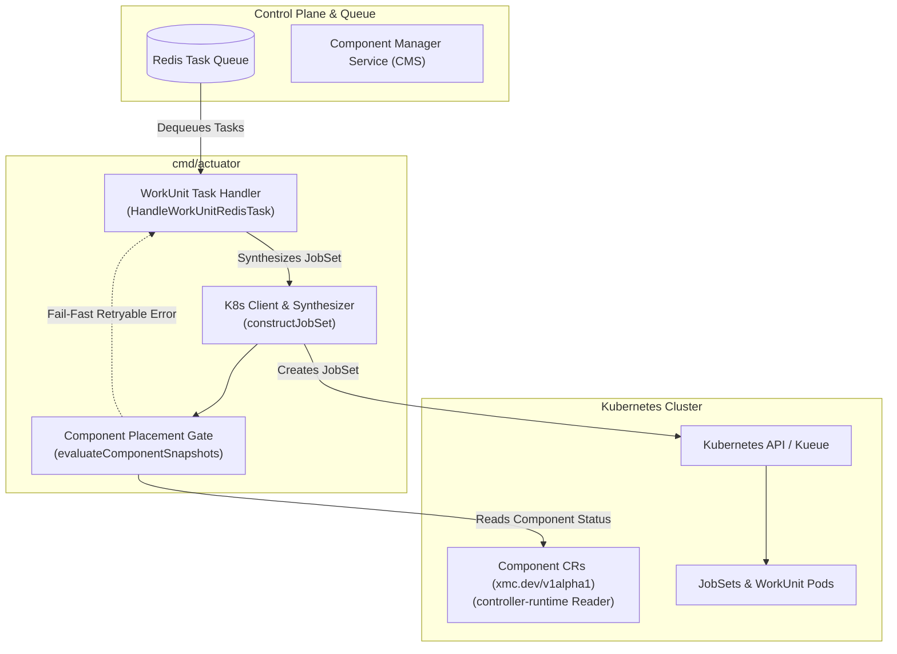

# XMC Actuator Daemon (`cmd/actuator`)

`actuator` is the Kubernetes execution controller daemon responsible for consuming WorkUnit tasks from Redis, synthesizing Kubernetes `JobSet` resources with Kueue queueing, enforcing execution contracts, and managing the lifecycle of distributed training jobs in XMC.

---

## Architecture Overview



---

## WorkUnit Task Processing

1. **Redis Task Ingestion**: The actuator continuously polls and dequeues WorkUnit execution payloads (`actuatortaskpb.ActuatorPayload`) from Redis.
2. **Pause Scheduling Interception (`pausescheduling/`)**: When `XMC_PAUSE_SCHEDULING_ENABLED` is enabled and the local pause cache reports that global scheduling is paused, `Create`, `Restart`, and `Update` actions are intercepted before reaching Kubernetes, persisted into the Spanner `PausedTasks` table, and (`Create`/`Restart`) transitioned to `SCHEDULING_PAUSED`. `Delete` actions bypass the pause so users can always stop work. The local pause cache is seeded from Spanner (`PauseSchedulingState`) on startup, updated via `xmc-pause-stream` Redis broadcasts, and fast-forwarded if a replayed task arrives with a newer `resumption_time` in its metadata.
3. **Preconditions Validation**: Verifies that required quotas, namespaces, and node preconditions are satisfied before job scheduling.
4. **JobSet Synthesis**: Compiles WorkUnit specifications into Kubernetes `JobSet` resources (`sigs.k8s.io/jobset/api/jobset/v1alpha2`).
5. **Contract Invariant Enforcement**:
   - **Non-Restarting JobSets Contract**: Primary container restart policy is strictly enforced (`Never` or `OnFailure` with `MaxRestarts: 0`) to guarantee deterministic execution tracking and prevent runaway restart loops.
6. **Execution Tracking**: Subscribes to JobSet status updates and reports state transitions back to the Experiment State Server (ESS).

---

## Component Snapshot Discovery & Placement Gating

When WorkUnits depend on reusable XMC components (such as storage drivers, monitoring agents, or sidecars), the Actuator inspects and resolves component configurations during JobSet construction:

### 1. Snapshot Discovery
Actuator inspects the `xmc.dev/component-snapshots` annotation on the JobSet specification. This annotation contains a JSON map of component names to locked generations:
```json
{
  "metrics-collector": 2,
  "storage-driver": 1
}
```
If the annotation is absent or empty, component evaluation is bypassed and standard JobSet construction proceeds.

### 2. Controller-Runtime Component Lookup
To avoid querying Cloud Spanner directly during JobSet construction, Actuator queries `Component` custom resources (`xmc.dev/v1alpha1`) using `controller-runtime`'s `runtimeclient.Reader` (initialized as a direct client by default, with support for an injected cached reader via `SetManagerClient`):
- **Namespace Resolution**: Actuator checks the WorkUnit's target queue namespace first.
- **Cluster Fallback**: If not found in the target namespace, it falls back to the default cluster-wide `"xmc"` namespace.
- **Dynamic Client Fallback**: In test environments or when `ManagerClient` is uninitialized, falls back to `dynamicClient`.

### 3. Conditional Placement Gate
For each required component, Actuator validates operational readiness:
- **Missing Component / Hydration Lag**: If a component CR is not found in the cache, returns `apierrors.NewServiceUnavailable`. The task handler catches this as a retryable error and requeues the task with exponential backoff.
- **Disabled State**: If `spec.enabled == false` or `status.state` is `COMPONENT_STATE_DISABLED`, `COMPONENT_STATE_DISABLING`, or `COMPONENT_STATE_DELETED`, returns `apierrors.NewServiceUnavailable`.
- **Unhealthy Conditions**: If conditions report `Ready != "True"` (including missing conditions or `Ready == "False"`), placement is blocked with `apierrors.NewServiceUnavailable`.
- **Not Synced with CMS**: If `status.componentGeneration` is unset or `0`, the bridge has not committed the component to CMS, so placement is blocked with `apierrors.NewServiceUnavailable`. There is no fallback to `status.observedGeneration`.

### 4. Generation Drift Detection
If the component is healthy and enabled, but `status.componentGeneration` differs from the `lockedGeneration` in the snapshot:
- Placement is **not blocked**.
- Actuator logs a warning (`"Component generation drift detected"`).
- Actuator attaches the `xmc.dev/component-drift-warning` annotation to the synthesized JobSet.

### 5. Environment Variable Injection
Once components pass the placement gate, Actuator resolves runtime configurations from `status.access`:
- **Plain Environment Variables**: Key-value pairs declared under `status.access.envVars` are injected into both primary containers and `initContainers` across all `replicatedJobs`. Existing variables of the same name are updated in place.
- **Secret Environment Variables**: Declarations under `status.access.secretEnvVars` (formatted as `"<secret_name>:<secret_key>"`) are resolved into `corev1.SecretKeyRef` selectors referencing the target Secret and key.

### 6. Secret Volume Mounts Injection
For component credentials and configuration files requiring filesystem mounts:
- **Volume Definition**: Declarations under `status.access.secretVolumeMounts` (formatted as `"<secret_name>:<mount_path>"`) attach secret volumes to `podSpec.Volumes`.
- **RFC 1123 Sanitization**: Secret names are converted to RFC 1123 compliant volume names (lowercase alphanumeric and hyphens, capped at 50 characters).
- **Collision Deduplication**: Repeated references to the same Kubernetes Secret reuse the existing volume definition. Duplicate volume name collisions are disambiguated with incremental numeric suffixes.
- **Container Mounting**: Read-only volume mounts are attached to all primary containers and `initContainers`. Mount paths must be absolute (starting with `/`), and duplicate container mount paths are deduplicated.


