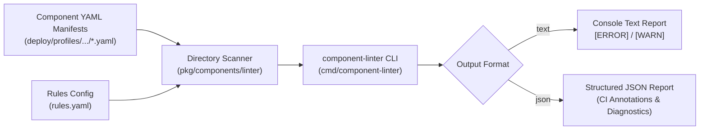
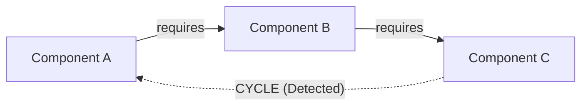
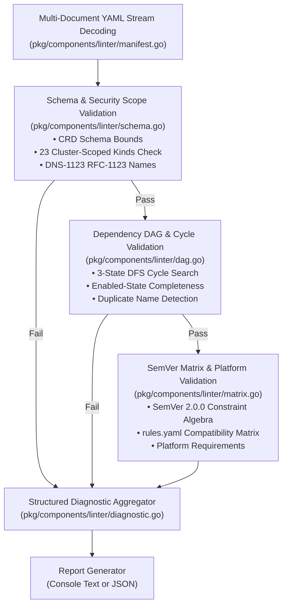

# Component Static Linter CLI (`cmd/component-linter`)

`component-linter` is a standalone Go command-line tool and validation engine for XMC Components. It performs offline static analysis and pre-flight verification on Kubernetes Component CRD manifests before deployment into GKE clusters.

---

## 1. Overview & Architecture

`component-linter` acts as an offline verification gate in local development and CI/CD pull request pipelines to prevent invalid, malformed, or unsafe Component declarations from reaching cluster environments.



---

## 2. CLI Usage & Flags

### Execution via Bazel

Run the CLI directly using Bazel:

```bash
bazel run //cmd/component-linter:component-linter -- --manifests-dir=deploy/profiles/stable-2026a/ [flags]
```

### Command-Line Flags

| Flag | Type | Default | Required | Description |
| :--- | :--- | :--- | :---: | :--- |
| `-manifests-dir` | `string` | `""` | **Yes** | Directory path containing component YAML manifests (`.yaml` / `.yml`). |
| `-rules-config` | `string` | `""` | No | Path to `rules.yaml` defining static checks and compatibility matrix rules. |
| `-output` | `string` | `"text"` | No | Reporting output format: `text` (human-readable) or `json` (structured diagnostics). |

---

## 3. Exit Code Semantics

The `xmc-linter` binary produces deterministic exit codes suitable for CI/CD status checks and git pre-commit hooks:

| Exit Code | Meaning | Description |
| :---: | :--- | :--- |
| `0` | **Success / Valid** | All manifests were successfully scanned and verified with zero blocking errors. |
| `1` | **Validation Failure / Error** | One or more blocking validation errors occurred, or invalid CLI flags were passed. |

---

## 4. Output Formats

### Text Output Format (`--output=text`)

Human-readable diagnostic messages logged to standard output:

```text
[ERROR] file: deploy/profiles/stable-2026a/manifest.yaml (line 12): [RULE_NAME] diagnostic message
All component manifests passed static validation successfully!
```

### JSON Output Format (`--output=json`)

Structured JSON output for programmatic evaluation and CI/CD annotation runners:

```json
{
  "valid": true,
  "diagnostics": null,
  "errors": null,
  "warnings": null
}
```

When validation issues are detected:

```json
{
  "valid": false,
  "diagnostics": [
    {
      "file": "deploy/profiles/stable-2026a/component_a.yaml",
      "line": 15,
      "severity": "ERROR",
      "rule": "INVALID_SCHEMA",
      "message": "spec.version cannot be empty"
    }
  ],
  "errors": [
    "spec.version cannot be empty"
  ],
  "warnings": null
}
```

---

## 5. Component Manifest Specification & Flexible YAML AST

`xmc-linter` defines the typed Component AST in `pkg/components/linter/manifest.go` and implements custom YAML deserializers in `pkg/components/linter/manifest_decoder.go` supporting flexible dependency declarations, duration formats, and YAML aliases.

### Manifest Structure

```yaml
apiVersion: components.xmc.dev/v1alpha1
kind: Component
metadata:
  name: storage-controller
  namespace: xmc
spec:
  version: "1.4.2"
  componentType: CUSTOM_1P_COMPONENT # CUSTOM_1P_COMPONENT | CUSTOM_3P_WRAPPER
  enabled: true
  deletionProtection: false
  deletionPolicy: DELETE             # DELETE | ORPHAN | UNSPECIFIED
  lifecycleControl:
    drainTimeoutSeconds: "60s"       # Supports "60s", "5m", or integer 60
    gracePeriodSeconds: 30
  dependencies:
    - name: storage-driver
      version: "^2.0.0"
      optional: false
```

### Flexible Dependency Notations

Dependencies in `spec.dependencies` can be expressed in any of three equivalent formats:

1. **List of Objects**:
   ```yaml
   dependencies:
     - name: logging-agent
       version: ">=1.2.0"
       optional: true
   ```
2. **List of Strings** (version omitted, defaults to any version):
   ```yaml
   dependencies:
     - logging-agent
     - metrics-collector
   ```
3. **Key-Value Mapping** (component name to SemVer constraint string):
   ```yaml
   dependencies:
     logging-agent: "^1.2.0"
     metrics-collector: ">=2.0.0"
     optional-driver: null
   ```

### Flexible Duration Parsing

Lifecycle durations (`spec.lifecycleControl.drainTimeoutSeconds` and `spec.lifecycleControl.gracePeriodSeconds`) support both integer seconds and human-friendly duration strings:
- String durations: `"30s"`, `"5m"`, `"1h"`.
- Numeric seconds: `30`, `300`, `3600`.
- Explicit `0` is preserved as a zero duration rather than treated as an omitted value.

---

## 6. Schema Conformance Validation (`schema.go`)

The schema validation layer (`pkg/components/linter/schema.go`) verifies baseline Kubernetes YAML correctness and Component CRD schema compliance.

### CRD Schema Checks

- **DNS-1123 RFC-1123 Label Conformance**: Validates that `metadata.name` contains only lowercase alphanumeric characters or `-`, starts and ends with an alphanumeric character, and does not exceed 63 characters (`INVALID_COMPONENT_NAME`).
- **Component Type Validation**: Asserts `spec.componentType` is one of `CUSTOM_1P_COMPONENT` or `CUSTOM_3P_WRAPPER` (`INVALID_COMPONENT_TYPE`).
- **3P Wrapper CRD References**: For `CUSTOM_3P_WRAPPER`, requires `spec.wrapperRef.crdGroup`, `crdVersion`, `crdKind`, and `targetName` to be non-empty (`MISSING_WRAPPER_REF`, `INVALID_WRAPPER_REF`). For `CUSTOM_1P_COMPONENT`, forbids `wrapperRef`.
- **Deletion Policy & Protection**: Asserts `spec.deletionPolicy` is valid (`DELETE`, `ORPHAN`, or `UNSPECIFIED` / `DELETION_POLICY_UNSPECIFIED`). If `staticChecks.enforceDeletionProtection: true` is enabled, asserts `spec.deletionProtection == true` (`DELETION_PROTECTION_REQUIRED`).
- **Lifecycle Drain Timeout Boundaries**: Validates that `spec.lifecycleControl.drainTimeoutSeconds` is non-negative and does not exceed `staticChecks.maxDrainTimeoutSeconds` (`DRAIN_TIMEOUT_EXCEEDED`).

### Rules Configuration Schema (`rules.yaml`)

```yaml
staticChecks:
  enforceDeletionProtection: false
  maxDrainTimeoutSeconds: 3600
```

---

## 7. Dependency DAG Construction & Cycle Detection (`dag.go`)

The DAG validation layer (`pkg/components/linter/dag.go`) constructs a directed acyclic graph (DAG) of component dependencies and ensures dependency completeness and acyclicity.

### Dependency Graph & Cycle Detection

The linter traverses the dependency tree using a 3-state Depth First Search (DFS) (`UNVISITED`, `VISITING`, `VISITED`) to detect circular dependency paths across any depth:



- **Cycle Path Formatting**: When a cycle is detected, `xmc-linter` reports the exact closed loop traversal path:
  ```text
  [ERROR] dependency cycle detected: storage-controller -> storage-driver -> storage-controller
  ```
- **Rule ID**: `CYCLIC_DEPENDENCY`

### Enabled-State Completeness & Optional Dependencies

- **Missing Dependency Assertion**: If component $A$ is enabled and requires component $B$, component $B$ must exist in the scanned manifest set (`MISSING_DEPENDENCY`).
- **Disabled Dependency Assertion**: If component $A$ is enabled and requires component $B$, component $B$ cannot have `spec.enabled: false` (`DISABLED_DEPENDENCY`).
- **Optional Dependencies (`optional: true`)**: Optional dependencies may be omitted or disabled without raising errors. If present and enabled, their version constraints are validated during compatibility matrix checking.
- **Duplicate Prevention**: Rejects multiple manifests defining the same component `metadata.name` across directories (`DUPLICATE_COMPONENT_NAME`).

---

## 8. Version Compatibility Matrix & SemVer Algebra (`matrix.go`, `constraints.go`)

The matrix validation layer (`pkg/components/linter/matrix.go`, `constraints.go`) validates manifest-level dependency constraints (`spec.dependencies[].version`) and asserts profile-level version compatibility matrices configured in `rules.yaml`.

### SemVer 2.0.0 Constraint Algebra

`xmc-linter` includes a full SemVer 2.0.0 constraint parser supporting standard npm/Go constraint operators:

| Operator | Notation Example | Meaning / Evaluation Rule |
| :--- | :--- | :--- |
| **Caret (`^`)** | `^1.2.3` | Allows updates without changing the left-most non-zero digit ($\ge 1.2.3 \text{ and } < 2.0.0$). For `^0.2.3`, allows $< 0.3.0$. For `^0.0.3`, allows exact `=0.0.3`. |
| **Tilde (`~`)** | `~1.2.3`<br>`~1.2`<br>`~1` | `~1.2.3` allows patch updates ($\ge 1.2.3 \text{ and } < 1.3.0$).<br>`~1.2` allows patch updates ($\ge 1.2.0 \text{ and } < 1.3.0$).<br>`~1` allows minor and patch updates ($\ge 1.0.0 \text{ and } < 2.0.0$). |
| **Relational** | `>=1.0.0 <2.0.0`<br>`>1.5.0`<br>`<=3.0.0` | Explicit lower and upper bounds. Whitespace joins multiple constraints as conjunctions (AND). |
| **Hyphen Range** | `1.0.0 - 2.5.0` | Inclusive range ($\ge 1.0.0 \text{ and } \le 2.5.0$). |
| **Wildcards** | `1.2.x`, `1.*`, `*` | Matches any version within the specified prefix or any version overall. |
| **Disjunction (`\|\|`)** | `^1.0.0 \|\| ^2.0.0` | Logical OR across multiple constraint clauses. |

### Compatibility Matrix Configuration (`rules.yaml`)

Profile authors configure cross-component version matrix rules and platform compatibility in `rules.yaml`:

```yaml
staticChecks:
  enforceNamespaceScope: true
  enforceDeletionProtection: false
  maxDrainTimeoutSeconds: 3600

compatibilityMatrix:
  # Cross-component version compatibility assertions
  componentDependencies:
    - component: storage-controller
      requires:
        - component: storage-driver
          version: ">=2.0.0 <3.0.0"

  # Platform-level integration rules
  platformRequirements:
    - component: storage-controller
      platform:
        minK8sVersion: "1.28.0"
        kubernetesVersion: ">=1.28.0 <1.32.0"
```

- **Disabled Component Handling**: If a component declared in `rules.yaml` is present but marked `spec.enabled: false`, it is ignored to prevent false-positive validation errors during gradual rollouts or deprecations.

---

## 9. Multi-Pass Static Validation Pipeline

When `xmc-linter` executes, it coordinates all verification validators in a linear pipeline:



### End-to-End Example: Detecting Multi-Pass Failures

```bash
$ bazel run //cmd/xmc-linter:xmc-linter -- --manifests-dir=deploy/profiles/test/ --rules-config=deploy/profiles/test/rules.yaml --output=text
[ERROR] cluster-scoped kind "ClusterRole" is forbidden when namespace scope is enforced
[ERROR] dependency cycle detected: storage-controller -> storage-driver -> storage-controller
[ERROR] component "storage-driver" (version 1.0.0) does not satisfy dependency constraint "^2.0.0" required by "storage-controller"
[ERROR] component "storage-controller" requires "storage-driver" version ">=2.0.0", but found version "1.0.0"
```

---

## 10. Running Tests & Measuring Coverage

### Bazel Test Matrix

```bash
# Run all unit tests across CLI and linter packages
bazel test //cmd/xmc-linter/... //pkg/components/linter/...

# Run tests with error verbosity
bazel test //cmd/xmc-linter/... //pkg/components/linter/... --test_output=errors
```

### Code Coverage Measurement

Measure test coverage using Bazel LCOV reports:

```bash
# Run coverage across all linter targets
bazel coverage //cmd/xmc-linter/... //pkg/components/linter/... --combined_report=lcov

# Inspect coverage percentage
genhtml bazel-out/_coverage/_coverage_report.dat -o coverage_html/
```

---

## 11. Multi-Profile Discovery Runner

For multi-directory scanning and repository-wide profile linting, use the Python discovery runner [`tools/components/run_linter.py`](../../tools/components/README.md):

```bash
# Scan across standard repository profile directories
bazel run //tools/components:run_linter

# Scan specific directories in strict mode
bazel run //tools/components:run_linter -- --scan-roots deploy/profiles --strict
```

See [`tools/components/README.md`](../../tools/components/README.md) for flag documentation and JSON output formats.

---

## 12. CI/CD Pre-Merge Verification

In pull request workflows, component manifest linting is enforced automatically via the composite GitHub Action [`.github/actions/run-component-linter`](../../.github/actions/run-component-linter/README.md) integrated into [`.github/workflows/lint.yml`](../../.github/workflows/lint.yml) (`Code Quality & Linting`). It verifies all profiles across `deploy/profiles/`, `deploy/components/`, and reference profiles under [`examples/components/profiles/`](../../examples/components/profiles/README.md) before PR merge.
