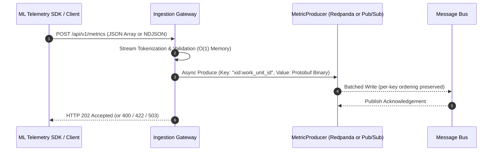

# Ingestion Gateway (`cmd/ingestion_gateway`)

The **Ingestion Gateway** is a high-throughput Go HTTP microservice that receives streaming telemetry metric records from ML training workloads (e.g. `sdks/python/xmc`) and publishes them asynchronously to a message bus with $O(1)$ memory footprint, lock-free early abortion, and strict intra-Work-Unit message ordering.

Two message bus backends are supported, selected with `-message_bus`:

- **`redpanda`** (default) — publishes over the Kafka wire protocol with franz-go.
- **`pubsub`** — publishes to a Google Cloud Pub/Sub topic.

> [!NOTE]
> In Redpanda mode ClickHouse consumes the metrics topic itself through its native
> `ENGINE = Kafka` table (see `../../deploy/clickhouse/schema.sql`). ClickHouse has no Pub/Sub
> table engine, so in Pub/Sub mode the [metrics ingester](../metrics_ingester/README.md) pulls
> from a subscription on the topic and inserts into ClickHouse. Deployment wiring for the
> ingester is not in place yet.

---

## 1. Architecture & Streaming Data Flow



Both backends implement the same `MetricProducer` interface (`ingestiongateway/metric_producer.go`)
over a backend-neutral `MetricRecord`, and classify their own failures into a `*PublishError` so the
HTTP status mapping in section 3 is identical regardless of which bus is in use.

---

## 2. Service Contracts

### Entry Contract (Ingestion HTTP API)

- **Endpoint**: `POST /api/v1/metrics`
- **Supported Content Types**: `application/json`, `application/x-ndjson`, or plain text stream.
- **Payload Format**: Supports both JSON Arrays (`[...]`) and Streaming NDJSON object sequences (`{...}\n{...}`).

#### Request Body Schema (Per Record)

| Field Name | Type | Required | Description |
| :--- | :--- | :---: | :--- |
| `xid` | `int64` (or `string`) | **Yes** | XManager Experiment ID. Decodes both raw numbers (`1001`) and stringified numbers (`"1001"`) per Google AIP-127. |
| `work_unit_id` | `int64` (or `string`) | **Yes** | Work Unit ID within the experiment. Decodes both raw numbers (`1`) and stringified numbers (`"1"`). |
| `execution_id` | `int64` (or `string`) | **Yes** | Execution attempt index. Decodes both raw numbers (`1`) and stringified numbers (`"1"`). |
| `job_name` | `string` | No | K8s ReplicatedJob name (e.g. `worker`, `evaluator`). If omitted in body, falls back to `X-Job-Name` HTTP header. |
| `replica_id` | `string` | No | Distributed training worker rank ID (defaults to `'0'`). If omitted in body, falls back to `X-Replica-ID` HTTP header. |
| `metric_name` | `string` | **Yes** | Metric identifier (e.g. `train_loss`, `eval/accuracy`). Cannot be empty. |
| `metric_value` | `float64` | **Yes** | Numeric metric measurement. Must be a finite double number. |
| `step` | `int64` | **Yes** | Training step index (must be $\ge 0$). |
| `timestamp` | `int64` | **Yes** | Microsecond Epoch timestamp (UTC). |

#### Request Headers

- `X-Job-Name` *(Optional)*: Fallback job name identifier if `job_name` is omitted in individual JSON metric records.
- `X-Replica-ID` *(Optional)*: Fallback worker rank identifier if `replica_id` is omitted in individual JSON metric records.

#### Forward & Backward Compatibility
- Uses `protojson.UnmarshalOptions{DiscardUnknown: true}` to gracefully discard unknown or newly introduced schema fields without rejecting client requests with `400 Bad Request`.

---

### Exit Contract (Message Bus Publishing)

Records successfully validated during HTTP stream decoding are immediately passed to the async producer pipeline.

Shared by both backends:

- **Target Topic**: Configurable via `-topic_name` (default: `xmc-metrics`). In Pub/Sub mode this is the topic ID within `-project_id`.
- **Record Key Format**: Composite key `FormatCompositeKey(xid, work_unit_id)` formatted as `"xid:work_unit_id"` (e.g., `"1001:1"`).
- **Record Value Format**: Protobuf binary payload (`cloud.xmanager.v1.Metric` generated from `api/protos/metrics/metrics.proto`).

#### Redpanda backend (`-message_bus=redpanda`, default)

- **Partitioning Strategy**: 32-bit MurmurHash2 sticky-key partitioning (`kgo.StickyKeyPartitioner`). Guarantees 100% of records for a given Work Unit land on the exact same partition in strict FIFO order, while balancing load uniformly across brokers.
- **Startup Check**: the topic must already exist with at least `-min_partitions` partitions and `-min_replicas` replicas per partition; otherwise the process exits.
- **Producer Configuration Defaults**:
  - Compression: Zstd (`kgo.ZstdCompression()`).
  - Linger Time: 15ms (`kgo.ProducerLinger(15ms)`).
  - Max Batch Size: 1MB (`kgo.ProducerBatchMaxBytes(1MB)`).
  - Required Acks: `all` (`kgo.AllISRAcks()`).
  - Unknown Topic Retries: `0` (`kgo.UnknownTopicRetries(0)`), so producing to a topic that does not exist fails fast instead of retrying.

#### Pub/Sub backend (`-message_bus=pubsub`)

- **Authentication**: Application Default Credentials. On GKE, use Workload Identity; the principal needs `roles/pubsub.publisher` to publish and `pubsub.topics.get` (e.g. via `roles/pubsub.viewer`) for the startup topic check.
- **Startup Check**: the topic must already exist in `-project_id`; otherwise the process exits. The gateway never creates topics.
- **Ordering**: `EnableMessageOrdering` is always on and the composite key is sent as the message `OrderingKey`, giving the same per-Work-Unit FIFO guarantee as the sticky-key partitioner. Note that end-to-end ordering also requires the *subscription* to have message ordering enabled — that is outside this service's control.
  - Pub/Sub suspends an ordering key after any publish failure for that key. The producer calls `ResumePublish` on every failure so a single transient error does not wedge a Work Unit for the lifetime of the process. This holds even when the HTTP caller disconnects mid-publish: the request context stops the caller waiting, but the resume decision and the produce counters are settled on the real publish outcome, awaited on a context detached from the request. A disconnect is therefore not counted as a publish error.
  - The resume is not instantaneous, so records published under a key between the failure and the resume fail as collateral rather than on their own merits. They are classified as congestion (`503`), not as a server fault, so the client retries them.
  - Pub/Sub enforces roughly **1 MB/s per ordering key**. A single Work Unit emitting more than that will be throttled; Kafka has no equivalent per-key cap.
- **Publish Batching**: 15ms delay threshold and 1MB byte threshold, mirroring the Redpanda linger and batch settings. Remaining settings use the client defaults.
- **Backpressure**: the one producer setting *not* mirrored from Redpanda. The Pub/Sub client defaults to `FlowControlIgnore`, so its outstanding-message limits are not enforced and there is no equivalent of the franz-go buffered-record ceiling. The effective bound is the client's buffered-byte limit (10 × the max publish request size, ~100MB); a publish rejected for exceeding it is reported as congestion. Choosing an explicit `FlowControlSettings` bound is a capacity decision left to a follow-up.
- **Not applicable**: `-redpanda_brokers`, `-min_partitions`, `-min_replicas`, and the SASL/TLS flags have no Pub/Sub equivalent. Setting `-sasl_enabled` or `-tls_enabled` in Pub/Sub mode is **rejected at startup** rather than silently ignored.

---

## 3. HTTP Response & Error Status Codes

| HTTP Status | Payload Schema | Scenario / Cause |
| :--- | :--- | :--- |
| **`202 Accepted`** | `{"status": "accepted", "count": N}` | Entire batch was successfully decoded, validated, and acknowledged by the message bus. |
| **`400 Bad Request`** | `{"error": "bad_request", "message": "..."}` | Malformed JSON payload, invalid syntax, empty body, missing required HTTP parameters, or a publish rejected as the caller's fault (see below). |
| **`422 Unprocessable Entity`** | `{"error": "unprocessable_entity", "failed_records": [...]}` | Payload is valid JSON, but one or more records failed field-level schema validation (`metric_name` empty, `metric_value` NaN/Inf, or `step < 0`). |
| **`503 Service Unavailable`** | `{"error": "service_unavailable", "message": "..."}` | Producer uninitialized, or an in-flight async publish hit backpressure or an unreachable bus. |
| **`500 Internal Server Error`** | `{"error": "internal_server_error", "message": "..."}` | An in-flight async publish failed for a reason that is neither caller error nor congestion (including misconfiguration such as a missing topic or absent IAM permission). |
| **`405 Method Not Allowed`** | Text body | HTTP method is not `POST`. |

### Publish failure classification

Each backend maps its own errors onto one of three neutral kinds, which determine the status above.

| Kind | HTTP | Redpanda | Pub/Sub (gRPC code) |
| :--- | :---: | :--- | :--- |
| Client | `400` | `kerr` errors attributable to the record (e.g. `MessageTooLarge`) | `InvalidArgument`, `FailedPrecondition`, `OutOfRange`, oversized message |
| Congestion | `503` | Buffer/queue saturation, broker unreachable, client closed | `ResourceExhausted`, `Unavailable`, `DeadlineExceeded`, `Aborted`, `Canceled`, topic stopped, suspended ordering key, client buffer overflow, abandoned wait |
| Unknown | `500` | Everything else | `NotFound`, `PermissionDenied`, `Unauthenticated`, everything else |

`NotFound` and the auth codes are deliberately `500`: a missing topic or a misgranted service account
is an operator fault, and returning `400` would tell the SDK to stop retrying a payload that is fine.

---

## 4. Configuration & Flag Exposure

The Ingestion Gateway exposes all operational settings via command-line flags and typed environment configuration (`ServerConfig`):

### Command-Line Flags

| Flag | Type | Default Value | Description |
| :--- | :--- | :--- | :--- |
| `-port` | `string` | `8080` | HTTP server listening port. |
| `-components_namespace` | `string` | `xmc` (or `COMPONENTS_NAMESPACE`) | Kubernetes namespace searched for `Component/redpanda` (`xmc.dev/v1alpha1`) when running in-cluster in Redpanda mode; falls back to `-redpanda_brokers` / `-topic_name` only when the CR is absent or disabled. |
| `-message_bus` | `string` | `redpanda` (applied after `MESSAGE_BUS`) | Message bus backend: `redpanda` or `pubsub`. |
| `-topic_name` | `string` | `xmc-metrics` | Destination topic: a Redpanda topic, or a Pub/Sub topic ID when `-message_bus=pubsub`. |
| `-project_id` | `string` | `""` | GCP project ID for logging. **Required** when `-message_bus=pubsub`, where it is also the Pub/Sub project. |
| `-redpanda_brokers` | `string` | `localhost:9092` | Comma-separated broker bootstrap addresses. Redpanda only. |
| `-min_partitions` | `int` | `128` | Startup topology assertion: minimum required partition count. Redpanda only. |
| `-min_replicas` | `int` | `3` | Startup topology assertion: minimum required replicas per partition. Redpanda only. |
| `-sasl_enabled` | `bool` | `false` | Enable SASL authentication. Redpanda only; rejected in Pub/Sub mode. |
| `-sasl_mechanism` | `string` | `SCRAM-SHA-256` | SASL mechanism (`SCRAM-SHA-256`, `SCRAM-SHA-512`, `PLAIN`). |
| `-sasl_user` | `string` | `""` | SASL username. If omitted, read from `<sasl_credentials_dir>/username`. |
| `-sasl_password` | `string` | `""` | SASL password. If omitted, read from `<sasl_credentials_dir>/password`. |
| `-sasl_credentials_dir` | `string` | `/etc/kafka/credentials` | Directory containing mounted SASL secret files. |
| `-tls_enabled` | `bool` | `false` | Enable TLS/mTLS for Redpanda connections. Redpanda only; rejected in Pub/Sub mode. |
| `-tls_cert_file` | `string` | `""` | TLS client certificate for mTLS. Must be set together with `-tls_key_file`. |
| `-tls_key_file` | `string` | `""` | TLS client private key for mTLS. |
| `-tls_ca_file` | `string` | `""` | CA certificate for server verification. |
| `-tls_insecure_skip_verify` | `bool` | `false` | Skip TLS certificate verification. Testing only. |

### Environment Variables

| Variable | Flag | Precedence |
| :--- | :--- | :--- |
| `PORT` | `-port` | Consulted whenever the flag holds its default value |
| `MESSAGE_BUS` | `-message_bus` | Consulted only when the flag is not passed |
| `REDPANDA_BROKERS`, `REDPANDA_BROKER` | `-redpanda_brokers` | Consulted whenever the flag holds its default value |
| `TOPIC_NAME`, `REDPANDA_TOPIC` | `-topic_name` | Consulted whenever the flag holds its default value |

`-message_bus` is the strict case: it has no flag-level default, so passing `-message_bus=redpanda`
explicitly beats `MESSAGE_BUS=pubsub` rather than being mistaken for an unset flag. The default is
applied after the environment is consulted.

> [!NOTE]
> The other three rows behave differently, and it is a latent footgun rather than a design choice:
> they cannot distinguish a flag left alone from one explicitly set to the documented default, so
> `-port=8080` with `PORT=9090` in the environment listens on 9090. Aligning them with
> `-message_bus` means changing three flags' published defaults and is left to a follow-up.

### Operational Health Probes

- **Liveness Probe**: `GET /healthz` (Returns `200 OK` when the process is running).
- **Readiness Probe**: `GET /readyz` (Same handler as `/healthz`; the destination topic check runs once at startup and is fatal, so a running process has already passed it).
- **Metrics**: `GET /metrics` (Prometheus exposition format).

### Produce Telemetry

| Metric | Backends |
| :--- | :--- |
| `xmc_ingestion_produce_records_total` | Both |
| `xmc_ingestion_produce_errors_total` | Both |
| `xmc_ingestion_produce_record_size_bytes` | Both |
| `franz_go_brokers_connections` | Redpanda only — reads `0` in Pub/Sub mode, which has no broker connection concept |

---

## 5. Verification & Testing

Run unit tests for the ingestion gateway:

```bash
bazel test //cmd/ingestion_gateway/... --test_output=all
```

The Pub/Sub backend is covered by unit tests against the in-process `pstest` fake, so no network,
credentials, or Docker are required.

### Manual smoke test against a real Pub/Sub project

```bash
gcloud pubsub topics create xmc-metrics
gcloud pubsub subscriptions create xmc-metrics-sub --topic=xmc-metrics --enable-message-ordering

go run ./cmd/ingestion_gateway -message_bus=pubsub -project_id=<proj> -topic_name=xmc-metrics

curl -s -X POST localhost:8080/api/v1/metrics -H 'Content-Type: application/json' \
  -d '[{"xid":1,"work_unit_id":1,"execution_id":1,"metric_name":"loss","metric_value":0.5,"step":1,"timestamp":1700000000}]'
# expect: 202 {"status":"accepted","count":1}

gcloud pubsub subscriptions pull xmc-metrics-sub --auto-ack --limit=1
```
