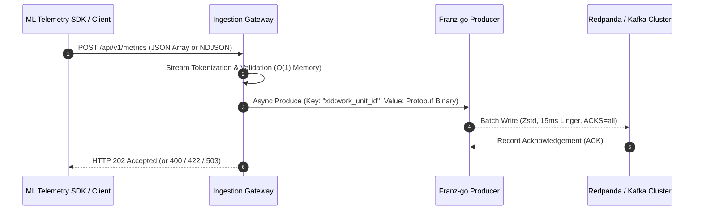

# Ingestion Gateway (`cmd/ingestion_gateway`)

The **Ingestion Gateway** is a high-throughput Go HTTP microservice that receives streaming telemetry metric records from ML training workloads (e.g. `sdks/python/xmc`) and publishes them asynchronously to Kafka / Redpanda topics with $O(1)$ memory footprint, lock-free early abortion, and strict intra-Work-Unit message ordering.

---

## 1. Architecture & Streaming Data Flow



---

## 2. Service Contracts

### Entry Contract (Ingestion HTTP API)

- **Endpoint**: `POST /api/v1/metrics`
- **Supported Content Types**: `application/json`, `application/x-ndjson`, or plain text stream.
- **Payload Format**: Supports both JSON Arrays (`[...]`) and Streaming NDJSON object sequences (`{...}\n{...}`).

#### Request Body Schema (Per Record)

| Field Name | Type | Required | Description |
| :--- | :--- | :---: | :--- |
| `xid` | `int64` (or `string`) | **Yes** | XManager Experiment ID. Decodes both raw numbers (`1001`) and stringified numbers (`"1001"`) per Google AIP-127. |
| `work_unit_id` | `int64` (or `string`) | **Yes** | Work Unit ID within the experiment. Decodes both raw numbers (`1`) and stringified numbers (`"1"`). |
| `execution_id` | `int64` (or `string`) | **Yes** | Execution attempt index. Decodes both raw numbers (`1`) and stringified numbers (`"1"`). |
| `job_name` | `string` | No | K8s ReplicatedJob name (e.g. `worker`, `evaluator`). If omitted in body, falls back to `X-Job-Name` HTTP header. |
| `replica_id` | `string` | No | Distributed training worker rank ID (defaults to `'0'`). If omitted in body, falls back to `X-Replica-ID` HTTP header. |
| `metric_name` | `string` | **Yes** | Metric identifier (e.g. `train_loss`, `eval/accuracy`). Cannot be empty. |
| `metric_value` | `float64` | **Yes** | Numeric metric measurement. Must be a finite double number. |
| `step` | `int64` | **Yes** | Training step index (must be $\ge 0$). |
| `timestamp` | `int64` | **Yes** | Microsecond Epoch timestamp (UTC). |

#### Request Headers

- `X-Job-Name` *(Optional)*: Fallback job name identifier if `job_name` is omitted in individual JSON metric records.
- `X-Replica-ID` *(Optional)*: Fallback worker rank identifier if `replica_id` is omitted in individual JSON metric records.

#### Forward & Backward Compatibility
- Uses `protojson.UnmarshalOptions{DiscardUnknown: true}` to gracefully discard unknown or newly introduced schema fields without rejecting client requests with `400 Bad Request`.

---

### Exit Contract (Kafka / Redpanda Publishing)

Records successfully validated during HTTP stream decoding are immediately passed to the async producer pipeline.

- **Target Topic**: Configurable via `-topic` flag (default: `xmc-metrics`).
- **Record Key Format**: Composite partition key `FormatCompositeKey(xid, work_unit_id)` formatted as `"xid:work_unit_id"` (e.g., `"1001:1"`).
  - **Partitioning Strategy**: 32-bit MurmurHash2 sticky-key partitioning (`kgo.StickyKeyPartitioner`). Guarantees 100% of records for a given Work Unit land on the exact same partition in strict FIFO order, while balancing load uniformly across brokers.
- **Record Value Format**: Protobuf binary payload (`xmc.metrics.Metric` generated from `api/protos/metrics/metrics.proto`).
- **Producer Configuration Defaults**:
  - Compression: Zstd (`kgo.ZstdCompression()`).
  - Linger Time: 15ms (`kgo.ProducerLinger(15ms)`).
  - Max Batch Size: 1MB (`kgo.ProducerBatchMaxBytes(1MB)`).
  - Required Acks: `all` (`kgo.AllISRAcks()`).
  - Auto Topic Creation: Disabled (`kgo.DisableAutoTopicCreation(true)`).
  - Unknown Topic Retries: `0` (`kgo.UnknownTopicRetries(0)`).

---

## 3. HTTP Response & Error Status Codes

| HTTP Status | Payload Schema | Scenario / Cause |
| :--- | :--- | :--- |
| **`202 Accepted`** | `{"status": "accepted", "valid_count": N}` | Entire batch was successfully decoded, validated, and acknowledged by Redpanda. |
| **`400 Bad Request`** | `{"error": "bad_request", "message": "..."}` | Malformed JSON payload, invalid syntax, empty body, or missing required HTTP parameters. |
| **`422 Unprocessable Entity`** | `{"error": "unprocessable_entity", "failed_records": [...]}` | Payload is valid JSON, but one or more records failed field-level schema validation (`metric_name` empty, `metric_value` NaN/Inf, or `step < 0`). |
| **`503 Service Unavailable`** | `{"error": "service_unavailable", "message": "..."}` | Producer uninitialized, or an in-flight async produce write encountered a terminal broker error. |
| **`405 Method Not Allowed`** | Text body | HTTP method is not `POST`. |

---

## 4. Configuration & Flag Exposure

The Ingestion Gateway exposes all operational settings via command-line flags and typed environment configuration (`ServerConfig`):

### Command-Line Flags

| Flag | Type | Default Value | Description |
| :--- | :--- | :--- | :--- |
| `-port` | `int` | `8080` | HTTP server listening port. |
| `-broker` | `string` | `localhost:9092` | Comma-separated list of Kafka/Redpanda broker bootstrap addresses. |
| `-topic` | `string` | `xmc-metrics` | Destination Kafka topic name for ingestion. |
| `-min-partitions` | `int` | `1` | Pre-flight readiness check: minimum required topic partition count. |
| `-min-replication` | `int` | `1` | Pre-flight readiness check: minimum required topic replication factor. |
| `-sasl-mechanism` | `string` | `""` | Optional SASL authentication mechanism (`SCRAM-SHA-256`, `SCRAM-SHA-512`, `PLAIN`). |
| `-sasl-user` | `string` | `""` | SASL authentication username. |
| `-sasl-pass` | `string` | `""` | SASL authentication password. |

### Operational Health Probes

- **Liveness Probe**: `GET /healthz` (Returns `200 OK` when the process is running).
- **Readiness Probe**: `GET /readyz` (Returns `200 OK` when the topic topology validation succeeds and producer is connected).

---

## 5. Verification & Testing

Run unit tests for the ingestion gateway:

```bash
bazel test //cmd/ingestion_gateway/... --test_output=all
```
