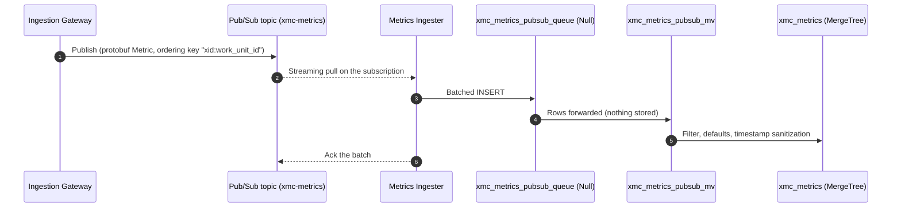
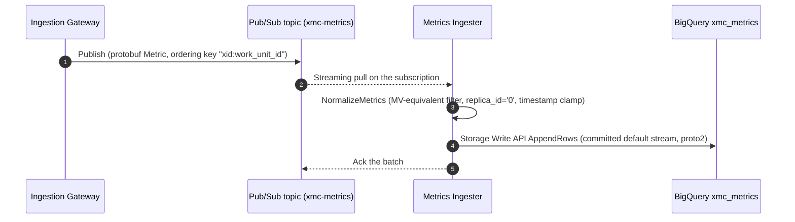

# Metrics Ingester

The **Metrics Ingester** delivers metrics from Google Cloud Pub/Sub into **ClickHouse** or **Google Cloud BigQuery**. It is used when the [Ingestion Gateway](../ingestion_gateway/README.md) runs with `-message_bus=pubsub`. In Redpanda + ClickHouse mode, ClickHouse consumes the topic directly through its `ENGINE = Kafka` table; when Pub/Sub is enabled (or BigQuery is selected as the metrics store), this service pulls from the subscription and writes batches into the configured store.

Running the consumer as a separate service rather than inside the Ingestion Gateway keeps storage credentials and network egress off workload-reachable gateway pods, and lets a small consumer replica count batch large writes independently of gateway HTTP autoscaling.

> [!NOTE]
> Helm chart and Cluster Toolkit wiring for this service are tracked separately; when running standalone, ensure the Pub/Sub topic/subscription, target table, and IAM bindings exist before startup.

---

## Data Flow

### ClickHouse Backend (`-metrics_store=clickhouse`, default)



`xmc_metrics_pubsub_queue` has the same columns as the Kafka queue table and uses `ENGINE = Null`. Its view `xmc_metrics_pubsub_mv` runs the same `SELECT` as `xmc_metrics_mv`, so both buses reject the same records, apply the same defaults, and sanitize timestamps the same way. [`deploy/clickhouse/schema_test.py`](../../deploy/clickhouse/schema_test.py) fails if the two views or the two queue tables drift apart.

### BigQuery Backend (`-metrics_store=bigquery`)



Because BigQuery appends directly to `xmc_metrics` without a landing table or materialized view, `NormalizeMetrics` applies the exact `xmc_metrics_pubsub_mv` filtering (`xid != 0`, `metric_name != ""`, `execution_id != 0`), `replica_id` defaulting (`"0"`), and UTC timestamp clamping (`[2020-01-01, 2050-01-01]`) in Go before appending via the BigQuery Storage Write API default stream. [`deploy/bigquery/schema_test.py`](../../deploy/bigquery/schema_test.py) and `TestMetricRowDescriptorAndWireFormatMatchSchemaJSON` lock [`deploy/bigquery/schema.json`](../../deploy/bigquery/schema.json), [`deploy/clickhouse/schema.sql`](../../deploy/clickhouse/schema.sql), and the proto2 wire descriptor together.

---

## Delivery Semantics

- **At least once.** A batch is acked only after its write succeeds. If the write fails, every message in the batch is nacked for redelivery and the batch loop backs off exponentially (`250ms` to `30s`), so a record can be written twice after a partial failure or a crash. Configure a subscription `RetryPolicy` minimum backoff (for example `10s`–`600s`) as well so Pub/Sub spaces redeliveries across replicas during prolonged storage outages.
- **Batching.** A batch is flushed when it reaches `-batch_size` messages or when `-batch_interval` passes, whichever happens first. The defaults are 1000 messages and 1s. The interval matches the Kafka table's `kafka_flush_interval_ms`. BigQuery batches exceeding 8 MiB serialized are automatically split across sequential `AppendRows` calls under the Storage Write API's 10 MB request cap; transient `AppendRows` errors are retried per chunk within the write timeout, though a chunk that still fails partway through a multi-chunk batch nacks the entire batch and can produce duplicates for earlier chunks already committed.
- **Malformed payloads** that fail protobuf wire unmarshaling as `cloud.xmanager.v1.Metric` are logged with a running drop count (`dropped_total`), acked, and dropped (unbounded, unlike `kafka_skip_broken_messages`, which caps skips at 100 per block). Because proto3 wire decoding is lenient, corrupt payloads that still form valid wire tags decode into near-empty messages and are filtered out by `xmc_metrics_pubsub_mv` or `NormalizeMetrics` (for example `xid = 0`).
- **Ordering** doesn't matter here. ClickHouse sorts `xmc_metrics` by its `ORDER BY` key and BigQuery clusters `xmc_metrics` by `(xid, metric_name, work_unit_id)`, so the subscription doesn't need message ordering enabled.
- **Flow control.** The client leases at most `2 × -batch_size` messages at a time.
- **Shutdown.** On SIGINT/SIGTERM, pending and already-buffered messages are flushed in `-batch_size` chunks within a shared 10s limit before closing the storage client; any message arriving after the buffer drain (including during the flush) is nacked for redelivery. Total shutdown covers this 10s flush, Pub/Sub `Receive` teardown, store teardown, and the 5s health server shutdown, so Kubernetes `terminationGracePeriodSeconds` must comfortably exceed ~15s (such as the 30s default).

---

## Configuration

Each setting is read from its flag first, then from its environment variable, then from the default.

| Flag | Environment | Default | Description |
| :--- | :--- | :--- | :--- |
| `-port` | `PORT` | `8080` | Port for the health endpoints. |
| `-project_id` | `GOOGLE_CLOUD_PROJECT` | *(required)* | GCP project that owns the Pub/Sub subscription. |
| `-subscription_id` | `PUBSUB_SUBSCRIPTION_ID` | *(required)* | Subscription on the metrics topic. |
| `-metrics_store` | `METRICS_STORE` | `clickhouse` | Target metrics store: `clickhouse` or `bigquery`. |
| `-bigquery_project_id` | `BIGQUERY_PROJECT_ID` | `-project_id` | GCP project that owns the BigQuery dataset (used when `-metrics_store=bigquery`). |
| `-bigquery_dataset` | `BIGQUERY_DATASET` | `xmc_metrics` | BigQuery dataset ID (used when `-metrics_store=bigquery`). |
| `-bigquery_table` | `BIGQUERY_TABLE` | `xmc_metrics` | BigQuery table ID (used when `-metrics_store=bigquery`). |
| `-batch_size` | — | `1000` | Maximum number of messages per batch write. |
| `-batch_interval` | — | `1s` | Target time a received message waits before its batch is written; longer if a previous write is still running. |

When `-metrics_store=clickhouse`, the ClickHouse connection comes from the shared `pkg/clickhouse` environment variables: `CLICKHOUSE_DSN`, or else `CLICKHOUSE_HOST`, `CLICKHOUSE_PORT`, `CLICKHOUSE_DATABASE`, `CLICKHOUSE_USER`, and `CLICKHOUSE_PASSWORD` / `CLICKHOUSE_PASSWORD_FILE`.

### Authentication & IAM

The ingester uses Application Default Credentials (Workload Identity on GKE):

- **Pub/Sub**: `roles/pubsub.subscriber` on the subscription, plus `pubsub.subscriptions.get` (for example through `roles/pubsub.viewer`) for the startup existence check.
- **BigQuery** (when `-metrics_store=bigquery`): `roles/bigquery.dataEditor` on the target dataset or table (grants `bigquery.tables.get` for the zero-cost `Table.Metadata` startup and `/readyz` checks plus `bigquery.tables.updateData` for Storage Write API `GetWriteStream` and `AppendRows`). Provision the table using [`deploy/bigquery/schema.json`](../../deploy/bigquery/schema.json) before starting the ingester; see [`deploy/bigquery/README.md`](../../deploy/bigquery/README.md).

---

## Health Endpoints

| Path | Returns 200 when |
| :--- | :--- |
| `/healthz` | The receive loop is running. |
| `/readyz` | The receive loop is running and the configured metrics store answers its readiness check (ClickHouse `Ping` or zero-cost BigQuery `Table.Metadata`). |

---

## Testing & Verification

```bash
# Unit tests (hermetic: pstest + in-process BigQuery REST/gRPC fakes; no network access needed)
bazel test //cmd/metrics_ingester/...

# Schema drift guards for ClickHouse views and BigQuery table parity
bazel test //deploy/clickhouse:schema_test //deploy/bigquery:schema_test

# End-to-end test against real ClickHouse in containers (manual; needs Docker)
bazel test //test/metrics:clickhouse_pipeline_test --test_filter=TestPubSubPipelineIngestion
```
