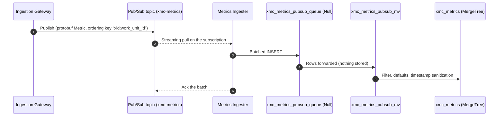

# Metrics Ingester

The **Metrics Ingester** delivers metrics from Google Cloud Pub/Sub into ClickHouse. It is only needed when the [Ingestion Gateway](../ingestion_gateway/README.md) runs with `-message_bus=pubsub`. In Redpanda mode, ClickHouse consumes the topic itself through its `ENGINE = Kafka` table. ClickHouse has no Pub/Sub table engine, so this service fills that role.

> [!NOTE]
> There is no Helm chart or Terraform for this service yet, so for now the topic, subscription and IAM bindings must be created by hand.

---

## Data Flow



`xmc_metrics_pubsub_queue` has the same columns as the Kafka queue table and uses `ENGINE = Null`. Its view `xmc_metrics_pubsub_mv` runs the same `SELECT` as `xmc_metrics_mv`, so both buses reject the same records, apply the same defaults, and sanitize timestamps the same way. `deploy/clickhouse/schema_test.py` fails if the two views or the two queue tables drift apart.

---

## Delivery Semantics

- **At least once.** A batch is acked only after its INSERT succeeds. If the INSERT fails, every message in the batch is nacked and Pub/Sub redelivers it, so a record can be written twice after a partial failure or a crash.
- **Batching.** A batch is flushed when it reaches `-batch_size` messages or when `-batch_interval` passes, whichever happens first. The defaults are 1000 messages and 1s. The interval matches the Kafka table's `kafka_flush_interval_ms`.
- **Malformed payloads** that don't decode as `cloud.xmanager.v1.Metric` are logged, acked and dropped, the same way `kafka_skip_broken_messages` handles them. Records that decode but fail validation, such as `xid = 0`, are dropped by the view.
- **Ordering** doesn't matter here. `xmc_metrics` is sorted by its `ORDER BY` key, so the subscription doesn't need message ordering enabled.
- **Flow control.** The client leases at most `2 × -batch_size` messages at a time.
- **Shutdown.** On SIGINT/SIGTERM the pending batch is flushed, with a 10s limit. Any message that arrives after that flush is nacked.

---

## Configuration

Each setting is read from its flag first, then from its environment variable, then from the default.

| Flag | Environment | Default | Description |
| :--- | :--- | :--- | :--- |
| `-port` | `PORT` | `8080` | Port for the health endpoints. |
| `-project_id` | `GOOGLE_CLOUD_PROJECT` | *(required)* | GCP project that owns the subscription. |
| `-subscription_id` | `PUBSUB_SUBSCRIPTION_ID` | *(required)* | Subscription on the metrics topic. |
| `-batch_size` | — | `1000` | Maximum number of messages per INSERT. |
| `-batch_interval` | — | `1s` | Longest time a partial batch waits before it is flushed. |

The ClickHouse connection comes from the shared `pkg/clickhouse` environment variables: `CLICKHOUSE_DSN`, or else `CLICKHOUSE_HOST`, `CLICKHOUSE_PORT`, `CLICKHOUSE_DATABASE`, `CLICKHOUSE_USER` and `CLICKHOUSE_PASSWORD` / `CLICKHOUSE_PASSWORD_FILE`.

### Authentication

The ingester uses Application Default Credentials. On GKE, use Workload Identity. The principal needs `roles/pubsub.subscriber` on the subscription, plus `pubsub.subscriptions.get` (for example through `roles/pubsub.viewer`) for the startup check. The subscription must already exist; the ingester never creates it and exits at startup if it's missing.

---

## Health Endpoints

| Path | Returns 200 when |
| :--- | :--- |
| `/healthz` | The receive loop is running. |
| `/readyz` | The receive loop is running and ClickHouse answers a ping. |

---

## Testing & Verification

```bash
# Unit tests. These use the in-memory Pub/Sub fake (pstest) and don't need network access.
bazel test //cmd/metrics_ingester/...

# Schema drift guard for the two materialized views
bazel test //deploy/clickhouse:schema_test

# End-to-end test against real ClickHouse in containers (manual; needs Docker)
bazel test //test/metrics:clickhouse_pipeline_test --test_filter=TestPubSubPipelineIngestion
```
