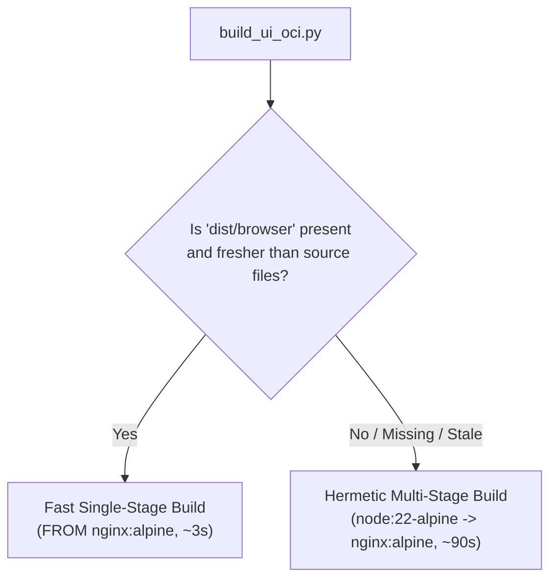

# UI Container Packaging (`cmd/ui`)

This directory contains the packaging logic for the XMC Web UI container image (`//cmd/ui:ui_image_tarball`).

---

## Packaging Architecture (`build_ui_oci.py`)

The container build uses a two-tier strategy to optimize local and CI build times while maintaining hermetic reproducibility:



1. **Fast Single-Stage Nginx Packaging (Tier 1)**:
   - When pre-compiled Angular assets exist in `dist/browser` and are fresher than UI source files, `build_ui_oci.py` generates a single-stage `Dockerfile` (`FROM nginx:alpine`) that directly copies the pre-built bundle.
   - Packaging takes **~3 seconds**.
2. **Hermetic Multi-Stage Fallback (Tier 2)**:
   - If `dist/browser` is absent, stale, or source files have been modified, it automatically falls back to a hermetic multi-stage build (`node:22-alpine` compiling with `npm ci` and `ng build`, copied into `nginx:alpine`).
   - Requires zero host dependencies beyond Docker.

---

## Build Commands

- **Bazel Target**:
  ```bash
  bazel build //cmd/ui:ui_image_tarball
  ```
- **Direct CLI Execution**:
  ```bash
  python3 cmd/ui/build_ui_oci.py <output_tar>
  ```

---

## E2E Runner Host Pre-Compilation (`test/e2e/lib/image_builder.py`)

The E2E test runner accelerates test execution by running `npm ci` and `ng build` directly on the host runner (where Node.js 22 is available) before invoking Bazel, allowing `build_ui_oci.py` to consistently hit the fast single-stage Nginx path.
