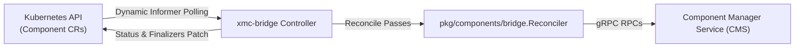

# XMC Bridge Controller Daemon (`cmd/xmc-bridge`)

`xmc-bridge` is the deployable controller daemon responsible for reconciling Kubernetes `Component` custom resources (`xmc.dev/v1alpha1`) with the Component Manager Service (CMS) in XMC.

---

## Daemon Architecture



---

## CLI Flags

| Flag | Default | Description |
| :--- | :--- | :--- |
| `--cms-address` | `"localhost:50051"` | gRPC endpoint address of the Component Manager Service. |
| `--namespace` | `"xmc"` | Target Kubernetes namespace to watch and reconcile Component custom resources. |
| `--probe-interval` | `5s` | Duration interval between dynamic reconciliation sweeps across the namespace. |
| `--probe-timeout` | `2s` | Timeout duration for individual component reconciliation passes. |
| `--kubeconfig` | `""` | Optional explicit path to kubeconfig file (defaults to in-cluster or `KUBECONFIG` env). |

---

## Helm Integration & Deployment

The daemon is deployed as a Kubernetes Deployment via Helm under `deploy/helm/templates/components/`:

```bash
helm upgrade --install xmc deploy/helm \
  --set componentsDeployment.enabled=true \
  --set componentsDeployment.cmsAddress=ess:50051
```
