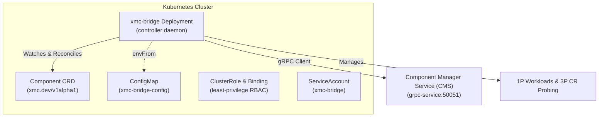

# XMC Bridge Controller Daemon (`cmd/xmc-bridge`)

`xmc-bridge` is the deployable controller daemon responsible for reconciling Kubernetes `Component` custom resources (`xmc.dev/v1alpha1`) with the Component Manager Service (CMS) in XMC.

---

## Daemon Architecture



---

## Component CRD Specification (`xmc.dev/v1alpha1`)

The `Component` Custom Resource Definition defines the declarative intent for platform components:

### Component Architecture Types

- **First-Party (1P) Native Components (`COMPONENT_TYPE_CUSTOM_1P_COMPONENT`)**:
  Microservices managed directly by XMC as Kubernetes Deployments and Services (e.g. Ingestion Gateway, Log Monitor, Actuators).
- **Third-Party (3P) Wrapped Operators (`COMPONENT_TYPE_CUSTOM_3P_WRAPPER`)**:
  Existing Kubernetes CRD operators and services (e.g. RayCluster, ClickHouseInstallation, Knative Service) whose lifecycle and network health coordinates are dynamically monitored and bound into CMS.

### Key Spec Fields

| Field | Type | Default | Description |
| :--- | :--- | :--- | :--- |
| `enabled` | `boolean` | (Required) | Desired activation state of the component. |
| `componentType` | `string` | `COMPONENT_TYPE_CUSTOM_1P_COMPONENT` | Control plane architecture model (`1P` vs `3P`). |
| `componentClass` | `string` | `""` | Optional classification identifier (e.g. core, storage, compute). |
| `deletionProtection` | `boolean` | `true` | Safeguards component inventory against accidental manifest deletion. |
| `deletionPolicy` | `string` | `Delete` | Teardown behavior upon deletion: `Delete` (prunes child workloads) or `Orphan` (retains child workloads). |
| `lifecycleControl` | `object` | `{}` | Lifecycle configuration such as `drainTimeoutSeconds` for graceful connection draining. |
| `parameters` | `map[string]string` | `{}` | Key-value configuration parameters passed into workload manifests (e.g. `image`, `port`). |
| `wrapperRef` | `object` | `{}` | Target 3P CRD reference (`group`, `version`, `kind`, `name`, `namespace`) and custom JSONPath query paths. |

---

## Configuration & CLI Flags

Configuration can be supplied via environment variables (mounted from `xmc-bridge-config` ConfigMap in Helm) or CLI flags:

| Flag / Environment Variable | Default | Description |
| :--- | :--- | :--- |
| `--cms-address` / `CMS_ADDRESS` | `"localhost:50051"` | gRPC endpoint address of the Component Manager Service. |
| `--namespace` / `NAMESPACE` | `"xmc"` | Target Kubernetes namespace to watch and reconcile Component custom resources. |
| `--probe-interval` / `PROBE_INTERVAL` | `5s` | Duration interval between dynamic reconciliation sweeps across the namespace. |
| `--probe-timeout` / `PROBE_TIMEOUT` | `2s` | Timeout duration for individual component reconciliation passes. |
| `--kubeconfig` / `KUBECONFIG` | `""` | Optional explicit path to kubeconfig file (defaults to in-cluster or `KUBECONFIG` env). |

---

## Helm Integration & Deployment

The component bridge controller is feature-flagged under `componentsDeployment` in Helm values:

```yaml
componentsDeployment:
  enabled: false                                  # Set to true to deploy xmc-bridge controller
  cmsAddress: "grpc-service:50051"                # In-cluster gRPC endpoint for ESS/CMS
  probeInterval: "5s"                             # Namespace reconciliation sweep interval
  probeTimeout: "2s"                              # Timeout per component reconciliation pass

xmc_bridge_custom_image: ""                       # Optional custom container image override
```

To install or upgrade:

```bash
helm upgrade --install xmc deploy/helm \
  --set componentsDeployment.enabled=true \
  --set componentsDeployment.cmsAddress=grpc-service:50051
```

---

## Security & RBAC Least Privilege

- **ServiceAccount**: `xmc-bridge` runs under a dedicated service account with `automountServiceAccountToken: true`.
- **ClusterRole**: Grants least-privilege permissions:
  - Full CRUD permissions on `components.xmc.dev` (including `/status` and `/finalizers`).
  - Workload management permissions on `apps/deployments` and `core/services` for 1P components.
  - Read-only (`get`, `list`, `watch`) discovery permissions across all API groups (`*`) to support dynamic 3P CR status detection.
  - Security contexts enforce read-only root filesystems, non-root execution, privilege escalation disabled, and dropping all capabilities (`ALL`).
