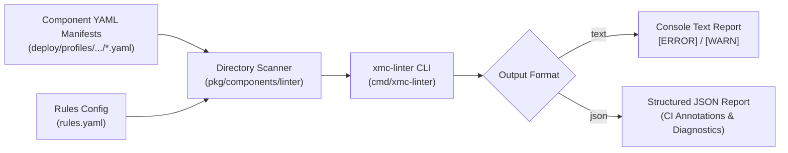

# Components Static Linter CLI (`cmd/xmc-linter`)

`xmc-linter` is a standalone Go command-line tool and validation engine for XMC Components. It performs offline static analysis and pre-flight verification on Kubernetes Component CRD manifests before deployment into GKE clusters.

---

## 1. Overview & Architecture

`xmc-linter` acts as an offline verification gate in local development and CI/CD pull request pipelines to prevent invalid, malformed, or unsafe Component declarations from reaching cluster environments.



---

## 2. CLI Usage & Flags

### Execution via Bazel

Run the CLI directly using Bazel:

```bash
bazel run //cmd/xmc-linter:xmc-linter -- --manifests-dir=deploy/profiles/stable-2026a/ [flags]
```

### Command-Line Flags

| Flag | Type | Default | Required | Description |
| :--- | :--- | :--- | :---: | :--- |
| `-manifests-dir` | `string` | `""` | **Yes** | Directory path containing component YAML manifests (`.yaml` / `.yml`). |
| `-rules-config` | `string` | `""` | No | Path to `rules.yaml` defining static checks and compatibility matrix rules. |
| `-output` | `string` | `"text"` | No | Reporting output format: `text` (human-readable) or `json` (structured diagnostics). |

---

## 3. Exit Code Semantics

The `xmc-linter` binary produces deterministic exit codes suitable for CI/CD status checks and git pre-commit hooks:

| Exit Code | Meaning | Description |
| :---: | :--- | :--- |
| `0` | **Success / Valid** | All manifests were successfully scanned and verified with zero blocking errors. |
| `1` | **Validation Failure / Error** | One or more blocking validation errors occurred, or invalid CLI flags were passed. |

---

## 4. Output Formats

### Text Output Format (`--output=text`)

Human-readable diagnostic messages logged to standard output:

```text
[ERROR] file: deploy/profiles/stable-2026a/manifest.yaml (line 12): [RULE_NAME] diagnostic message
All component manifests passed static validation successfully!
```

### JSON Output Format (`--output=json`)

Structured JSON output for programmatic evaluation and CI/CD annotation runners:

```json
{
  "valid": true,
  "diagnostics": null,
  "errors": null,
  "warnings": null
}
```

When validation issues are detected:

```json
{
  "valid": false,
  "diagnostics": [
    {
      "file": "deploy/profiles/stable-2026a/component_a.yaml",
      "line": 15,
      "severity": "ERROR",
      "rule": "INVALID_SCHEMA",
      "message": "spec.version cannot be empty"
    }
  ],
  "errors": [
    "spec.version cannot be empty"
  ],
  "warnings": null
}
```

---

## 5. Component Manifest Specification & Flexible YAML AST

`xmc-linter` defines the typed Component AST in `pkg/components/linter/manifest.go` and implements custom YAML deserializers in `pkg/components/linter/manifest_decoder.go` supporting flexible dependency declarations, duration formats, and YAML aliases.

### Manifest Structure

```yaml
apiVersion: components.xmc.dev/v1alpha1
kind: Component
metadata:
  name: storage-controller
  namespace: xmc
spec:
  version: "1.4.2"
  componentType: CUSTOM_1P_COMPONENT # CUSTOM_1P_COMPONENT | CUSTOM_3P_WRAPPER
  enabled: true
  deletionProtection: false
  deletionPolicy: DELETE             # DELETE | ORPHAN | UNSPECIFIED
  lifecycleControl:
    drainTimeoutSeconds: "60s"       # Supports "60s", "5m", or integer 60
    gracePeriodSeconds: 30
  dependencies:
    - name: storage-driver
      version: "^2.0.0"
      optional: false
```

### Flexible Dependency Notations

Dependencies in `spec.dependencies` can be expressed in any of three equivalent formats:

1. **List of Objects**:
   ```yaml
   dependencies:
     - name: logging-agent
       version: ">=1.2.0"
       optional: true
   ```
2. **List of Strings** (version omitted, defaults to any version):
   ```yaml
   dependencies:
     - logging-agent
     - metrics-collector
   ```
3. **Key-Value Mapping** (component name to SemVer constraint string):
   ```yaml
   dependencies:
     logging-agent: "^1.2.0"
     metrics-collector: ">=2.0.0"
     optional-driver: null
   ```

### Flexible Duration Parsing

Lifecycle durations (`spec.lifecycleControl.drainTimeoutSeconds` and `spec.lifecycleControl.gracePeriodSeconds`) support both integer seconds and human-friendly duration strings:
- String durations: `"30s"`, `"5m"`, `"1h"`.
- Numeric seconds: `30`, `300`, `3600`.
- Explicit `0` is preserved as a zero duration rather than treated as an omitted value.

---

## 6. Running Tests

Run all unit and integration tests across the CLI binary and linter packages:

```bash
# Run all linter tests
bazel test //cmd/xmc-linter/... //pkg/components/linter/...

# Run tests with detailed testlog output
bazel test //cmd/xmc-linter/... //pkg/components/linter/... --test_output=errors
```

