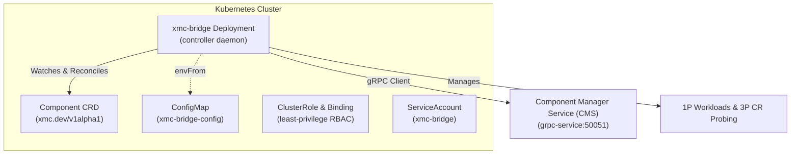

# XMC Bridge Controller Daemon (`cmd/xmc_bridge`)

`xmc-bridge` is the deployable controller daemon responsible for reconciling Kubernetes `Component` custom resources (`xmc.dev/v1alpha1`) with the Component Manager Service (CMS) in XMC.

---

## Daemon Architecture



---

## Component CRD Specification (`xmc.dev/v1alpha1`)

The `Component` Custom Resource Definition defines the declarative intent for platform components:

### Component Architecture Types

- **First-Party (1P) Native Components (`COMPONENT_TYPE_CUSTOM_1P_COMPONENT`)**:
  Microservices managed directly by XMC as Kubernetes Deployments and Services (e.g. Ingestion Gateway, Log Monitor, Actuators).
- **Third-Party (3P) Wrapped Operators (`COMPONENT_TYPE_CUSTOM_3P_WRAPPER`)**:
  Existing Kubernetes CRD operators and services (e.g. RayCluster, ClickHouseInstallation, Knative Service) whose lifecycle and network health coordinates are dynamically monitored and bound into CMS.

### Key Spec Fields

| Field | Type | Default | Description |
| :--- | :--- | :--- | :--- |
| `enabled` | `boolean` | (Required) | Desired activation state of the component. |
| `componentType` | `string` | `COMPONENT_TYPE_CUSTOM_1P_COMPONENT` | Control plane architecture model (`1P` vs `3P`). |
| `componentClass` | `string` | `""` | Optional classification identifier (e.g. core, storage, compute). |
| `deletionProtection` | `boolean` | `true` | Safeguards component inventory against accidental manifest deletion. |
| `deletionPolicy` | `string` | `Delete` | Teardown behavior upon deletion: `Delete` (prunes child workloads) or `Orphan` (retains child workloads). |
| `lifecycleControl` | `object` | `{}` | Lifecycle configuration such as `drainTimeoutSeconds` for graceful connection draining. |
| `parameters` | `map[string]string` | `{}` | Key-value configuration parameters passed into workload manifests (e.g. `image`, `port`, `chartPath`). |
| `wrapperRef` | `object` | `{}` | Target 3P CRD reference (`group`, `version`, `kind`, `name`, `namespace`) and custom JSONPath query paths. |

---

## Configuration & CLI Flags

Configuration can be supplied via environment variables (mounted from `xmc-bridge-config` ConfigMap in Helm) or CLI flags:

| Flag / Environment Variable | Default | Description |
| :--- | :--- | :--- |
| `--cms-address` / `CMS_ADDRESS` | `"localhost:50051"` | gRPC endpoint address of the Component Manager Service. |
| `--namespace` / `NAMESPACE` | `"xmc"` | Target Kubernetes namespace to watch and reconcile Component custom resources. |
| `--chart-path` / `HELM_CHART_PATH` | `""` | Base directory containing per-component Helm charts (`<base>/components/<name>`, `<base>/<name>`, `<base>/<name>.tgz`) or fallback umbrella chart path (defaults to embedded chart when empty). |
| `--probe-interval` / `PROBE_INTERVAL` | `5s` | Delay after a successful reconcile pass before the same Component is reconciled again, to observe workload health changes that emit no Component event. |
| `--probe-timeout` / `PROBE_TIMEOUT` | `2s` | Timeout of one workload health probe. |
| `--reconcile-timeout` / `RECONCILE_TIMEOUT` | `60s` | Timeout of one Component's reconcile pass (CMS calls, actuation and probing); persisting the pass's status is not bounded by it. |
| `--max-concurrent-reconciles` / `MAX_CONCURRENT_RECONCILES` | `1` | Number of Components reconciled in parallel. Must be at least 1. |
| `--metrics-bind-address` | `"127.0.0.1:8080"` | Address the controller-runtime metrics endpoint listens on. The endpoint has no authentication, so it listens on loopback by default. `"0"` disables it. |
| `--health-probe-bind-address` | `":8081"` | Address serving the `/healthz` and `/readyz` probes. Must not be empty or `"0"` (both would disable the probes). |
| `--kubeconfig` / `KUBECONFIG` | `""` | Optional explicit path to kubeconfig file (defaults to in-cluster or `KUBECONFIG` env). |

Once elected, `xmc-bridge` invokes `HydrateFromCluster` to restore active 1P component states from the `xmc-component-values` ConfigMap, preventing redundant Helm release revision increments and ensuring post-restart deactivations execute cleanly. It runs concurrently with the first reconciles: each 1P Component also hydrates its own state before its Helm actuation, and a reconcile whose dependency gate runs before any hydration falls back to the Component's `DependenciesReady` and `Ready` conditions, so at worst one pass reports `DependenciesNotReady` instead of `HelmUpgradePending` without touching the workload. A torn-down component stays recorded as inactive, so no namespace hydration re-activates a purged or orphaned component from the ConfigMap.

### Reconciliation

`xmc-bridge` runs a controller-runtime manager whose cache watches the Component CRs of `--namespace` only. Reconciles and the dependents watch read Components from that cache, so the API server sees one list and watch per bridge rather than reads per Component. Each Component is reconciled on its own work queue item:

- when its spec (generation), labels or annotations change, or its deletion starts;
- when a Component it lists in `spec.dependencies` is created, deleted, changes generation, or becomes ready or unready as a dependency. Status writes that keep a dependency's readiness, such as condition timestamp refreshes, do not re-enqueue its dependents;
- after each successful pass: after the pass's explicit requeue delay when it sets one, otherwise after `--probe-interval`. The explicit delay is always honored, longer or shorter than the probe interval: 30s while deactivation is blocked (`DeactivationBlocked`, so the blocked workload's health and the CMS `PrepareDeactivation` recheck refresh every 30s), and the 5-minute CMS heartbeat once a Component is disabled;
- after a failed pass (CMS, actuation or status persistence error), with per-Component exponential backoff from 5s to 300s and ±10% jitter. A successful pass resets the backoff.

A pass always persists its status, also when it fails, so the CR reports the failure while the retry is pending.

### Single writer

Only one `xmc-bridge` process reconciles at a time. Each process competes for the `xmc-bridge` Lease in `--namespace`, and only the holder runs the Component controller and Helm actuation. The Helm Deployment uses `strategy: Recreate`, so a rollout stops the old pod before the new one starts. The Lease covers the remaining overlap cases, such as a partitioned node.

- **Shutdown**: on `SIGTERM` the leader stops reconciling, drops queued asynchronous Helm upgrades that have not started (its successor re-reconciles them from the Component CRs), gives the in-flight upgrade 20s to finish and cancels it after that, and then releases the Lease, so its successor takes over without waiting for the Lease to expire. The whole shutdown is bounded at 25s; the Deployment's `terminationGracePeriodSeconds` is 45.
- **Lost Lease**: a leader that fails to renew the Lease stops at once and exits, cancelling in-flight Helm work, so that no write outlives its Lease.
- `/healthz` on `--health-probe-bind-address` is the liveness probe and only reports that the process serves requests.
- `/readyz` reports ready once the Component informer has synced. Processes waiting for the Lease start and sync the informer too, so they report ready.
- Controller-runtime metrics are served on `--metrics-bind-address`, `127.0.0.1:8080` by default, which the Helm Deployment does not expose. To scrape them, run a sidecar that adds authentication, or bind them to `:8080` and restrict access with a NetworkPolicy.

---

## Helm Integration & Deployment

The component bridge controller is feature-flagged under `componentsDeployment` in Helm values:

```yaml
componentsDeployment:
  enabled: false                                  # Set to true to deploy xmc-bridge controller
  cmsAddress: "grpc-service:50051"                # In-cluster gRPC endpoint for ESS/CMS
  chartPath: ""                                   # Optional base Helm chart directory or fallback chart path
  probeInterval: "5s"                             # Per-Component re-probe delay after a successful pass
  probeTimeout: "2s"                              # Timeout per workload health probe
  reconcileTimeout: "60s"                         # Timeout per Component reconcile pass
  maxConcurrentReconciles: 1                      # Components reconciled in parallel

xmc_bridge_custom_image: ""                       # Optional custom container image override
```

To install or upgrade:

```bash
helm upgrade --install xmc deploy/helm \
  --set componentsDeployment.enabled=true \
  --set componentsDeployment.cmsAddress=grpc-service:50051
```

### CRD lifecycle

The `components.xmc.dev` CRD is rendered whether or not `componentsDeployment.enabled` is set, because deleting a CRD deletes every CR of that type. It carries:

- `helm.sh/resource-policy: keep`, so `helm uninstall` and a flag flip leave the CRD and all Component CRs in place.
- `argocd.argoproj.io/sync-options: Prune=false,Delete=false`, so Argo CD never prunes or deletes it.
- `argocd.argoproj.io/sync-wave: "-1"`, which orders it before the Component CRs only when both are synced by the same Argo CD Application. Across Applications it has no effect: sync the Application that installs this chart first, or give the Application holding the CRs a sync retry policy.

The `stable-2026a` profile's Component CRs carry `argocd.argoproj.io/sync-options: SkipDryRunOnMissingResource=true`, so an Argo CD application's first sync does not fail its dry run before the CRD exists. Set the same annotation on any Component CR you author yourself.

Because the CRD renders even with `componentsDeployment.enabled=false`, whoever installs or upgrades the chart needs permission to create and update `customresourcedefinitions`.

The `component-deletion-protection` `ValidatingAdmissionPolicy` and its binding follow the CRD: they render whatever `componentsDeployment.enabled` is set to and carry `helm.sh/resource-policy: keep`, so disabling the bridge or uninstalling the chart never silently drops deletion protection for the CRs the kept CRD still holds. The installer therefore also needs permission to manage `validatingadmissionpolicies` and `validatingadmissionpolicybindings`. The policy exempts only the Kubernetes namespace controller and garbage collector, and `system:masters`; there is no `xmc-platform-admins` breakglass group. To delete a protected Component, set `spec.deletionProtection: false` first. A kept policy and binding also retain their release annotations, so reassign them the same way as the CRD below before installing under a different release.

The kept CRD retains the `meta.helm.sh/release-name` and `meta.helm.sh/release-namespace` annotations of the release that created it. Reinstalling under the same release name and namespace adopts it again. Installing under a different release name or namespace fails with an ownership error; reassign the CRD first:

```bash
kubectl annotate crd components.xmc.dev --overwrite \
  meta.helm.sh/release-name=<release> meta.helm.sh/release-namespace=<namespace>
```

With `componentsDeployment.enabled=false`, nothing removes the `xmc.dev/cms-cleanup` finalizer that `xmc-bridge` attached, so deleting a Component CR, or the namespace that holds it, hangs. Re-enable the bridge, or strip the finalizer by hand. Stripping it skips the bridge's CMS cleanup and teardown of the component's workload release:

```bash
kubectl patch components.xmc.dev <name> -n <namespace> --type=merge -p '{"metadata":{"finalizers":null}}'
```

Earlier bridge versions attached `finalizers.xmc.dev/deletion-protection` instead. No migration is needed: the bridge treats that name as its cleanup finalizer, so a Component CR that carries it gets the same CMS cleanup and teardown on deletion, and releasing the finalizer removes both names. The merge patch above also strips the legacy name.

`xmc-bridge` never blocks a deletion itself: `spec.deletionProtection` is enforced only by the `component-deletion-protection` admission policy, so a deletion the policy admits, such as one issued by the namespace controller, always runs the bridge cleanup.

Removing the CRD is a deliberate manual step. While `xmc-bridge` is still running, so it can release each CR's finalizer, delete every Component CR (see the profile's [Disable or Uninstall](../../deploy/profiles/stable-2026a/README.md#disable-or-uninstall) flow). Then run `kubectl delete crd components.xmc.dev`, and remove the kept policy with `kubectl delete validatingadmissionpolicybinding component-deletion-protection-binding` and `kubectl delete validatingadmissionpolicy component-deletion-protection`.

---

## Security & RBAC Least Privilege

- **ServiceAccount**: `xmc-bridge` runs under a dedicated service account with `automountServiceAccountToken: true`.
- **ClusterRole**: Grants least-privilege permissions:
  - Full CRUD permissions on `components.xmc.dev` (including `/status` and `/finalizers`).
  - Workload management permissions on `apps/deployments` and `core/services` for 1P components.
  - Read-only (`get`, `list`, `watch`) discovery permissions across all API groups (`*`) to support dynamic 3P CR status detection.
  - Security contexts enforce read-only root filesystems, non-root execution, privilege escalation disabled, and dropping all capabilities (`ALL`).
- **Leader election Role**: `xmc-bridge-leader-election` grants `create` on `coordination.k8s.io` leases, and `get` and `update` on the `xmc-bridge` Lease only. It is a namespaced Role in the release namespace also when `componentsDeployment.rbac.clusterScope` is `true`, so the bridge cannot write Leases of other namespaces.
