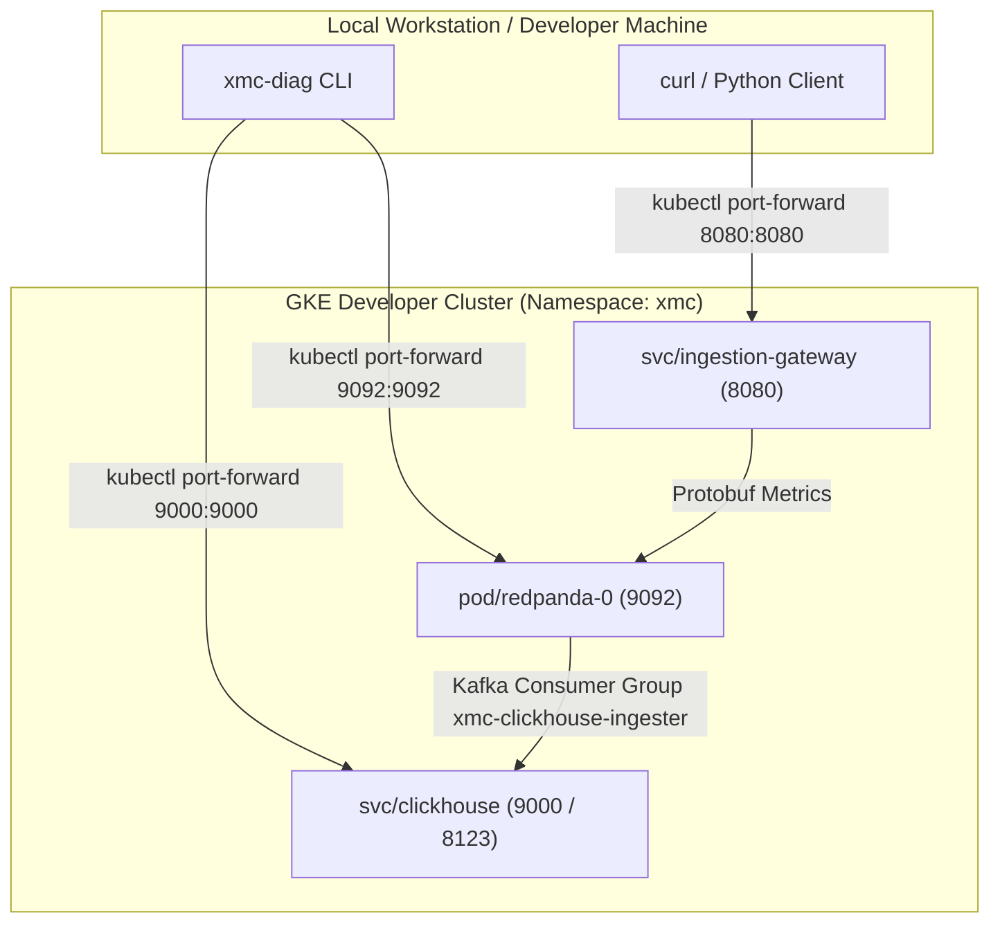

# Developer Cluster Setup & Manual Testing Guide (`deploy/local`)

This directory documents the developer cluster testing workflow for XManager on Cloud (XMC v2) metrics telemetry pipelines.

> [!NOTE]
> In XMC v2, Redpanda and ClickHouse are **Bring-Your-Own (BYO)** infrastructure components managed out-of-band by enterprise platform administrators. They are not bundled as local Docker containers in the delivered XMC product stack.
> For developer testing, BYO Redpanda and ClickHouse instances are deployed directly onto a GKE developer test cluster (e.g. `xmc` namespace in project `xmc-example-project`) via Helm addons ([`deploy/addons/metrics/`](../addons/metrics)).

---

## 1. Developer Test Cluster Architecture



---

## 2. Port-Forwarding to GKE Developer Cluster

Authenticate to your target GKE developer cluster and open port-forwards for local testing:

```bash
# 1. Authenticate to GKE cluster
gcloud container clusters get-credentials <CLUSTER_NAME> \
    --region <REGION> \
    --project <PROJECT_ID>

# 2. Port-forward ClickHouse native TCP port (9000)
kubectl port-forward svc/clickhouse 9000:9000 -n xmc &

# 3. Port-forward Redpanda service (9092)
kubectl port-forward svc/redpanda 9092:9092 -n xmc &

# 4. Port-forward Ingestion Gateway HTTP service (8080)
kubectl port-forward svc/ingestion-gateway 8080:8080 -n xmc &
```

---

## 3. Diagnostic Health Check (`xmc-diag`)

Run `xmc-diag` from your local machine to verify ClickHouse schema initialization (`xmc_metrics`, `xmc_metrics_queue`, `xmc_metrics_mv`) and Redpanda consumer lag:

```bash
go run ./tools/xmc-diag \
  --clickhouse_host=127.0.0.1 \
  --clickhouse_port=9000 \
  --redpanda_brokers=127.0.0.1:9092 \
  --dial_with_seed_only=true \
  --consumer_group=xmc-clickhouse-ingester
```

*Expected Output:*
```text
=== XMC Diagnostic Report ===
Overall Status: HEALTHY
Timestamp: ...

--- ClickHouse ---
  Status: HEALTHY
  Connected: true
  Version: 26.7.1...
  Missing Schema Tables: None
  Query Latency: 130ms

--- Redpanda / Kafka ---
  Status: HEALTHY
  Connected: true
  Broker Count: 1
  Topic Partitions: 1
  Consumer Group Lag:
    Group: xmc-clickhouse-ingester
    Topic: xmc-metrics
    Total Lag: 0 records
```

---

## 4. Emitting Metric Streams & Manual Ingestion Flow

### Step 1: Submit Metric Payload to Ingestion Gateway

Send sample JSON metric records to the port-forwarded Ingestion Gateway:

```bash
curl -X POST http://localhost:8080/api/v1/metrics \
  -H "Content-Type: application/json" \
  -d '[
    {
      "xid": 1001,
      "work_unit_id": 1,
      "execution_id": 1,
      "replica_id": "worker-0",
      "metric_name": "train_loss",
      "metric_value": 0.85,
      "step": 10,
      "timestamp": 1770000000000000
    },
    {
      "xid": 1001,
      "work_unit_id": 1,
      "execution_id": 1,
      "replica_id": "worker-0",
      "metric_name": "train_loss",
      "metric_value": 0.72,
      "step": 20,
      "timestamp": 1770000010000000
    },
    {
      "xid": 1001,
      "work_unit_id": 1,
      "execution_id": 1,
      "replica_id": "worker-0",
      "metric_name": "train_loss",
      "metric_value": 0.65,
      "step": 20,
      "timestamp": 1770000020000000
    }
  ]'
```

*Expected Response:*
```json
{"status":"accepted","valid_count":3}
```

---

### Step 2: Verify ClickHouse Streaming Ingestion & Deduplication Queries

ClickHouse reads Protobuf records asynchronously from Redpanda topic `xmc-metrics` via `xmc_metrics_queue` and materializes them into `xmc_metrics`.

Execute verification queries directly against ClickHouse via `kubectl exec`:

#### 1. Query Raw Ingested Rows
```bash
kubectl exec -it svc/clickhouse -n xmc -- clickhouse-client --query \
  "SELECT xid, work_unit_id, metric_name, metric_value, step, timestamp, created_at FROM xmc_metrics ORDER BY timestamp ASC;"
```

#### 2. Query Deduplicated Metrics (`argMax(metric_value, created_at)`)
```bash
kubectl exec -it svc/clickhouse -n xmc -- clickhouse-client --query \
  "SELECT xid, work_unit_id, metric_name, step, argMax(metric_value, created_at) AS latest_value FROM xmc_metrics GROUP BY xid, work_unit_id, metric_name, step ORDER BY step ASC;"
```
---

## 5. Local KinD Development Quickstart

For detailed CLI options, configuration resolution precedence, dynamic service discovery, and architecture specifications, refer to the [Development Environment Tooling Guide](../../tools/dev_env/README.md).

### Quickstart Workflow

```bash
# 1. Provision local KinD cluster, support manifests, and secrets
python3 tools/dev_env/dev_env.py cluster create

# 2. Provision Cloud Spanner development databases (batch DDL & proto descriptors)
python3 tools/dev_env/dev_env.py spanner ensure

# 3. Build microservice container images in parallel and load into KinD nodes
python3 tools/dev_env/dev_env.py build-images all --load-kind

# 4. Check cluster health and service pod readiness
python3 tools/dev_env/dev_env.py status

# 5. Stream container logs for troubleshooting
python3 tools/dev_env/dev_env.py logs experiment_state_server -f

# 6. Teardown local cluster when finished
python3 tools/dev_env/dev_env.py cluster delete
```

> [!TIP]
> Configuration parameters (such as project ID, Spanner instance, and microservices) can be configured via `deploy/local/xmanager-cloud-local.yaml`, environment variables, or CLI flags. See the [Configuration Architecture Guide](../../tools/dev_env/README.md#configuration-architecture-localdevconfig) for the full configuration reference and resolution precedence rules.
