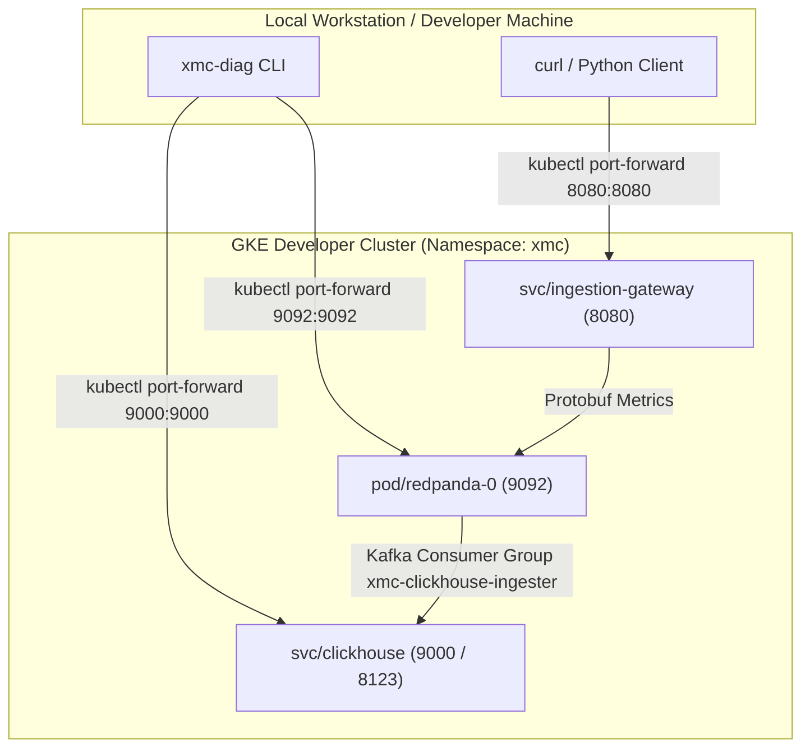

# Developer Cluster Setup & Manual Testing Guide (`deploy/local`)

This directory documents the developer cluster testing workflow for XManager on Cloud (XMC v2) metrics telemetry pipelines.

> [!NOTE]
> In XMC v2, Redpanda and ClickHouse are **Bring-Your-Own (BYO)** infrastructure components managed out-of-band by enterprise platform administrators. They are not bundled as local Docker containers in the delivered XMC product stack.
> For developer testing, BYO Redpanda and ClickHouse instances are deployed directly onto a GKE developer test cluster (e.g. `xmc` namespace in project `xmc-example-project`) via Helm addons ([`deploy/addons/metrics/`](../addons/metrics)).

---

## 1. Developer Test Cluster Architecture



---

## 2. Port-Forwarding to GKE Developer Cluster

Authenticate to your target GKE developer cluster and open port-forwards for local testing:

```bash
# 1. Authenticate to GKE cluster
gcloud container clusters get-credentials <CLUSTER_NAME> \
    --region <REGION> \
    --project <PROJECT_ID>

# 2. Port-forward ClickHouse native TCP port (9000)
kubectl port-forward svc/clickhouse 9000:9000 -n xmc &

# 3. Port-forward Redpanda service (9092)
kubectl port-forward svc/redpanda 9092:9092 -n xmc &

# 4. Port-forward Ingestion Gateway HTTP service (8080)
kubectl port-forward svc/ingestion-gateway 8080:8080 -n xmc &
```

---

## 3. Diagnostic Health Check (`xmc-diag`)

Run `xmc-diag` from your local machine to verify ClickHouse schema initialization (`xmc_metrics`, `xmc_metrics_queue`, `xmc_metrics_mv`) and Redpanda consumer lag:

```bash
go run ./tools/xmc-diag \
  --clickhouse_host=127.0.0.1 \
  --clickhouse_port=9000 \
  --redpanda_brokers=127.0.0.1:9092 \
  --dial_with_seed_only=true \
  --consumer_group=xmc-clickhouse-ingester
```

*Expected Output:*
```text
=== XMC Diagnostic Report ===
Overall Status: HEALTHY
Timestamp: ...

--- ClickHouse ---
  Status: HEALTHY
  Connected: true
  Version: 26.7.1...
  Missing Schema Tables: None
  Query Latency: 130ms

--- Redpanda / Kafka ---
  Status: HEALTHY
  Connected: true
  Broker Count: 1
  Topic Partitions: 1
  Consumer Group Lag:
    Group: xmc-clickhouse-ingester
    Topic: xmc-metrics
    Total Lag: 0 records
```

---

## 4. Emitting Metric Streams & Manual Ingestion Flow

### Step 1: Submit Metric Payload to Ingestion Gateway

Send sample JSON metric records to the port-forwarded Ingestion Gateway:

```bash
curl -X POST http://localhost:8080/api/v1/metrics \
  -H "Content-Type: application/json" \
  -d '[
    {
      "xid": 1001,
      "work_unit_id": 1,
      "execution_id": 1,
      "replica_id": "worker-0",
      "metric_name": "train_loss",
      "metric_value": 0.85,
      "step": 10,
      "timestamp": 1770000000000000
    },
    {
      "xid": 1001,
      "work_unit_id": 1,
      "execution_id": 1,
      "replica_id": "worker-0",
      "metric_name": "train_loss",
      "metric_value": 0.72,
      "step": 20,
      "timestamp": 1770000010000000
    },
    {
      "xid": 1001,
      "work_unit_id": 1,
      "execution_id": 1,
      "replica_id": "worker-0",
      "metric_name": "train_loss",
      "metric_value": 0.65,
      "step": 20,
      "timestamp": 1770000020000000
    }
  ]'
```

*Expected Response:*
```json
{"status":"accepted","valid_count":3}
```

---

### Step 2: Verify ClickHouse Streaming Ingestion & Deduplication Queries

ClickHouse reads Protobuf records asynchronously from Redpanda topic `xmc-metrics` via `xmc_metrics_queue` and materializes them into `xmc_metrics`.

Execute verification queries directly against ClickHouse via `kubectl exec`:

#### 1. Query Raw Ingested Rows
```bash
kubectl exec -it svc/clickhouse -n xmc -- clickhouse-client --query \
  "SELECT xid, work_unit_id, metric_name, metric_value, step, timestamp, created_at FROM xmc_metrics ORDER BY timestamp ASC;"
```

#### 2. Query Deduplicated Metrics (`argMax(metric_value, created_at)`)
```bash
kubectl exec -it svc/clickhouse -n xmc -- clickhouse-client --query \
  "SELECT xid, work_unit_id, metric_name, step, argMax(metric_value, created_at) AS latest_value FROM xmc_metrics GROUP BY xid, work_unit_id, metric_name, step ORDER BY step ASC;"
```
---

## 5. Local KinD Development Quickstart

For detailed CLI options, configuration resolution precedence, dynamic service discovery, and architecture specifications, refer to the [Development Environment Tooling Guide](../../tools/dev_env/README.md).

### Quickstart Workflow

```bash
# 1. Start full local environment (Spanner databases, KinD cluster, images, and Helm release)
python3 tools/dev_env/dev_env.py up

# 2. Hot-reload changed microservices on demand
python3 tools/dev_env/dev_env.py reload

# 3. Or enable continuous live watch mode (auto-rebuilds and restarts on file save)
python3 tools/dev_env/dev_env.py reload --watch

# 4. Check cluster health and service pod readiness
python3 tools/dev_env/dev_env.py status

# 5. Stream container logs from a specific service
python3 tools/dev_env/dev_env.py logs reconciler -f

# 6. Tear down local environment when finished
python3 tools/dev_env/dev_env.py down
```

> [!TIP]
> Configuration parameters (such as project ID, Spanner instance, and microservices) can be configured via `deploy/local/xmanager-cloud-local.yaml`, environment variables, or CLI flags. See the [Configuration Architecture Guide](../../tools/dev_env/README.md#configuration-architecture-localdevconfig) for the full configuration reference and resolution precedence rules.

---

## 6. Fast Reload Architecture & Optimization Roadmap

### Current Baseline (Level 1: Direct Container Streaming)

The current local development workflow uses **Direct Container Streaming & Fast Probes**:
1. **Delta-Scoped Change Detection**: Only the exact files modified in a given save are evaluated by `ChangeDetector`, ignoring unrelated dirty files.
2. **Direct KinD `containerd` Streaming**: Bazel-built OCI tarballs are piped directly into the KinD node's `containerd` via `ctr --namespace=k8s.io images import -`, bypassing the intermediate host `docker load` and `kind load` double-tar roundtrip (~15s saved).
3. **Aggressive Dev Probes & Instant Pod Swaps**: Local deployments are patched with `initialDelaySeconds: 1`, `periodSeconds: 1`, and `terminationGracePeriodSeconds: 0`, eliminating rollout stalls.
4. **Persistent BuildKit Cache Mounts**: Angular builds in `cmd/ui/build_ui_oci.py` utilize BuildKit `--mount=type=cache,target=/app/.angular/cache` and development configuration.

#### Performance Profile

| Component | Reload Latency | Dominant Phase |
| :--- | :---: | :--- |
| **Go Backends (ESS, XID, Reconciler)** | **~15–19s** | Bazel transitive graph analysis across 14,000+ proto/Go targets (~13s) + Pod rollout (~4s) |
| **Angular UI** | **~35–42s** | Docker BuildKit container spawn + Angular build + tarball export (~35s) + Pod rollout (~3s) |

---

### Future Roadmap: Level 2 In-Pod Binary & Asset Sync (Fast Inner Loop)

For sub-5-second local iteration loops, a **Level 2 In-Pod Sync** pattern can be implemented in the future (e.g. via `dev_env.py reload --fast` or `-f`):
- **Go Backends**: Compile the bare Linux ELF binary via Bazel (`//cmd/<service>`) in ~1.5s, sync `/bin/<service>` directly into the active pod via `kubectl cp` or `hostPath`, and trigger an in-pod process restart (~50ms).
- **Angular UI**: Execute `ng build --configuration development` on host in ~3s, and sync `dist/browser` directly into Nginx's `/usr/share/nginx/html` without restarting the pod.

#### Trade-Offs & Parity Drifts to Consider

When implementing Level 2 in-pod syncing, be aware of the following architectural trade-offs:

1. **Pod Ephemerality Drift ("Disappearing Fixes")**:
   - In Level 2, code is synced into the active pod's writable layer, not the immutable container image.
   - If a pod crashes, runs out of memory (OOM), or gets rescheduled by Kubernetes, it will restart from the older base image stored in `containerd`, temporarily reverting uncommitted hot-fixes until the next sync or full build.
2. **Dockerfile & Container Configuration Blindspots**:
   - Level 2 only syncs compiled application artifacts (`*.go`, `*.ts`, `*.html`, `*.scss`).
   - Edits to `Dockerfile`, `nginx.conf`, entrypoint shell scripts, or new system package dependencies (`apk add`) are completely bypassed during in-pod sync and require a full Level 1 container rebuild to take effect.
3. **Host Toolchain vs. Container Toolchain Drift**:
   - Host `ng build` runs using the host machine's Node.js and npm versions rather than the hermetic, container-pinned `node:22-alpine` environment.
   - Non-hermetic Go builds could potentially pick up host glibc libraries if CGO is enabled, rather than static Alpine `musl` binaries.
4. **Container Security Context Drift**:
   - Production GKE deployments enforce `readOnlyRootFilesystem: true` and non-root users (`runAsUser: 1000`).
   - In-pod hot-syncing requires target paths (`/bin/` or `/usr/share/nginx/html`) to be writable, requiring relaxed filesystem security or dedicated `emptyDir`/`hostPath` volume mounts in local dev manifests.
5. **Process Lifecycle & PID 1 Behavior**:
   - In production, microservice binaries execute as PID 1. If the binary exits, the container terminates.
   - In-pod hot-restarting requires a lightweight supervisor or wrapper script inside the dev container to restart the process in-place without triggering Kubernetes `CrashLoopBackOff`.

#### Recommended Hybrid Implementation Strategy

To safely leverage Level 2 velocity without risking production drift:
1. Provide Level 2 as an opt-in fast flag (e.g. `dev_env local reload -w --fast`).
2. Automatically fall back to a full Level 1 container rebuild whenever `package.json`, `go.mod`, `Dockerfile`, or `deploy/` templates are modified.
3. Run a full hermetic verification (`dev_env build-images` or Bazel test suite) prior to opening Pull Requests.
