<!--
Copyright 2026 Google LLC

Licensed under the Apache License, Version 2.0 (the "License");
you may not use this file except in compliance with the License.
You may obtain a copy of the License at

    http://www.apache.org/licenses/LICENSE-2.0

Unless required by applicable law or agreed to in writing, software
distributed under the License is distributed on an "AS IS" BASIS,
WITHOUT WARRANTIES OR CONDITIONS OF ANY KIND, either express or implied.
See the License for the specific language governing permissions and
limitations under the License.
-->

# `stable-2026a` Component Profile

This directory is the `stable-2026a` profile: a Helm meta-chart (`xmc-profile-stable-2026a`) that renders the `Component` custom resources (`components.xmc.dev/v1alpha1`) for every catalog component in the profile from a single admin values file.

The meta-chart has no Helm `dependencies:`. It reads each co-located component chart under [`components/`](components/) through `.Files` and renders only that chart's `templates/component.yaml`. Component workloads are installed separately by `xmc-bridge` as `xmc-cmp-<name>` releases from the same component charts.

## Layout

| Path | Purpose |
| :--- | :--- |
| [`Chart.yaml`](Chart.yaml) | Meta-chart metadata. The `xmc.dev/profile` annotation carries the profile name. |
| [`values.yaml`](values.yaml) | Admin values: `global` settings and `components.<name>` overrides. All components are disabled by default. |
| [`values.schema.json`](values.schema.json) | Strict schema for admin values. Unknown components and keys are rejected. |
| [`templates/components.yaml`](templates/components.yaml) | Emits one `Component` CR per catalog component, in dependency order. |
| [`templates/_helpers.tpl`](templates/_helpers.tpl) | Value merging and `component.yaml` rendering helpers. |
| [`profile.yaml`](profile.yaml) | Profile metadata: `name`, `minXmcVersion`, `supportWindow`. |
| [`rules.yaml`](rules.yaml) | Static checks and compatibility matrix used by the [component linter](../../../cmd/component-linter/README.md). |
| [`components/`](components/) | Component charts: [`redpanda`](components/redpanda/README.md), [`clickhouse`](components/clickhouse/README.md), [`ingestion-gateway`](components/ingestion-gateway/README.md), [`vizier`](components/vizier/README.md) (`EXPERIMENTAL`), [`hpo`](components/hpo/README.md) (`EXPERIMENTAL`). |
| [`charts.go`](charts.go) | Embeds the `ingestion-gateway` and `hpo` 1P charts into `xmc-bridge`. |

## Admin Workflow

### Prerequisites

The XMC umbrella chart must be installed with `enable_components=true` (Helm value `componentsDeployment.enabled=true`). That installs `xmc-bridge`. The chart installs the `Component` CRD and the `component-deletion-protection` admission policy regardless of the flag and never deletes them (see [CRD lifecycle](../../../cmd/xmc_bridge/README.md#crd-lifecycle)).

Components are an unlaunched feature, so install the profile fresh. If you installed a component chart directly as its own Helm release during development, uninstall that release first. To migrate an existing umbrella-managed `ingestion-gateway` deployment (`enable_components=false`) to this profile without downtime, follow [`docs/migrations/components.md`](../../../docs/migrations/components.md).

### Install

Install the profile as a single release:

```bash
# 1. Render the Component CRs with your overrides.
mkdir -p rendered
helm template xmc-profile deploy/profiles/stable-2026a -n xmc -f my-values.yaml > rendered/profile.yaml

# 2. Validate dependencies, schema, and the compatibility matrix offline.
go run ./cmd/component-linter \
  --manifests-dir=rendered \
  --rules-config=deploy/profiles/stable-2026a/rules.yaml

# 3. Install the same values, or commit rendered/ to your GitOps repository instead.
helm install xmc-profile deploy/profiles/stable-2026a -n xmc -f my-values.yaml
```

The release name must not start with `xmc-cmp-`, which is reserved for `xmc-bridge` component releases; rendering fails if it does.

To isolate a template error in one component, render that component chart on its own, for example `helm template redpanda deploy/profiles/stable-2026a/components/redpanda`.

Example `my-values.yaml` enabling the metrics pipeline:

```yaml
components:
  redpanda:
    enabled: true
  clickhouse:
    enabled: true
    parameters:
      storageSize: "50Gi"
  ingestion-gateway:
    enabled: true
```

### Disable or Uninstall

`Component` CRs default to `deletionProtection: true`, and the `component-deletion-protection` admission policy denies deleting a `Component` unless its `spec.deletionProtection` is `false`. The policy has no `xmc-platform-admins` group exemption; only the Kubernetes namespace controller and garbage collector, and `system:masters`, bypass it.

- **Disable a component:** set `components.<name>.enabled=false` and run `helm upgrade`. The CR stays, and `xmc-bridge` removes the `xmc-cmp-<name>` workload release.
- **Uninstall the profile:** first run `helm upgrade` with `components.<name>.deletionProtection=false` for every component, then run `helm uninstall xmc-profile -n xmc`.
- **Recover a stuck uninstall:** if the admission policy denied the uninstall and the release is stuck in `uninstalling`, patch each remaining CR, for example `kubectl patch components.xmc.dev <name> -n xmc --type=merge -p '{"spec":{"deletionProtection":false}}'`, then run `helm uninstall` again.
- **Remove a component from the catalog:** first ship a profile patch that sets the component to `enabled: false` and `deletionProtection: false`. Otherwise the admission policy denies the delete that the next `helm upgrade` performs.
- **Remove a component under GitOps (Argo CD, Flux):** use two commits, and let the first one sync before you push the second.
  1. Set `deletionProtection: false` (and `enabled: false`) for the component.
  2. Remove the component from the values.

  A single commit fails the prune, because the admission policy still sees `deletionProtection: true` on the live CR. To keep CRs out of automated pruning entirely, add `Prune=false` to their `argocd.argoproj.io/sync-options` annotation instead. The CRs already carry that annotation with `SkipDryRunOnMissingResource=true`, and Argo CD reads a single comma-separated value, so set it to `SkipDryRunOnMissingResource=true,Prune=false`. The profile has no value for extra sync options: set the annotation with a Kustomize patch or a Helm post-renderer, or turn off automated pruning for the whole Argo CD Application (`syncPolicy.automated.prune: false`).

Renders with `deletionProtection: false` intentionally fail the component linter, because the profile [`rules.yaml`](rules.yaml) sets `enforceDeletionProtection: true`. Apply these teardown and removal steps without the lint gate.

### Experimental components

Catalog components declare a `spec.stability` level (`EXPERIMENTAL`, `PREVIEW`, or `STABLE`) in their component chart's `values.yaml` (`redpanda`, `clickhouse`, and `ingestion-gateway` are `STABLE`; `vizier` and `hpo` are `EXPERIMENTAL`). `STABLE` and `PREVIEW` components can be enabled with `enabled: true` alone. Enabling an `EXPERIMENTAL` component requires an explicit acknowledgement in your admin values:

```yaml
components:
  vizier:
    enabled: true
    acknowledgeExperimental: true
  hpo:
    enabled: true
    acknowledgeExperimental: true
```

Without `acknowledgeExperimental: true`, an enabled `EXPERIMENTAL` component is rejected by Kubernetes CRD CEL validation at admission time and by `component-linter`. Admins cannot override `stability` through profile values.

## Values Contract

Per-component overrides live under `components.<name>` and are deep-merged over that component's `values.yaml`. Explicit `false`, `0`, and `""` overrides are honored, and lists (such as `dependencies`) replace the defaults. `null` overrides are not supported: the schema rejects most of them, and Helm drops the rest so the component default applies. Use `[]` or an explicit value instead.

| Key | Components | Description |
| :--- | :--- | :--- |
| `global.platformProfile` | all | Fixed to `stable-2026a`. |
| `global.imageTag` | `ingestion-gateway`, `hpo` | Image tag rendered into `spec.imageTag`. |
| Other `global.*` keys | none | Accepted so the profile can be nested under a wrapper chart with its own globals; the component templates ignore them. |
| `enabled` | all | Renders `spec.enabled`. |
| `namespace` | all | Namespace of the `Component` CR. Must be a DNS-1123 label. |
| `deletionProtection` | all | Renders `spec.deletionProtection`. |
| `deletionPolicy` | all | `Delete` or `Orphan`. |
| `acknowledgeExperimental` | all | Renders `spec.acknowledgeExperimental` to opt into enabling an `EXPERIMENTAL` component (`vizier`, `hpo`). |
| `parameters` | all | Component parameters. `redpanda`, `clickhouse`, `vizier`, and `hpo` accept only the parameters documented in their READMEs; `ingestion-gateway` passes extra keys through. |
| `dependencies` | all | Component names rendered into `spec.dependencies`. |
| `imageTag` | `ingestion-gateway`, `hpo` | Used when `global.imageTag` is empty. |

These keys are rejected by the schema:

- `componentClass`, `stability`, and chart or component versions, because the catalog fixes component identity and maturity level. Each component's `components/<name>/Chart.yaml` is the only version pin.
- Workload keys such as `deployWorkload`, because the profile never renders workloads.

## Runtime Dependencies

Component runtime dependencies are not Helm dependencies. They are expressed in two places:

1. `spec.dependencies` on each `Component` CR, from the component's `values.yaml` (for example, `ingestion-gateway` depends on `redpanda` and `clickhouse`, and `hpo` depends on `vizier` and `clickhouse`). `xmc-bridge` waits for dependencies to be Ready before actuating a component.
2. The `compatibilityMatrix` in [`rules.yaml`](rules.yaml), which the component linter checks against the rendered CRs.

## Versioning

- Each component's `components/<name>/Chart.yaml` `version` is rendered into `spec.version` and `spec.chartVersion`.
- A profile patch release bumps the changed component's `Chart.yaml` version and the patch version in the profile [`Chart.yaml`](Chart.yaml).
- [`profile.yaml`](profile.yaml) records the minimum XMC release and the support window. A test keeps its `name` consistent with the `Chart.yaml` annotation, `values.yaml`, and `values.schema.json`.

## How the Profile Renders Components

[`templates/components.yaml`](templates/components.yaml) calls `xmc-profile.component` from [`templates/_helpers.tpl`](templates/_helpers.tpl) once per catalog component. That helper resolves values the way Helm resolves a sub-chart, then renders the component's own `component.yaml` with `tpl`:

```mermaid
flowchart LR
  chart["readYaml components/NAME/Chart.yaml"] --> values["readYaml components/NAME/values.yaml"]
  values --> body["readFile components/NAME/templates/component.yaml"]
  body --> global["mergeInto global"]
  global --> overrides["mergeInto components.NAME"]
  overrides --> ctx["build .Chart and .Template context"]
  ctx --> tpl["tpl body with context"]
  tpl --> cr["Component CR"]
```



For example, with admin values `global.imageTag: v1.2.3` and overrides under `components.ingestion-gateway`, the rendered `ingestion-gateway` CR resolves as follows:

| Key | Component `values.yaml` | `global` | `components.ingestion-gateway` | Result |
| :--- | :--- | :--- | :--- | :--- |
| `deletionProtection` | `true` | | `false` | `false`: explicit falsy overrides win |
| `parameters.topicName` | `xmc-metrics` | | `custom` | `custom` |
| `parameters.port` | `8080` | | | `8080`: nested maps merge key by key |
| `dependencies` | `[redpanda, clickhouse]` | | `[redpanda]` | `[redpanda]`: lists are replaced |
| `global.imageTag` | `""` | `v1.2.3` | | `v1.2.3`, rendered as `spec.imageTag` |

### Why the Template Looks Unusual

| Pattern | Reason |
| :--- | :--- |
| `.Files.Glob` on a literal path | Helm 3 `.Files` has no callable `Has` method. A missing file fails rendering with a clear error instead of rendering an empty template. |
| `hasKey $parsed "Error"` after `fromYaml` | `fromYaml` returns `{"Error": ...}` for invalid YAML, which would otherwise merge silently into the values or chart metadata. |
| Custom `mergeInto` instead of sprig `merge`/`mergeOverwrite` | Sprig drops falsy overrides, so `deletionProtection: false` would be ignored. |
| Helpers fill a caller-provided dict in place | Named templates can only return strings. |
| `deepCopy` of merged maps | The resolved values never alias a `.Values` map. Lists stay shared, which is safe because component templates never mutate them. |
| Hand-built `tpl` context | `tpl` receives only `.Values`, `.Chart`, `.Release`, `.Capabilities`, and `.Template` (`Name`, `BasePath`); the component chart's `.Files` and named templates are not loaded. |

## Authoring `component.yaml`

The profile renders each `components/<name>/templates/component.yaml` with the limited `tpl` context described above, so these templates must follow these rules:

- Use only `.Values`, `.Chart` (`Name`, `Version`, `AppVersion`), `.Release`, `.Capabilities`, and `.Template`.
- Do not `include` named templates from the component chart's `_*.tpl` files, and do not use `.Files`.
- Do not exclude `components/*/Chart.yaml`, `components/*/values.yaml`, or `components/*/templates/component.yaml` in [`.helmignore`](.helmignore); the profile reads them through `.Files` and fails rendering if one is missing.

When adding a component, add it to the list in [`templates/components.yaml`](templates/components.yaml), to `components` in [`values.yaml`](values.yaml) and [`values.schema.json`](values.schema.json), and to the `:chart` filegroup in [`BUILD.bazel`](BUILD.bazel). [`profile_chart_test.go`](../../../test/helm/profiles/stable2026a/profile_chart_test.go) checks that rendering matches each standalone component chart and that the catalog lists stay consistent.
