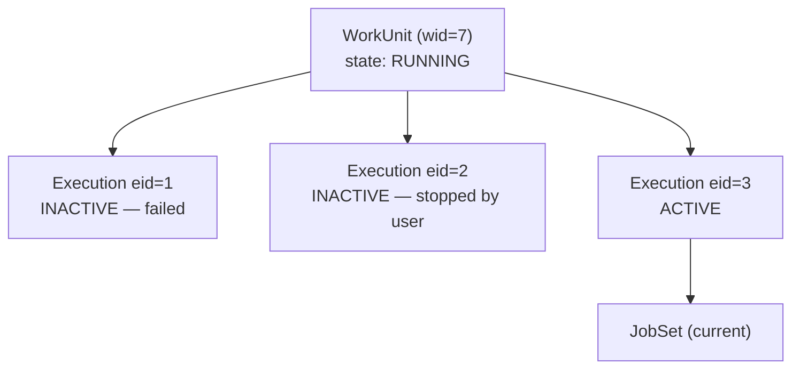
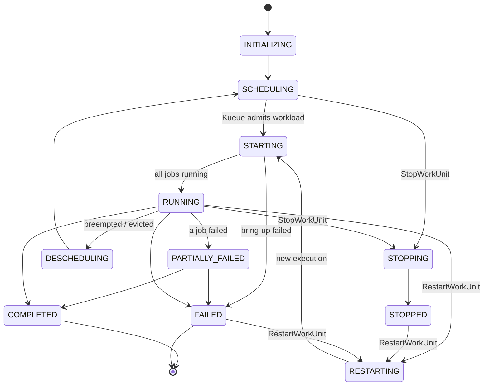

# Execution Model

How XMC represents work, how that work moves through states, and the contracts that govern
retries and scheduling. This is the conceptual core of the platform — most surprising behaviour
elsewhere follows from something on this page.

See [Architecture Overview](overview.md) for the component landscape and
[Main Flows](../flows/README.md) for the sequences that drive these transitions.

---

## 1. Resource Hierarchy

XMC models work as four nested resources. The first three are XMC's own API resources, defined in
[`api/protos/experiment`](../../api/protos/experiment) and named according to Google AIP
conventions; the fourth is the Kubernetes object that physically runs the work.

| Resource | Resource name pattern | Identifier | Meaning |
| :--- | :--- | :--- | :--- |
| Experiment | `experiments/{xid}` | `xid` | A user-owned grouping of related runs, with shared metadata, priority, and access control. |
| WorkUnit | `experiments/{xid}/workUnits/{wid}` | `wid` | One logical run. This is what users start, stop, and restart. |
| WorkUnitExecution | `experiments/{xid}/workUnits/{wid}/executions/{execution_id}` | `eid` | One *attempt* at running the WorkUnit. |
| JobSet | Kubernetes object in a namespace | — | The concrete workload: replicated jobs, pods, containers. |

A fifth resource hangs off the hierarchy rather than sitting inside it:

| Resource | Resource name pattern | Identifier | Meaning |
| :--- | :--- | :--- | :--- |
| Artifact | `artifacts/{aid}` | `aid` | A named output or reference attached to an experiment or work unit — a checkpoint path, a dataset URI, a link to an external system. Pure Spanner CRUD; it never reaches the cluster. |

The relationship that matters most:

> **1 WorkUnit = N sequential WorkUnitExecutions. 1 WorkUnitExecution = exactly 1 JobSet, run from
> start to finish.**

A WorkUnit therefore has a history. Restarting it does not reuse the previous JobSet — it produces
a new `WorkUnitExecution` with a new `eid` and a new JobSet, and the previous execution is
retained. Exactly one execution is `ACTIVE` at a time; all others are `INACTIVE`
(`WorkUnitExecution.WorkUnitExecutionState`). `GetCurrentWorkUnitExecution` returns the active one;
`ListWorkUnitExecutions` returns the history.

---

## 2. Work Unit State Machine

`WorkUnitStatus.WorkUnitState`
([`status.proto`](../../api/protos/experiment/status.proto)) has twelve values. Two are terminal.

| State | Meaning |
| :--- | :--- |
| `INITIALIZING` | Being prepared before launch. |
| `SCHEDULING` | Waiting for resources from the scheduler (Kueue has not admitted it). |
| `STARTING` | Admitted and being launched. |
| `RUNNING` | All jobs are running. |
| `PARTIALLY_FAILED` | At least one job failed while another is still active. |
| `STOPPING` | User requested a stop; transitioning to `STOPPED`. |
| `RESTARTING` | User requested a restart; stopping the current job before transitioning to `STARTING`. |
| `DESCHEDULING` | Descheduled by the scheduler (for example, preempted); transitioning back to `SCHEDULING`. |
| `STOPPED` | Stopped by the user. Will not continue without user interaction. |
| `COMPLETED` | **Terminal.** Finished successfully. |
| `FAILED` | **Terminal.** Finished unsuccessfully, or bring-up failed. |
| `WORK_UNIT_STATE_UNSPECIFIED` | Should not occur in practice. |

The diagram shows the transitions the platform drives; the authoritative enum and its comments are
in [`status.proto`](../../api/protos/experiment/status.proto).

Two derived signals matter operationally:

- **`SCHEDULING` that never advances** usually means Kueue cannot admit the workload — insufficient
  quota, no matching resource flavor, or an inadmissible request. The Reconciler's Workload
  reconciler surfaces the reason as a status message rather than leaving the work unit silently
  pending.
- **`STARTING` that never advances** is caught by the startup pod error check: the JobSet
  reconciler waits `startup_pod_error_check_time` (2m) after JobSet creation, then inspects the
  pods for image pull failures, scheduling errors, and similar bring-up problems.

Both diagnostics are on in every deployment. `detectInadmissibleWorkUnits` and
`startupPodErrorCheckEnabled` still exist as kill switches and both default to `true`, so read
them as "how to turn this off", not as something an operator has to turn on.

### Experiment-level state

An experiment aggregates its work units rather than having its own execution.
`ExperimentStatus` reports:

- `ActiveState` — `ACTIVE` if at least one work unit is active or the experiment is currently
  launching, otherwise `INACTIVE`.
- `LaunchState` — `LAUNCHING`, `COMPLETED`, or `FAILED`, together with a `launch_id`. This tracks
  the *submission* of an experiment, which the client advances with
  `UpdateExperimentLaunchState`; a client that dies mid-launch leaves the experiment visibly
  `LAUNCHING` rather than looking complete.
- `StateCount` entries — how many child work units are in each `WorkUnitState`.
- `MessageSeverityCount` entries — how many status messages exist at each severity.

---

## 3. Long-Running Operations

`CreateWorkUnit`, `StopWorkUnit`, `RestartWorkUnit`, and their `Batch*` variants return a
`google.longrunning.Operation` rather than a finished result.

None of these RPCs touch the cluster. What they do is durably record an intent that *will* change
it: ESS commits the state change, hands a signed actuation payload to the Actuator through Redis,
and returns. The Actuator is the only component that talks to the Kubernetes API, and it does so
after the RPC has already answered.

The sequence is always the same:

1. ESS authorizes the call against the XID Service.
2. ESS writes the state change to Spanner, then records an `Operation` row for the caller to poll.
3. ESS enqueues a signed actuation payload to the Redis stream.
4. ESS returns the `Operation` — typically within milliseconds, and before any pod exists.
5. The Actuator performs the cluster mutation and marks the `Operation` done.

Steps 2 and 3 are separate writes rather than one atomic commit, so a crash between them can leave
an operation with no queued task — see
[Work Unit Lifecycle §7](../flows/work_unit_lifecycle.md#7-failure-handling-along-the-path) for how
that case is recovered.

Clients poll the operation, or simply watch the work unit's state converge. The decoupling is what
lets a `BatchStopWorkUnits` call over hundreds of work units return promptly, and what makes the
whole path retryable: if the Actuator crashes mid-batch, the unacknowledged messages stay in the
Redis stream and are reclaimed by another consumer.

See [Work Unit Lifecycle Flows](../flows/work_unit_lifecycle.md) for the full sequences.

---

## 4. The Non-Restarting JobSets Contract

This is XMC's most important invariant, and it constrains the design above.

> **Work that already completed successfully must never be re-executed without explicit user
> input.**

Concretely:

| Rule | Rationale |
| :--- | :--- |
| `JobSetSpec.FailurePolicy.MaxRestarts` **must always be `0`**. | A JobSet-level restart re-runs *every* job in the set, including the ones that already succeeded. |
| Full retries happen only at the XMC WorkUnit level, by creating a new `WorkUnitExecution`. | This keeps the retry decision visible, attributable, and recorded in execution history. |
| Pod-level replacement is permitted. | `JobSpec.BackoffLimit` replaces *failed* pods only; it never re-runs a pod that already succeeded. |
| Container-level `restartPolicy: Always` on native sidecar init containers is permitted. | Same reason: it restarts a failed sidecar, not completed work. |
| Pod `restartPolicy: Always` is **forbidden**. | In-place pod restarts without coordinator synchronisation cause multi-host deadlocks in distributed training. |

The Actuator enforces the `MaxRestarts` rule programmatically — JobSet construction in
[`cmd/actuator/k8s_client/jobset.go`](../../cmd/actuator/k8s_client/jobset.go) sets it to `0` and a
validation step rejects any JobSet where it is not, with a `contract violation` error.

Per-job knobs users *can* set on a `KubernetesJob`
([`work_unit.proto`](../../api/protos/experiment/work_unit.proto)):

- `restart_policy` — `"Never"` (default) or `"OnFailure"`. `"Always"` is rejected. Jobs using
  `"OnFailure"` get a default backoff limit of 100.
- `disable_pod_failure_policy` — omit XMC's injected `PodFailurePolicy` so standard Kubernetes
  backoff absorbs expected non-zero exits, which multi-component JobSets with worker daemons need.
- `termination_grace_period_seconds` — how long to wait for graceful shutdown.

The full contract, including the escalation rule for change requests that would violate it, is in
[Architectural Contracts & Invariants](../../.agents/rules/architectural_contracts.md#1-non-restarting-jobsets-contract).

---

## 5. Identifier and Metadata Contract

Every Kubernetes object XMC creates is stamped with the identifiers needed to map it back to
Spanner. Definitions live in
[`internal/kubernetes/common/constants`](../../internal/kubernetes/common/constants/constants.go).

### Labels and annotations

| Key | Kind | Purpose |
| :--- | :--- | :--- |
| `app.kubernetes.io/managed-by: xmc` | label | Marks the object as XMC-managed. Also drives the Cloud Logging sink filter. |
| `xmc.google.com/experiment-id` | label | `xid` |
| `xmc.google.com/work-unit-id` | label | `wid` |
| `xmc.google.com/execution-id` | label | `eid` |
| `xmc.google.com/last-edit` | label | Last edit timestamp, used for conflict detection. |
| `xmc.google.com/author` | annotation | The user who launched the work. |
| `kueue.x-k8s.io/queue-name` | label | Target Kueue local queue. |
| `kueue.x-k8s.io/priority-class` | label | Resolved `WorkloadPriorityClass` (see [§6](#6-scheduling-and-priority)). |
| `cluster-autoscaler.kubernetes.io/safe-to-evict` | annotation | Autoscaler eviction hint. |
| `jobset.xmanager.cloud/finalizer` | finalizer | Lets the Reconciler record the terminal state before the JobSet disappears. |

### Injected environment variables

Containers receive their own coordinates without any SDK configuration:

`XMC_MANAGED_BY`, `XMC_AUTHOR`, `XMC_NAMESPACE`, `XMC_QUEUE_NAME`, `XMC_EXPERIMENT_ID`,
`XMC_WORK_UNIT_ID`, `XMC_EXECUTION_ID`, `XMC_JOB_INDEX`, `XMC_JOB_NAME`, `XMC_METRICS_ENABLED`,
and — when managed profiling is configured — `XMC_MANAGED_XPROF_GCS_BUCKET`,
`XMC_MANAGED_XPROF_GCS_OBJECT_FOLDER`, `XMC_MANAGED_XPROF_DISPLAY_NAME`,
`XMC_MANAGED_XPROF_RUN_GROUP`.

The `xmc` Python SDK reads `XMC_WORK_UNIT_ID`, `XMC_EXECUTION_ID`, `XMC_JOB_NAME`, and
`XMC_JOB_INDEX` straight from this set to tag its metrics. Note that it expects the experiment ID
as `XMC_XID` rather than the injected `XMC_EXPERIMENT_ID`, so that one must be set explicitly on the
work unit — see
[Metrics & Observability §1.1](../flows/metrics_and_observability.md#11-emission--the-sdk).

### System key precedence

User-supplied labels and annotations are merged *underneath* the system keys above: the Actuator
copies a user key only `if _, exists := labels[k]; !exists`
([`buildJobSetLabelsAndAnnotations`](../../cmd/actuator/k8s_client/jobset.go)). A work unit can add
metadata, never overwrite a reserved key.

This matters more than it sounds. Every identifier the Reconciler parses off a JobSet, and every
label Kueue routes on, comes from this set. If a user could redefine
`xmc.google.com/work-unit-id`, they could silently attach their pods to someone else's work unit.

---

## 6. Scheduling and Priority

XMC does not schedule workloads itself. It hands a labelled JobSet to Kueue and lets Kueue decide
admission against `ClusterQueue` quota.

### Priority mapping

Priority is expressed twice — once on the experiment, once on the work unit — each as
`LOW`, `NORMAL`, or `HIGH` ([`priority.proto`](../../api/protos/experiment/priority.proto)). The
pair is mapped to one of nine Kueue `WorkloadPriorityClass` objects
([`deploy/helm/templates/wpc`](../../deploy/helm/templates/wpc)), with experiment priority
dominating:

| Experiment ↓ / WorkUnit → | `LOW` | `NORMAL` | `HIGH` |
| :--- | :--- | :--- | :--- |
| `LOW` | `exp-low-wu-low` (300) | `exp-low-wu-medium` (310) | `exp-low-wu-high` (320) |
| `NORMAL` | `exp-medium-wu-low` (600) | `exp-medium-wu-medium` (610) | `exp-medium-wu-high` (620) |
| `HIGH` | `exp-high-wu-low` (900) | `exp-high-wu-medium` (910) | `exp-high-wu-high` (920) |

> [!NOTE]
> The API enum and the priority class names use different words for the middle rung: API `NORMAL`
> maps to `medium` in the class name. Searching the cluster for a `*-normal-*` priority class will
> find nothing — look for `exp-medium-wu-medium`.

The 300-point gaps mean *any* high-priority experiment outranks *every* work unit in a
normal-priority experiment.

The pair is resolved when an actuation task is enqueued, not when the JobSet is built, and the two
halves of it behave differently once work is already running:

- Changing a **work unit's** priority (`UpdateWorkUnit`) enqueues an update task, and the Actuator
  patches `kueue.x-k8s.io/priority-class` on the existing JobSet in place (`updateJobSetPriority`)
  rather than recreating it, so re-prioritising never interrupts running work.
- Changing an **experiment's** priority (`UpdateExperiment`) enqueues nothing. It is read from
  Spanner by the next `CreateWorkUnit`, `RestartWorkUnit`, or `UpdateWorkUnit` in that experiment,
  so it governs work actuated after the change; JobSets already in the cluster keep the class they
  were labelled with until something re-enqueues them.

### Queue observability

Because admission is asynchronous and quota-bound, "why is my job not running?" is a first-class
question. Two mechanisms answer it:

- The **Kueue sync worker** in the Reconciler polls Kueue's pending-workloads endpoint per cluster
  queue and records queue position as scheduling information on the work unit.
- The **ROD Data Provider** exposes cluster queue inventory, running and pending jobs, and the
  submit queue to the `/resources` dashboard.

---

## 7. Failure and Retry Boundaries

Retries exist at four independent layers. Keeping them straight is the key to reasoning about
duplicate work.

| Layer | Mechanism | Bounded by | Re-runs succeeded work? |
| :--- | :--- | :--- | :--- |
| Actuation task | Redis stream redelivery to the `actuator-group` consumer group | 5 retries, 2 min processing timeout, 5 min abandoned-message reclaim, then `xmc-dlq-stream` | No — payloads carry an idempotency key. |
| Pod | `JobSpec.BackoffLimit` replaces failed pods | Per-job backoff limit (100 by default under `restart_policy: "OnFailure"`) | No — only failed pods are replaced. |
| Container | Native sidecar `restartPolicy: Always` on init containers | Kubernetes | No — only the failed sidecar restarts. |
| Execution | A user or automation calls `RestartWorkUnit`, creating a new `WorkUnitExecution` | Explicit user action | Yes, by design and by explicit request. |

Notably absent: JobSet-level restart. That layer is deliberately disabled — see
[§4](#4-the-non-restarting-jobsets-contract).

---

## 8. State Propagation Back to Spanner

Cluster state does not write itself into the API. The Reconciler observes it and the Batcher
persists it.

Three sources produce `WorkUnitExecutionUpdate` values:

| Source | Trigger | Contributes |
| :--- | :--- | :--- |
| JobSet reconciler | `JobSet` create/update/delete events | Aggregate job status, pod-level bring-up errors, terminal state on finalizer removal. |
| Workload reconciler | Kueue `Workload` events | Admission, preemption, and inadmissibility signals. |
| Kueue sync worker | Periodic tick | Pending-queue position for workloads not yet admitted. |

All three call `Batcher.Add(update, source)`, which returns immediately and stores the update in a
map keyed `xid → wid → source`. On each tick the batcher swaps the map, processes experiments in
parallel, flattens each work unit's updates across sources, and issues one
`UpdateWorkUnitExecutions` call per experiment.

Keying by source is what prevents the three producers from clobbering one another: a scheduling
update from the Kueue sync worker and a status update from the JobSet reconciler arriving in the
same tick are merged, not raced. See [Reconciliation Flows](../flows/reconciliation.md).

---

## 9. Related Reading

- [Component Reference](components.md) — the services implementing this model.
- [Main Flows](../flows/README.md) — the sequences that drive these transitions.
- [Use Cases](use_cases.md) — the model from a user's point of view.
- [Architectural Contracts & Invariants](../../.agents/rules/architectural_contracts.md) — the
  normative statement of the contracts summarised here.
