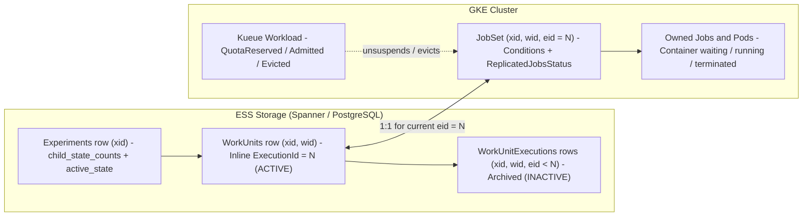
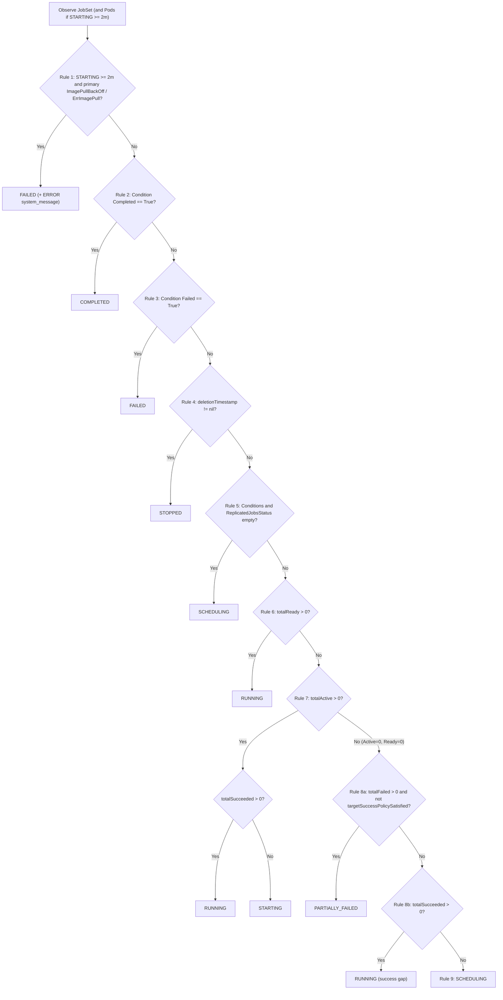
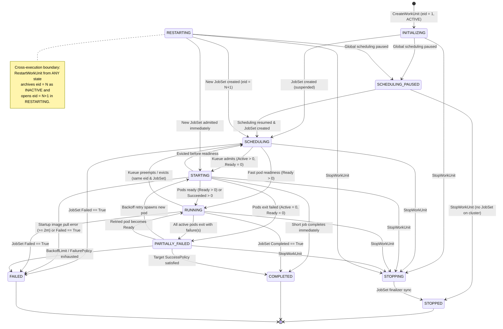
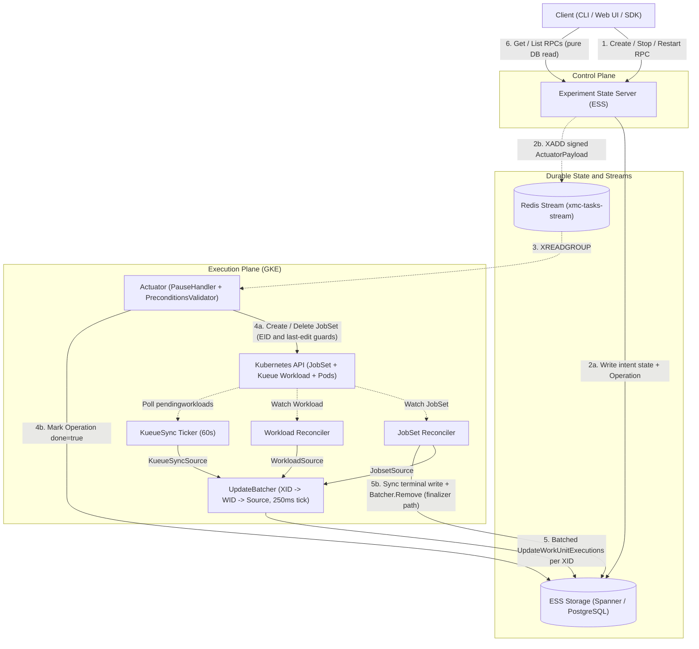
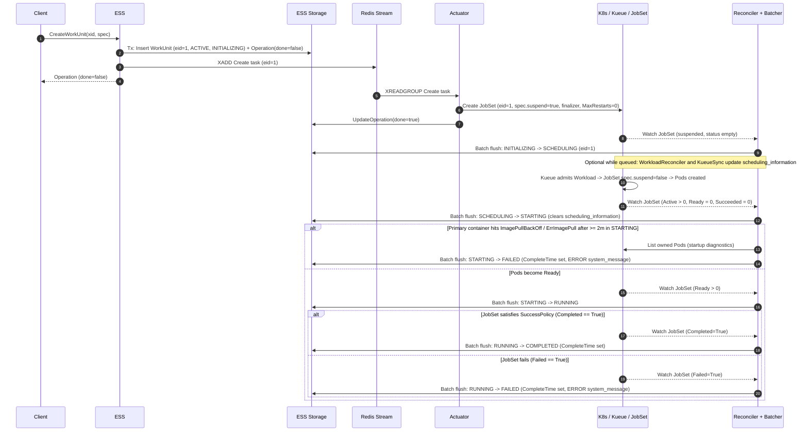
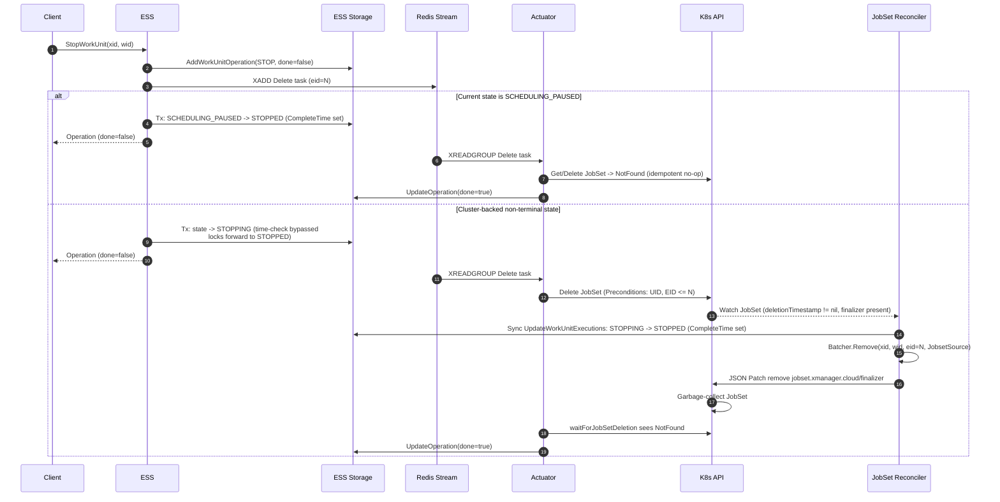
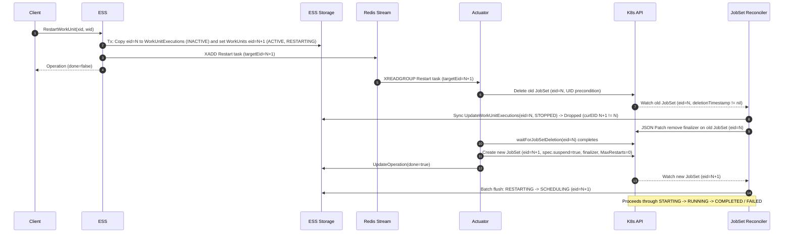
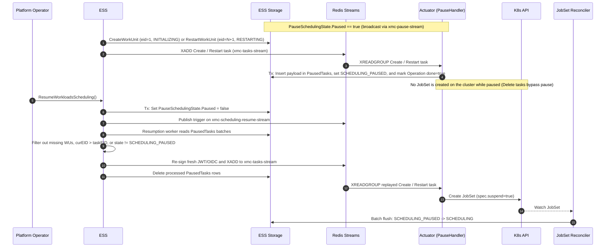

# JobSet, WorkUnitExecution, and WorkUnit States

How Kubernetes `JobSet` conditions and pod counts map to XMC `WorkUnitExecution` and `WorkUnit`
states, which state values and transitions are permitted, how state converges across the intent and
observation loops, and the exact sequence of events during lifecycle changes.

See [Architecture Overview](overview.md) for the platform topology,
[Execution Model](execution_model.md) for the resource hierarchy and retry contract,
[Work Unit Lifecycle Flows](../flows/work_unit_lifecycle.md) for RPC-level actuation details, and
[Reconciliation Flows](../flows/reconciliation.md) for controller internals.

---

## 1. Three-Layer State Model & Storage Layout

XMC tracks workload state across three resource layers plus an experiment-level rollup:

1. **Kubernetes `JobSet` (plus Kueue `Workload` and owned `Pod`s)** — the physical cluster attempt
   (`jobset.x-k8s.io/v1alpha2`). Under the
   [Non-Restarting JobSets Contract](execution_model.md#4-the-non-restarting-jobsets-contract),
   `JobSetSpec.FailurePolicy.MaxRestarts` is always `0` and pod `restartPolicy` is restricted to
   `Never` or `OnFailure`. Exactly **one `JobSet` backs one `WorkUnitExecution`**.
2. **`WorkUnitExecution` (`eid`)** — a single numbered execution attempt of a work unit
   ([`work_unit_execution.proto`](../../api/protos/experiment/work_unit_execution.proto)). Each
   execution carries **two orthogonal state fields**:
   - **Slot state (`WorkUnitExecution.state` / `WorkUnitExecutionState`)**: `ACTIVE` for the
     work unit's current attempt, or `INACTIVE` for historical attempts superseded by a restart.
   - **Run state (`WorkUnitExecution.status.state` / `WorkUnitStatus.WorkUnitState`)**: the
     13-value operational lifecycle of that attempt (`INITIALIZING`, `SCHEDULING`, `STARTING`,
     `RUNNING`, `COMPLETED`, `FAILED`, `STOPPED`, etc. in
     [`status.proto`](../../api/protos/experiment/status.proto)).
3. **`WorkUnit` (`wid`)** — the logical run managed by users
   ([`work_unit.proto`](../../api/protos/experiment/work_unit.proto)). `WorkUnit` has **no
   standalone `state` field**; its state is always projected from its active execution:
   `work_unit.current_work_unit_execution.status.state`.
4. **Parent `Experiment` (`xid`) rollup** — `Experiment.status` maintains denormalized
   `child_state_counts` over each child work unit's *current* `WorkUnitState` and derives
   `Experiment.status.active_state` (`ACTIVE` vs. `INACTIVE`) via
   [`DenormalizeWorkUnitStatus`](../../internal/storage/state/state.go) and
   [`UpdateExperimentActiveState`](../../internal/storage/state/state.go).

### Physical storage representation

In Cloud Spanner and PostgreSQL ([`ess-schema.sql`](../../internal/storage/spanner/schema/ess-schema.sql)),
active and historical executions are stored in separate tables rather than toggling a boolean
column:

- **`WorkUnits` table (inline active execution)**: Stores the work unit definition alongside the
  *current* execution's `ExecutionId`, `WorkUnitStatus`, `ExecutionMetadata`, execution timestamps,
  and a stored generated column `ExecutionState AS (WorkUnitStatus.state)` used for indexed
  filtering. Reads from `WorkUnits` always stamp `WorkUnitExecution.state = ACTIVE`
  ([`spanner/data/workunit.go`](../../internal/storage/spanner/data/workunit.go),
  [`spanner/data/workunitexecutions.go`](../../internal/storage/spanner/data/workunitexecutions.go)).
- **`WorkUnitExecutions` interleaved child table (historical executions)**: Populated **only** when
  `RestartWorkUnit` or `BatchRestartWorkUnits` archives the outgoing execution before incrementing
  `WorkUnits.ExecutionId`
  ([`restartworkunitexecutions.go`](../../cmd/experiment_state_server/server/restartworkunitexecutions.go)).
  Reads from `WorkUnitExecutions` always stamp `WorkUnitExecution.state = INACTIVE`.

> [!IMPORTANT]
> `WorkUnitExecutionState = ACTIVE` means *"current execution slot of the WorkUnit"*, **not**
> *"currently running on the cluster"*. When an execution finishes (`COMPLETED`, `FAILED`, or
> `STOPPED`), its `WorkUnitStatus.state` becomes terminal and `complete_time` is set, while its
> `WorkUnitExecutionState` **remains `ACTIVE`** on the `WorkUnits` row until a user invokes
> `RestartWorkUnit` to allocate `eid + 1`.

---

## 2. Allowed States Across Layers

### 2.1 WorkUnitExecution Slot States (`WorkUnitExecutionState`)

Defined in [`work_unit_execution.proto`](../../api/protos/experiment/work_unit_execution.proto):

| Enum Value | Storage Location | Meaning | When Transitioned |
| :--- | :--- | :--- | :--- |
| `ACTIVE` (`1`) | Inline columns on `WorkUnits` | Current execution attempt returned by `GetWorkUnit` and `GetCurrentWorkUnitExecution`. | Created on `CreateWorkUnit` (`eid=1`) or `RestartWorkUnit` (`eid=N+1`). |
| `INACTIVE` (`2`) | Child row in `WorkUnitExecutions` | Historical execution attempt returned by `ListWorkUnitExecutions` and `GetWorkUnitExecution`. | Copied from `WorkUnits` into `WorkUnitExecutions` during `RestartWorkUnit` / `BatchRestartWorkUnits`. |
| `WORK_UNIT_EXECUTION_STATE_UNSPECIFIED` (`0`) | Never persisted | Protobuf zero value. | Never written by XMC services. |

### 2.2 WorkUnit & Execution Run States (`WorkUnitStatus.WorkUnitState`)

Defined in [`status.proto`](../../api/protos/experiment/status.proto) and governed by
[`internal/storage/state/state.go`](../../internal/storage/state/state.go):

| `WorkUnitState` | Category | Authoritative Writer(s) | Execution-Terminal in Storage? | Meaning |
| :--- | :--- | :--- | :--- | :--- |
| `INITIALIZING` (`1`) | Control-plane intent | ESS (`CreateWorkUnit`) | No | `WorkUnit` and `eid=1` persisted in storage; actuation task queued for `JobSet` creation. |
| `SCHEDULING_PAUSED` (`12`) | Control-plane / Actuator hold | Actuator (`TaskPauseHandler`) | No | Global workload scheduling is paused; task payload is buffered in `PausedTasks` with no `JobSet` on cluster. |
| `SCHEDULING` (`2`) | Cluster queued | JobSet Reconciler | No | `JobSet` exists on cluster (`spec.suspend=true` or zero active/ready/failed/succeeded jobs), awaiting Kueue quota admission. |
| `STARTING` (`3`) | Cluster bring-up | JobSet Reconciler | No | Kueue admitted the workload and at least one job is active (`totalActive > 0`), with `totalReady == 0` and `totalSucceeded == 0`. |
| `RUNNING` (`4`) | Cluster active | JobSet Reconciler | No | At least one job pod is ready (`totalReady > 0`), or jobs have already succeeded while others remain active or are finalizing (`totalSucceeded > 0`). |
| `PARTIALLY_FAILED` (`5`) | Cluster degraded | JobSet Reconciler | No | No jobs are currently active or ready (`totalActive == 0 && totalReady == 0`), `totalFailed > 0`, and `JobSet` has not yet reached `Completed` or `Failed` (nor satisfied target success policy). |
| `DESCHEDULING` (`9`) | Reserved in proto | *None currently* (see [§3.2](#32-control-plane-only-states--preemption-descheduling-nuance)) | No | Defined in `status.proto` for scheduler preemption/eviction; current reconciler transitions `RUNNING → SCHEDULING` directly. |
| `STOPPING` (`6`) | Control-plane intent | ESS (`StopWorkUnit`, `BatchStopWorkUnits`) | No (locks forward transitions to `STOPPED` only) | User requested stop; deletion task queued while `JobSet` teardown and finalizer sync complete. |
| `RESTARTING` (`7`) | Control-plane intent | ESS (`RestartWorkUnit`, `BatchRestartWorkUnits`) | No | Previous `eid` archived as `INACTIVE`; new `eid+1` created as `ACTIVE` while Actuator replaces the `JobSet`. |
| `STOPPED` (`8`) | Execution-terminal | JobSet Reconciler (finalizer path), or ESS directly when stopping from `SCHEDULING_PAUSED` | **Yes** (`WorkUnitTerminalStates`) | Stopped by user and `JobSet` deleted. Execution `eid` is frozen (`complete_time` set); WorkUnit can still be restarted under `eid+1`. |
| `COMPLETED` (`10`) | Execution-terminal | JobSet Reconciler | **Yes** (`WorkUnitTerminalStates`) | `JobSet` satisfied its `SuccessPolicy` (`Completed=True`). Execution `eid` is frozen (`complete_time` set). |
| `FAILED` (`11`) | Execution-terminal | JobSet Reconciler (condition or startup pod diagnostics) | **Yes** (`WorkUnitTerminalStates`) | `JobSet` failed (`Failed=True`) or failed startup image pull checks after `2m`. Execution `eid` is frozen (`complete_time` set). |
| `WORK_UNIT_STATE_UNSPECIFIED` (`0`) | Unset / default | Never written as a target state | No | Protobuf zero value used when an `UpdateMask` omits `status.state`. |

> [!NOTE]
> **Execution finality vs. WorkUnit restartability**: In storage
> ([`WorkUnitTerminalStates`](../../internal/storage/state/state.go)), `STOPPED`, `COMPLETED`, and
> `FAILED` are all **execution-terminal** — none of them can transition to another state on the
> *same* `eid`, all three stamp `WorkUnitExecution.complete_time`, and an experiment whose child
> work units are all in `{STOPPED, COMPLETED, FAILED}` transitions `ExperimentStatus.active_state`
> to `INACTIVE`. At the WorkUnit API level, however, `RestartWorkUnit` can be called on a work unit
> in **any** state (including `COMPLETED`, `FAILED`, `STOPPED`, or `RUNNING`) because restarting
> archives `eid` and starts a fresh `eid + 1`.

### 2.3 Kubernetes `JobSet`, Kueue `Workload`, and `Pod` Signals

Kubernetes `JobSet` (`jobset.x-k8s.io/v1alpha2`) does not expose a single `phase` field. Instead,
XMC inspects a combination of metadata, conditions, aggregated replicated-job counters, Kueue
`Workload` conditions, and pod container states:

| Resource | Signal / Field | Values Observed by XMC | Role in State Derivation |
| :--- | :--- | :--- | :--- |
| `JobSet` | `metadata.deletionTimestamp` & `metadata.finalizers` | Non-nil timestamp + `jobset.xmanager.cloud/finalizer` | Triggers synchronous terminal state persistence (`STOPPED`, unless `Completed`/`Failed` is already `True`) before finalizer removal. |
| `JobSet` | `spec.suspend` | `true` / `false` | Set `true` on creation; flipped `false` by Kueue upon quota admission and flipped back to `true` on Kueue eviction/preemption. |
| `JobSet` | `status.conditions` | `Completed` (`JobSetCompleted`), `Failed` (`JobSetFailed`), `Suspended` (`JobSetSuspended`) | `Completed=True` → `COMPLETED`; `Failed=True` → `FAILED`. `Suspended=False` `LastTransitionTime` anchors the startup pod error timer. |
| `JobSet` | `status.replicatedJobsStatus[]` | Summed across jobs into `JobTotals`: `Ready`, `Active`, `Succeeded`, `Failed`, `Replicas` | Drives `SCHEDULING`, `STARTING`, `RUNNING`, and `PARTIALLY_FAILED`, and populates `WorkUnitStatus.detailed_status.job_statuses`. |
| `JobSet` | `spec.successPolicy` | `operator` (`All` / `Any`), `targetReplicatedJobs` | Suppresses false `PARTIALLY_FAILED` flashes when target leader jobs have already succeeded and non-target workers exit during teardown. |
| Owned `Pod` | `status.containerStatuses[]` / `status.conditions` | Primary container `Waiting.Reason` in `{ImagePullBackOff, ErrImagePull}`; `PodScheduled=False` (`Reason=Unschedulable`) | While `STARTING` after `startup_pod_error_check_time` (`2m`): image pull errors override state to `FAILED`; unschedulable pods keep `STARTING` and emit a `WARNING` message. |
| Kueue `Workload` | `status.conditions` | `QuotaReserved=False` (`Reason=Inadmissible`), `Admitted=True`, `Evicted=True` | Does **not** write `status.state` directly; populates `status.scheduling_information` (`ERROR` when `Inadmissible`) and execution cluster/flavor metadata. |
| Kueue Visibility API | `ClusterQueue` `/pendingworkloads` | `positionInQueue` per pending `Workload` | Polled every `60s` by `KueueSync`; writes `status.scheduling_information` (`INFO` + queue position) without changing `status.state`. |

---

## 3. Mapping Between JobSet and WorkUnit States

### 3.1 Ordered Evaluation Rules (`JobSet` → `WorkUnitState`)

Whenever `JobSetReconciler` processes a `JobSet`, it converts the live object into a
`WorkUnitState` using [`ConvertJobSetToWorkUnitExecutionUpdate`](../../cmd/reconciler/jobset/converter.go),
[`ToWorkUnitState`](../../cmd/reconciler/jobset/converter.go), and
[`handleStartupPodChecks`](../../cmd/reconciler/jobset/startup_diagnostics.go). Rules are evaluated
in strict priority order — the **first matching rule wins**:

| Priority | Condition on `JobSet` (and Owned `Pod`s) | Resulting `WorkUnitState` | Rationale & Edge-Case Handling |
| :---: | :--- | :--- | :--- |
| **1** | `ToWorkUnitState(js) == STARTING`, time since unsuspended (`JobSetSuspended=False`, or `creationTimestamp` fallback) `>= 2m`, and any primary container is waiting with `ImagePullBackOff` or `ErrImagePull` | **`FAILED`** | Fails fast on broken container images instead of hanging in `STARTING` indefinitely; attaches an `ERROR` `system_message`. (Sidecar init containers with `restartPolicy: Always` are excluded; `Unschedulable` pods remain **`STARTING`** with a `WARNING` message.) |
| **2** | `Condition[Completed] == True` | **`COMPLETED`** | Evaluated **before** `deletionTimestamp != nil` so a completed `JobSet` being garbage-collected (for example, TTL cleanup) preserves `COMPLETED` rather than flipping to `STOPPED`. |
| **3** | `Condition[Failed] == True` | **`FAILED`** | Evaluated **before** `deletionTimestamp != nil` for the same reason; surfaces condition message as an `ERROR` `system_message`. |
| **4** | `metadata.deletionTimestamp != nil` | **`STOPPED`** | Active `JobSet` is being deleted (user stop or external `kubectl delete`); persisted synchronously via the finalizer path. |
| **5** | `len(status.conditions) == 0 && len(status.replicatedJobsStatus) == 0` | **`SCHEDULING`** | Newly created `JobSet` before the JobSet controller has populated `status`. |
| **6** | `totalReady > 0` | **`RUNNING`** | "Alive" check: if at least one pod is ready, the workload is running even if Kubernetes momentarily reports `Active == 0` during status propagation. |
| **7a** | `totalActive > 0 && totalSucceeded > 0` | **`RUNNING`** | Some pods have already completed while sibling pods are still active. |
| **7b** | `totalActive > 0 && totalSucceeded == 0` | **`STARTING`** | Evaluated **before** `totalFailed > 0` so a job actively retrying failed pods within `JobSpec.BackoffLimit` reports `STARTING` rather than `PARTIALLY_FAILED`. |
| **8a** | `totalActive == 0 && totalReady == 0 && totalFailed > 0 && !targetSuccessPolicySatisfied(js)` | **`PARTIALLY_FAILED`** | All pods are currently inactive with at least one failure while the `JobSet` as a whole has not yet failed or satisfied its target `SuccessPolicy`. |
| **8b** | `totalActive == 0 && totalReady == 0 && totalSucceeded > 0` | **`RUNNING`** | Bridges the "success gap" where target jobs have succeeded (including when non-target workers failed during leader-triggered teardown) while the JobSet controller is about to stamp `Completed=True`. |
| **9** | Otherwise (`Ready == 0, Active == 0, Failed == 0, Succeeded == 0`) | **`SCHEDULING`** | Covers both newly suspended `JobSet`s awaiting Kueue quota and workloads whose pods terminated after Kueue preemption/eviction (`spec.suspend=true`). |

### 3.2 Control-Plane-Only States & Preemption (`DESCHEDULING`) Nuance

Four active states never appear in the `JobSet` mapping diagram above because they represent
control-plane or actuation states *prior to* or *superseding* cluster observation:

- **`INITIALIZING`** — written exclusively by ESS during `CreateWorkUnit` before any `JobSet`
  exists ([`createworkunit.go`](../../cmd/experiment_state_server/server/createworkunit.go)).
- **`RESTARTING`** — written exclusively by ESS during `RestartWorkUnit` / `BatchRestartWorkUnits`
  on the newly allocated `eid + 1` before the Actuator replaces the `JobSet`
  ([`restartworkunitexecutions.go`](../../cmd/experiment_state_server/server/restartworkunitexecutions.go)).
- **`STOPPING`** — written exclusively by ESS during `StopWorkUnit` / `BatchStopWorkUnits` before
  the Actuator deletes the `JobSet`
  ([`batchstopworkunits.go`](../../cmd/experiment_state_server/server/batchstopworkunits.go)).
- **`SCHEDULING_PAUSED`** — written exclusively by the Actuator's `TaskPauseHandler` when global
  workload scheduling is paused and the `Create`/`Restart` task is parked in `PausedTasks` instead
  of creating a `JobSet`
  ([`pause_handler.go`](../../cmd/actuator/pausescheduling/pause_handler.go)).

**`DESCHEDULING` in `status.proto` vs. production behavior:**
`WorkUnitState.DESCHEDULING` (`9`) is defined in [`status.proto`](../../api/protos/experiment/status.proto)
to describe scheduler preemption/eviction, and the Web UI includes display styling for it. However,
**no backend producer currently writes `DESCHEDULING`**. When Kueue preempts or evicts a workload,
Kueue sets `JobSet.spec.suspend = true` and terminates active pods; as `totalReady` and
`totalActive` drop to `0`, `JobSetReconciler` transitions the execution directly from `RUNNING` (or
`STARTING`) back to `SCHEDULING` via Rule 9 on the **same `eid` and same `JobSet`**.

### 3.3 Field Ownership Across Execution Writers

Multiple services call `UpdateWorkUnitExecutions`, each scoped to disjoint `google.protobuf.FieldMask`
paths so concurrent telemetry and scheduling updates never clobber `status.state`:

| Writer Component | Batcher Source | Mutates `status.state`? | Masked Fields Written |
| :--- | :--- | :---: | :--- |
| **ESS** (`Create` / `Stop` / `Restart`) | Direct transaction | **Yes** | `INITIALIZING`, `STOPPING`, `STOPPED` (only from `SCHEDULING_PAUSED`), `RESTARTING` (on `eid+1`). |
| **Actuator** (`TaskPauseHandler`) | Direct transaction | **Yes** | `status.state = SCHEDULING_PAUSED`, `status.state_update_time` (only when global scheduling is paused). |
| **Actuator** (`WorkUnitTaskHandler`) | Direct (`Operations` repo) | **No** | Marks `Operations.done = true` (or error); never writes `RUNNING` or `STOPPED`. |
| **Reconciler — `JobSetReconciler`** | `JobsetSource` (or direct on finalizer) | **Yes** | `status.state`, `status.state_update_time`, `status.detailed_status`, `status.system_message` (on failure/startup check), `metadata.job_manifest` (when MLRun enabled). |
| **Reconciler — `WorkloadReconciler`** | `WorkloadSource` | **No** | `metadata.{executing_cluster, multi_kueue_cluster_name, resource_flavor, node_selectors}`, plus `status.scheduling_information` (`ERROR` when `QuotaReserved=False, Reason=Inadmissible`) ([`workload/converter.go`](../../cmd/reconciler/workload/converter.go)). |
| **Reconciler — `KueueSync`** | `KueueSyncSource` | **No** | `status.scheduling_information` (`INFO` message + `QueueInfo.position_in_queue`) ([`kueue_sync.go`](../../cmd/reconciler/kueue_sync/kueue_sync.go)). |
| **Log Monitor** | Direct transaction | **No** | `status.user_message` extracted from Cloud Logging / Pub/Sub container logs ([`log_processor.go`](../../cmd/log_monitor/log_processor.go)). |

---

## 4. Allowed State Transitions & Storage Guard Rules

### 4.1 Execution-Scoped vs. WorkUnit-Scoped State Machine

Transitions divide into **intra-execution transitions** (mutating `WorkUnits` in place for a fixed
`eid`) and **cross-execution restarts** (archiving `eid=N` as `INACTIVE` in `WorkUnitExecutions` and
initializing `eid=N+1` as `ACTIVE` in `RESTARTING`):

### 4.2 Transition Matrix & Monotonicity Guards

Every call to [`UpdateWorkUnitExecutions`](../../internal/workunit/updateworkunitexecutions.go)
runs inside a read-write database transaction (`RunInTransaction`) and evaluates
[`ShouldUpdateWorkUnitExecutionState`](../../internal/storage/state/state.go) and
[`MergeWorkUnitExecution`](../../internal/storage/data/workunitexecutions.go) before persisting
a state change on the current `eid`:

1. **Execution ID Fencing (`curEID == update.EID`)**:
   If `update.EID != currentWorkUnit.ExecutionId`, the update is **dropped completely** and logged
   (`updateworkunitexecutions.go`). Late Reconciler or Log Monitor updates from an archived
   execution (`eid=N`) can never corrupt `eid=N+1` after a restart.
2. **Same-State Idempotency (`currentState == newState`)**:
   Returns `false` for state transition so the original `status.state_update_time` is preserved,
   while still merging any other fields in `UpdateMask` (such as `detailed_status`, `metadata`, or
   messages).
3. **Forward Transition Allowlist (`WorkUnitAllowedForwardTransitions`)**:
   - `STOPPED → ∅`, `COMPLETED → ∅`, `FAILED → ∅`: Once an execution reaches a terminal state, no
     further state changes are accepted for that `eid`.
   - `STOPPING → {STOPPED}`: Once `StopWorkUnit` commits `STOPPING`, **only `STOPPED` is
     permitted**. In-flight `STARTING`, `RUNNING`, `PARTIALLY_FAILED`, `COMPLETED`, or `FAILED`
     observations from the Reconciler cannot revert or override the user's stop intent.
   - All other non-terminal states allow transitions to any target state not blocked by backward
     rules.
4. **Backward Transition Blocklist (`WorkUnitAllowedBackwardTransitions`)**:
   - `* → INITIALIZING`: Rejected (`{}`).
   - `* → RESTARTING`: Rejected (`{}`) via `UpdateWorkUnitExecutions` (`RESTARTING` can only be
     entered by allocating a brand-new `eid + 1` in `RestartWorkUnitExecutions`).
5. **Timestamp Monotonicity & `STOPPING` Clock-Skew Bypass**:
   - `newExecution.status.state_update_time` must be valid (non-zero) and
     `>= currentExecution.status.state_update_time` (`!currentTime.After(newTime)`).
   - **Exception (`WorkUnitTimeIgnoredStates = {STOPPING}`)**: `STOPPING` bypasses the timestamp
     ordering check so a user `StopWorkUnit` request on ESS is never rejected if a GKE Reconciler
     node's clock was slightly ahead when writing `RUNNING`.
6. **Graceful Partial Merge on Rejected State Change**:
   When `ShouldUpdateWorkUnitExecutionState` returns `false`, `MergeWorkUnitExecution` resets
   `status.state` and `status.state_update_time` back to `currentExecution`'s values **without
   failing the transaction**. Companion fields in the same update (for example, final pod counts in
   `detailed_status`) still merge cleanly.

| Current State (`eid=N`) | Allowed Next States on Same `eid=N` | Requires `newTime >= curTime`? | Can `RestartWorkUnit` Start `eid=N+1`? |
| :--- | :--- | :---: | :---: |
| `INITIALIZING` | Any state except `INITIALIZING`, `RESTARTING` | Yes (except `STOPPING`) | Yes |
| `SCHEDULING_PAUSED` | Any state except `INITIALIZING`, `RESTARTING` | Yes (except `STOPPING`) | Yes |
| `RESTARTING` | Any state except `INITIALIZING`, `RESTARTING` | Yes (except `STOPPING`) | Yes |
| `SCHEDULING` | Any state except `INITIALIZING`, `RESTARTING` | Yes (except `STOPPING`) | Yes |
| `STARTING` | Any state except `INITIALIZING`, `RESTARTING` | Yes (except `STOPPING`) | Yes |
| `RUNNING` | Any state except `INITIALIZING`, `RESTARTING` | Yes (except `STOPPING`) | Yes |
| `PARTIALLY_FAILED` | Any state except `INITIALIZING`, `RESTARTING` | Yes (except `STOPPING`) | Yes |
| `STOPPING` | **`STOPPED` only** | Yes for `STOPPED` | Yes |
| `STOPPED` | **None (`∅`)** | N/A | Yes |
| `COMPLETED` | **None (`∅`)** | N/A | Yes |
| `FAILED` | **None (`∅`)** | N/A | Yes |

### 4.3 Automatic Side Effects on Accepted State Transitions

When a state transition `oldState → newState` (`oldState != newState`) is accepted inside
`UpdateWorkUnitExecutions`:

- **Completion Timestamp**: If `oldState` is non-terminal and `newState` is in
  `WorkUnitTerminalStates` (`STOPPED`, `COMPLETED`, `FAILED`), `WorkUnitExecution.complete_time` is
  set to the transaction timestamp.
- **Scheduling Information Reset (`ShouldResetSchedulingInfo`)**: Whenever `newState != SCHEDULING`,
  `status.scheduling_information` is automatically cleared so stale queue positions or
  inadmissibility warnings disappear as soon as the workload advances or stops.
- **Status Message Reset & Retention (`ShouldResetStatusMessage`)**: `status.system_message` and
  `status.user_message` are cleared on state change **unless**:
  1. The incoming `UpdateMask` explicitly writes that message field in the same update,
  2. The existing message has `Severity == FATAL`, or
  3. `newState` is in `WorkUnitStatusRetainingStates` (`{STOPPED, FAILED}`), preserving the diagnostic
     error or user log context that preceded failure or stop.
- **Audit & Message Tables**: Any change to `WorkUnitExecution.status` appends a snapshot row to
  `StatusHistories` ([`internal/workunit/history.go`](../../internal/workunit/history.go)), and new
  structured messages are mirrored into `StatusMessages` while updating `Experiment.status` message
  severity counts.
- **Parent Experiment Aggregation**: `DenormalizeWorkUnitStatus` decrements `oldState` and
  increments `newState` in `Experiment.status.child_state_counts`. `UpdateExperimentActiveState`
  recomputes `Experiment.status.active_state` (`ACTIVE` while `LaunchState == LAUNCHING` or at least
  one work unit is non-terminal; `INACTIVE` once `LaunchState == FAILED` or all child work units are
  in `{STOPPED, COMPLETED, FAILED}`, setting `Experiment.complete_time`).

---

## 5. State Synchronization Architecture

XMC synchronizes state through two decoupled, retryable loops that meet only in storage and in the
Kubernetes API:

### 5.1 Intent Loop (ESS → Redis → Actuator → Kubernetes)

1. **Durable Intent First**: ESS commits the target intent state (`INITIALIZING`, `STOPPING`, or
   `RESTARTING` on `eid+1`) and an `Operations` row (`done = false`) to storage before enqueuing a
   Tink-JWT and OIDC-signed `ActuatorPayload` onto Redis stream `xmc-tasks-stream`.
2. **Cluster Precondition Validation**: Before mutating Kubernetes, the Actuator's
   [`preconditions_validator`](../../cmd/actuator/k8s_client/preconditions_validator/preconditions_validator.go)
   inspects the existing `JobSet` (if any) via its reserved labels:
   - **`xmc.google.com/execution-id` guard**: If `k8sEid > targetEid`, the task is stale (superseded
     by a newer restart) and skipped. On `Create`/`Restart`, if `k8sEid == targetEid`, the `JobSet`
     was already created on an earlier attempt and the task succeeds idempotently.
   - **`xmc.google.com/last-edit` guard**: Rejects out-of-order tasks whose `operationTime` predates
     the `JobSet`'s recorded `last-edit` timestamp.
   - **UID Precondition & Deletion Poll**: `Delete` passes `metav1.Preconditions{UID: &jobSet.UID}`
     to prevent deleting a newly recreated `JobSet` of the same name and polls
     `waitForJobSetDeletion` (`2s` interval, `30s` timeout) until the object disappears
     ([`k8s_client/jobset.go`](../../cmd/actuator/k8s_client/jobset.go)).
3. **Operation Completion**: Once the Kubernetes API call finishes, the Actuator updates
   `Operations.done = true` in storage and `XACK`s the Redis message. Cluster execution states
   (`SCHEDULING`, `STARTING`, `RUNNING`, `STOPPED`, `COMPLETED`, `FAILED`) are **never** written by
   the Actuator — they arrive exclusively through the observation loop (except `SCHEDULING_PAUSED`
   when global scheduling is paused).

### 5.2 Observation Loop (Kubernetes → Reconciler → `UpdateBatcher` → Storage)

1. **Event-Driven & Polled Watchers**:
   - `JobSetReconciler` triggers on `JobSet` creation, `deletionTimestamp` transition, `status`
     changes, or `metadata.annotations` changes.
   - `WorkloadReconciler` triggers when Kueue `Workload` `QuotaReserved` or `Admitted` conditions
     change.
   - `KueueSync` ticks every `kueue_sync_tick_duration` (`60s`), reading active `ClusterQueue` names
     from `NameCache` and querying Kueue's pending-workloads visibility endpoint.
2. **Three-Level Coalescing in `UpdateBatcher`**
   ([`cmd/reconciler/shared/batcher.go`](../../cmd/reconciler/shared/batcher.go)):
   - Pending updates are indexed in memory as `XID → WID → UpdateSource` (`JobsetSource`,
     `WorkloadSource`, `KueueSyncSource`).
   - Rapid bursts on the same `(xid, wid, source)` overwrite the slot with the latest snapshot,
     dropping any update with `update.EID < pending.EID`. Keeping separate slots per `UpdateSource`
     ensures a `KueueSync` queue-position update never overwrites a `JobsetSource` state transition
     waiting in the same `250ms` window.
   - Every `batcher_tick_duration` (`250ms`), the batcher swaps out its map and flushes up to
     `max_concurrent_flushes` (`20`) experiments in parallel, issuing one transactional
     `UpdateWorkUnitExecutions(ctx, xid, updates)` call per `XID`.
   - **Failure recovery**: Transient storage errors re-queue failed updates without overwriting
     newer arrivals; `InvalidArgument` batch errors trigger per-work-unit isolation retries so one
     malformed update cannot block sibling work units in the same experiment.

### 5.3 Synchronous Finalizer Bypass on `JobSet` Deletion

Every XMC `JobSet` is created with finalizer `jobset.xmanager.cloud/finalizer`
([`k8s_client/jobset.go`](../../cmd/actuator/k8s_client/jobset.go)). When `deletionTimestamp != nil`,
`JobSetReconciler` **bypasses `UpdateBatcher`**
([`jobset/reconciler.go`](../../cmd/reconciler/jobset/reconciler.go)):

1. Builds the terminal update via `buildDeletionUpdate` (`COMPLETED` if `Completed == True`,
   `FAILED` if `Failed == True`, else `STOPPED`).
2. Calls `UpdateWorkUnitExecutions` **synchronously** with a `10s` write timeout.
   - If a retryable storage error occurs within `finalizerMaxRetryDuration` (`15m` from
     `deletionTimestamp`), the reconciler returns an error to `controller-runtime`, keeping the
     finalizer attached and retrying with exponential backoff.
   - If the write succeeds, fails permanently (`NotFound`, `InvalidArgument`), or exceeds the `15m`
     retry budget (preventing leaked stuck-deleting objects), reconciliation proceeds to cleanup.
3. Calls `Batcher.Remove(xid, wid, eid, JobsetSource)` so no stale pre-deletion `RUNNING` update
   buffered in memory can flush after the terminal write (even if flushed concurrently, storage
   terminal-state guards reject `STOPPED/COMPLETED/FAILED → RUNNING`).
4. Removes `jobset.xmanager.cloud/finalizer` using an atomic RFC 6902 JSON Patch (`test` + `remove`
   on `/metadata/finalizers/<idx>`), allowing Kubernetes to garbage-collect the `JobSet`.

---

## 6. Sequence of Events on State Changes

### 6.1 Create, Admission, Startup Diagnostics, and Completion / Failure

**State progression (`eid = 1`, `ACTIVE` throughout):**
`[*] → INITIALIZING → SCHEDULING → STARTING → RUNNING → (PARTIALLY_FAILED →) COMPLETED | FAILED`

### 6.2 Preemption / Eviction and Re-Admission

**State progression (`eid = 1` unchanged, same `JobSet`):**
`RUNNING → SCHEDULING → STARTING → RUNNING`

When a higher-priority workload claims quota in Kueue:

1. Kueue sets `Evicted=True` on the `Workload` and patches `JobSet.spec.suspend = true`.
2. The JobSet controller terminates running pods without incrementing `JobSet` failure counts.
3. Once `totalReady == 0` and `totalActive == 0` (with `Failed == 0, Succeeded == 0`),
   `JobSetReconciler` evaluates Rule 9 (`ToWorkUnitState == SCHEDULING`) and flushes
   `RUNNING → SCHEDULING` on the **same `eid`**.
4. `KueueSync` and `WorkloadReconciler` resume updating `status.scheduling_information` with the
   re-queued position.
5. When quota becomes available again, Kueue sets `JobSet.spec.suspend = false`, new pods start, and
   the execution advances `SCHEDULING → STARTING → RUNNING` without creating a historical
   `WorkUnitExecutions` row.

### 6.3 Stop Work Unit and Finalizer Teardown

**State progression (`eid = N` stays `ACTIVE`):**
- Cluster-backed execution: `{INITIALIZING | SCHEDULING | STARTING | RUNNING | PARTIALLY_FAILED | RESTARTING} → STOPPING → STOPPED`
- Paused shortcut (no `JobSet` on cluster): `SCHEDULING_PAUSED → STOPPED` (state committed directly in ESS; `Delete` task still closes `Operation.done = true` upon `NotFound`)

**Race handling during deletion and stop:**
- **Already terminal before `StopWorkUnit`**: If the execution is already in `COMPLETED`, `FAILED`,
  or `STOPPED` when `StopWorkUnit` runs, `WorkUnitAllowedForwardTransitions` rejects
  `COMPLETED/FAILED/STOPPED → STOPPING` without failing the transaction, preserving the original
  terminal state and `complete_time`.
- **Cluster TTL cleanup or external delete without `StopWorkUnit`**: Because `ToWorkUnitState`
  evaluates `Completed == True` and `Failed == True` *before* `deletionTimestamp != nil`,
  `buildDeletionUpdate` persists `COMPLETED` or `FAILED` rather than overwriting a finished run
  with `STOPPED`.
- **In-flight Reconciler updates after `STOPPING` is committed**:
  `WorkUnitAllowedForwardTransitions[STOPPING]` permits **only** `{STOPPED}`, so late `STARTING`,
  `RUNNING`, or `PARTIALLY_FAILED` batch flushes cannot revert `STOPPING` back to a running state
  (while companion non-state fields such as `detailed_status` still merge cleanly).

### 6.4 Restart Work Unit (Cross-Execution Transition)

**State progression:**
- Outgoing execution `eid = N`: moved from `WorkUnits` to `WorkUnitExecutions` (`ACTIVE → INACTIVE`,
  retaining its last `WorkUnitState`, e.g., `FAILED`, `STOPPED`, `COMPLETED`, or `RUNNING`).
- New execution `eid = N + 1`: created inline on `WorkUnits` (`ACTIVE`):
  `RESTARTING → SCHEDULING → STARTING → RUNNING`

### 6.5 Global Scheduling Pause and Resume

**State progression (`eid = 1` or `eid = N + 1`):**
`{INITIALIZING | RESTARTING} → SCHEDULING_PAUSED → SCHEDULING → STARTING → RUNNING`

