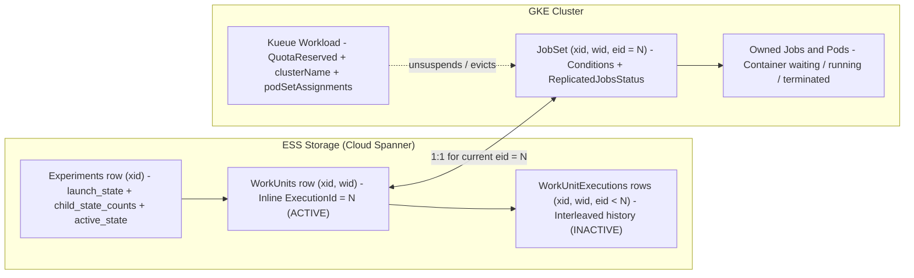
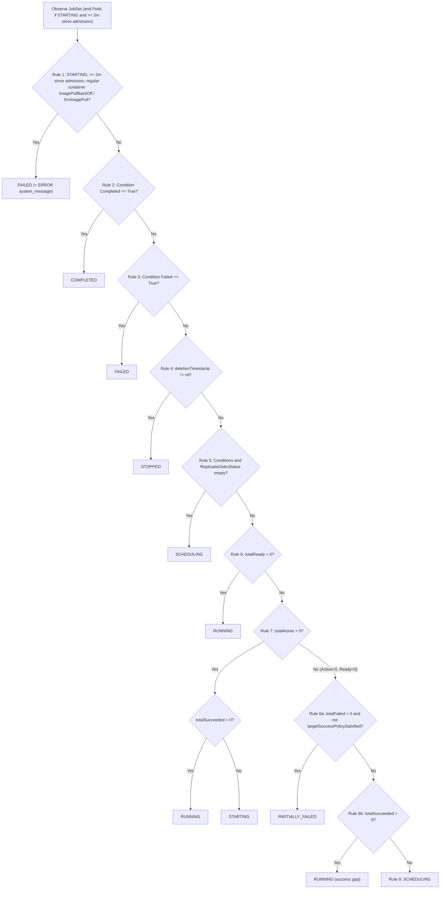
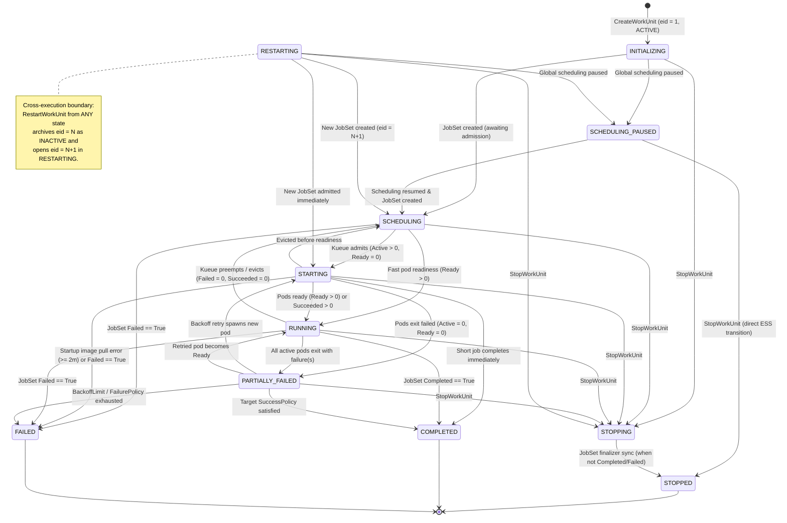
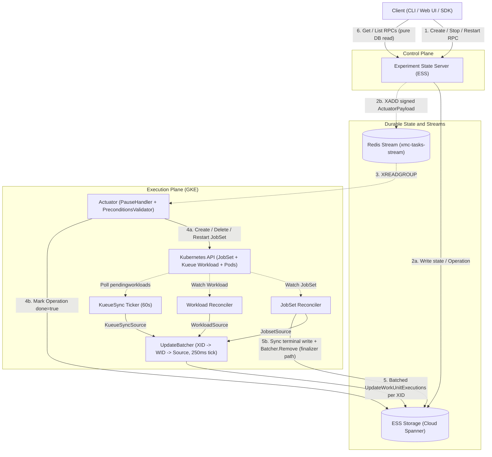
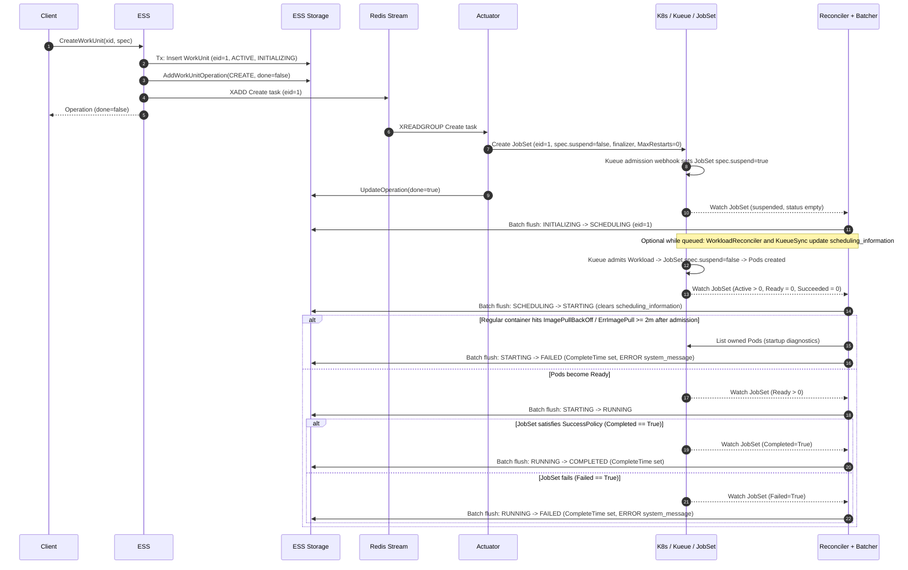
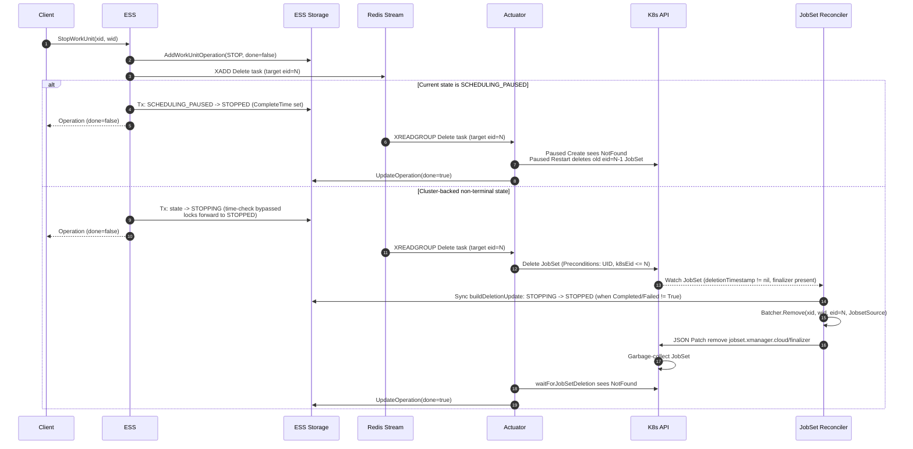
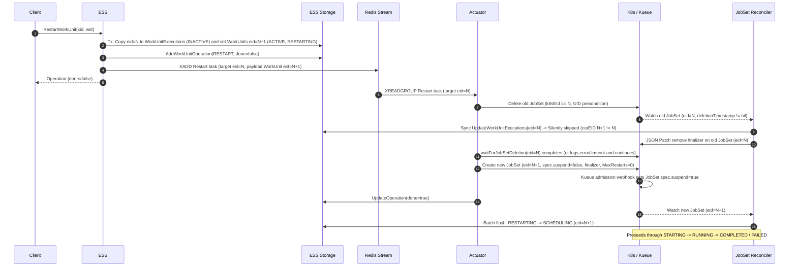
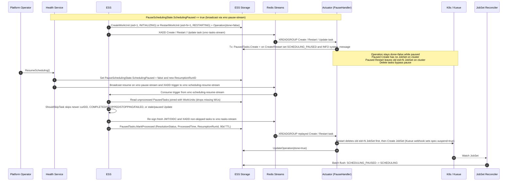

# JobSet, WorkUnitExecution, and WorkUnit States

How Kubernetes `JobSet` conditions and pod counts map to XMC `WorkUnitExecution` and `WorkUnit`
states, which state values and transitions are permitted, how state converges across the intent and
observation loops, and the exact sequence of events during lifecycle changes.

See [Architecture Overview](overview.md) for the platform topology,
[Execution Model](execution_model.md) for the resource hierarchy and retry contract,
[Work Unit Lifecycle Flows](../flows/work_unit_lifecycle.md) for RPC-level actuation details, and
[Reconciliation Flows](../flows/reconciliation.md) for controller internals.

---

## 1. Three-Layer State Model & Storage Layout

XMC tracks workload state across three resource layers plus an experiment-level rollup:

1. **Kubernetes `JobSet` (plus Kueue `Workload` and owned `Pod`s)** — the physical cluster attempt
   (`jobset.x-k8s.io/v1alpha2`). Under the
   [Non-Restarting JobSets Contract](execution_model.md#4-the-non-restarting-jobsets-contract),
   `JobSetSpec.FailurePolicy.MaxRestarts` is always `0` and pod `restartPolicy` is restricted to
   `Never` or `OnFailure`. Exactly **one `JobSet` backs one `WorkUnitExecution`**.
2. **`WorkUnitExecution` (`eid`)** — a single numbered execution attempt of a work unit
   ([`work_unit_execution.proto`](../../api/protos/experiment/work_unit_execution.proto)). Each
   execution carries **two orthogonal state fields**:
   - **Slot state (`WorkUnitExecution.state` / `WorkUnitExecutionState`)**: `ACTIVE` for the
     work unit's current attempt, or `INACTIVE` for historical attempts superseded by a restart.
   - **Run state (`WorkUnitExecution.status.state` / `WorkUnitStatus.WorkUnitState`)**: the
     13-value operational lifecycle of that attempt (`INITIALIZING`, `SCHEDULING`, `STARTING`,
     `RUNNING`, `COMPLETED`, `FAILED`, `STOPPED`, etc. in
     [`status.proto`](../../api/protos/experiment/status.proto)).
3. **`WorkUnit` (`wid`)** — the logical run managed by users
   ([`work_unit.proto`](../../api/protos/experiment/work_unit.proto)). `WorkUnit` has **no
   standalone `state` field**; its state is always projected from its active execution:
   `work_unit.current_work_unit_execution.status.state`.
4. **Parent `Experiment` (`xid`) rollup** — `Experiment.status` maintains denormalized
   `child_state_counts` over each child work unit's *current* `WorkUnitState` and derives
   `Experiment.status.active_state` (`ACTIVE` vs. `INACTIVE`) from **both**
   `Experiment.status.launch_state` (`LAUNCHING` forces `ACTIVE`; `FAILED` forces `INACTIVE`) and
   whether any child work unit remains outside `WorkUnitTerminalStates`, via
   [`DenormalizeWorkUnitStatus`](../../internal/storage/state/state.go) and
   [`UpdateExperimentActiveState`](../../internal/storage/state/state.go).

### Physical storage representation (Cloud Spanner)

In Cloud Spanner ([`spanner/schema/ess-schema.sql`](../../internal/storage/spanner/schema/ess-schema.sql)),
active and historical executions are stored in separate tables rather than toggling a boolean
column:

- **`WorkUnits` table (inline active execution)**: Stores the work unit definition alongside the
  *current* execution's `ExecutionId`, `WorkUnitStatus`, `ExecutionMetadata`, execution timestamps,
  and a Cloud Spanner stored generated column `ExecutionState AS (WorkUnitStatus.state) STORED`
  used for indexed filtering. Spanner reads from `WorkUnits` always stamp
  `WorkUnitExecution.state = ACTIVE`
  ([`spanner/data/workunit.go`](../../internal/storage/spanner/data/workunit.go),
  [`spanner/data/workunitexecutions.go`](../../internal/storage/spanner/data/workunitexecutions.go)).
- **`WorkUnitExecutions` interleaved child table (historical executions)**: Interleaved in parent
  `WorkUnits` and populated **only** when `RestartWorkUnit` or `BatchRestartWorkUnits` archives the
  outgoing execution before incrementing `WorkUnits.ExecutionId`
  ([`restartworkunitexecutions.go`](../../cmd/experiment_state_server/server/restartworkunitexecutions.go)).
  Spanner reads from `WorkUnitExecutions` always stamp `WorkUnitExecution.state = INACTIVE`.

> [!NOTE]
> **PostgreSQL backend status**: In
> [`postgres/schema/ess-schema.sql`](../../internal/storage/postgres/schema/ess-schema.sql),
> `ExecutionState` is a plain `BIGINT` column populated on write and `WorkUnitExecutions` is a
> separate table with a standard `FOREIGN KEY` rather than Spanner table interleaving. The
> PostgreSQL work-unit repository
> ([`postgres/workunit/repository.go`](../../internal/storage/postgres/workunit/repository.go))
> currently returns `codes.Unimplemented`.

> [!IMPORTANT]
> `WorkUnitExecutionState = ACTIVE` means *"current execution slot of the WorkUnit"*, **not**
> *"currently running on the cluster"*. When an execution finishes (`COMPLETED`, `FAILED`, or
> `STOPPED`), its `WorkUnitStatus.state` becomes terminal and `complete_time` is set, while its
> `WorkUnitExecutionState` **remains `ACTIVE`** on the `WorkUnits` row until a user invokes
> `RestartWorkUnit` to allocate `eid + 1`.

---

## 2. Allowed States Across Layers

### 2.1 WorkUnitExecution Slot States (`WorkUnitExecutionState`)

Defined in [`work_unit_execution.proto`](../../api/protos/experiment/work_unit_execution.proto):

| Enum Value | Spanner Storage Location | Meaning | When Transitioned |
| :--- | :--- | :--- | :--- |
| `ACTIVE` (`1`) | Inline columns on `WorkUnits` | Current execution attempt returned by `GetWorkUnit`, `GetCurrentWorkUnitExecution`, and as the first entry of `ListWorkUnitExecutions` ([`listworkunitexecutions.go`](../../internal/storage/spanner/workunit/listworkunitexecutions.go)). | Created on `CreateWorkUnit` (`eid=1`) or `RestartWorkUnit` (`eid=N+1`). |
| `INACTIVE` (`2`) | Child row in `WorkUnitExecutions` | Historical execution attempts returned after the current `ACTIVE` execution by `ListWorkUnitExecutions` (`ExecutionId DESC`; there is no single-item `GetWorkUnitExecution` RPC). | Copied from `WorkUnits` into `WorkUnitExecutions` during `RestartWorkUnit` / `BatchRestartWorkUnits`. |
| `WORK_UNIT_EXECUTION_STATE_UNSPECIFIED` (`0`) | Never persisted | Protobuf zero value. | Never written by XMC services. |

### 2.2 WorkUnit & Execution Run States (`WorkUnitStatus.WorkUnitState`)

Defined in [`status.proto`](../../api/protos/experiment/status.proto) and governed by
[`internal/storage/state/state.go`](../../internal/storage/state/state.go):

| `WorkUnitState` | Category | Authoritative Writer(s) | Execution-Terminal in Storage? | Meaning |
| :--- | :--- | :--- | :--- | :--- |
| `INITIALIZING` (`1`) | Control-plane intent | ESS (`CreateWorkUnit`) | No | `WorkUnit` and `eid=1` persisted in storage; actuation task queued for `JobSet` creation. |
| `SCHEDULING_PAUSED` (`12`) | Control-plane / Actuator hold | Actuator (`TaskPauseHandler`, on `Create`/`Restart`) | No | Global workload scheduling is paused; `Create`/`Restart` task payload is parked in `PausedTasks` (`Create` has no `JobSet` on cluster yet; a paused `Restart` leaves the prior `eid=N` `JobSet` in place until resumed or stopped). |
| `SCHEDULING` (`2`) | Cluster queued | JobSet Reconciler | No | `JobSet` exists on cluster with empty status or zero active/ready/failed/succeeded jobs (for example, suspended by Kueue's admission webhook while awaiting quota, or after preemption). |
| `STARTING` (`3`) | Cluster bring-up | JobSet Reconciler | No | Kueue admitted the workload and at least one job is active (`totalActive > 0`), with `totalReady == 0` and `totalSucceeded == 0`. |
| `RUNNING` (`4`) | Cluster active | JobSet Reconciler | No | At least one job pod is ready (`totalReady > 0`), or jobs have already succeeded while others remain active or are finalizing (`totalSucceeded > 0`). |
| `PARTIALLY_FAILED` (`5`) | Cluster degraded | JobSet Reconciler | No | No jobs are currently active or ready (`totalActive == 0 && totalReady == 0`), `totalFailed > 0`, and `JobSet` has not yet reached `Completed` or `Failed` (nor satisfied target success policy). |
| `DESCHEDULING` (`9`) | Reserved in proto | *None currently* (see [§3.2](#32-control-plane-only-states--preemption-descheduling-nuance)) | No | Defined in `status.proto` for scheduler preemption/eviction; current reconciler transitions `RUNNING → SCHEDULING` directly when no jobs have succeeded/failed. |
| `STOPPING` (`6`) | Control-plane intent | ESS (`StopWorkUnit`, `BatchStopWorkUnits`) | No (locks forward transitions to `STOPPED` only) | User requested stop; deletion task queued while `JobSet` teardown and finalizer sync complete. |
| `RESTARTING` (`7`) | Control-plane intent | ESS (`RestartWorkUnit`, `BatchRestartWorkUnits`) | No | Previous `eid` archived as `INACTIVE`; new `eid+1` created as `ACTIVE` while Actuator replaces the `JobSet`. |
| `STOPPED` (`8`) | Execution-terminal | JobSet Reconciler (finalizer path), or ESS directly when stopping from `SCHEDULING_PAUSED` | **Yes** (`WorkUnitTerminalStates`) | Stopped by user and `JobSet` deleted. Execution `eid` is frozen (`complete_time` set); WorkUnit can still be restarted under `eid+1`. |
| `COMPLETED` (`10`) | Execution-terminal | JobSet Reconciler | **Yes** (`WorkUnitTerminalStates`) | `JobSet` satisfied its `SuccessPolicy` (`Completed=True`). Execution `eid` is frozen (`complete_time` set). |
| `FAILED` (`11`) | Execution-terminal | JobSet Reconciler (condition or startup pod diagnostics) | **Yes** (`WorkUnitTerminalStates`) | `JobSet` failed (`Failed=True`) or regular containers failed startup image pull checks `>= 2m` after admission. Execution `eid` is frozen (`complete_time` set). |
| `WORK_UNIT_STATE_UNSPECIFIED` (`0`) | Unset / default | Never written as a target state | No | Protobuf zero value used when an `UpdateMask` omits `status.state`. |

> [!NOTE]
> **Execution finality vs. WorkUnit restartability**: In storage
> ([`WorkUnitTerminalStates`](../../internal/storage/state/state.go)), `STOPPED`, `COMPLETED`, and
> `FAILED` are all **execution-terminal** — none of them can transition to another state on the
> *same* `eid`, all three stamp `WorkUnitExecution.complete_time`, and an experiment whose
> `launch_state` is not `LAUNCHING` and whose child work units are all in `{STOPPED, COMPLETED,
> FAILED}` (or whose `launch_state` is `FAILED`) transitions `ExperimentStatus.active_state` to
> `INACTIVE`. At the WorkUnit API level, however, `RestartWorkUnit` can be called on a work unit in
> **any** state (including `COMPLETED`, `FAILED`, `STOPPED`, or `RUNNING`) because restarting
> archives `eid` and starts a fresh `eid + 1`.

### 2.3 Kubernetes `JobSet`, Kueue `Workload`, and `Pod` Signals

Kubernetes `JobSet` (`jobset.x-k8s.io/v1alpha2`) does not expose a single `phase` field. Instead,
XMC inspects a combination of metadata, conditions, aggregated replicated-job counters, Kueue
`Workload` status fields, and pod container states:

| Resource | Signal / Field | Values Observed by XMC | Role in State Derivation |
| :--- | :--- | :--- | :--- |
| `JobSet` | `metadata.deletionTimestamp` & `metadata.finalizers` | Non-nil timestamp + `jobset.xmanager.cloud/finalizer` | Triggers synchronous terminal state persistence (`STOPPED`, unless `Completed`/`Failed` is already `True`) before finalizer removal. |
| `JobSet` | `spec.suspend` | `true` / `false` | Actuator creates `JobSet`s with `spec.suspend = false` ([`jobset_builder.go`](../../cmd/actuator/k8s_client/jobset_builder.go)); Kueue's mutating admission webhook sets `true` on queue-labeled `JobSet`s, flips to `false` on admission, and resets to `true` on eviction. **Never read by `ToWorkUnitState`** — used only as a reconcile-trigger predicate ([`jobset/predicates.go`](../../cmd/reconciler/jobset/predicates.go)). |
| `JobSet` | `status.conditions` | `Completed` (`JobSetCompleted`), `Failed` (`JobSetFailed`), `Suspended` (`JobSetSuspended`) | `Completed=True` → `COMPLETED`; `Failed=True` → `FAILED`. `Suspended=False` `LastTransitionTime` (`creationTimestamp` fallback) anchors the startup pod error timer. |
| `JobSet` | `status.replicatedJobsStatus[]` & `spec.replicatedJobs[].replicas` | Summed across jobs into `JobTotals`: `Ready`, `Active`, `Succeeded`, `Failed` (from `status`) and `Replicas` (from `spec`) | Drives `SCHEDULING`, `STARTING`, `RUNNING`, and `PARTIALLY_FAILED`, and populates `WorkUnitStatus.detailed_status.jobset_status` (`replicated_jobs_status`). |
| `JobSet` | `spec.successPolicy` | `operator` (`All` / `Any`), `targetReplicatedJobs` | Suppresses false `PARTIALLY_FAILED` flashes when target leader jobs have already succeeded and non-target workers exit during teardown. |
| Owned `Pod` | `status.containerStatuses[]` / `status.conditions` | Any regular container (`spec.containers`, skipping all `initContainers`) `Waiting.Reason` in `{ImagePullBackOff, ErrImagePull}`; `PodScheduled=False` (`Reason=Unschedulable`) | When `ToWorkUnitState == STARTING` and `>= 2m` (`startup_pod_error_check_time`) has elapsed since admission (`JobSetSuspended=False`): image pull errors override state to `FAILED`; unschedulable pods keep `STARTING` and emit a `WARNING` message. |
| Kueue `Workload` | `status.conditions`, `status.clusterName`, `status.admission.podSetAssignments` | `QuotaReserved=False` (`Reason=Inadmissible`), MultiKueue `clusterName`, assigned flavors/node selectors (`Admitted` and `Evicted` conditions are not read) | Does **not** write `status.state`; populates `status.scheduling_information` (`ERROR` when `Inadmissible`) and execution cluster/flavor metadata. |
| Kueue Visibility API | `ClusterQueue` `/pendingworkloads` | 0-based `positionInClusterQueue` per pending `Workload` | Polled every `60s` by `KueueSync`; stores 1-based `positionInClusterQueue + 1` in `QueueInfo.position_in_queue` with an `INFO` message in `status.scheduling_information` without changing `status.state`. |

---

## 3. Mapping Between JobSet and WorkUnit States

### 3.1 Ordered Evaluation Rules (`JobSet` → `WorkUnitState`)

Whenever `JobSetReconciler` processes a `JobSet`, it converts the live object into a
`WorkUnitState` using [`ConvertJobSetToWorkUnitExecutionUpdate`](../../cmd/reconciler/jobset/converter.go),
[`ToWorkUnitState`](../../cmd/reconciler/jobset/converter.go), and
[`handleStartupPodChecks`](../../cmd/reconciler/jobset/startup_diagnostics.go). Rules are evaluated
in strict priority order — the **first matching rule wins**:

| Priority | Condition on `JobSet` (and Owned `Pod`s) | Resulting `WorkUnitState` | Rationale & Edge-Case Handling |
| :---: | :--- | :--- | :--- |
| **1** | `ToWorkUnitState(js) == STARTING`, time since admission (`JobSetSuspended=False` `LastTransitionTime`, or `creationTimestamp` fallback) `>= 2m` (`startup_pod_error_check_time`), and any regular container (`status.containerStatuses`) is waiting with `ImagePullBackOff` or `ErrImagePull` | **`FAILED`** | Fails fast on broken container images instead of hanging in `STARTING` indefinitely; attaches an `ERROR` `system_message` (with `DeferToExistingMessage: true`). All `initContainers` (both one-shot and sidecar) are skipped; `Unschedulable` pods remain **`STARTING`** with a `WARNING` message. |
| **2** | `Condition[Completed] == True` | **`COMPLETED`** | Evaluated **before** `deletionTimestamp != nil` so a completed `JobSet` being garbage-collected (for example, TTL cleanup) preserves `COMPLETED` rather than flipping to `STOPPED`. |
| **3** | `Condition[Failed] == True` | **`FAILED`** | Evaluated **before** `deletionTimestamp != nil` for the same reason; surfaces condition message as an `ERROR` `system_message` with `DeferToExistingMessage: true` so an existing message of equal (`ERROR`) or higher (`FATAL`) severity is preserved. |
| **4** | `metadata.deletionTimestamp != nil` | **`STOPPED`** | Active `JobSet` is being deleted (user stop or external `kubectl delete`); persisted synchronously via the finalizer path. |
| **5** | `len(status.conditions) == 0 && len(status.replicatedJobsStatus) == 0` | **`SCHEDULING`** | Newly created `JobSet` before the JobSet controller has populated `status`. |
| **6** | `totalReady > 0` | **`RUNNING`** | "Alive" check: if at least one pod is ready, the workload is running even if Kubernetes momentarily reports `Active == 0` during status propagation. |
| **7a** | `totalActive > 0 && totalSucceeded > 0` | **`RUNNING`** | Some pods have already completed while sibling pods are still active. |
| **7b** | `totalActive > 0 && totalSucceeded == 0` | **`STARTING`** | Evaluated **before** `totalFailed > 0` so a job actively retrying failed pods within `JobSpec.BackoffLimit` reports `STARTING` rather than `PARTIALLY_FAILED`. |
| **8a** | `totalActive == 0 && totalReady == 0 && totalFailed > 0 && !targetSuccessPolicySatisfied(js)` | **`PARTIALLY_FAILED`** | All pods are currently inactive with at least one failure while the `JobSet` as a whole has not yet failed or satisfied its target `SuccessPolicy`. |
| **8b** | `totalActive == 0 && totalReady == 0 && totalSucceeded > 0` | **`RUNNING`** | Bridges the "success gap" where target jobs have succeeded (including when non-target workers failed during leader-triggered teardown) while the JobSet controller is about to stamp `Completed=True`. |
| **9** | Otherwise (`Ready == 0, Active == 0, Failed == 0, Succeeded == 0`) | **`SCHEDULING`** | Covers both newly suspended `JobSet`s awaiting Kueue quota and workloads whose pods terminated after Kueue preemption/eviction without prior job completions or failures. |

### 3.2 Control-Plane-Only States & Preemption (`DESCHEDULING`) Nuance

Four active states never appear in the `JobSet` mapping diagram above because they represent
control-plane or actuation states *prior to* or *superseding* cluster observation:

- **`INITIALIZING`** — written exclusively by ESS during `CreateWorkUnit` before any `JobSet`
  exists ([`createworkunit.go`](../../cmd/experiment_state_server/server/createworkunit.go)).
- **`RESTARTING`** — written exclusively by ESS during `RestartWorkUnit` / `BatchRestartWorkUnits`
  on the newly allocated `eid + 1` before the Actuator replaces the `JobSet`
  ([`restartworkunitexecutions.go`](../../cmd/experiment_state_server/server/restartworkunitexecutions.go)).
- **`STOPPING`** — written exclusively by ESS during `StopWorkUnit` / `BatchStopWorkUnits`
  ([`stopworkunit.go`](../../cmd/experiment_state_server/server/stopworkunit.go),
  [`batchstopworkunits.go`](../../cmd/experiment_state_server/server/batchstopworkunits.go)). Note
  that ESS records the `Operation` and enqueues the `Delete` task *before* persisting `STOPPING` in
  storage, so Actuator deletion can race ahead of `STOPPING` (see [§5.1](#51-intent-loop-ess--redis--actuator--kubernetes)).
- **`SCHEDULING_PAUSED`** — written exclusively by the Actuator's `TaskPauseHandler` when global
  workload scheduling is paused and a `Create` or `Restart` task is parked in `PausedTasks` instead
  of actuating Kubernetes (paused `Update` tasks also park in `PausedTasks` without changing
  `status.state`; [`pause_handler.go`](../../cmd/actuator/pausescheduling/pause_handler.go)).

**`DESCHEDULING` in `status.proto` vs. production behavior:**
`WorkUnitState.DESCHEDULING` (`9`) is defined in [`status.proto`](../../api/protos/experiment/status.proto)
to describe scheduler preemption/eviction, and the Web UI includes display styling for it. However,
**no backend producer currently writes `DESCHEDULING`**. When Kueue preempts or evicts a workload,
Kueue sets `JobSet.spec.suspend = true` and terminates active pods; as `totalReady` and
`totalActive` drop to `0` (with `Failed == 0` and `Succeeded == 0`), `JobSetReconciler` transitions
the execution directly from `RUNNING` (or `STARTING`) back to `SCHEDULING` via Rule 9 on the **same
`eid` and same `JobSet`**. (If the evicted workload already had completed jobs with
`totalSucceeded > 0` and no unsatisfied failures, Rule 8b keeps it in `RUNNING`; if
`totalFailed > 0` without target `SuccessPolicy` satisfied, Rule 8a maps it to `PARTIALLY_FAILED`.)

### 3.3 Field Ownership & Conflict Resolution Across Execution Writers

Writers that call `UpdateWorkUnitExecutions` pass explicit `google.protobuf.FieldMask` paths so
non-state telemetry and scheduling producers (`WorkloadReconciler`, `KueueSync`, Log Monitor) never
touch `status.state`. Masks across writers are **not** disjoint, however: `status.state` is written
by ESS `Stop`, `TaskPauseHandler`, and `JobSetReconciler`; `status.system_message` is written by
`JobSetReconciler`, `TaskPauseHandler`, and ESS enqueue-error handling; and
`status.scheduling_information` is written by both `WorkloadReconciler` and `KueueSync`. Collisions
on shared paths are serialized transactionally via `status.state_update_time` ordering, the
transition guards in [§4.2](#42-transition-matrix--monotonicity-guards), and message
severity/recency/`DeferToExistingMessage` rules in `MergeWorkUnitExecution`:

| Writer Component | Write Path / Batcher Source | Mutates `status.state`? | Fields / `UpdateMask` Paths Written |
| :--- | :--- | :---: | :--- |
| **ESS** (`Create` / `Restart`) | Direct full-row write (not `UpdateWorkUnitExecutions`) | **Yes** | `InsertWorkUnit` writes `INITIALIZING` on `eid=1` ([`server/utils.go`](../../cmd/experiment_state_server/server/utils.go)); `SaveWorkUnitExecution` + `UpdateCurrentWorkUnitExecution` archive `eid=N` and write `RESTARTING` on `eid=N+1` ([`restartworkunitexecutions.go`](../../cmd/experiment_state_server/server/restartworkunitexecutions.go)). |
| **ESS** (`Stop` / enqueue error) | Direct `UpdateWorkUnitExecutions` | **Yes** (`Stop` only) | `StopWorkUnit` / `BatchStopWorkUnits` masks `["status.state"]` (`STOPPING`, or `STOPPED` from `SCHEDULING_PAUSED`, [`batchstopworkunits.go`](../../cmd/experiment_state_server/server/batchstopworkunits.go)); Redis enqueue failure (`handleEnqueueActionError`, [`server/utils.go`](../../cmd/experiment_state_server/server/utils.go)) masks `["status.system_message"]` (`ForceStatusMessageUpdate: true`). |
| **Actuator** (`TaskPauseHandler`) | Direct `UpdateWorkUnitExecutions` | **Yes** (`Create` / `Restart` only) | Masks `["status.state", "status.system_message"]` (`SCHEDULING_PAUSED` + `INFO` message, with `state_update_time` carried implicitly by `status.state`; [`pause_handler.go`](../../cmd/actuator/pausescheduling/pause_handler.go)). Paused `Update` tasks only insert into `PausedTasks`. |
| **Reconciler — `JobSetReconciler`** | `JobsetSource` (or direct on finalizer) | **Yes** | Regular reconcile masks `status.{state, detailed_status, system_message}` (`state_update_time` travels implicitly with `status.state`), `metadata.{management_cluster, type, resource_name, namespace, service_account}`, plus `metadata.mlrun_url` when MLRun is enabled ([`jobset/converter.go`](../../cmd/reconciler/jobset/converter.go)). Finalizer `STOPPED` fallback (`createStoppedUpdate`) masks only `["status.state", "status.system_message"]`. |
| **Reconciler — `WorkloadReconciler`** | `WorkloadSource` | **No** | Masks `metadata.{executing_cluster, multi_kueue_cluster_name, resource_flavor, node_selectors}` and `status.scheduling_information` (`ERROR` when `QuotaReserved=False, Reason=Inadmissible`; [`workload/reconciler.go`](../../cmd/reconciler/workload/reconciler.go), [`workload/converter.go`](../../cmd/reconciler/workload/converter.go)). |
| **Reconciler — `KueueSync`** | `KueueSyncSource` | **No** | Masks `["status.scheduling_information"]` (`INFO` message + `QueueInfo.position_in_queue`; [`kueue_sync.go`](../../cmd/reconciler/kueue_sync/kueue_sync.go)). |
| **Log Monitor** | Direct `UpdateWorkUnitExecutions` | **No** | Masks `["status.user_message"]` extracted from Cloud Logging / Pub/Sub container logs ([`log_processor.go`](../../cmd/log_monitor/log_processor.go)). |

> [!NOTE]
> **Actuator `Operations` updates**: Normal task actuation in `workunittaskhandler.Handler`
> ([`workunit_task_handler.go`](../../cmd/actuator/workunittaskhandler/workunit_task_handler.go)) has
> no `WorkUnitExecution` storage client; `k8sclient.Client.updateOperation`
> ([`k8s_client/client.go`](../../cmd/actuator/k8s_client/client.go)) writes directly to the
> `Operations` repository (`UpdateMask: ["done", "response"]` or `["done", "error"]` on `Create`,
> `Delete`, and `Restart`) and never writes `WorkUnitExecution` states such as `RUNNING` or
> `STOPPED`.

---

## 4. Allowed State Transitions & Storage Guard Rules

### 4.1 Execution-Scoped vs. WorkUnit-Scoped State Machine

Transitions divide into **intra-execution transitions** (mutating `WorkUnits` in place for a fixed
`eid`) and **cross-execution restarts** (archiving `eid=N` as `INACTIVE` in `WorkUnitExecutions` and
initializing `eid=N+1` as `ACTIVE` in `RESTARTING`):

> [!NOTE]
> **Common operational edges vs. authoritative storage matrix**: The diagram above highlights
> primary operational transitions. Because `ToWorkUnitState` is stateless, storage actually permits
> **any** non-terminal transition allowed by the [§4.2 matrix](#42-transition-matrix--monotonicity-guards)
> — including `RUNNING → STARTING` (active pods remain while ready and succeeded counts are `0`),
> `SCHEDULING → PARTIALLY_FAILED` or `COMPLETED`, `PARTIALLY_FAILED → SCHEDULING`, and direct
> `<non-terminal> → STOPPED` when a `JobSet` is deleted externally (`kubectl delete`) without a
> preceding `StopWorkUnit` call.

### 4.2 Transition Matrix & Monotonicity Guards

Every call to [`UpdateWorkUnitExecutions`](../../internal/workunit/updateworkunitexecutions.go)
runs inside a read-write database transaction (`RunInTransaction`) and evaluates
[`ShouldUpdateWorkUnitExecutionState`](../../internal/storage/state/state.go) and
[`MergeWorkUnitExecution`](../../internal/storage/data/workunitexecutions.go) before persisting
a state change on the current `eid`:

1. **Execution ID Fencing (`curEID == update.EID`)**:
   If `update.EID != currentWorkUnit.ExecutionId`, the update is **silently skipped** (`continue`
   without logging in `updateworkunitexecutions.go`). Late Reconciler or Log Monitor updates from an
   archived execution (`eid=N`) can never corrupt `eid=N+1` after a restart.
2. **Same-State Idempotency (`currentState == newState`)**:
   Returns `false` for state transition so the original `status.state_update_time` is preserved,
   while still merging any other fields in `UpdateMask` (such as `detailed_status`, `metadata`, or
   messages).
3. **Forward Transition Allowlist (`WorkUnitAllowedForwardTransitions`)**:
   - `STOPPED → ∅`, `COMPLETED → ∅`, `FAILED → ∅`: Once an execution reaches a terminal state, no
     further state changes are accepted for that `eid`.
   - `STOPPING → {STOPPED}`: Once `StopWorkUnit` commits `STOPPING`, **only `STOPPED` is
     permitted**. In-flight `STARTING`, `RUNNING`, `PARTIALLY_FAILED`, `COMPLETED`, or `FAILED`
     observations from the Reconciler cannot revert or override `STOPPING`. *(Known edge case: if a
     deleting `JobSet` already has `Completed=True` or `Failed=True`, the finalizer's
     `buildDeletionUpdate` sends `COMPLETED` or `FAILED`; this guard rejects that transition while
     the finalizer is still removed, leaving the execution in `STOPPING`.)*
   - All other non-terminal states allow transitions to any target state not blocked by backward
     rules.
4. **Backward Transition Blocklist (`WorkUnitAllowedBackwardTransitions`)**:
   - `* → INITIALIZING`: Rejected (`{}`).
   - `* → RESTARTING`: Rejected (`{}`) via `UpdateWorkUnitExecutions` (`RESTARTING` can only be
     entered by allocating a brand-new `eid + 1` in `restartWorkUnitExecutions`).
5. **Timestamp Presence, Monotonicity & `STOPPING` Clock-Skew Bypass**:
   - Whenever `"status.state"` is included in `UpdateMask`,
     `newExecution.status.state_update_time` must be non-nil and valid — omitting it fails the
     **entire batch transaction** with `InvalidArgument` in `MergeWorkUnitExecution`. When present,
     it must satisfy `newTime >= currentTime` (`!currentTime.After(newTime)`).
   - **Exception (`WorkUnitTimeIgnoredStates = {STOPPING}`)**: `STOPPING` bypasses the timestamp
     ordering check (though a valid `state_update_time` is still required) so a user `StopWorkUnit`
     request on ESS is never rejected if a GKE Reconciler node's clock was slightly ahead when
     writing `RUNNING`.
6. **Graceful Partial Merge on Rejected State Change**:
   When `ShouldUpdateWorkUnitExecutionState` returns `false`, `MergeWorkUnitExecution` resets
   `status.state` and `status.state_update_time` back to `currentExecution`'s values **without
   failing the transaction**. Companion fields in the same update (for example, final pod counts in
   `detailed_status`) still merge cleanly.

| Current State (`eid=N`) | Allowed Next States on Same `eid=N` | Requires `newTime >= curTime`? | Can `RestartWorkUnit` Start `eid=N+1`? |
| :--- | :--- | :---: | :---: |
| `INITIALIZING` | Any state except `INITIALIZING`, `RESTARTING` | Yes (except `STOPPING`) | Yes |
| `SCHEDULING_PAUSED` | Any state except `INITIALIZING`, `RESTARTING` | Yes (except `STOPPING`) | Yes |
| `RESTARTING` | Any state except `INITIALIZING`, `RESTARTING` | Yes (except `STOPPING`) | Yes |
| `SCHEDULING` | Any state except `INITIALIZING`, `RESTARTING` | Yes (except `STOPPING`) | Yes |
| `STARTING` | Any state except `INITIALIZING`, `RESTARTING` | Yes (except `STOPPING`) | Yes |
| `RUNNING` | Any state except `INITIALIZING`, `RESTARTING` | Yes (except `STOPPING`) | Yes |
| `PARTIALLY_FAILED` | Any state except `INITIALIZING`, `RESTARTING` | Yes (except `STOPPING`) | Yes |
| `STOPPING` | **`STOPPED` only** | Yes for `STOPPED` | Yes |
| `STOPPED` | **None (`∅`)** | N/A | Yes |
| `COMPLETED` | **None (`∅`)** | N/A | Yes |
| `FAILED` | **None (`∅`)** | N/A | Yes |

### 4.3 Automatic Side Effects on Accepted Updates & State Transitions

Inside `UpdateWorkUnitExecutions`, accepted execution updates trigger the following automatic side
effects:

- **Completion Timestamp (on `state` change to terminal)**: If `oldState != newState`, `oldState` is
  non-terminal, and `newState` is in `WorkUnitTerminalStates` (`STOPPED`, `COMPLETED`, `FAILED`),
  `WorkUnitExecution.complete_time` is set to `timestamppb.New(time.Now())`.
- **Scheduling Information Reset (`ShouldResetSchedulingInfo`, on `state` change)**: Whenever
  `oldState != newState` and `newState != SCHEDULING`, `status.scheduling_information` is
  automatically cleared so stale queue positions or inadmissibility warnings disappear as soon as
  the workload advances or stops.
- **Status Message Reset & Retention (`ShouldResetStatusMessage`, on `state` change)**: When
  `oldState != newState`, `status.system_message` and `status.user_message` are cleared **unless**:
  1. The same update **successfully replaces** that message field (`!proto.Equal(currentMsg,
     resolvedMsg)` after severity, recency, and `DeferToExistingMessage` checks — if the incoming
     masked message loses to the existing one, the current message is still cleared),
  2. The existing message has `Severity == FATAL`, or
  3. `newState` is in `WorkUnitStatusRetainingStates` (`{STOPPED, FAILED}`), preserving the diagnostic
     error or user log context that preceded failure or stop.
- **Transition History & Status Message Tables**
  ([`internal/workunit/history.go`](../../internal/workunit/history.go)):
  - **`WorkUnitStatusHistory` (only when `oldState != newState`)**: Appends a transition record
    storing `PreviousState`, `NewState`, `QueueName`, `ResourceType`, and `ResourceUnits` (30-day
    TTL), rather than a full `WorkUnitStatus` snapshot.
  - **`StatusMessages` & `message_severity_counts` (on any accepted execution change, even when
    `oldState == newState`)**: `recordStatusMessages` mirrors new `status.system_message` and
    `status.user_message` entries (excluding `status.scheduling_information.message`) into
    `StatusMessages`, while `Experiment.status.message_severity_counts` tracks only the single
    highest-severity `{system_message, user_message}` per work unit (`GetBestMessageFromStatus`).
- **Parent Experiment Aggregation (on `state` change)**: `DenormalizeWorkUnitStatus` decrements
  `oldState` and increments `newState` in `Experiment.status.child_state_counts`.
  `UpdateExperimentActiveState` recomputes `Experiment.status.active_state` (`ACTIVE` while
  `LaunchState == LAUNCHING` or at least one work unit is non-terminal; `INACTIVE` once
  `LaunchState == FAILED` or all child work units are in `{STOPPED, COMPLETED, FAILED}`, setting
  `Experiment.complete_time`).

---

## 5. State Synchronization Architecture

XMC synchronizes state through two decoupled, retryable loops that meet only in storage and in the
Kubernetes API:

### 5.1 Intent Loop (ESS → Redis → Actuator → Kubernetes)

1. **Storage Persistence vs. Redis Enqueue Ordering**:
   - **`Create` and `Restart` (durable state first)**: `CreateWorkUnit` and `RestartWorkUnit` /
     `BatchRestartWorkUnits` commit the new execution state (`INITIALIZING` on `eid=1` or
     `RESTARTING` on `eid+1`) to storage and record an `Operations` row (`done = false`) *before*
     enqueuing a Tink-JWT and OIDC-signed `ActuatorPayload` onto Redis stream `xmc-tasks-stream`.
   - **`Stop` (task enqueued before `STOPPING` batch write)**: `StopWorkUnit` /
     `BatchStopWorkUnits` records the `Operations` row (`done = false`) and enqueues the `Delete`
     task onto `xmc-tasks-stream` *before* writing `STOPPING` (or `STOPPED` from
     `SCHEDULING_PAUSED`) in batch
     ([`batchstopworkunits.go`](../../cmd/experiment_state_server/server/batchstopworkunits.go)), so
     Actuator deletion can race ahead of `STOPPING`.
2. **Cluster Idempotency & Precondition Validation**:
   - **`Create` (`AlreadyExists` verification)**: `Create` skips `preconditions_validator` and
     submits the `JobSet` directly; if Kubernetes returns `AlreadyExists`, the Actuator invokes
     `verifyDuplicateJobSet` ([`k8s_client/client.go`](../../cmd/actuator/k8s_client/client.go)) and
     treats a matching `JobSet` as an idempotent success.
   - **`Delete` and `Restart` (`xmc.google.com/execution-id` & `xmc.google.com/last-edit` guards)**:
     Evaluated by
     [`preconditions_validator`](../../cmd/actuator/k8s_client/preconditions_validator/preconditions_validator.go)
     **only on `Delete` and `Restart`**. If `k8sEid > targetEid`, the task is skipped as superseded;
     `last-edit` rejects tasks whose `operationTime` predates the `JobSet`'s `xmc.google.com/last-edit`
     label. On `Restart`, `targetEid` is the **outgoing `eid = N`** (while `N + 1` travels inside
     `payload.WorkUnit`): if `k8sEid == N`, the Actuator deletes `eid=N` and creates `eid=N+1`; on a
     redelivered retry after `eid=N+1` exists, `k8sEid (N+1) > targetEid (N)` skips idempotently.
   - **UID Precondition & Deletion Poll**: `Delete` (and `Restart`'s old-`JobSet` teardown) passes
     `metav1.Preconditions{UID: &jobSet.UID}` to prevent deleting a newly recreated `JobSet` of the
     same name and polls `waitForJobSetDeletion` (`2s` interval, `30s` timeout) until the object
     disappears ([`k8s_client/jobset.go`](../../cmd/actuator/k8s_client/jobset.go)).
3. **Operation Completion & Dead-Letter Routing**: Once actuation completes, `k8sclient.Client`
   updates `Operations.done = true` with `response` on success—or `Operations.done = true` with
   `error` on failure—and the consumer `XACK`s the message (routing exhausted/failed tasks to
   dead-letter stream `xmc-tasks-dlq`). Cluster execution states (`SCHEDULING`, `STARTING`,
   `RUNNING`, `STOPPED`, `COMPLETED`, `FAILED`) are **never** written by the Actuator — they arrive
   exclusively through the observation loop (except `SCHEDULING_PAUSED` when global scheduling is
   paused).

### 5.2 Observation Loop (Kubernetes → Reconciler → `UpdateBatcher` → Storage)

1. **Event-Driven & Polled Watchers**:
   - `JobSetReconciler` triggers on `JobSet` creation, `metadata.generation` change, `xid`/`wid`/`eid`
     label changes, `spec.suspend` change, replica count change, watched `status` changes
     (`restarts`, `conditions`, `replicatedJobsStatus`), or the initial `deletionTimestamp`
     transition (`nil → non-nil`), and **ignores further updates once `deletionTimestamp` is already
     set** ([`jobset/predicates.go`](../../cmd/reconciler/jobset/predicates.go); `metadata.annotations`
     changes do not trigger reconciliation).
   - `WorkloadReconciler` triggers on `Workload` creation, generation change, or any watched
     `status` change (`clusterName`, `admission`, `conditions`).
   - `KueueSync` ticks every `kueue_sync_tick_duration` (`60s`), reading active `ClusterQueue` names
     from `NameCache` and querying Kueue's `/pendingworkloads` visibility endpoint.
2. **Latest-Wins Replacement Inside `UpdateBatcher`'s Three-Level Slot Index**
   ([`cmd/reconciler/shared/batcher.go`](../../cmd/reconciler/shared/batcher.go)):
   - Pending updates are stored in a three-level in-memory index `XID → WID → UpdateSource`
     (`JobsetSource`, `WorkloadSource`, `KueueSyncSource`), with **latest-wins replacement per
     `(xid, wid, source)` leaf slot** (dropping any incoming update with `update.EID < pending.EID`).
   - Keeping separate leaf slots per `UpdateSource` means up to three updates per work unit flush
     together in one batch without a `KueueSync` queue-position update overwriting a `JobsetSource`
     state transition waiting in the same `250ms` window.
   - Every `batcher_tick_duration` (`250ms`), the batcher swaps out its map and flushes up to
     `max_parallel_experiments` (`10` by default in
     [`cmd/reconciler/config.go`](../../cmd/reconciler/config.go)) experiments in parallel, issuing
     one transactional `UpdateWorkUnitExecutions(ctx, xid, updates)` call per `XID`.
   - **Failure recovery**: Transient storage errors re-queue failed updates without overwriting
     newer arrivals; any permanent storage error (`IsPermanentStorageError`: `NotFound`,
     `InvalidArgument`, `FailedPrecondition`, `PermissionDenied` in
     [`shared/storage_errors.go`](../../cmd/reconciler/shared/storage_errors.go)) triggers
     per-work-unit isolation retries (`WorkUnitNotFoundError` drops missing work units) so one
     permanently failing update cannot block sibling work units in the same experiment.

### 5.3 Synchronous Finalizer Bypass on `JobSet` Deletion

Every XMC `JobSet` is built with finalizer `jobset.xmanager.cloud/finalizer` in `buildBaseJobSet`
([`k8s_client/jobset_builder.go`](../../cmd/actuator/k8s_client/jobset_builder.go)). When
`deletionTimestamp != nil`, `JobSetReconciler` **bypasses `UpdateBatcher`**
([`jobset/reconciler.go`](../../cmd/reconciler/jobset/reconciler.go)):

1. Builds the terminal update via `buildDeletionUpdate` (`COMPLETED` if `Completed == True`,
   `FAILED` if `Failed == True`, else `STOPPED`).
2. Calls `UpdateWorkUnitExecutions` **synchronously** with a `10s` write timeout.
   - If a retryable storage error occurs within `maxStoppedWriteRetryAge` (`15m` from
     `deletionTimestamp`), the reconciler returns an error to `controller-runtime`, keeping the
     finalizer attached and retrying with exponential backoff.
   - If the write succeeds, fails permanently (`NotFound`, `InvalidArgument`, `FailedPrecondition`,
     `PermissionDenied`), or exceeds the `15m` retry budget (preventing leaked stuck-deleting
     objects), reconciliation proceeds to cleanup.
3. Calls `Batcher.Remove(xid, wid, eid, JobsetSource)` so no stale pre-deletion `RUNNING` update
   buffered in memory can flush after the terminal write (even if flushed concurrently, storage
   terminal-state guards reject `STOPPED/COMPLETED/FAILED → RUNNING`).
4. Removes `jobset.xmanager.cloud/finalizer` using an atomic RFC 6902 JSON Patch (`test` + `remove`
   on `/metadata/finalizers/<idx>`), allowing Kubernetes to garbage-collect the `JobSet`.

---

## 6. Sequence of Events on State Changes

### 6.1 Create, Admission, Startup Diagnostics, and Completion / Failure

**State progression (`eid = 1`, `ACTIVE` throughout):**
`[*] → INITIALIZING → SCHEDULING → STARTING → RUNNING → (PARTIALLY_FAILED →) COMPLETED | FAILED`

### 6.2 Preemption / Eviction and Re-Admission

**State progression (`eid = 1` unchanged, same `JobSet`, when `Failed == 0 && Succeeded == 0`):**
`RUNNING → SCHEDULING → STARTING → RUNNING`

When a higher-priority workload claims quota in Kueue:

1. Kueue sets `Evicted=True` on the `Workload` and patches `JobSet.spec.suspend = true` (`Evicted`
   itself is not read by XMC; reconciliation reacts to the `JobSet` spec and pod counter changes).
2. The JobSet controller terminates running pods without incrementing `JobSet` failure counts.
3. Once `totalReady == 0` and `totalActive == 0`:
   - If `Failed == 0 && Succeeded == 0`, `JobSetReconciler` evaluates Rule 9 (`ToWorkUnitState ==
     SCHEDULING`) and flushes `RUNNING → SCHEDULING` on the **same `eid`**.
   - If some jobs had already completed before preemption (`totalSucceeded > 0` with no unsatisfied
     failures), Rule 8b keeps the execution in `RUNNING` (or Rule 8a maps it to `PARTIALLY_FAILED`
     if `totalFailed > 0` without target `SuccessPolicy` satisfied).
4. While in `SCHEDULING`, `KueueSync` and `WorkloadReconciler` resume updating
   `status.scheduling_information` with the re-queued position (`positionInClusterQueue + 1`).
5. When quota becomes available again, Kueue sets `JobSet.spec.suspend = false`, new pods start, and
   the execution advances `SCHEDULING → STARTING → RUNNING` without creating a historical
   `WorkUnitExecutions` row.

### 6.3 Stop Work Unit and Finalizer Teardown

**State progression (`eid = N` stays `ACTIVE`):**
- Cluster-backed execution: `{INITIALIZING | SCHEDULING | STARTING | RUNNING | PARTIALLY_FAILED | RESTARTING} → STOPPING → STOPPED`
- Paused shortcut: `SCHEDULING_PAUSED → STOPPED` (state committed directly in ESS; for a paused `Create` the `Delete` task sees `NotFound`, whereas for a paused `Restart` on `eid = N` the `Delete` task deletes the prior `eid = N - 1` `JobSet`)

**Race handling during deletion and stop:**
- **Already terminal before `StopWorkUnit`**: If the execution is already in `COMPLETED`, `FAILED`,
  or `STOPPED` when `StopWorkUnit` runs, `WorkUnitAllowedForwardTransitions` rejects
  `COMPLETED/FAILED/STOPPED → STOPPING` without failing the transaction, preserving the original
  terminal state and `complete_time`.
- **Cluster TTL cleanup or external delete without `StopWorkUnit`**: Because `ToWorkUnitState`
  evaluates `Completed == True` and `Failed == True` *before* `deletionTimestamp != nil`,
  `buildDeletionUpdate` persists `COMPLETED` or `FAILED` rather than overwriting a finished run
  with `STOPPED`.
- **In-flight Reconciler updates after `STOPPING` is committed**:
  `WorkUnitAllowedForwardTransitions[STOPPING]` permits **only** `{STOPPED}`, so late `STARTING`,
  `RUNNING`, or `PARTIALLY_FAILED` batch flushes cannot revert `STOPPING` back to a running state
  (while companion non-state fields such as `detailed_status` still merge cleanly).
- **`JobSet` reaches `Completed=True` or `Failed=True` after `STOPPING` is committed**: If the
  `JobSet` finishes on the cluster while ESS has already written `STOPPING`, `buildDeletionUpdate`
  computes `COMPLETED` or `FAILED` rather than `STOPPED`. Storage rejects `STOPPING →
  COMPLETED/FAILED` (`ShouldUpdateWorkUnitExecutionState == false` without error) and the finalizer
  is still removed, leaving the execution in `STOPPING`.

### 6.4 Restart Work Unit (Cross-Execution Transition)

**State progression:**
- Outgoing execution `eid = N`: moved from `WorkUnits` to `WorkUnitExecutions` (`ACTIVE → INACTIVE`,
  retaining its last `WorkUnitState`, e.g., `FAILED`, `STOPPED`, `COMPLETED`, or `RUNNING`).
- New execution `eid = N + 1`: created inline on `WorkUnits` (`ACTIVE`):
  `RESTARTING → SCHEDULING → STARTING → RUNNING`

### 6.5 Global Scheduling Pause and Resume

**State progression (`eid = 1` or `eid = N + 1`):**
`{INITIALIZING | RESTARTING} → SCHEDULING_PAUSED → SCHEDULING → STARTING → RUNNING`

