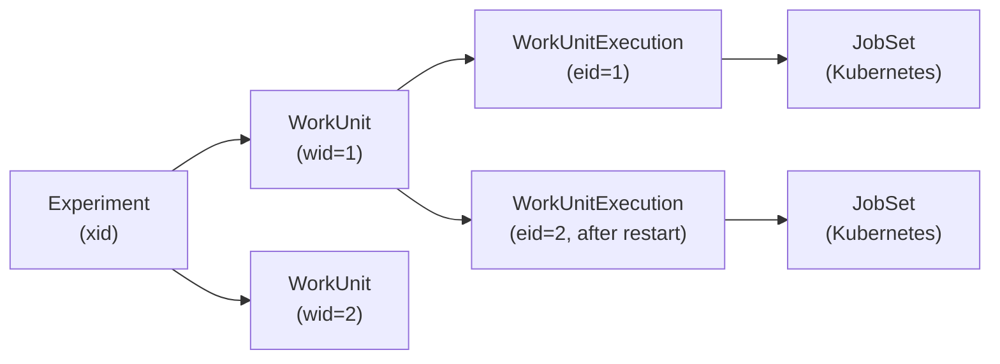
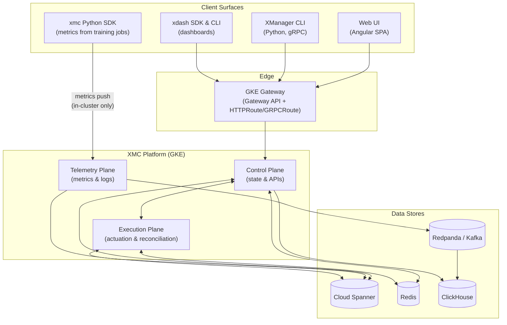
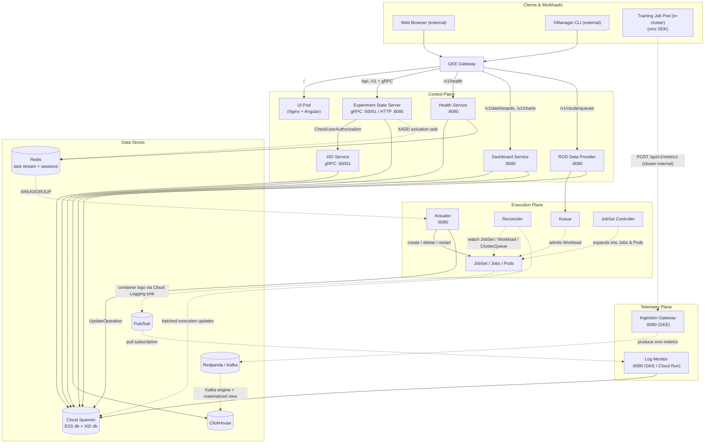

# XMC Architecture Overview

XManager on Cloud (XMC) is a control plane for running machine learning experiments on
Google Kubernetes Engine (GKE). It accepts experiment definitions over gRPC/HTTP, persists
them durably, turns them into Kubernetes `JobSet` workloads scheduled through
[Kueue](https://kueue.sigs.k8s.io/), observes those workloads, and streams state and
telemetry back to users through a web UI, CLIs, and Python SDKs.

This document is the entry point for the architecture documentation set:

| Document | Contents |
| :--- | :--- |
| **Architecture Overview** (this page) | System context, planes, component interaction map, data stores, cross-cutting concerns. |
| [Component Reference](components.md) | Every deployed binary and shared library: responsibility, ports, dependencies. |
| [Execution Model](execution_model.md) | Experiment/WorkUnit/WorkUnitExecution/JobSet hierarchy, state machine, retry contract, scheduling. |
| [Use Cases](use_cases.md) | End-to-end scenarios per persona, with the components each one touches. |
| [Main Flows](../flows/README.md) | Sequence diagrams and narratives for the principal request and reconciliation flows. |

Related design documents: [Deployment Topologies](../design/topologies.md) and
[Gateway & Traffic Routing Design](../design/gateway.md).

---

## 1. Core Mental Model

Four nested concepts carry almost all of XMC's behaviour. They are defined precisely in the
[Execution Model](execution_model.md); the short version is:

- **Experiment** — a user-owned container of related runs, identified by an `xid`.
- **WorkUnit** — one logical run within an experiment, identified by a `wid`. This is the unit
  users start, stop, and restart.
- **WorkUnitExecution** — one *attempt* at running a WorkUnit, identified by an `eid`. Restarting
  a WorkUnit creates a new execution; previous executions are retained as history.
- **JobSet** — the Kubernetes resource that physically runs an execution. Exactly one JobSet
  backs one WorkUnitExecution, and it runs from start to finish without cluster-level restarts.

One more resource sits beside the chain rather than inside it: an **Artifact** (`aid`) is a named
output or reference attached to an experiment or work unit — a checkpoint path, a dataset URI, a
link to an external system. It is pure Spanner CRUD and never reaches the cluster.

The invariant that makes this hierarchy necessary — *successfully completed work is never
re-executed without explicit user input* — is a hard platform contract. See
[Non-Restarting JobSets](execution_model.md#4-the-non-restarting-jobsets-contract).

---

## 2. System Context

XMC has four client surfaces and one ingress point.

Spanner and Redis are drawn bidirectionally on purpose: the control and execution planes both read
and write each of them. ESS writes experiment state and reads it back on every request; the
Actuator consumes from the Redis stream and writes operation results to Spanner; the Reconciler
writes execution updates and reads what it needs to convert them. The one-way arrows are the paths
that genuinely only flow one direction — the Ingestion Gateway produces to Redpanda without
consuming, ClickHouse consumes from Redpanda without producing, and the Log Monitor writes status
messages to Spanner without reading them back.

The Gateway is the only externally reachable component. Everything else is cluster-internal and
reached through Kubernetes `Service` objects. The routing table that maps external paths onto
services is in [Gateway & Traffic Routing Design](../design/gateway.md) and summarised in
[§5](#5-request-routing-at-the-edge) below.

The metrics path is the exception to "everything goes through the Gateway": the Ingestion Gateway
is a `ClusterIP` service guarded by a `NetworkPolicy`, so only pods inside the cluster — that is,
the training jobs XMC itself launched — can post metrics to it. The restriction is on *metrics
ingestion only*, which is all the xmc SDK does. Submitting and managing experiments is not
cluster-bound — the CLI and the UI reach ESS from outside, through the Gateway, like any other
client.

---

## 3. The Four Planes

XMC's services group into four planes with distinct responsibilities and failure characteristics.
This section is the conceptual map; the per-binary reference — ports, scaling profiles, Helm value
gates, dependencies — lives in [Component Reference](components.md) and is not repeated here.

### 3.1 Control Plane — authoritative state and public APIs

The **Experiment State Server (ESS)**, **XID Service**, **Health Service**, **Dashboard Service**,
and **ROD Data Provider** (Resource Observability Dashboard). Between them they serve every public
API surface and own all authoritative state: experiments, work units, executions, artifacts, and
status messages; the allocation of experiment IDs and the authorization decisions attached to them;
platform health; dashboard and chart definitions; and cluster capacity views.

The control plane is stateless — all durable state lives in Cloud Spanner. ESS and XID scale
horizontally behind HPAs, since XID is on the critical path of every ESS mutation.

**Reference:** [Component Reference §2](components.md#2-control-plane).

### 3.2 Execution Plane — turning intent into running pods

The **Actuator** and the **Reconciler**, and the split between them is the point. The Actuator is
the only component that *writes* workload resources to the cluster: it consumes actuation tasks
from a Redis stream and creates, deletes, restarts, or re-prioritises `JobSet` resources. The
Reconciler is the only component that *derives state* from them, watching `JobSet`, Kueue
`Workload`, and `ClusterQueue` resources and batching the results into Spanner. Neither talks to
the other directly — they meet in Spanner and in the Kubernetes API.

Scheduling itself is delegated to third-party controllers: **Kueue** admits workloads against
`ClusterQueue` quota, and the **JobSet controller** expands a JobSet into Jobs and Pods.

**Reference:** [Component Reference §3](components.md#3-execution-plane).

### 3.3 Telemetry Plane — metrics and logs

The **Ingestion Gateway** receives metric batches from training jobs over HTTP and publishes them
to the metrics message bus; it runs in GKE. The **Log Monitor** pulls filtered workload log entries
from a Pub/Sub subscription, parses them into structured status messages, and writes them to
Spanner; it runs as a GKE `Deployment` by default (or on **Cloud Run** when
`log_monitor_deployment_enabled` is `false`).

Metrics never transit the control plane: the SDK writes straight to the Ingestion Gateway, and
ClickHouse consumes from the bus on its own. See
[Metrics & Observability Flows](../flows/metrics_and_observability.md).

**Reference:** [Component Reference §4](components.md#4-telemetry-plane).

### 3.4 Components Subsystem — platform capability catalog

The **Component Manager Service (CMS)**, hosted inside the ESS gRPC server, is the control plane
for reusable platform components: registration, dependency DAG validation, snapshot resolution, and
lifecycle intents. **XMC Bridge** reconciles `Component.xmc.dev/v1alpha1` custom resources against
it, bridging GitOps manifests and the Spanner catalog. **Component Linter** is a standalone CLI that
statically validates component manifests in CI, before they reach a cluster.

**Reference:** [Components Subsystem README](../../pkg/components/README.md),
[Component Reference §5](components.md#5-components-subsystem).

---

## 4. Component Interaction Map

The following diagram shows how the planes wire together at runtime. Solid arrows are
synchronous calls; dashed arrows are asynchronous or watch-based.

### The two loops

Almost every behaviour in XMC is one of two loops:

1. **Intent loop (write path)** — a client states intent (`CreateWorkUnit`, `StopWorkUnit`,
   `RestartWorkUnit`). ESS validates and persists it, returns a long-running `Operation`
   immediately, and hands actuation to the Actuator through Redis. The Actuator makes the cluster
   match the intent and marks the operation done.
2. **Observation loop (read path)** — the Reconciler watches cluster resources, converts what it
   sees into work unit execution updates, batches them, and writes them to Spanner. Clients read
   that state back through ESS.

The loops are decoupled: neither blocks on the other, and both are individually retryable. This
is why `CreateWorkUnit` can return before a single pod exists, and why killing the Actuator does
not lose state — the tasks stay in the Redis stream.

---

## 5. Request Routing at the Edge

A single `Gateway` fronts the platform; `HTTPRoute` and `GRPCRoute` resources fan traffic out by
path. The effective table (from [`deploy/helm/templates`](../../deploy/helm/templates)):

| Path prefix | Backend | Port |
| :--- | :--- | :--- |
| `/v1/health` | `health-service` | 8080 |
| `/v1/clusterqueues` | `rod-data-provider-service` | 8080 |
| `/v1/dashboards`, `/v1/charts`, `/v1/experiments/*/workUnits/*/charts*` | `dashboard-service` | 8080 |
| `/api`, `/v1` | ESS `http-service` (gRPC-Gateway transcoding) | 8080 |
| `/` (catch-all) | `ui-service` | 80 |
| gRPC (dedicated hostname) | ESS `grpc-service` | 50051 |

More specific prefixes are matched before `/v1`, so the health, ROD, and dashboard services claim
their sub-paths before the ESS catch-all sees them. Full routing, TLS, and IAM detail is in
[Gateway & Traffic Routing Design](../design/gateway.md).

---

## 6. Data Stores

| Store | Role | Written by | Read by |
| :--- | :--- | :--- | :--- |
| **Cloud Spanner** (ESS database) | Source of truth for experiments, work units, executions, operations, artifacts, status messages, dashboards, components, global scheduling pause state (`PauseSchedulingState`), and buffered paused tasks (`PausedTasks`). | ESS, Actuator, Reconciler, Log Monitor, Dashboard Service, Health Service | ESS, Actuator, Health Service, ROD, Dashboard Service |
| **Cloud Spanner** (XID database) | Experiment ID allocation and authorization records. | XID Service | XID Service, Health Service |
| **Redis** (Memorystore or in-cluster) | Actuation task stream (`xmc-tasks-stream`), dead-letter stream (`xmc-dlq-stream`), pause broadcast stream (`xmc-pause-stream`), resumption trigger stream (`xmc-scheduling-resume-stream`), OAuth2 session cache. | ESS, Actuator, Health Service | Actuator, ESS, Health Service |
| **Redpanda / Kafka** | Durable buffer for the metrics firehose (topic `xmc-metrics`). Cloud Pub/Sub is a supported alternative backend, chosen with the Ingestion Gateway's `-message_bus` flag. | Ingestion Gateway | ClickHouse |
| **ClickHouse** | Analytical store for time-series metrics (`xmc_metrics` table). | ClickHouse Kafka engine + materialized view | Dashboard Service |
| **Pub/Sub** | Transport for workload log entries exported from Cloud Logging. | Cloud Logging sink | Log Monitor |
| **Google Cloud Storage** | Managed profiling (`xprof`) artifacts written by training jobs. | Training job pods | Users, profiling tooling |

Redpanda and ClickHouse are **bring-your-own** infrastructure in XMC v2 — they are deployed as
Helm addons ([`deploy/addons/metrics`](../../deploy/addons/metrics)) rather than bundled into the
product chart.

---

## 7. Cross-Cutting Concerns

### 7.1 Identity and authorization

Authentication is uniform across environments by contract: the same OIDC token decoding and
signature validation code runs in production, CI, and local development. Production validates
against enterprise identity providers (Google IAP, Workspace, Okta, Azure AD); ephemeral test
environments validate against an in-cluster CNCF Dex with static personas. There are no
application-level authentication bypasses in production binaries. See
[Zero-Bypass Authentication Invariant](../../.agents/rules/architectural_contracts.md#2-zero-bypass-authentication-invariant).

Authorization is a separate step: ESS calls `XidService.CheckUserAuthorization` with the required
role (`READER` for reads, `WRITER` for mutations) before touching experiment state. The one
exception is `CreateExperiment`, which has no XID entry to check yet: ESS evaluates the requested
ACLs locally with the same `internal/auth` logic before allocating the XID.
Session state for browser clients is cached in Redis; pod-to-GCP access uses GKE Workload
Identity rather than static credentials.

### 7.2 Inter-service task authentication

Tasks placed on the Redis stream by ESS are independently authenticated, because the queue is a
trust boundary. Each message carries three parts:

- the `ActuatorPayload` serialized as protojson,
- a Tink-signed JWT binding a SHA-256 hash of the payload body (default TTL 24 h, configurable via
  `taskSignatureTtlSeconds`),
- a Google-issued OIDC token scoped to the Actuator's audience.

The Actuator validates both tokens and the body hash before acting. A tampered or replayed payload
fails verification and is rejected.

### 7.3 Identifier propagation

The `xid` / `wid` / `eid` triple is stamped onto every Kubernetes object XMC creates, as labels
(`xmc.google.com/experiment-id`, `xmc.google.com/work-unit-id`, `xmc.google.com/execution-id`) and
injected into containers as environment variables (`XMC_EXPERIMENT_ID`, `XMC_WORK_UNIT_ID`,
`XMC_EXECUTION_ID`, and others). This is what lets the Reconciler map an arbitrary cluster event
back to a row in Spanner, and what lets the `xmc` SDK tag metrics without configuration.

These are reserved system keys: user-supplied labels, annotations, and environment variables can
never overwrite them. The full table is in
[Execution Model §5](execution_model.md#5-identifier-and-metadata-contract).

### 7.4 Configuration

Every service loads configuration from environment variables populated by a Helm-rendered
`ConfigMap`. The canonical value set and its defaults are documented in the
[Configuration Reference](../../INSTALL.md#configuration-reference). The Health Service exposes the
effective runtime configuration through `ListConfigEntries` for operators who need to confirm what
a running pod actually has.

### 7.5 API style

All public APIs are defined as protobuf services under [`api/protos`](../../api/protos) and follow
Google AIP conventions: resource names such as
`experiments/{xid}/workUnits/{wid}/executions/{eid}`, `List`/`Search` pairs with AIP-160 filter
expressions, and long-running `google.longrunning.Operation` responses for anything that touches
the cluster. HTTP is generated from the same definitions via gRPC-Gateway transcoding, so the REST
and gRPC surfaces cannot drift.

---

## 8. Deployment Shape

XMC ships as a Helm chart ([`deploy/helm`](../../deploy/helm)) normally applied through a Cluster
Toolkit blueprint. Every in-cluster service is a `Deployment` with a dedicated `ServiceAccount`;
the Actuator, Reconciler, and ROD Data Provider additionally hold `ClusterRole` bindings for
`JobSet`, Kueue, and namespace resources, since they are the components that read or write
cluster-scoped workload and quota objects.

The **Log Monitor** runs as an in-cluster `Deployment` by default (`logMonitorDeployment.enabled: true`), while the
Terraform module [`deploy/ctk_v2/modules/log_monitor`](../../deploy/ctk_v2/modules/log_monitor)
provisions its Cloud Logging sink, Pub/Sub topic, dead-letter topic, and subscription (plus the
fallback Cloud Run service when `log_monitor_deployment_enabled` is `false`). **Redpanda** and
**ClickHouse** are bring-your-own addons under [`deploy/addons/metrics`](../../deploy/addons/metrics),
and **Open Source Vizier** (the `vizier` component) is one under
[`deploy/addons/hpo/vizier`](../../deploy/addons/hpo/vizier).

Two topologies exist — a legacy split across GKE and Cloud Run behind IAP, and the current unified
GKE deployment behind the Gateway API with application-level OAuth2. The differences are described
in [Deployment Topologies](../design/topologies.md), and installation is covered end-to-end in the
[Installation & Deployment Guide](../../INSTALL.md).

---

## 9. Where to Go Next

- To learn what a specific binary does → [Component Reference](components.md).
- To understand states, retries, and scheduling → [Execution Model](execution_model.md).
- To trace a request end to end → [Main Flows](../flows/README.md).
- To see how a persona uses the system → [Use Cases](use_cases.md).
- To build, test, or debug locally → [Developer Documentation](../developer.md).
