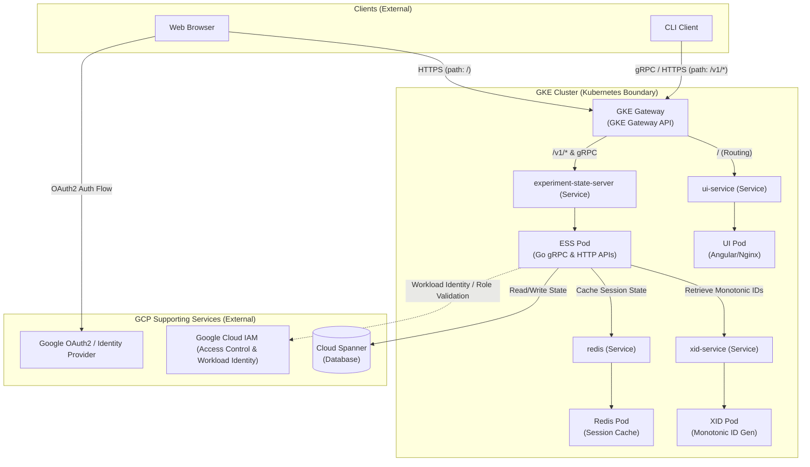
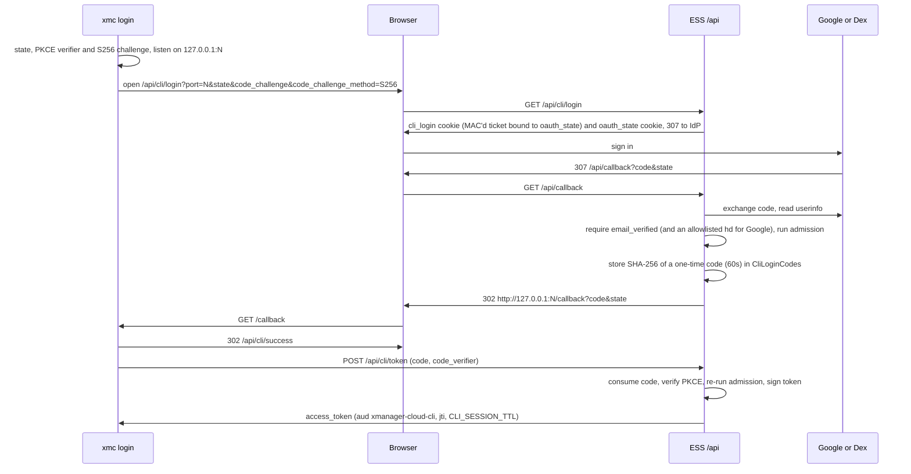

# XManager Cloud (XMC) Deployment & Gateway Design

This document describes the deployment architecture of the XManager Cloud (XMC) application, highlighting the GKE (Google Kubernetes Engine) stack, supporting Google Cloud Platform (GCP) services, user authentication, and traffic routing mechanisms for both web-based and CLI clients.

> [!NOTE]
> This page focuses on the edge: routing, authentication, and the GCP services behind them. For the
> full component inventory and how the services interact, see the
> [Architecture Overview](../architecture/overview.md) and the
> [Component Reference](../architecture/components.md).

---

## Architecture Overview

The XMC application is designed around a hybrid model: core application services run inside a **GKE Cluster**, while managed databases, authentication providers, and access control policies are delegated to **GCP Supporting Services**.



---

## Core Components & GKE Deployments

### Running inside GKE (Kubernetes Boundary)

All standard stateless services and in-cluster caching workloads run on GKE:

1. **GKE Gateway**: An external HTTP(S) and gRPC load balancer managed via the **GKE Gateway API** (typically utilizing the `gke-l7-global-external-managed` controller class). It manages TLS terminates, and forwards requests to the appropriate in-cluster services.
2. **UI Deployment (`ui-deployment`)**:
   - **Tech Stack**: Angular SPA compiled and served via an Nginx web server.
   - **Role**: Serves the static frontend assets to the user's browser.
3. **Experiment State Server (ESS) Deployment (`ess-deployment`)**:
   - **Tech Stack**: Go web server exposing both a REST/JSON API and gRPC endpoints.
   - **Role**: The main orchestrator of XMC, coordinating experiment states, workload pipelines, and CLI communications.
4. **XID Service Deployment (`xid-deployment`)**:
   - **Role**: Lightweight internal service providing monotonically increasing, globally unique IDs.
5. **Local Redis Instance Deployment (`redis-deployment`)**:
   - **Role**: Serves as a fast session cache, authentication cache, and pub/sub channel for active workloads.

### GCP Supporting Services (External to GKE)

1. **Google Cloud Spanner**:
   - The primary distributed SQL database system storing persistent experiment schemas, task logs, and metadata.
2. **Google Cloud IAM (Identity and Access Control)**:
   - Grants and verifies fine-grained permissions for the cluster services. It handles **Workload Identity**, allowing GKE Service Accounts to impersonate GCP IAM Service Accounts without managing secrets.
3. **Google OAuth2 / IAP (Identity-Aware Proxy)**:
   - Acts as the global identity provider. Secures authentication flows and validates client tokens.

---

## Traffic Flows & Routing Rules

### 1. Web Browser Traffic Flow (HTTP/S)

```
[ Browser ] --(1. URL Request)--> [ GKE Gateway ]
                                        |
                                        +---> (Path: /) ------> [ UI Pod ]
                                        |
                                        +---> (Path: /v1/*) --> [ ESS Pod ]
```

1. **Initial Request**: The user navigates to the XMC application domain.
2. **TLS Termination**: GKE Gateway terminates TLS using certificates managed by Google Managed Certificates or private GTS/Let's Encrypt issuers.
3. **Path-Based Routing**:
   - Path `/` and other UI routes are matched against `HTTPRoute` rules and forwarded to `ui-service`, which serves the static Angular UI files from the Nginx server in the UI Pod.
   - Path `/v1/*` routes API requests to `experiment-state-server-service` (ESS HTTP API) for fetching dynamic experiment lists, user profiles, etc.
4. **Authentication**:
   - Unauthenticated users are redirected to **Google Accounts** for OAuth2 consent.
   - Once authenticated, the backend issues a signed, stateless session token in an HTTP-only cookie.

---

### 2. CLI Client Traffic Flow (gRPC / HTTPS)

The command-line interface (CLI) client bypasses the web UI entirely, communicating directly with the APIs.

```
[ CLI Client ] --(gRPC API Calls)--> [ GKE Gateway ] --(GRPCRoute)--> [ ESS Pod ]
```

1. **Direct Request**: The CLI initiates requests directly to the dedicated API hostnames (e.g., `api.your-domain.com` or `grpc.your-domain.com`).
2. **Protocol Routing**:
   - **HTTP Requests** targeting `/v1/*` are routed to the ESS HTTP endpoint.
   - **gRPC Requests** (such as `/experiment.ExperimentService/*`) are routed via `GRPCRoute` directly to the gRPC port of the `experiment-state-server`.
3. **Authentication**:
   - The CLI attaches a bearer token to the call metadata: an XMC CLI session token from `xmc login` (see [CLI Login](#3-cli-login-browser-loopback)), a Google-signed ID token whose audience the deployment accepts (see [Accepted ID Token Audiences](#accepted-id-token-audiences)), for example from a service account's `generateIdToken`, a token from the configured OIDC provider, or an XMC session token.
   - Each gRPC service verifies the token, rejects Google and OIDC tokens whose `email_verified` claim is false (Google tokens must carry the claim), and then runs the same deployment admission check as the HTTP API (see [Client Authorization](#client-authorization)) before processing the call.

---

### 3. CLI Login (Browser Loopback)

`xmc login` signs the user in through the same OAuth client, identity provider and `/api/callback` redirect URI as the Dashboard ([google/xmc#1309](https://github.com/google/xmc/issues/1309)).



1. **Login ticket**: `/api/cli/login` accepts only a numeric loopback `port` (1024 to 65535), a CLI `state`, an S256 `code_challenge` and an optional `login_hint`. It stores them in the `cli_login` cookie, MAC'd with a key derived from the JWT secret by HKDF and scoped to `/api/callback`, together with the hash of the `oauth_state` it generates. To stop other sites from starting a login in the user's browser (login CSRF) or embedding it, browsers that send fetch metadata must send `Sec-Fetch-Site: none` and `Sec-Fetch-Dest: document`. Browsers without fetch metadata are allowed, which leaves them exposed to login CSRF.
2. **Callback**: `/api/callback` completes a CLI login only when the `cli_login` ticket is authentic, unexpired and bound to the `oauth_state` of the same round trip; otherwise it signs the user in to the Dashboard as before. `/api/login` deletes any `cli_login` cookie. Every outcome goes to the loopback URL, which is built from the ticket's port, never from the request: an identity provider error or cancellation, or a rejected user, is sent `error=access_denied`, and a failed code exchange or other server failure `error=server_error`. The email never appears in the URL.
3. **Token exchange**: `/api/cli/token` rejects malformed requests before reading the store or spending rate limit, consumes the code in a Spanner read-write transaction before checking the PKCE verifier, and answers every code or verifier problem with `400 invalid_grant`. A user who lost admission since signing in gets `403 access_denied`. Responses are `no-store`, and a process-wide rate limit protects the store.
4. **Use**: the CLI token is an HS256 session token with audience `xmanager-cloud-cli`. HTTP accepts it only as a bearer token, never as the session cookie, and gRPC accepts it in call metadata. Every call re-runs deployment admission.

The CLI login endpoints are registered only when authentication is enabled (no `MOCK_AUTH` or `DISABLE_AUTHENTICATION`) and the server has a Spanner client.

---

## Access Control & GCP IAM Integrations

XMC strictly enforces access control policies using native Google IAM mechanisms:

```
[ GKE Pod ] --(Workload Identity)--> [ Google Cloud IAM ] --(Verifies permissions)--> [ Cloud Spanner ]
```

### Workload Identity
Each pod that interacts with Cloud Spanner or other GCP APIs runs under a dedicated GKE Service Account that is bound to a Google Cloud Service Account. 
- **Kubernetes Service Account**: `xid-service`, `actuator-service-account`, `reconciler-service-account`.
- **GCP IAM Mapping**: The GKE service account is annotated to impersonate a GCP IAM Service Account:
  ```yaml
  metadata:
    annotations:
      iam.gke.io/gcp-service-account: "your-gcp-service-account@your-project.iam.gserviceaccount.com"
  ```
- **Resource Access**: The GCP Service Account is assigned specific IAM roles (e.g., Spanner Database User, Secret Manager Secret Accessor) providing secure, passwordless resource access.

### Client Authorization
Every authenticated caller, whether it arrives with a browser session cookie, an HTTP bearer token or gRPC metadata, must be admitted to the deployment before any per-experiment ACL is evaluated. HTTP and gRPC share one admission pipeline (`oauth2.Authenticator.IsUserAuthorized`), which admits the caller if it matches, in order:
1. the email allowlist (`ALLOWED_EMAILS`),
2. the domain allowlist (`ALLOWED_DOMAINS`), or
3. a direct binding of the authorized IAM role (`AUTHORIZED_IAM_ROLE`, `roles/viewer` by default) on the deployment project for the caller's `user:`, `serviceAccount:` or `domain:` principal. Owner, editor and group bindings do not satisfy this check.

Callers that authenticate but are not admitted receive `PERMISSION_DENIED` on gRPC and `403` on HTTP. With `DISABLE_AUTHENTICATION=true` (local development only), gRPC skips admission. The Component Manager Service additionally admits the workload service account that `xmc-bridge` runs as (`ess_service_account`); no other service admits it by identity.

### Accepted ID Token Audiences
A Google or OIDC ID token is accepted only if its `aud` claim is one of the deployment's accepted audiences. `oauth2.Config.AcceptedAudiences` builds this list in one place, in a fixed order, for the HTTP middleware, the gRPC authorizers and the JWKS validators:
1. service-specific audiences, on gRPC only: the IAP audiences (`IAP_EXPECTED_HTTP_AUDIENCE`, `IAP_EXPECTED_GRPC_AUDIENCE`) on the experiment state server and XID service, plus the XID audience on the XID service,
2. the deployment's OAuth client (`CLIENT_ID`), and
3. `ADDITIONAL_AUDIENCES` (Helm `auth.additionalAudiences`): extra OAuth client IDs that the deployer owns, such as a Desktop client used by scripts.

Empty and duplicate `ADDITIONAL_AUDIENCES` entries are dropped; an unset required audience such as `CLIENT_ID` still stops the experiment state server, XID and dashboard services at startup. Accepting an audience only authenticates the caller; deployment admission still applies (see [Client Authorization](#client-authorization)). Services fail to start if `ADDITIONAL_AUDIENCES` contains a shared public Google client, such as the Google Cloud SDK client (`32555940559.apps.googleusercontent.com`) or the application-default credentials client (`764086051850-6qr4p6gpi6hn506pt8ejuq83di341hur.apps.googleusercontent.com`). Any Google user can mint ID tokens for those clients, so accepting them would leave the admission check as the only control between the deployment and every Google account.
