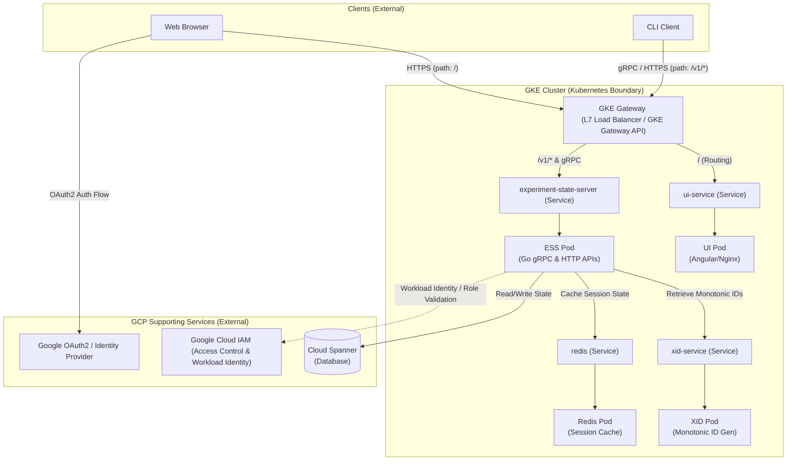

# XManager Cloud (XMC) Deployment & Gateway Design

This document describes the deployment architecture of the XManager Cloud (XMC) application, highlighting the GKE (Google Kubernetes Engine) stack, supporting Google Cloud Platform (GCP) services, user authentication, and traffic routing mechanisms for both web-based and CLI clients.

---

## Architecture Overview

The XMC application is designed around a hybrid model: core application services run inside a **GKE Cluster**, while managed databases, authentication providers, and access control policies are delegated to **GCP Supporting Services**.



---

## Core Components & GKE Deployments

### Running inside GKE (Kubernetes Boundary)

All standard stateless services and in-cluster caching workloads run on GKE:

1. **GKE Gateway**: An external HTTP(S) and gRPC load balancer managed via the **GKE Gateway API** (typically utilizing the `gke-l7-global-external-managed` controller class). It manages TLS terminates, and forwards requests to the appropriate in-cluster services.
2. **UI Deployment (`ui-deployment`)**:
   - **Tech Stack**: Angular SPA compiled and served via an Nginx web server.
   - **Role**: Serves the static frontend assets to the user's browser.
3. **Experiment State Server (ESS) Deployment (`ess-deployment`)**:
   - **Tech Stack**: Go web server exposing both a REST/JSON API and gRPC endpoints.
   - **Role**: The main orchestrator of XMC, coordinating experiment states, workload pipelines, and CLI communications.
4. **XID Service Deployment (`xid-deployment`)**:
   - **Role**: Lightweight internal service providing monotonically increasing, globally unique IDs.
5. **Local Redis Instance Deployment (`redis-deployment`)**:
   - **Role**: Serves as a fast session cache, authentication cache, and pub/sub channel for active workloads.

### GCP Supporting Services (External to GKE)

1. **Google Cloud Spanner**:
   - The primary distributed SQL database system storing persistent experiment schemas, task logs, and metadata.
2. **Google Cloud IAM (Identity and Access Control)**:
   - Grants and verifies fine-grained permissions for the cluster services. It handles **Workload Identity**, allowing GKE Service Accounts to impersonate GCP IAM Service Accounts without managing secrets.
3. **Google OAuth2 / IAP (Identity-Aware Proxy)**:
   - Acts as the global identity provider. Secures authentication flows and validates client tokens.

---

## Traffic Flows & Routing Rules

### 1. Web Browser Traffic Flow (HTTP/S)

```
[ Browser ] --(1. URL Request)--> [ GKE Gateway ]
                                        |
                                        +---> (Path: /) ------> [ UI Pod ]
                                        |
                                        +---> (Path: /v1/*) --> [ ESS Pod ]
```

1. **Initial Request**: The user navigates to the XMC application domain.
2. **TLS Termination**: GKE Gateway terminates TLS using certificates managed by Google Managed Certificates or private GTS/Let's Encrypt issuers.
3. **Path-Based Routing**:
   - Path `/` and other UI routes are matched against `HTTPRoute` rules and forwarded to `ui-service`, which serves the static Angular UI files from the Nginx server in the UI Pod.
   - Path `/v1/*` routes API requests to `experiment-state-server-service` (ESS HTTP API) for fetching dynamic experiment lists, user profiles, etc.
4. **Authentication**:
   - Unauthenticated users are redirected to **Google Accounts** for OAuth2 consent.
   - Once authenticated, the browser exchanges codes for an ID token, establishing a secure session cached in the in-cluster Redis instance.

---

### 2. CLI Client Traffic Flow (gRPC / HTTPS)

The command-line interface (CLI) client bypasses the web UI entirely, communicating directly with the APIs.

```
[ CLI Client ] --(gRPC API Calls)--> [ GKE Gateway ] --(GRPCRoute)--> [ ESS Pod ]
```

1. **Direct Request**: The CLI initiates requests directly to the dedicated API hostnames (e.g., `api.your-domain.com` or `grpc.your-domain.com`).
2. **Protocol Routing**:
   - **HTTP Requests** targeting `/v1/*` are routed to the ESS HTTP endpoint.
   - **gRPC Requests** (such as `/experiment.ExperimentService/*`) are routed via `GRPCRoute` directly to the gRPC port of the `experiment-state-server`.
3. **Authentication**:
   - The CLI authenticates by attaching a service account credential (GCP IAM Service Account Key or federated OIDC token) to the call metadata.
   - The ESS server parses and validates this token against configured GCP IAM roles before processing any API calls.

---

## Access Control & GCP IAM Integrations

XMC strictly enforces access control policies using native Google IAM mechanisms:

```
[ GKE Pod ] --(Workload Identity)--> [ Google Cloud IAM ] --(Verifies permissions)--> [ Cloud Spanner ]
```

### Workload Identity
Each pod that interacts with Cloud Spanner or other GCP APIs runs under a dedicated GKE Service Account that is bound to a Google Cloud Service Account. 
- **Kubernetes Service Account**: `xid-service`, `actuator-service-account`, `reconciler-service-account`.
- **GCP IAM Mapping**: The GKE service account is annotated to impersonate a GCP IAM Service Account:
  ```yaml
  metadata:
    annotations:
      iam.gke.io/gcp-service-account: "your-gcp-service-account@your-project.iam.gserviceaccount.com"
  ```
- **Resource Access**: The GCP Service Account is assigned specific IAM roles (e.g., Spanner Database User, Secret Manager Secret Accessor) providing secure, passwordless resource access.

### Client Authorization
When the `experiment-state-server` receives authentication tokens (from either browser session cookies or CLI JWT metadata):
- It uses Google IAM APIs to verify the calling identity's permissions.
- Access is granted only if the identity possesses the authorized GCP IAM Role (e.g., `roles/oauth2PrototypeUser` or equivalent custom role configured in the Helm values).
