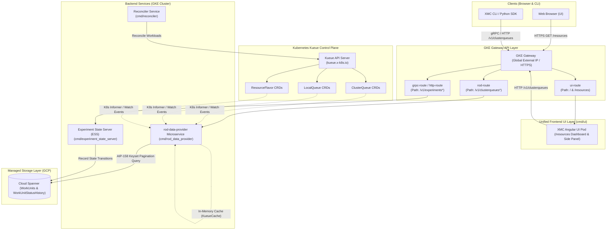
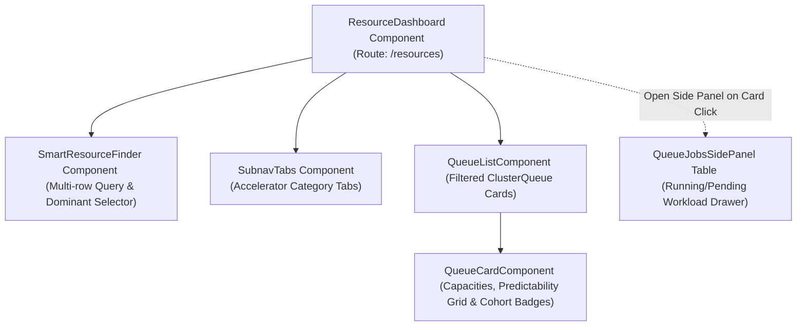

# Resource Observability Dashboard (ROD) System Design & Architecture

The **Resource Observability Dashboard (ROD)** provides real-time visibility into Kubernetes Kueue cluster queues, compute resource capacity, workload backlogs, and historical scheduling velocity across XManager on Cloud (XMC) clusters.

---

## 1. Overview & Motivation

When scheduling large-scale machine learning, High-Performance Computing (HPC), and batch workloads across multi-tenant GPU, TPU, and CPU clusters, users and automated orchestrators face several visibility challenges:

* **Resource Fragmentation & Queuing Blind Spots**: Identifying which cluster queues have immediate scheduling headroom versus deep waitlists.
* **Complex Multi-Flavor Quota Accounting**: Understanding instantaneous available capacity across heterogeneous accelerators (e.g., NVIDIA H100/A100, TPU v4/v5e/v5p) with varying nominal quotas, borrowing limits, and shared cohort pools.
* **Turnover Predictability**: Estimating how fast workloads are completing and freeing up compute resources in a given queue.
* **Workload Attribution**: Inspecting running and pending jobs, user ownership, priority levels, and deep-linking directly into experiment execution traces.

ROD addresses these challenges through a **Unified UI Layer** and a dedicated, event-driven **Backend Data Provider Microservice (`rod-data-provider`)**.

---

## 2. System Architecture & Component Topology

ROD follows an event-driven informer and streaming cache architecture to serve real-time queue states while querying Cloud Spanner for historical telemetry and turnover velocity.



---

## 3. Frontend Architecture (`cmd/ui/app/resource_dashboard/`)

The Resource Observability Dashboard frontend is built **directly into the main XMC UI single-page application** (`cmd/ui/`), re-using shared Angular styles, Material components, header navigation, and slide-out side panels.

### Key UI Components



### Key UI Features & Interaction Contracts

1. **Smart Resource Finder**:
   * Multi-row filter bar enabling users to define custom compute resource queries (e.g. `2 x nvidia-tesla-h100`, `16 x CPU`).
   * Evaluates instantaneous queue capacities and highlights qualifying cluster queues.
   * **Dominant Resource Selector**: The resource in the first filter slot (index 0) is designated as the **Dominant Resource** (highlighted with an uppercase blue badge and border). This selection drives the queue turnover velocity calculations across all queue cards. If no resource filter is selected, velocity metrics are suppressed in favor of a clean empty state.

2. **Queue Capacity Cards**:
   * **Nominal Quota ($Q_{\text{nominal}}$)**: Total guaranteed compute quota allocated to the queue.
   * **Used Capacity ($U_{\text{local}}$)**: Resources reserved by active workloads in this queue.
   * **Instantaneous Free Capacity**: Real-time headroom calculated as:
     $$\text{Free}_{\text{local}} = \max(0, Q_{\text{nominal}} - U_{\text{local}})$$
   * **Cohort Borrowing & Headroom**:
     When queues belong to a shared Kueue cohort, immediate admission headroom accounts for shared cohort pools:
     $$\text{Schedulable Now} = \min(\text{Free}_{\text{local}}, \text{Free}_{\text{cohort}})$$
     * **Squeezed State**: When cohort peers borrow communal quota, lowering immediate admission below nominal entitlement ($\text{Free}_{\text{cohort}} < \text{Free}_{\text{local}}$), the card displays a contextual alert badge indicating temporary cohort peer usage.
     * **Borrowing State**: When spare cohort quota is available for burst usage beyond nominal limits ($\text{Free}_{\text{cohort}} > \text{Free}_{\text{local}}$), an expandable borrowing badge indicates available burst headroom.

3. **Queue Jobs Inspection Side-Panel**:
   * Slide-out drawer opened upon clicking any queue card or navigating to `/resources?queue=<queue-name>`.
   * Displays paginated running and pending workloads (`AIP-158` keyset pagination with page size selector).
   * Renders queue position (`N/A - running` for active jobs, monotonic rank `1, 2, 3...` for pending jobs), experiment ID, status badge, priority, requested resources, author email/username, and direct deep-links to `/experiments/:xid`.

---

## 4. Backend Microservice (`cmd/rod_data_provider/`)

The `rod-data-provider` is a high-performance Go microservice exposing gRPC and gRPC-Gateway HTTP APIs.

### Informer & In-Memory Cache Layer (`kueue_cache.go`)

To avoid flooding the Kubernetes API server with frequent poll requests, `rod-data-provider` leverages `controller-runtime` event informers:
* **ClusterQueue Informer**: Tracks `kueue.x-k8s.io/v1beta1` `ClusterQueue` status, flavor reservations, usage, nominal quotas, borrowing limits, and cohort memberships.
* **LocalQueue Informer**: Tracks namespace-to-ClusterQueue bindings.
* **ResourceFlavor Informer**: Tracks accelerator and node flavor mappings.

These informers maintain a thread-safe in-memory cache (`ResourceCache[T]` & `KueueCache`), serving primary queue queries sub-millisecond without database or API server latency.

### API Endpoints & Capabilities

#### Primary In-Memory Endpoints

* **`GetClusterQueues` (`GET /v1/clusterqueues`)**:
  Returns all registered cluster queues with aggregated flavor quotas, real-time allocations, cohort borrowing headroom, and status conditions.
* **`GetSubmitQueue` (`GET /v1/clusterqueues:getSubmitQueue`)**:
  Evaluates requested resource constraints and returns the optimal `LocalQueue` and `ClusterQueue` target for workload submission.
* **`GetFittingQueues` (`POST /v1/clusterqueues:getFittingQueues`)**:
  Filters and ranks queues capable of accommodating a multi-resource workload specification.

#### Secondary Storage & Telemetry Endpoints

* **`GetRunningAndPendingJobs` (`GET /v1/clusterqueues/{queue_name}/jobs`)**:
  Queries Cloud Spanner for active and queuing workloads belonging to the target queue. Supports forward and backward keyset pagination via `pageToken` and `pageSize`.
* **`BatchGetQueueSecondaryData` (`POST /v1/clusterqueues:batchGetSecondaryData`)**:
  Computes historical turnover analytics over configurable time horizons (`RANGE_PRESET_LAST_HOUR`, `RANGE_PRESET_LAST_DAY`):
  * **Job Velocity**: Completed jobs per hour ($\text{jobs/hr}$).
  * **Resource Velocity**: Released compute units per hour ($\text{accelerators/hr}$, $\text{cores/hr}$).
  * **Backlog Snapshot**: Count and total compute demand of pending workloads awaiting admission.

---

## 5. Cloud Spanner Telemetry Schema

Historical scheduling velocity and active job queries are powered by dedicated Spanner tables and secondary indexes.

### `WorkUnitStatusHistory` Table
Captures discrete state transitions of work units for sliding-window turnover metrics:

```sql
CREATE TABLE WorkUnitStatusHistory (
  Xid INT64 NOT NULL,
  BitReversedXid INT64 NOT NULL AS (BIT_REVERSE(Xid, FALSE)) STORED,
  WorkUnitId INT64 NOT NULL,
  HistoryId INT64 NOT NULL,
  ExecutionId INT64,
  QueueName STRING(MAX),
  PreviousState cloud.xmanager.v1.WorkUnitStatus.WorkUnitState,
  NewState cloud.xmanager.v1.WorkUnitStatus.WorkUnitState NOT NULL,
  ResourceType STRING(MAX),
  ResourceUnits INT64,
  CreateTime TIMESTAMP NOT NULL,
  ExpirationTime TIMESTAMP AS (TIMESTAMP_ADD(CreateTime, INTERVAL 30 DAY)) STORED,
) PRIMARY KEY (BitReversedXid, WorkUnitId, HistoryId),
  ROW DELETION POLICY (OLDER_THAN(ExpirationTime, INTERVAL 0 DAY));

CREATE INDEX WorkUnitStatusHistoryByQueueAndCreateTime 
ON WorkUnitStatusHistory (QueueName, CreateTime DESC, NewState, PreviousState) 
STORING (ResourceType, ResourceUnits);
```

### Active Jobs Query Index (`WorkUnitsByQueueAndPosition`)
Enables high-throughput keyset pagination for queue inspection without table scans:

```sql
CREATE INDEX WorkUnitsByQueueAndPosition 
ON WorkUnits (QueueName, PositionInQueue, Xid, WorkUnitId) 
STORING (WorkUnitStatus, Priority, Executable);
```

---

## 6. GKE Gateway Routing & Ingress Rules

In Blueprint v2 topologies, GKE Gateway API routes external traffic to `rod-data-provider-service` on port `8080` via `rod-route`:

```yaml
apiVersion: gateway.networking.k8s.io/v1
kind: HTTPRoute
metadata:
  name: rod-route
  namespace: xmc
spec:
  hostnames:
  - "<domain-name>"
  parentRefs:
  - name: xmc-gateway
    sectionName: https
  rules:
  - matches:
    - path:
        type: PathPrefix
        value: /v1/clusterqueues
    - path:
        type: PathPrefix
        value: /v1/clusterqueues:batchGetSecondaryData
    backendRefs:
    - name: rod-data-provider-service
      port: 8080
```

---

## 7. Developer & Testing Guide

### Bazel Build & Test Commands

* **Build the Data Provider daemon**:
  ```bash
  bazel build //cmd/rod_data_provider:rod_data_provider
  ```

* **Run all Data Provider unit tests**:
  ```bash
  bazel test //cmd/rod_data_provider/...
  ```

* **Run UI unit and component tests**:
  ```bash
  bazel test //cmd/ui:ui_unit_tests
  ```

* **Run UI screenshot regression tests**:
  ```bash
  cd cmd/ui && npm run test:screenshot
  ```

* **Build and push the OCI container image**:
  ```bash
  bazel run //cmd/rod_data_provider:rod_data_provider_image_push
  ```
