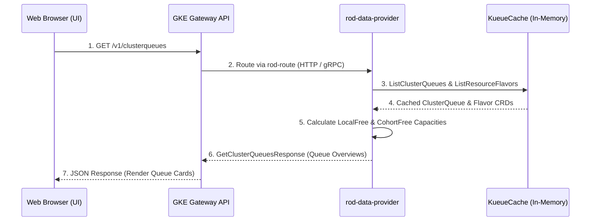
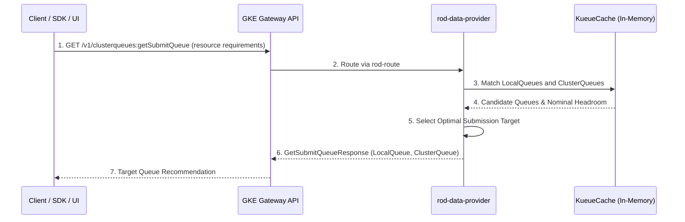
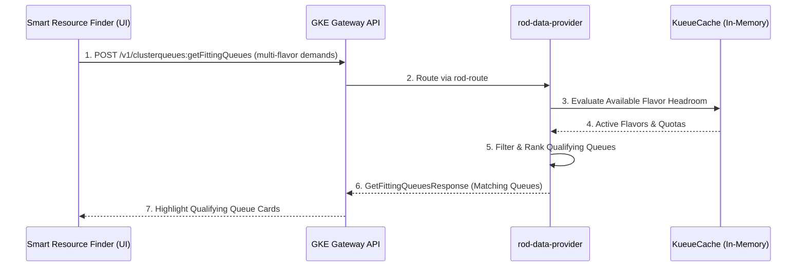
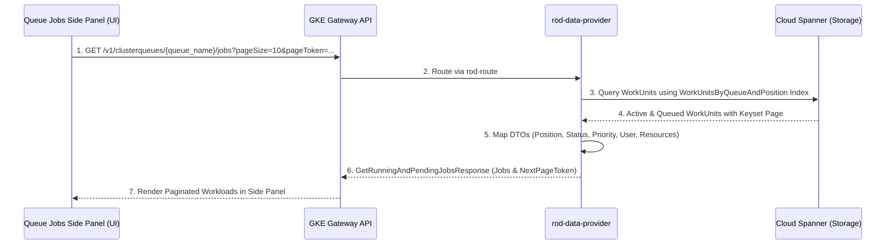
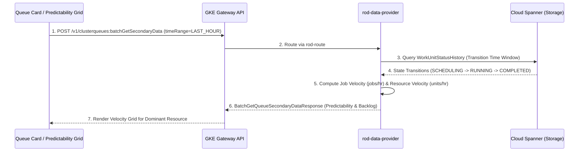
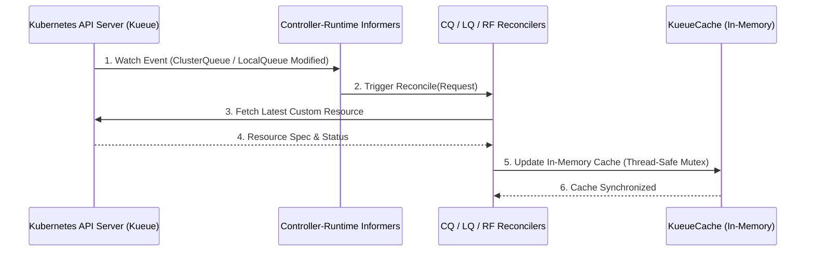

# XMC System Execution & Sequence Flows

This directory documents the end-to-end communication, state transitions, and sequence flows across XManager on Cloud (XMC) services.

Sequence diagrams are defined as standard [Mermaid](https://mermaid.js.org/) files (`.mmd`) under [`artifacts/`](artifacts/).

---

## 1. Resource Observability Dashboard (ROD) Flows

The Resource Observability Dashboard components communicate across GKE Gateway, the `rod-data-provider` Go microservice, in-memory Kueue informers, and Cloud Spanner.

### 1.1 Real-Time Queue Capacity Flow (`GetClusterQueues`)
Fetches real-time cluster queue capacity, flavor quotas, used resources, and cohort borrowing headroom directly from the in-memory `KueueCache`.

* **Artifact Source**: [`artifacts/rod_get_clusterqueues.mmd`](artifacts/rod_get_clusterqueues.mmd)

---

### 1.2 Target Submission Queue Selection Flow (`GetSubmitQueue`)
Resolves the optimal `LocalQueue` and `ClusterQueue` for submitted workload resource requirements.

* **Artifact Source**: [`artifacts/rod_get_submit_queue.mmd`](artifacts/rod_get_submit_queue.mmd)

---

### 1.3 Smart Resource Finder Fit Matching Flow (`GetFittingQueues`)
Filters and ranks cluster queues capable of accommodating multi-flavor compute specifications.

* **Artifact Source**: [`artifacts/rod_get_fitting_queues.mmd`](artifacts/rod_get_fitting_queues.mmd)

---

### 1.4 Queue Jobs Keyset Pagination Flow (`GetRunningAndPendingJobs`)
Queries Cloud Spanner via the `WorkUnitsByQueueAndPosition` secondary index for running and pending workloads in a target queue with AIP-158 keyset pagination.

* **Artifact Source**: [`artifacts/rod_get_queue_jobs.mmd`](artifacts/rod_get_queue_jobs.mmd)

---

### 1.5 Turnover Velocity & Predictability Flow (`BatchGetQueueSecondaryData`)
Aggregates historical state transitions from `WorkUnitStatusHistory` over configurable timeframes (`RANGE_PRESET_LAST_HOUR` / `RANGE_PRESET_LAST_DAY`) to compute completion rates and resource release rates for dominant resources.

* **Artifact Source**: [`artifacts/rod_batch_get_secondary_data.mmd`](artifacts/rod_batch_get_secondary_data.mmd)

---

### 1.6 Kueue Informer Cache Sync Flow
Watches Kubernetes Kueue custom resources asynchronously, keeping in-memory `KueueCache` updated with zero polling overhead.

* **Artifact Source**: [`artifacts/rod_kueue_informer_sync.mmd`](artifacts/rod_kueue_informer_sync.mmd)

---

## 2. Core Service & WorkUnit Flows

### 2.1 Experiment Management
* **Create Experiment**: [`artifacts/create_experiment.mmd`](artifacts/create_experiment.mmd)
* **Get Experiment**: [`artifacts/get_experiment.mmd`](artifacts/get_experiment.mmd)
* **List Experiments**: [`artifacts/list_experiments.mmd`](artifacts/list_experiments.mmd)
* **Update Experiment**: [`artifacts/update_experiment.mmd`](artifacts/update_experiment.mmd)

### 2.2 WorkUnit Lifecycle & Execution
* **Create WorkUnit (Single)**: [`artifacts/create_wu_single.mmd`](artifacts/create_wu_single.mmd)
* **Create WorkUnit (Sync / Async)**: [`artifacts/create_wu_sync.mmd`](artifacts/create_wu_sync.mmd) / [`artifacts/create_wu_async.mmd`](artifacts/create_wu_async.mmd)
* **Get / List WorkUnits**: [`artifacts/get_wu.mmd`](artifacts/get_wu.mmd) / [`artifacts/list_wu.mmd`](artifacts/list_wu.mmd)
* **Stop WorkUnit**: [`artifacts/stop_wu_single.mmd`](artifacts/stop_wu_single.mmd) / [`artifacts/stop_wu_sync.mmd`](artifacts/stop_wu_sync.mmd) / [`artifacts/stop_wu_async.mmd`](artifacts/stop_wu_async.mmd)
* **Restart WorkUnit**: [`artifacts/restart_wu_single.mmd`](artifacts/restart_wu_single.mmd) / [`artifacts/restart_wu_sync.mmd`](artifacts/restart_wu_sync.mmd) / [`artifacts/restart_wu_async.mmd`](artifacts/restart_wu_async.mmd)
* **Update WorkUnit**: [`artifacts/update_wu_single.mmd`](artifacts/update_wu_single.mmd) / [`artifacts/update_wu_sync.mmd`](artifacts/update_wu_sync.mmd) / [`artifacts/update_wu_async.mmd`](artifacts/update_wu_async.mmd)

### 2.3 Reconciliation & Background Workers
* **JobSet Reconciler**: [`artifacts/reconcile_jobset.mmd`](artifacts/reconcile_jobset.mmd)
* **ClusterQueue Reconciler**: [`artifacts/clusterqueue_reconciler.mmd`](artifacts/clusterqueue_reconciler.mmd)
* **Kueue Sync Worker**: [`artifacts/kueue_sync_worker.mmd`](artifacts/kueue_sync_worker.mmd)
* **Batcher Logic**: [`artifacts/batcher_logic.mmd`](artifacts/batcher_logic.mmd)

### 2.4 Artifacts & Status Tracking
* **Artifact Operations**: [`artifacts/create_artifact.mmd`](artifacts/create_artifact.mmd), [`artifacts/get_artifact.mmd`](artifacts/get_artifact.mmd), [`artifacts/list_artifacts.mmd`](artifacts/list_artifacts.mmd), [`artifacts/delete_artifact.mmd`](artifacts/delete_artifact.mmd)
* **Status Updates**: [`artifacts/get_status.mmd`](artifacts/get_status.mmd), [`artifacts/list_status_messages.mmd`](artifacts/list_status_messages.mmd), [`artifacts/update_launch_state.mmd`](artifacts/update_launch_state.mmd)
