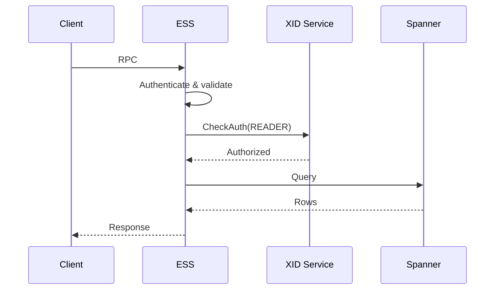
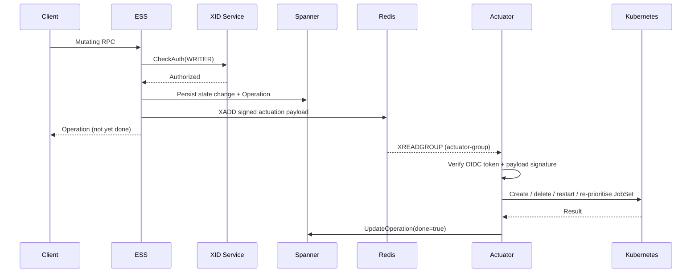

# Main Flows

Sequence-level documentation for XMC's principal request, actuation, and observation paths. Read
[Architecture Overview](../architecture/overview.md) for the component landscape and
[Execution Model](../architecture/execution_model.md) for the state machine these flows drive.

| Document | Covers |
| :--- | :--- |
| [Experiment Lifecycle](experiment_lifecycle.md) | Creating, reading, updating, and listing experiments; launch state; status; artifacts; status messages. |
| [Work Unit Lifecycle](work_unit_lifecycle.md) | Creating, stopping, restarting, and updating work units — the asynchronous actuation path end to end. |
| [Reconciliation](reconciliation.md) | How cluster state becomes persisted work unit state: JobSet and ClusterQueue reconcilers, Kueue sync worker, and the batcher. |
| [Metrics & Observability](metrics_and_observability.md) | The metrics pipeline from training job to dashboard, plus logs, health, and resource observability. |

---

## Anatomy of an XMC Request

Almost every flow in this section is a variation on one of three shapes. Recognising which shape
you are looking at answers most questions about latency, consistency, and failure behaviour.

### Shape 1 — Synchronous read



Fully synchronous, strongly consistent, no cluster involvement. `GetExperiment`, `ListWorkUnits`,
`ListStatusMessages`, and every `Search*` RPC take this shape.

### Shape 2 — Synchronous write

Same as shape 1, but authorized with `WRITER` (or `OWNER` for deletion) and committing a Spanner
transaction. `CreateExperiment`, `UpdateExperiment`, and the artifact mutations take this shape.
The response reflects committed state.

### Shape 3 — Asynchronous actuation



Any RPC that must change the cluster takes this shape: `CreateWorkUnit`, `StopWorkUnit`,
`RestartWorkUnit`, `UpdateWorkUnit`, and their `Batch*` variants. The client's response arrives
before the cluster has changed; convergence is observed either by polling the returned
`google.longrunning.Operation` or by watching the work unit's state.

---

## Reading the Diagrams

The diagrams on these pages are kept in sync with the Mermaid sources in
[`artifacts/`](artifacts), which also hold pre-rendered SVGs. Many flows exist there in three
variants:

| Suffix | Contents |
| :--- | :--- |
| `_sync` | Only the synchronous, client-facing half of the flow. |
| `_async` | Only the asynchronous, Actuator-side half. |
| `_single` | Both halves in one diagram. |

These pages generally embed the `_single` variant, since it shows the complete path.

The `.mmd` files are the canonical sources. When you change one, update the diagram embedded in the
corresponding page to match — GitHub renders the fenced ` ```mermaid ` blocks natively, so the
pages do not depend on the SVGs.

The checked-in SVGs are produced by
[`artifacts/render_mermaid.ts`](artifacts/render_mermaid.ts), which takes an input `.mmd` and an
output `.svg`. It depends on the `beautiful_mermaid` package and there is no build target for it in
this repository, so regenerating SVGs is not part of the normal local workflow.
