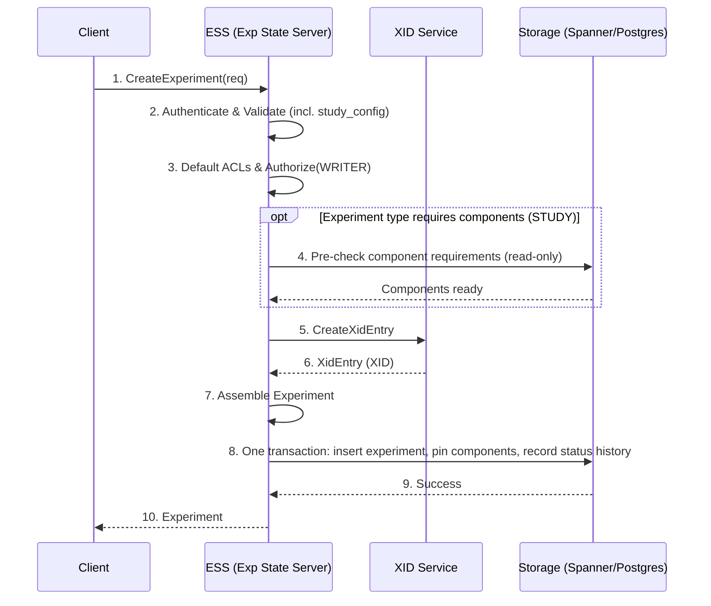
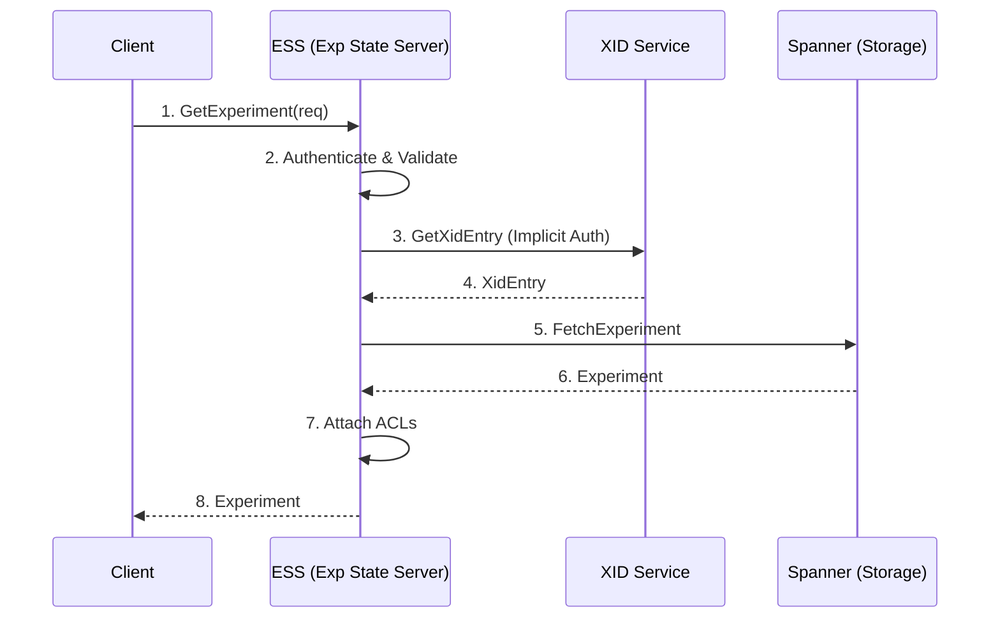
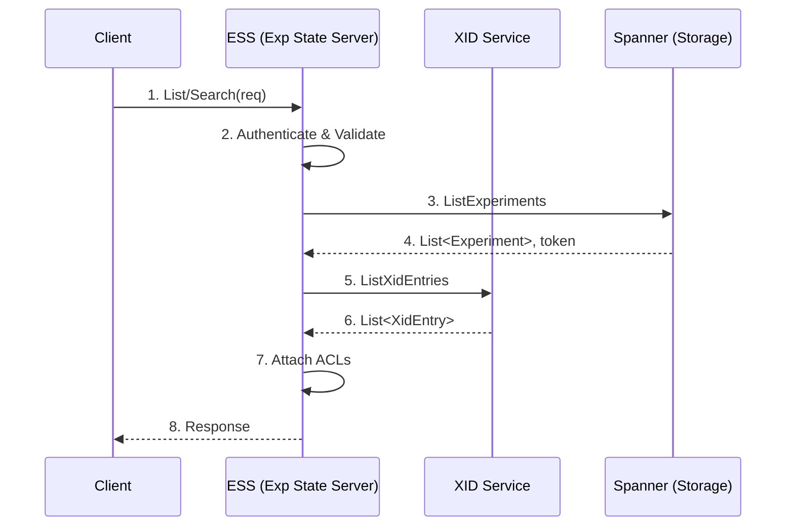
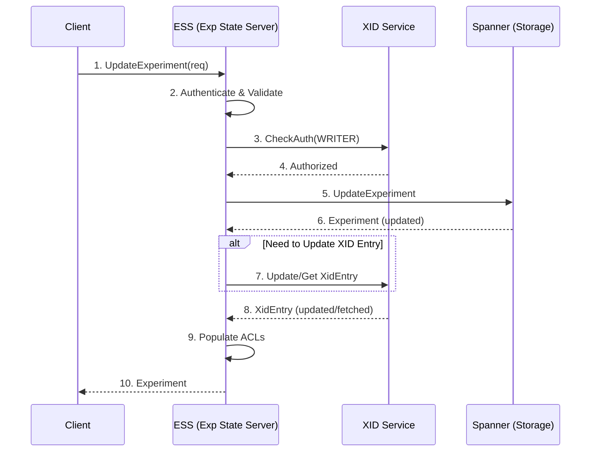

# Experiment Lifecycle Flows

The read and write paths for experiments, their status, their artifacts, and their status
messages. All of these are handled entirely by the Experiment State Server (ESS), the XID Service,
and the storage backend (Cloud Spanner or PostgreSQL) — none of them touch the cluster.

For anything that starts, stops, or restarts actual work, see
[Work Unit Lifecycle](work_unit_lifecycle.md).

---

## 1. Create Experiment

The ordering here is worth noting: the `xid` is allocated by the XID Service **before** the
experiment row exists. The XID entry is what carries ownership and access control, which keeps a
single source of truth for "who may touch experiment N" across every subsequent call. Request
validation, authorization, and the component pre-check run before `CreateXidEntry`, so these
rejections leave no XID entry behind; a failure in the creation transaction (step 8) happens after it
and leaves its XID entry in place.

**Validation (step 2).** Malformed requests fail with `INVALID_ARGUMENT`. Besides the general field
rules, `experiment_type` must be a known value, and a missing or `UNSPECIFIED` `experiment_type` is
normalized to `STANDARD` before the experiment is stored. `study_config` is required when the type
is `STUDY` and rejected for every other type. A study config must have a single objective metric, a
supported search algorithm, and valid parameters; see
[STUDY Experiments](../../cmd/experiment_state_server/README.md#study-experiments).

**Authorization (step 3).** Because there is no XID entry to check against yet, ESS authorizes the
creator directly against the requested ACLs, using the same `internal/auth` evaluation the XID
Service applies. A creator who does not hold `WRITER` (or `OWNER`) on the requested ACLs gets
`PERMISSION_DENIED`. If the request's `acls` is unset or lists no principals in any role, ESS grants
the creator `OWNER`; ACLs that list any principal are passed through unchanged, but must name at
least one owner and a principal in every role, or the request fails with `INVALID_ARGUMENT`.

**Component requirements (step 4).** Some experiment types require catalog components
([`internal/experiment/componentrequirements.go`](../../internal/experiment/componentrequirements.go)):
a `STUDY` requires the `hpo` component and, transitively, every dependency it declares (`vizier`,
`clickhouse`). For these types ESS returns `FAILED_PRECONDITION` when a required component is
missing, not `ENABLED`, of the wrong type, or has not observed its current generation. The pre-check reads one read-only catalog snapshot and writes nothing.
`STANDARD` experiments require no components and skip it.

**Persistence (step 8).** [`experiment.CreateExperiment`](../../internal/experiment/createexperiment.go)
inserts the experiment and records its initial status message history in one storage transaction.
For experiment types with component requirements, the transaction is serializable and, after the
insert, repeats the requirement check authoritatively and pins each resolved component as an
`ExperimentComponentSnapshots` row at its current generation. The repeated check closes the window
between the pre-check and the transaction: an unmet requirement found there still returns
`FAILED_PRECONDITION` and rolls back the experiment row, while other storage errors return
`INTERNAL`.

Domain rules for assembling the experiment — defaults, derived fields, validation — live in
[`internal/domain/experiment`](../../internal/domain/experiment), separate from the RPC handler.

---

## 2. Read Experiments

### Get a single experiment

`GetXidEntry` serves double duty: it authorizes the read (a caller who cannot see the entry cannot
see the experiment) and supplies the ACL data attached to the response, so the UI can decide
whether to render stop/restart controls without a second round trip.

### List or search experiments

The order inverts relative to `GetExperiment`: Spanner is queried first, then a single batched
`ListXidEntries` call resolves ACLs for the whole page. This keeps list latency independent of page
size in terms of XID round trips.

`ListExperiments` and `SearchExperiments` share this implementation; `Search*` additionally accepts
an AIP-160 filter expression, compiled by
[`internal/query_generator`](../../internal/query_generator). The same `List`/`Search` pairing
exists for work units, artifacts, and status messages — and in all four cases the `Search*` half
reads with a 15-second bounded staleness while the `List*` half reads strongly, so a filtered query
can lag a write that a plain list would already show.

---

## 3. Update Experiment

Some experiment fields are mirrored in the XID entry (ownership and access control in particular),
so an update that touches them writes to both stores. Fields that exist only in Spanner skip the
conditional branch.

> [!NOTE]
> Changing an experiment's **priority** is not an exception to "none of this touches the cluster".
> `UpdateExperiment` enqueues no actuation task. The new value is read from Spanner the next time a
> work unit in that experiment is created, restarted, or re-prioritised — that is when the
> experiment/work-unit priority pair is resolved into a Kueue `WorkloadPriorityClass`. JobSets
> already in the cluster keep the class they were labelled with. See
> [Execution Model §6](../architecture/execution_model.md#6-scheduling-and-priority).

---

## 4. Update Launch State

`UpdateExperimentLaunchState` is a plain
[Shape 2 — synchronous write](README.md#shape-2--synchronous-write): `WRITER` check, Spanner commit,
a `GetXidEntry` to populate ACLs on the response, done.

Launching an experiment is a client-side loop: create the experiment, then create each work unit,
then declare the launch finished. `UpdateExperimentLaunchState` is how the client reports where it
is in that loop — `LAUNCHING`, then `COMPLETED` or `FAILED`, carrying a `launch_id`.

This exists because XMC cannot infer completion of a client-driven loop. Without it, an experiment
whose submitting process crashed after three of ten work units would look identical to a
deliberately small experiment. With it, the UI can show "launching" and operators can spot
abandoned launches.

---

## 5. Get Experiment Status

Another plain [Shape 1 — synchronous read](README.md#shape-1--synchronous-read). What is
interesting here is not the path but the payload.

`GetExperimentStatus` returns the aggregate rollup rather than the experiment resource: active
state, launch state, per-`WorkUnitState` counts, and per-severity status message counts. It is the
call the UI polls for the experiment list and detail pages, because it answers "how is this going?"
in one round trip instead of listing every work unit.

The counts it aggregates are written by the observation loop described in
[Reconciliation](reconciliation.md) — this read path never consults the cluster.

---

## 6. Artifacts

Artifacts are named outputs and references attached to experiments and work units — checkpoint
paths, dataset URIs, links to external systems. They are pure Spanner CRUD with no cluster
involvement — [Shape 1](README.md#shape-1--synchronous-read) for the reads and
[Shape 2](README.md#shape-2--synchronous-write) for the writes, with nothing bolted on.

All six artifact RPCs follow that shape, differing only in the role they require:

| RPC | Required role |
| :--- | :--- |
| `GetArtifact`, `ListArtifacts`, `SearchArtifacts`, `CreateArtifact` | `READER` |
| `UpdateArtifact` | `WRITER` |
| `DeleteArtifact` | `OWNER` |

The ladder is not the obvious one. `CreateArtifact` requires only `READER`
([`createartifact.go`](../../cmd/experiment_state_server/server/createartifact.go)) — anyone who can
see an experiment can attach an output to it — while *changing* an existing artifact requires
`WRITER`. Deletion then requires `OWNER` rather than `WRITER`, so a collaborator who can add
outputs cannot remove someone else's.

---

## 7. Status Messages

`ListStatusMessages` and `SearchStatusMessages` are
[Shape 1](README.md#shape-1--synchronous-read) reads, paginated and parent-scoped.

Status messages are the human-readable narrative attached to a work unit: scheduling explanations
from Kueue, bring-up errors from the JobSet reconciler, and parsed application errors from the
Log Monitor. They carry a severity, which is what `ExperimentStatus.MessageSeverityCount`
aggregates.

The two RPCs differ in read consistency. `ListStatusMessages` issues a strong Spanner read
(staleness `0`), so a message written a moment ago is guaranteed to appear. `SearchStatusMessages`
issues a stale read with a 15-second bound, trading immediacy for cheaper reads on the filtered,
scan-heavy path. Every change to a work unit's status message is also written to a history table,
unconditionally since [#801](https://github.com/google/xmc/pull/801) removed the
`statusMessageHistoryEnabled` gate.

Where the messages come from is covered in
[Metrics & Observability §3](metrics_and_observability.md#3-log-monitoring-pipeline).

---

## 8. Related Reading

- [Work Unit Lifecycle](work_unit_lifecycle.md) — the flows that actually launch work.
- [Execution Model](../architecture/execution_model.md) — the state machine behind these statuses.
- [`api/protos/experiment/api.proto`](../../api/protos/experiment/api.proto) — the authoritative
  RPC definitions.
