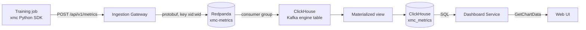
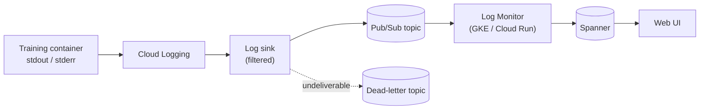

# Metrics & Observability Flows

Four independent paths answer four different questions about a running system:

| Question                         | Path                                                    | Store                     |
| :------------------------------- | :------------------------------------------------------ | :------------------------ |
| How is my model training?        | [Metrics pipeline](#1-the-metrics-pipeline)             | ClickHouse                |
| Why did my job fail?             | [Log monitoring](#3-log-monitoring-pipeline)            | Spanner (status messages) |
| Is XMC itself healthy?           | [Health service](#4-platform-health)                    | in-memory cache           |
| Where is cluster capacity going? | [Resource observability](#5-resource-observability-rod) | in-memory cache           |

They share no infrastructure, deliberately: a ClickHouse outage must not hide a failing job, and a
metrics firehose must not compete with the control plane for Spanner throughput.

---

## 1. The Metrics Pipeline

The only high-throughput path in XMC. It moves training metrics from inside a job's process to a
chart in the browser without ever touching the control plane.

Every hop is asynchronous. Nothing in this path can block a training step, and nothing in it can
block an experiment RPC.

### 1.1 Emission — the SDK

The SDK reads its configuration entirely from the environment. Some of it the Actuator injects; the
rest you must supply in the work unit spec:

| Variable                               | Source                       | Purpose                                              |
| :------------------------------------- | :--------------------------- | :--------------------------------------------------- |
| `XMC_XID`                              | **you** (work unit `EnvVar`) | Experiment ID. Mandatory.                            |
| `XMC_GATEWAY_URL`                      | **you** (work unit `EnvVar`) | Ingestion Gateway address. Mandatory.                |
| `XMC_WORK_UNIT_ID`, `XMC_EXECUTION_ID` | Actuator                     | Mandatory identity.                                  |
| `XMC_JOB_NAME`, `XMC_JOB_INDEX`        | Actuator                     | Which replicated job, and the rank fallback.         |
| `XMC_REPLICA_ID`                       | optional override            | Explicit rank, if the automatic resolution is wrong. |
| `XMC_METRICS_DISABLED`                 | optional                     | Opt-out switch.                                      |

> [!IMPORTANT]
> The Actuator injects the experiment ID as **`XMC_EXPERIMENT_ID`**, but the Python SDK reads
> **`XMC_XID`**. The two names are not the same variable, so the SDK does not pick the injected one
> up. Set `XMC_XID` (and `XMC_GATEWAY_URL`) explicitly on the work unit — see
> [`examples/metrics_job/launch.py`](../../examples/metrics_job/launch.py).

The SDK's failure posture is worth stating plainly: a pod missing mandatory identity logs an error,
sets `is_silenced`, and keeps quiet. Telemetry never takes down the job it is observing.

Rank resolution in `dist_harvest.py` runs three stages: framework ranks (`RANK`,
`JAX_PROCESS_INDEX`, `OMPI_COMM_WORLD_RANK`); a fail-closed safety net that silences when generic
distributed indicators (`WORLD_SIZE > 1`, `MASTER_ADDR`, `RAY_ADDRESS`) appear _without_ a strict
rank; and finally the orchestrator index (`XMC_JOB_INDEX` or `JOB_COMPLETION_INDEX`).

**By default only rank zero emits.** Non-zero ranks are silenced, because a 512-worker job logging
identical loss values 512 times is 511 copies of noise. Pass `log_all_replicas` when you genuinely
want per-replica series.

### 1.2 Ingestion — the Gateway

`POST /api/v1/metrics` accepts a JSON array or an NDJSON stream. The gateway tokenises the request
body as it arrives rather than buffering it, giving O(1) memory regardless of batch size. Records
are produced asynchronously, but the handler waits on every in-flight publish before it answers, so
a `202` means the broker took them — not merely that they were queued in the client.

| Status | Meaning                                                                                                                             |
| :----- | :---------------------------------------------------------------------------------------------------------------------------------- |
| `202`  | Batch decoded, validated, and acknowledged by the message bus.                                                                      |
| `400`  | Malformed JSON or empty body.                                                                                                       |
| `422`  | Valid JSON, but records failed field validation (empty `metric_name`, non-finite value, negative `step`) — the response names them. |
| `503`  | Producer unavailable or a terminal broker error.                                                                                    |
| `504`  | The request deadline elapsed while publishes were still in flight.                                                                  |

The distinction between `400` and `422` matters in practice: `422` returns the specific failed
records, so a mostly-good batch tells the user exactly which metrics were dropped.

Records are keyed `"<xid>:<work_unit_id>"` and partitioned with a sticky-key partitioner. That
single choice delivers the pipeline's central guarantee: **all metrics for one work unit stay in
FIFO order**, so a loss curve can never arrive out of order, while different work units still
spread across brokers. The Redpanda producer batches with Zstd compression, a 15 ms linger, and
`acks=all`.

Redpanda is the default backend but not the only one: `-message_bus pubsub` publishes to a Cloud
Pub/Sub topic instead, using the same composite key for ordering. The rest of this section
describes the Redpanda path, which is what the ClickHouse consumer below expects.

The Gateway is deliberately unreachable from outside the cluster — a `ClusterIP` service behind a
`NetworkPolicy`, with no `HTTPRoute`. Its clients are pods.

### 1.3 Storage — Redpanda to ClickHouse

ClickHouse consumes the topic itself; there is no intermediate service.
[`deploy/clickhouse/schema.sql`](../../deploy/clickhouse/schema.sql) defines three objects:

1. **`xmc_metrics_queue`** — a `Kafka` engine table subscribed to `xmc-metrics` as consumer group
   `xmc-clickhouse-ingester`, decoding `ProtobufSingle` against `metrics.proto:Metric`. It tolerates
   up to 100 broken messages rather than stalling the consumer on one bad record.
2. **`xmc_metrics_mv`** — a materialized view that fires on every consumed batch, defaults an empty
   `replica_id` to `"0"`, and converts microsecond epochs to `DateTime64(6, 'UTC')`. Timestamps
   outside 2020–2050 are replaced with ingestion time — a guard against a client with a broken
   clock creating thousands of monthly partitions.
3. **`xmc_metrics`** — the `MergeTree` table, partitioned by month and ordered
   `(xid, metric_name, timestamp, work_unit_id, execution_id, job_name, replica_id, step)`.

The sort order is the query pattern written down: charts always filter by experiment and metric
name, so those lead the key and let ClickHouse prune almost everything before reading.

### 1.4 Query — the Dashboard Service

`GetChartData` resolves the chart, authorizes the caller against the experiment's XID ACLs — the
_same_ check the ESS applies, so dashboards cannot leak data the user could not read directly —
and compiles the plot spec into SQL against `xmc_metrics`.

Charts are downsampled server-side. The client sends its plot width in pixels; the engine divides
the step range by a target point count and, if the resulting bucket exceeds 1, aggregates with
`intDiv(step, N) * N` grouping, returning `avg`, `min`, and `max` per bucket. A million-step run
therefore transfers a few thousand points and still shows its true envelope rather than a
decimated line.

The Dashboard Service starts even when ClickHouse is unreachable, running without a data engine:
dashboard and chart CRUD stays available, only data queries fail. Metrics are an addon, and the
service is built not to require them.

---

## 2. Reading the Metrics Path Backwards

When a chart is empty, the pipeline's stages fail in distinguishable ways:

| Symptom                                                      | Likely stage                                                                                          |
| :----------------------------------------------------------- | :---------------------------------------------------------------------------------------------------- |
| SDK logs "disabling metrics ingestion for misconfigured pod" | Missing `XMC_*` identity vars — the work unit spec, not the pipeline.                                 |
| Gateway returns `422`                                        | Client-side validation; the response lists the offending records.                                     |
| Gateway returns `503`                                        | Redpanda unreachable or the topic missing (auto-creation is disabled by design).                      |
| Gateway `202`, nothing in ClickHouse                         | Kafka engine table consumer — check the consumer group and the mounted `metrics.proto` format schema. |
| Data present, chart empty                                    | Plot spec filters (metric name, step range) or the authorization check.                               |
| Dashboard Service up, all queries fail                       | It started without a ClickHouse connection.                                                           |

---

## 3. Log Monitoring Pipeline

The path that turns an application crash into a user-visible status message.

A Cloud Logging sink, provisioned by
[`deploy/ctk_v2/modules/log_monitor`](../../deploy/ctk_v2/modules/log_monitor), filters container
logs and routes them to a Pub/Sub topic with a dead-letter topic attached. The Log Monitor
subscribes to it as a GKE `Deployment` by default (`log_monitor_deployment_enabled: true`, or as a
Cloud Run service when set to `false`).

For each entry it:

1. Extracts `xid` / `wid` / `eid` from the log's resource labels — the same identifiers the
   Actuator stamped onto the pods.
2. Strips the `XMC LOG:` prefix (configurable via `-log_keyword`) from the message.
3. Maps the Cloud Logging severity, plus the presence of a stack trace, onto a
   `StructuredMessage.Severity`.
4. Buffers into batches of up to 1000 entries or 250 ms, groups them by experiment, and writes
   status messages to Spanner with bounded concurrency.

Those messages surface through
[`ListStatusMessages`](experiment_lifecycle.md#7-status-messages) alongside the scheduling and
startup diagnostics written by the [Reconciler](reconciliation.md).

**Deployment modes.** The Log Monitor reads a Pub/Sub subscription and writes Spanner —
it never touches the Kubernetes API. By default it runs as an in-cluster GKE `Deployment`
(`log_monitor_deployment_enabled: true`); setting `log_monitor_deployment_enabled: false` deploys
it as a Cloud Run service outside the cluster instead. It is also optional: environments that
do not enable the Log Monitor simply get no parsed application errors.

The `XMC LOG:` convention is what makes this affordable. Ingesting every line every job prints
would be expensive and mostly noise, so the sink filters, and users opt into the pipeline by
prefixing the lines they want surfaced.

---

## 4. Platform Health

The Health Service answers "is XMC working?" for the UI's status page and for operators.

`GetHealthStatus` fans out in parallel across:

| Target                    | Probe                                                                        |
| :------------------------ | :--------------------------------------------------------------------------- |
| ESS                       | HTTP `GET /readyz`                                                           |
| Actuator                  | HTTP `GET /readyz`                                                           |
| Reconciler                | HTTP `GET /readyz`                                                           |
| XID Service               | gRPC health check on `xmc.XidService`                                        |
| Log Monitor               | HTTP `GET /readyz` on `log-monitor-service` (GKE) or Cloud Run service state |
| Redis                     | `PING`                                                                       |
| Spanner ESS / Spanner XID | Connectivity **plus schema version comparison**                              |

The Spanner checks are the interesting ones. They compare the live schema version against the
version the binaries expect, so a partially applied migration is reported as unhealthy rather than
surfacing later as a confusing runtime error.

Results are cached for `health_status_cache_ttl` (default 15 s). Clients may request
`force_refresh`, but that is rate-limited to `health_status_force_refresh_max_requests` (default 5)
per window; over the limit, the flag is ignored and the cached result is returned rather than the
request being rejected. A refresh button held down by an anxious operator degrades to stale data,
not to a health-check stampede against every component.

`ListConfigEntries` exposes effective configuration and is gated by an admin role guard.

When `XMC_PAUSE_SCHEDULING_ENABLED` is enabled, the Health Service also serves the global workload
scheduling pause controls: `GetSchedulingStatus` (available to all authenticated users so the UI can
render the scheduling-paused banner) and the admin-guarded `PauseScheduling` / `ResumeScheduling`
RPCs (see [Work Unit Lifecycle §7](work_unit_lifecycle.md#7-pause-and-resume-workload-scheduling)).

### 4.1 Pause Scheduling & Resumption Observability

When `XMC_PAUSE_SCHEDULING_ENABLED` is enabled, the Health Service, Actuator, and ESS expose Prometheus metrics under `/metrics`:

| Metric                                     | Type    | Component      | Labels             | Description                                                                                 |
| :----------------------------------------- | :------ | :------------- | :----------------- | :------------------------------------------------------------------------------------------ |
| `xmc_actuator_scheduling_paused`           | Gauge   | Actuator       | —                  | Current pause state in the local Actuator cache (1 = paused, 0 = unpaused).                 |
| `xmc_actuator_paused_tasks_buffered_total` | Counter | Actuator       | `action`           | Total WorkUnit tasks intercepted and buffered into Spanner `PausedTasks` during pause.      |
| `xmc_resumption_tasks_total`               | Counter | ESS            | `action`, `result` | Paused tasks processed during resumption replay, differentiating `replayed` from `skipped`. |
| `xmc_resumption_throttles_total`           | Counter | ESS            | —                  | Number of times the resumption worker paused replay for 10s due to task queue backlog.      |
| `xmc_resumption_errors_total`              | Counter | ESS            | `stage`            | Errors encountered by the resumption worker during replay batches.                          |
| `xmc_scheduling_pause_events_total`        | Counter | Health Service | `action`, `status` | Total count of pause and resume operations triggered via the Health Service API.            |

---

## 5. Resource Observability (ROD)

The ROD Data Provider answers capacity questions: what queues exist, what is running, what is
waiting, and what is available.

| RPC                          | Answers                                                                                        |
| :--------------------------- | :--------------------------------------------------------------------------------------------- |
| `ListClusterQueues`          | What queues exist and what quota do they hold?                                                 |
| `GetRunningAndPendingJobs`   | What is executing (and how long since XMC observed it entering `RUNNING`) and what is waiting? |
| `GetSubmitQueue`             | What is the ordered admission queue?                                                           |
| `BatchGetQueueSecondaryData` | Derived per-queue detail, batched.                                                             |

Its design mirrors the Reconciler's: controller-runtime reconcilers watch Kueue `ClusterQueue`,
`LocalQueue`, and `ResourceFlavor` objects and maintain an in-memory `ResourceCache`. RPCs read the
cache; they never hit the Kubernetes API. Active job rows in `GetRunningAndPendingJobs` come from
Spanner. For a `RUNNING` job, `running_duration_seconds` is `now - WorkUnitStatus.state_update_time`:
the time since XMC observed the job entering `RUNNING`. It is not a container uptime:

- `RUNNING` means at least one pod is ready, and `state_update_time` is when the Reconciler observed
  that transition. XMC jobs have no readiness probes, so the value usually trails the actual
  container start by a few seconds; it trails by longer if the Reconciler was unavailable when the
  job started. It never overstates the runtime.
- It resets whenever the work unit leaves `RUNNING` (for example a pod is replaced or the work unit
  restarts) and is not cumulative across restarts.
- It is `0` for jobs that are not `RUNNING`, and when `state_update_time` is missing, invalid, or in
  the future.

The reason is the same as everywhere else in XMC. A dashboard that polls every few seconds must not
translate into API server load proportional to the number of viewers. Watch once, serve many.

Unlike the Reconciler, ROD persists nothing — its cache is derived state, rebuilt from a full
re-list on restart.

`GetRunningAndPendingJobs` also returns `user_allocations` on every page: the requested units (not
measured utilization) of each resource type, summed per experiment creator across *all* active jobs
in the queue, not just the current page.

- Storage returns each active work unit's creator, executable and state; ROD canonicalizes the
  resource types (CPU in cores, memory in GiB, GPU devices, TPU chips) and sums them.
- `RUNNING` and `STARTING` count as running (admitted by Kueue); `SCHEDULING` and `INITIALIZING`
  count as pending. `INITIALIZING` precedes admission, even though the jobs table orders it with
  running jobs.
- A generic accelerator request (e.g. `nvidia.com/gpu`) is attributed to a model only when the
  queue's flavors resolve that accelerator to exactly one model.
- The jobs page and `user_allocations` are read from one read-only snapshot, so they always agree.

---

## 6. Related Reading

- [Ingestion Gateway README](../../cmd/ingestion_gateway/README.md) — full request/response
  contract, flags, and producer tuning.
- [ClickHouse schema](../../deploy/clickhouse/schema.sql) — the authoritative table definitions.
- [Component Reference §4](../architecture/components.md#4-telemetry-plane) — Telemetry Plane
  components.
- [Architecture Overview §6](../architecture/overview.md#6-data-stores) — every data store and what
  it holds.
