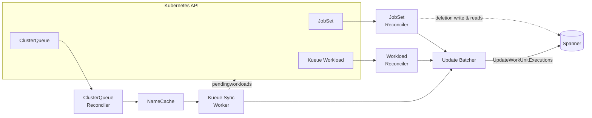
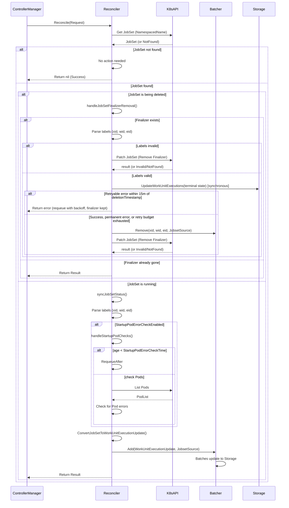
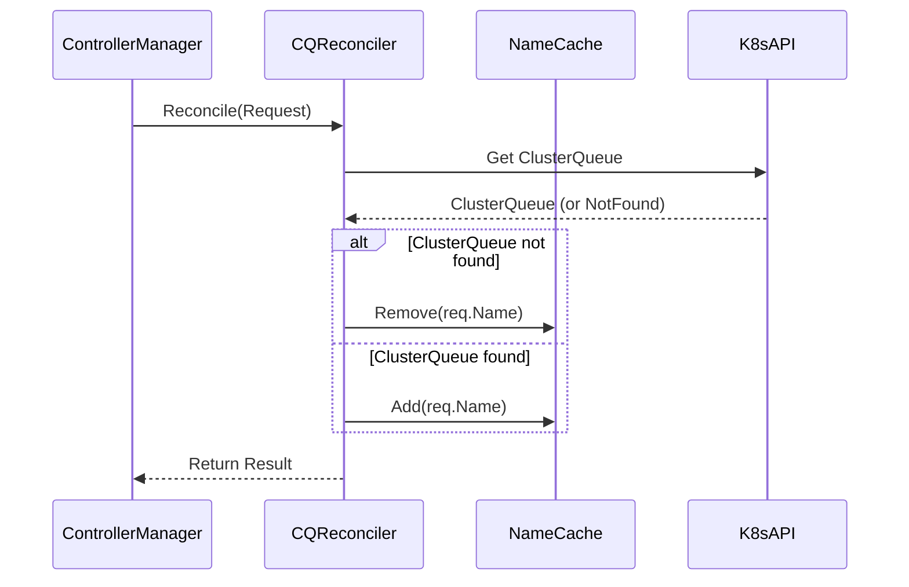
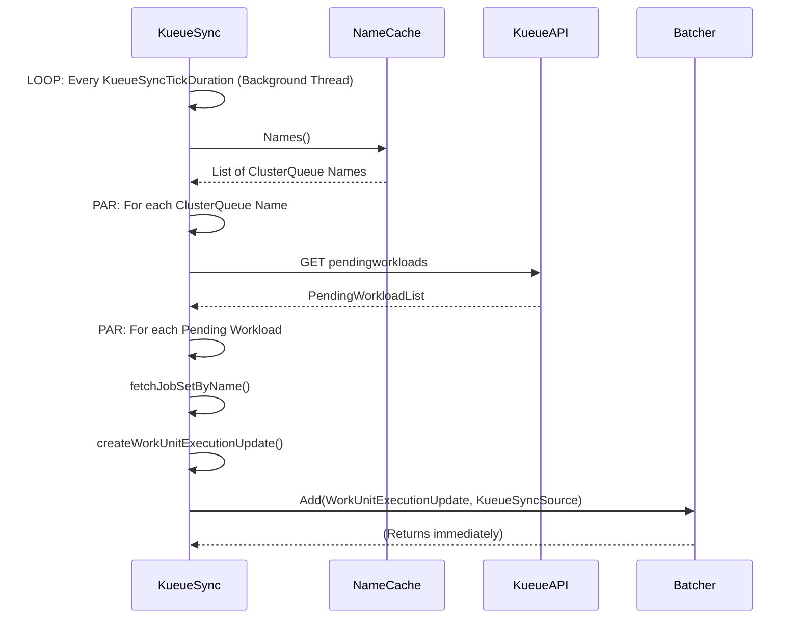
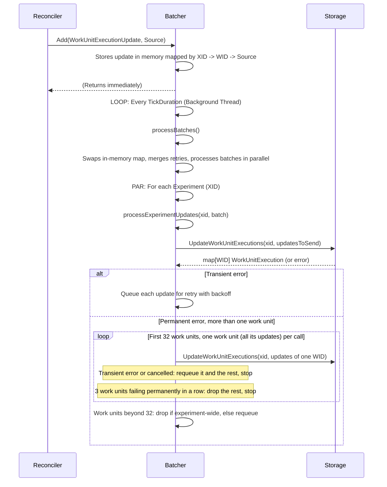

# Reconciliation Flows

How cluster reality becomes persisted work unit state. This is the **observation loop**: the
counterpart to the actuation path in [Work Unit Lifecycle](work_unit_lifecycle.md).

Nothing in XMC's read path queries Kubernetes. Every state a user sees — `RUNNING`, `FAILED`, a
Kueue scheduling explanation, an execution's start time — was written to Spanner by one of the four
components on this page.

---

## 1. The Reconciler Process

`cmd/reconciler` is a single controller-runtime manager hosting four cooperating pieces:

| Piece | Kind | Watches / drives | Answers |
| :--- | :--- | :--- | :--- |
| [JobSet Reconciler](#2-jobset-reconciler) | Controller | `JobSet` | Is the work running, finished, or gone? |
| [Workload Reconciler](#3-workload-reconciler) | Controller | Kueue `Workload` | Was it admitted, and if not, why? |
| [ClusterQueue Reconciler](#4-clusterqueue-reconciler) | Controller | Kueue `ClusterQueue` | Which queues exist? |
| [Kueue Sync Worker](#5-kueue-sync-worker) | Ticker | Kueue pending-workload API | Where is it in the queue? |

Periodic and status-change updates from all four flow through one shared
[Update Batcher](#6-the-update-batcher). The [JobSet Reconciler](#2-jobset-reconciler) also talks
directly to Spanner to persist terminal status synchronously before releasing a deleting JobSet's
finalizer and to read execution and artifact state during MLRun reconciliation.



The split exists because the three signals arrive on different clocks. JobSet events are
edge-triggered and immediate. Workload conditions are edge-triggered but describe admission, not
execution. Queue position has no event at all and must be polled. Funnelling them through one
batcher is what keeps Spanner write volume proportional to *experiments per tick* rather than to
*Kubernetes events per second*.

Concurrency is bounded per controller by `max_concurrent_reconciles` (default 10), and Kubernetes
API pressure by `kube_api_qps` / `kube_api_burst` (100 / 200). Each `Reconcile` call's context is
bounded by `reconciliation_timeout` (default 2 minutes), so a hung API or Spanner call cannot pin a
worker indefinitely.

> [!NOTE]
> Every reconciler tunable named in this document is a `snake_case` name — a flag on the binary
> ([`cmd/reconciler/config.go`](../../cmd/reconciler/config.go)), fed either from
> [`reconciler-config`](../../deploy/helm/templates/reconciler/configmap.yaml) or from the flag's
> own default. Most of the ConfigMap's entries are hardcoded in the template with no Helm value to
> override them; only the Spanner database name, the quota project, and the metrics port are
> rendered from `values.yaml`.
>
> There are no feature gates left. `detectInadmissibleWorkUnits`, `startupPodErrorCheckEnabled`,
> and `statusMessageHistoryEnabled` were `camelCase` Helm booleans that defaulted to `true`;
> [#801](https://github.com/google/xmc/pull/801) removed all three, so the behaviour they guarded
> is now simply what the Reconciler does.

---

## 2. JobSet Reconciler

The primary source of truth for execution state.



### The deletion branch and why the finalizer matters

XMC attaches the finalizer `jobset.xmanager.cloud/finalizer` to every JobSet it creates. A finalizer
makes deletion a two-phase operation: Kubernetes sets `deletionTimestamp` and *waits*.

That pause is the entire point. Without it, a `StopWorkUnit` would race — the JobSet could
disappear from the API server before the Reconciler observed it, leaving the work unit stuck in
`STOPPING` forever with no event to ever fix it. With it, the ordering is guaranteed:

1. Parse `xid` / `wid` / `eid` from the JobSet's labels.
2. Write the terminal status to Storage synchronously (bounded by a 10s timeout), bypassing the in-memory batcher so a reconciler restart or failed batch flush cannot lose it. If the JobSet already reached `Completed` or `Failed` (for example, before `TTLSecondsAfterFinished` cleanup or a concurrent stop), that terminal update (`COMPLETED` or `FAILED`) is written; otherwise `STOPPED` is written. Once the write succeeds (or is abandoned), any pending `JobsetSource` entry in the batcher for `eid` (or an older execution) is evicted via `Batcher.Remove` so a stale update cannot overwrite the terminal system message on the next tick without incurring a second Spanner write.
3. Remove the finalizer via an RFC 6902 JSON Patch (`test` + `remove` on `/metadata/finalizers/<idx>`) and patch the JobSet, letting the deletion complete.

If the `STOPPED` write fails, the reconciler decides whether to retry or give up:

- **Permanent errors** (`NotFound`, `InvalidArgument`, `FailedPrecondition`, `PermissionDenied`): the write is abandoned and the finalizer is released.
- **Retry budget exhausted**: any other error more than 15 minutes after the JobSet's `deletionTimestamp` is also abandoned and the finalizer released.
- **Otherwise** the reconcile returns the error and keeps the finalizer, so controller-runtime retries with backoff.

Abandoned writes are logged and counted in `jobset_stopped_write_abandoned_total{reason="permanent"|"retry_budget_exhausted"}`. Retrying is safe: Storage skips updates whose `eid` is not the current execution, and terminal states (including `STOPPED`) allow no further transitions.

Independently, the batcher never lets a lower-`eid` update replace a pending higher-`eid` update from the same source for the same work unit, since Storage would skip the stale update and the newer execution's update would be lost.

Scoping the precondition to `/metadata/finalizers/<idx>` instead of the whole object's `resourceVersion` ensures concurrent `.status` updates by the JobSet controller during teardown do not cause spurious conflicts, while still guarding against concurrent edits to the finalizer list. A failed `test` precondition (`422 Invalid`) requeues the request without counting as a reconcile error; a `NotFound` is treated as already-done. A JobSet carrying the finalizer but with unparseable labels is logged and released rather than blocking deletion indefinitely — a stuck finalizer is worse than a lost state update.

Outside the deletion branch, event predicates filter out JobSets and Workloads with missing or unparseable XMC labels up front (while allowing later Update events that fix the labels). As a defensive guard if an object's labels are invalid when `Reconcile` reads from the cache, label parse failures are returned as `reconcile.TerminalError` — logged and counted, but not requeued by the rate limiter until a subsequent update fixes the labels.

### Startup pod checks

A JobSet can be admitted and expanded yet never actually run: an image that does not pull, a node
selector nothing satisfies, a config map that does not exist. None of these produce a JobSet-level
failure, so the work unit would simply sit in `STARTING`.

So the reconciler requeues young JobSets until they reach `startup_pod_error_check_time`
(default 2 minutes), then lists their pods and inspects container statuses. Errors found there
become user-facing status messages, turning silent hangs into readable diagnostics.

### Status conversion

`ConvertJobSetToWorkUnitExecutionUpdate` (`cmd/reconciler/jobset/converter.go`) maps JobSet
conditions and per-job status onto the `WorkUnitExecution` fields — state, timestamps, and the
cluster info that lets the UI deep-link into Cloud Console.

---

## 3. Workload Reconciler

Kueue represents each admitted JobSet as a `Workload`. Its conditions carry the scheduling story
that the JobSet itself never sees.

The reconciler filters events with a predicate so it only wakes on meaningful status changes —
admission, pod-set assignment, and condition transitions — rather than on every resource version
bump.

Its most valuable job is diagnosing non-admission. It looks for the Kueue condition:

```text
type: QuotaReserved, status: False, reason: Inadmissible
```

and converts the condition's message into a user-facing status message attached to the work unit.

Without this, an under-quota experiment is indistinguishable from a slow one: both show
`SCHEDULING` and nothing else. With it, the user reads *why* — "insufficient quota for
nvidia.com/gpu" — from the UI, without cluster access.

---

## 4. ClusterQueue Reconciler



The simplest controller in the system, and it writes nothing to Spanner. It exists only to maintain
an in-memory `NameCache` of live `ClusterQueue` names.

That cache is what makes the Kueue Sync Worker possible: pending-workload queue positions must be
fetched *per queue*, so the poller needs a current list of queue names without hitting the API
server for it on every tick.

---

## 5. Kueue Sync Worker



This is the only polling component in the reconciler, because queue *position* is not a watchable
resource — Kueue exposes it through the `pendingworkloads` visibility endpoint, which must be
asked.

Every `kueue_sync_tick_duration` (default 60 s) it walks the cached queue names in parallel, reads
each queue's pending list, resolves the owning JobSet, and emits a position update. Concurrency is
capped at `max_concurrent_kueue_sync_reconciles` (default 1000).

A 60-second cadence is deliberately coarse. Queue position is advisory — it answers "am I moving?"
— and polling every queue harder would cost API budget that admission and execution events need
more.

---

## 6. The Update Batcher



### The keying, and what it buys

Updates are held in a three-level map:

```text
XID → WID → UpdateSource → WorkUnitExecutionUpdate
```

Two consequences follow from that shape, and both are deliberate:

- **Within a source, the latest update wins.** A work unit whose JobSet changes fifty times in one
  250 ms tick produces exactly one Spanner write. This is what lets XMC absorb the event storm of a
  thousand-pod experiment starting at once. The one exception: a lower-`eid` update never replaces
  a pending higher-`eid` update, because Storage skips updates for a non-current execution.
- **Across sources, nothing is lost.** The JobSet, Workload, and Kueue Sync updates for the same
  work unit are kept side by side and all flushed. They describe different facets — execution
  state, admission state, queue position — so collapsing them would mean a scheduling explanation
  silently overwriting a state transition.

### The flush

Every `batcher_tick_duration` (default 250 ms) the batcher **swaps** the accumulation map for an
empty one and processes the old one, together with any retries that are due. Producers are never
blocked while a flush is in flight.

Experiments are then processed in parallel, bounded by `max_parallel_experiments` (default 10), with
one `UpdateWorkUnitExecutions` call per experiment. Batching per experiment matches Spanner's
interleaved schema, where an experiment's work units are physically co-located.

### Failure behaviour

When a flush fails, the batcher classifies the error the same way the JobSet finalizer path does:

- **Transient** (anything other than `NotFound`, `InvalidArgument`, `FailedPrecondition`,
  `PermissionDenied`): each update in the batch moves to a retry queue keyed by
  `(xid, wid, source)`. The retry waits with exponential backoff, starting at the tick duration
  (at least 250 ms), doubling per attempt, and capped at 30 s. An update that is still failing
  more than 5 minutes after its first failure is dropped.
- **Permanent, single work unit:** the work unit's updates are dropped.
- **Permanent, multiple work units:** one bad work unit fails the whole per-experiment transaction,
  so up to 32 work units are resent on their own, one work unit (all of its sources' updates) per
  call, since Storage reports missing rows per work unit. Work units that succeed are persisted and
  those that fail permanently are dropped. Isolation stops early at the first transient failure or
  context cancellation (that work unit and all unsent ones are requeued), and after 3 work units in
  a row fail permanently, which is treated as experiment-wide (the unsent work units are dropped).
  Work units beyond the first 32 are dropped if the failure was experiment-wide and requeued
  otherwise, draining over later ticks. Requeued updates, including this overflow, are charged a
  backoff attempt and, if they expire, are counted as `retry_budget_exhausted`. Isolated writes are
  separate transactions, so they can record intermediate status-history rows that a single batched
  write would not.

On each tick, queued retries are merged with the new pending updates slot by slot
(`(xid, wid, source)`), mirroring `Add`:

- A pending update with an equal or higher `eid` is newer state and discards the retry.
- A pending update with a lower `eid` is discarded in favor of the retry, whether or not the retry
  is due yet.
- A due retry is sent. A retry that is not yet due is also sent if its experiment is being flushed
  this tick anyway, since that costs no extra call. Backoff therefore only bounds retry-only load.
- If a flush fails after `Remove` or a newer `Add` (`eid >= entry.eid`) arrived while the RPC was in
  flight, the superseded entry is skipped rather than re-queued or counted as budget-exhausted.

An update can therefore take up to about 6 minutes to be dropped: the 5 minute budget, plus up to
30 s of backoff before the attempt that notices it, plus the 30 s storage call timeout. A pending
update that supersedes a retry starts a fresh budget. Non-state fields are last-writer-wins across
sources, and because a retry can now land up to 5 minutes late, an older value from one source can
overwrite a newer value from another source in that window.

Metrics:

- `batcher_updates_dropped_total{xid, reason="permanent"|"retry_budget_exhausted"}` counts dropped
  updates.
- `batcher_updates_retried_total{xid}` counts retries merged back into a flush.
- `batcher_retry_queue_size` is the current retry-queue length.
- `xmc_actuator_batcher_update_calls_total` now includes retried and isolated calls, and
  `batcher_updates_processed_total` counts a retried update again each time it is flushed.

The batcher is still an in-memory buffer, and it makes the usual trade: if the Reconciler pod dies
with a tick or retry pending, those updates are gone. This is safe because every update is a
*snapshot* of current cluster state, not a delta. On restart, controller-runtime re-lists all
watched resources and reconciles each one, so the next tick rewrites the current truth. The visible
symptom of a Reconciler outage is stale state, never wrong state. The one update with no later
snapshot, the terminal `STOPPED` written when a JobSet is deleted, is persisted synchronously
before the finalizer is removed (see [§2](#2-jobset-reconciler)).

---

## 7. Where These Updates Surface

| Write | Read by |
| :--- | :--- |
| `WorkUnitExecution` state and timestamps | `GetWorkUnit`, `ListWorkUnits`, the UI work unit table |
| Aggregated per-state counts | [`GetExperimentStatus`](experiment_lifecycle.md#5-get-experiment-status) |
| Status messages (inadmissible, startup errors) | [`ListStatusMessages`](experiment_lifecycle.md#7-status-messages) |
| Cluster info (project, location, cluster) | UI deep links into Cloud Console |

---

## 8. Related Reading

- [Work Unit Lifecycle](work_unit_lifecycle.md) — the actuation half of the loop.
- [Execution Model §2](../architecture/execution_model.md#2-work-unit-state-machine) — the states
  these updates move through.
- [Execution Model §8](../architecture/execution_model.md#8-state-propagation-back-to-spanner) —
  the write path in summary form.
- [Component Reference §3.2](../architecture/components.md#3-execution-plane) — Reconciler
  sub-components at a glance.
