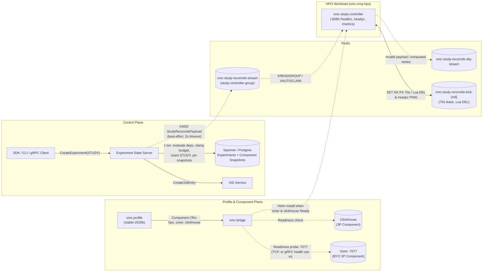
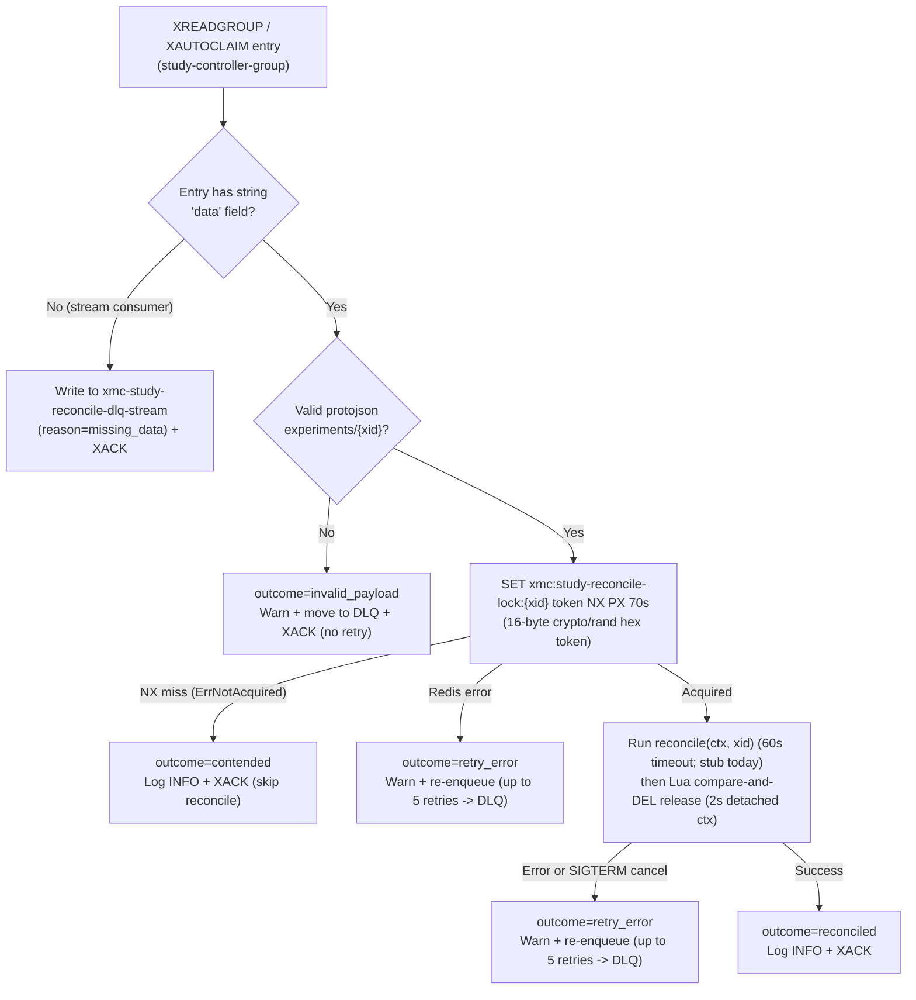

# Study Lifecycle (HPO)

End-to-end architecture and tick-processing flow for `STUDY` experiments orchestrated by the
Hyperparameter Optimization (`hpo`) component. Read
[Experiment Lifecycle](experiment_lifecycle.md#1-create-experiment) for synchronous experiment
creation, [STUDY Experiments](../../cmd/experiment_state_server/README.md#study-experiments) for
validation and component-pinning rules in the Experiment State Server (ESS), and the
[`hpo` Component Blueprint](../../deploy/profiles/stable-2026b/components/hpo/README.md) for Helm
profile values and actuation details.

> [!NOTE]
> `hpo` and `vizier` are `EXPERIMENTAL` components shipped in the preview
> [`stable-2026b`](../../deploy/profiles/stable-2026b/README.md) profile (disabled by default;
> enabling requires `acknowledgeExperimental: true`). Today `xmc-study-controller` validates
> reconcile ticks, serializes per-study execution under an advisory Redis lease lock, and records
> health and Prometheus metrics; reconciling studies against ESS, Vizier, and ClickHouse is still a
> no-op stub.

---

## 1. Runtime Topology

The diagram below shows every live runtime edge involved in actuating `hpo`, submitting a `STUDY`
experiment, and consuming study reconcile ticks. Solid arrows are synchronous requests or
in-transaction writes; dashed arrows are asynchronous probes or Redis stream operations.

Key boundaries in this topology:

- **Profile gate (`stable-2026b` only)**: `stable-2026a` does not ship `hpo` or `vizier`, so
  `CreateExperiment(STUDY)` fails closed with `FAILED_PRECONDITION` unless `stable-2026b` is
  installed and `hpo`, `vizier`, and `clickhouse` are enabled and `Ready` at their current
  generations.
- **Dependency loss after actuation**: once `xmc-cmp-hpo` is installed, `xmc-bridge` leaves the
  running `xmc-study-controller` workload in place if `vizier` or `clickhouse` later becomes
  unready (holding only future Helm upgrades). `/readyz` on `xmc-study-controller` currently pings
  Redis (`2s` timeout); `/healthz` checks only HTTP liveness so a Redis outage marks the pod
  `NotReady` without restarting it.
- **Unsigned hint stream**: `xmc-study-reconcile-stream` carries an unsigned protojson
  `StudyReconcilePayload` (`{"experiment": "experiments/{xid}"}`,
  [`api/protos/task_queue/task.proto`](../../api/protos/task_queue/task.proto)) with at-least-once
  delivery; see [Architecture Overview §7.2](../architecture/overview.md#72-signed-task-payloads)
  for the trust-boundary exception.

---

## 2. Per-Tick Processing & Per-Study Lease Lock

`xmc-study-controller` ([`cmd/study_controller`](../../cmd/study_controller)) shares a single
`*redis.Client` connection pool across stream consumption (`ConsumerClient`), per-study lease
locking ([`internal/redislock`](../../internal/redislock)), and `/readyz`. Each delivered stream
entry follows the decision path below:

### Lease, Timeout, and Shutdown Invariants

| Parameter | Value | Role |
| :--- | :--- | :--- |
| Lock key | `xmc:study-reconcile-lock:{xid}` | Isolates locking per study (`int64` XID) so distinct studies reconcile concurrently across workers. |
| Lease TTL | `70s` | Exceeds the `60s` reconcile timeout (`< 2m` `RedisProcessTimeout`) so an active reconcile never outlives its lease without needing a background renewal goroutine. |
| Reconcile timeout | `60s` | Bounds per-tick execution below `ConsumerClient`'s `2m` process timeout so the handler cancels work and releases the lock before stream timeout handling fires. |
| Release timeout | `2s` (detached) | Runs `if GET == token then DEL` on `context.WithoutCancel(ctx)` so `SIGTERM` shutdown still frees the lock in Redis rather than leaving a `70s` orphan. |
| Consumer drain | `10s` (`5s` HTTP first) | Covers the `2s` `XREADGROUP` block or `2s` detached lock release plus `5s` stream settle timeout (`SettleTimeout`) before closing the shared Redis client. |
| Abandoned PEL claim | `5m` (`XAUTOCLAIM`) | Reclaims unacknowledged stream entries if a controller pod crashes (`SIGKILL` / OOM) mid-reconcile after its `70s` Redis lease has expired. |

### Outcomes & Observability

`GET /metrics` pre-initializes all four `outcome` series on
`xmc_study_controller_reconcile_ticks_total` at startup:

- **`reconciled`**: lock acquired, reconcile completed, lock released, tick acknowledged.
- **`contended`**: another worker already holds `xmc:study-reconcile-lock:{xid}`; the duplicate
  tick is acknowledged immediately without reconciling while the active holder remains responsible
  for the study.
- **`retry_error`**: Redis lock acquisition failed, `reconcile` returned an error, or `SIGTERM`
  cancelled an in-flight tick; `ConsumerClient` re-adds and acknowledges the entry up to
  `RedisMaxRetries` (`5`) before moving it to `xmc-study-reconcile-dlq-stream` (ticks interrupted
  after shutdown begins are always retried rather than dead-lettered unless retries are exhausted).
- **`invalid_payload`**: `data` failed protojson decoding or did not carry a valid
  `experiments/{xid}` resource name; routed straight to `xmc-study-reconcile-dlq-stream` without
  acquiring the lock or retrying.
