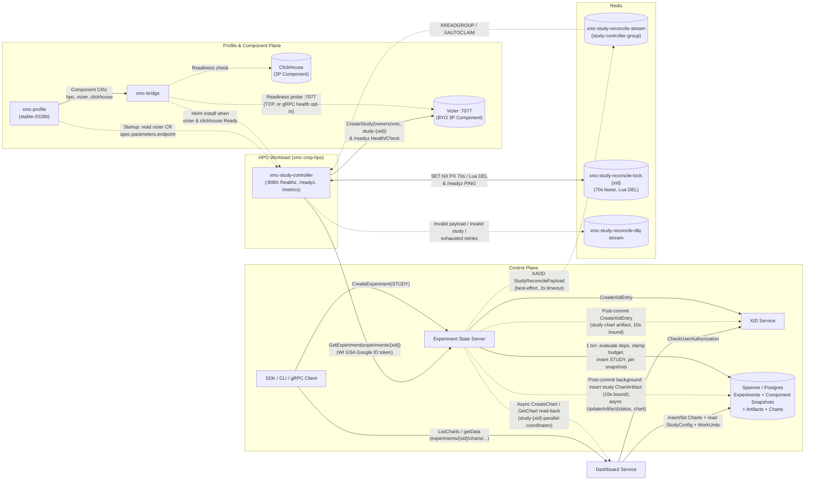
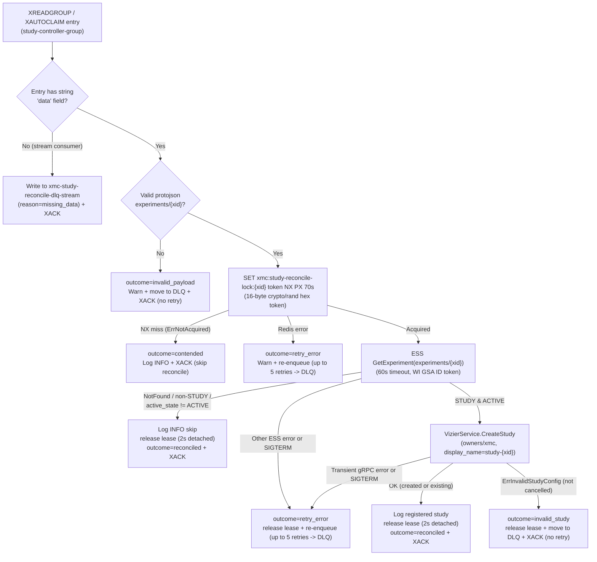
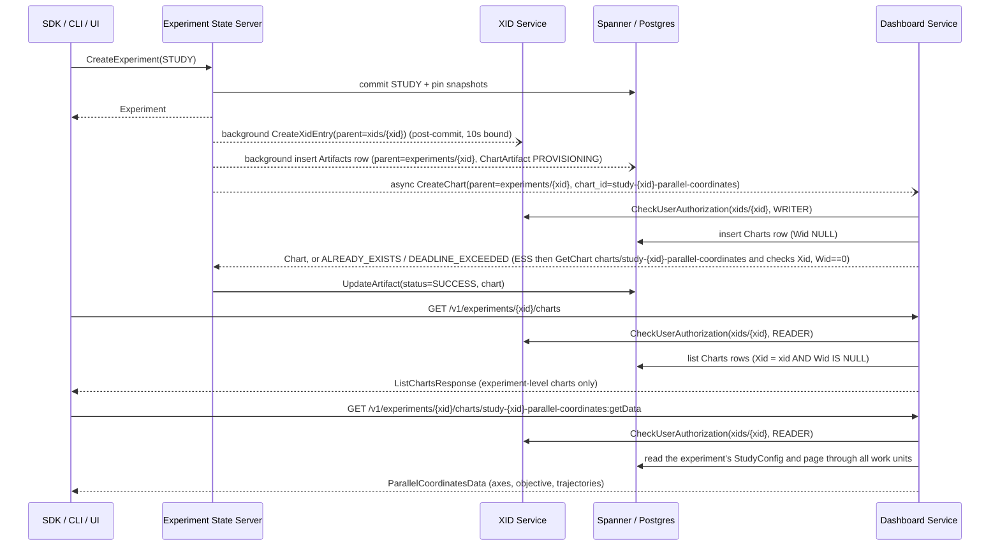

# Study Lifecycle (HPO)

End-to-end architecture and tick-processing flow for `STUDY` experiments orchestrated by the
Hyperparameter Optimization (`hpo`) component. Read
[Experiment Lifecycle](experiment_lifecycle.md#1-create-experiment) for synchronous experiment
creation, [STUDY Experiments](../../cmd/experiment_state_server/README.md#study-experiments) for
validation and component-pinning rules in the Experiment State Server (ESS), and the
[`hpo` Component Blueprint](../../deploy/profiles/stable-2026b/components/hpo/README.md) for Helm
profile values and actuation details.

> [!NOTE]
> `hpo` and `vizier` are `EXPERIMENTAL` components shipped in the preview
> [`stable-2026b`](../../deploy/profiles/stable-2026b/README.md) profile (disabled by default;
> enabling requires `acknowledgeExperimental: true`). Today `xmc-study-controller` resolves the
> `vizier` Component CR endpoint at startup (`503` on `/readyz` until resolved and reachable via
> `Health/Check`), serializes per-study execution under an advisory Redis lease lock,
> authenticates to ESS with its Workload Identity Google ID token to re-read each ticked
> experiment (`STUDY` + `ACTIVE` gate), and idempotently registers active studies in OSS Vizier via
> `VizierService.CreateStudy`; trial suggestion/dispatch and ClickHouse orchestration are not yet
> wired.

---

## 1. Runtime Topology

The diagram below shows every live runtime edge involved in actuating `hpo`, submitting a `STUDY`
experiment (including post-commit reconcile enqueueing and study chart provisioning), consuming
study reconcile ticks, and reading the study's parallel-coordinates chart. Solid arrows are
synchronous requests or in-transaction writes; dashed arrows are asynchronous probes, post-commit
side effects, or Redis stream operations.

Key boundaries in this topology:

- **Profile gate (`stable-2026b` only)**: `stable-2026a` does not ship `hpo` or `vizier`, so
  `CreateExperiment(STUDY)` fails closed with `FAILED_PRECONDITION` unless `stable-2026b` is
  installed and `hpo`, `vizier`, and `clickhouse` are enabled and `Ready` at their current
  generations.
- **Dependency loss after actuation**: once `xmc-cmp-hpo` is installed, `xmc-bridge` leaves the
  running `xmc-study-controller` workload in place if `vizier` or `clickhouse` later becomes
  unready (holding only future Helm upgrades). `/readyz` on `xmc-study-controller` checks both
  Redis (`Ping`) and Vizier (`grpc.health.v1.Health/Check`) within a `2s` timeout; `/healthz`
  checks only HTTP liveness so a dependency outage marks the pod `NotReady` without restarting it.
- **Unsigned hint stream**: `xmc-study-reconcile-stream` carries an unsigned protojson
  `StudyReconcilePayload` (`{"experiment": "experiments/{xid}"}`,
  [`api/protos/task_queue/task.proto`](../../api/protos/task_queue/task.proto)) with at-least-once
  delivery; see
  [Architecture Overview §7.2](../architecture/overview.md#72-inter-service-task-authentication)
  for the trust-boundary exception.
- **Study chart reads**: the Dashboard Service serves the experiment-level parallel-coordinates
  chart from the experiment database it already opens (the `StudyConfig` and the study's work units)
  after the same XID ACL check as ESS; it never calls `xmc-study-controller` or Vizier (see
  [§3](#3-study-visualization-parallel-coordinates-chart)).

---

## 2. Per-Tick Processing & Per-Study Lease Lock

`xmc-study-controller` ([`cmd/study_controller`](../../cmd/study_controller)) shares a single
`*redis.Client` connection pool across stream consumption (`ConsumerClient`), per-study lease
locking ([`internal/redislock`](../../internal/redislock)), and `/readyz`. Each delivered stream
entry follows the decision path below:

### Lease, Timeout, and Shutdown Invariants

| Parameter | Value | Role |
| :--- | :--- | :--- |
| Lock key | `xmc:study-reconcile-lock:{xid}` | Isolates locking per study (`int64` XID) so distinct studies reconcile concurrently across workers. |
| Lease TTL | `70s` | Exceeds the `60s` reconcile timeout (`< 2m` `RedisProcessTimeout`) so an active reconcile never outlives its lease without needing a background renewal goroutine. |
| Reconcile timeout | `60s` | Bounds per-tick execution below `ConsumerClient`'s `2m` process timeout so the handler cancels work and releases the lock before stream timeout handling fires. |
| Release timeout | `2s` (detached) | Runs `if GET == token then DEL` on `context.WithoutCancel(ctx)` so `SIGTERM` shutdown still frees the lock in Redis rather than leaving a `70s` orphan. |
| Consumer drain | `10s` (`5s` HTTP first) | Covers the `2s` `XREADGROUP` block or `2s` detached lock release plus `5s` stream settle timeout (`SettleTimeout`) before closing the shared Redis client. |
| Abandoned PEL claim | `5m` (`XAUTOCLAIM`) | Reclaims unacknowledged stream entries if a controller pod crashes (`SIGKILL` / OOM) mid-reconcile after its `70s` Redis lease has expired. |

### Outcomes & Observability

`GET /metrics` pre-initializes all five `outcome` series on
`xmc_study_controller_reconcile_ticks_total` at startup:

- **`reconciled`**: lock acquired, reconcile completed (including idempotent Vizier study
  registration for active `STUDY` experiments), lock released, tick acknowledged.
- **`contended`**: another worker already holds `xmc:study-reconcile-lock:{xid}`; the duplicate
  tick is acknowledged immediately without reconciling while the active holder remains responsible
  for the study.
- **`retry_error`**: Redis lock acquisition failed, `reconcile` returned a transient error, or
  `SIGTERM` cancelled an in-flight tick; `ConsumerClient` re-adds and acknowledges the entry up to
  `RedisMaxRetries` (`5`) before moving it to `xmc-study-reconcile-dlq-stream` (ticks interrupted
  after shutdown begins are always retried rather than dead-lettered unless retries are exhausted).
- **`invalid_payload`**: `data` failed protojson decoding or did not carry a valid
  `experiments/{xid}` resource name; routed straight to `xmc-study-reconcile-dlq-stream` without
  acquiring the lock or retrying.
- **`invalid_study`**: `StudyConfig` failed forward conversion or Vizier returned
  `InvalidArgument` (while `ctx` is not cancelled); routed straight to
  `xmc-study-reconcile-dlq-stream` without retrying or logging user payload contents.

---

## 3. Study Visualization (Parallel-Coordinates Chart)

When a `STUDY` experiment is created and `ess_dashboard_service_addr` is configured on `ESS` (via
environment variable or the `ess-config` ConfigMap), `ESS`
automatically provisions an experiment-level `PARALLEL_COORDINATES` chart for the study through its
artifact observer pipeline and the dashboard API
([`dashboard_service.proto`](../../api/protos/dashboard/dashboard_service.proto)).

- **Post-commit auto-provisioning**: after the `STUDY` creation transaction commits (next to the
  initial reconcile tick enqueue), `ESS` creates a server-provisioned `ChartArtifact` under
  `experiments/{xid}` (`WorkUnitId` `NULL`, display name and title `"Parallel Coordinates"`,
  `metric_names` listing the study's objective metric ID, initial status `PROVISIONING`) on a
  background goroutine tracked by the server's shutdown wait group, bounded at `10s` on a
  cancellation-detached context that preserves caller auth metadata, so `CreateExperiment` returns
  right after commit and a slow XID or database call cannot make clients time out and retry a
  committed study. User
  `CreateArtifact` calls continue to reject experiment-level `ChartArtifact` payloads with
  `INVALID_ARGUMENT`. The `dashboardObserver` then asynchronously calls `DashboardService.CreateChart`
  with the creating user's forwarded credentials, `parent = experiments/{xid}`, deterministic
  `chart_id = study-{xid}-parallel-coordinates`, and a single `PARALLEL_COORDINATES` plot, writing
  `SUCCESS` and the created `Chart` (or `FAILED` and `error_message`) back to the artifact. Because the
  chart ID is deterministic, a `CreateChart` that returns `ALREADY_EXISTS` or `DEADLINE_EXCEEDED`
  (the chart may already be committed) makes the observer read
  `charts/study-{xid}-parallel-coordinates` back with `GetChart`, verify `Xid == xid` and `Wid == 0`,
  and record `SUCCESS` when it matches. Note that
  `dashboard-service` gRPC currently validates `CLIENT_ID` on forwarded tokens (full
  `IAP_EXPECTED_HTTP_AUDIENCE`, `IAP_EXPECTED_GRPC_AUDIENCE`, `IAP_EXPECTED_ISSUER`, and `JWKS`
  validator parity with `ESS` lands in a follow-up change, so IAP-fronted gRPC `CreateExperiment`
  callers such as `xm_cloud` or JWKS OIDC callers record `ChartArtifact` `FAILED` with
  `Unauthenticated` until then). When no Dashboard Service is configured (`ess_dashboard_service_addr`
  empty, the Helm default when `dashboardServiceDeployment.enabled` is `false`), `ESS` skips
  provisioning so no artifact is left stuck in `PROVISIONING`.
- **Deterministic chart ID**: the study chart's resource name is computable from the experiment XID
  as `experiments/{xid}/charts/study-{xid}-parallel-coordinates` (parent-binding reservation rules are
  listed under Experiment-level charts below).
- **UI rendering status**: `<xmc-chart-artifact-view>` is mounted only on work unit pages; on the
  experiment Artifacts tab (`experiments/{xid}`), the study's `OUTPUT` `ChartArtifact` renders as an
  `<xmc-artifact-card>` in the `Output` pipeline column displaying its `study` /
  `parallel-coordinates` tags, comma-joined `Metrics` (`accuracy`), and — once `chart` is populated on
  `SUCCESS` — a collapsible `Chart Data` JSON block until experiment-level `PARALLEL_COORDINATES` UI
  rendering support lands.
- **Experiment-level charts**: named `experiments/{xid}/charts/{chart}`, created and listed under
  the parent `experiments/{xid}` (`ListCharts` returns only that experiment's experiment-level charts
  and never its work unit charts), with `Chart.wid` 0 (stored as a `NULL` `Charts.Wid`, migration 021).
  They may only hold `PARALLEL_COORDINATES` plots, and work unit charts may not hold any
  (`INVALID_ARGUMENT`). Chart IDs matching `^study-\d+-parallel-coordinates$` (after trimming
  whitespace) are reserved: `CreateChart` accepts one only as exactly `study-{xid}-parallel-coordinates`
  under `experiments/{xid}`, and rejects any other experiment or work unit parent, a padded ID, a
  leading zero, or an overflowing number with `INVALID_ARGUMENT`. Access follows the experiment's
  XID ACL, like work unit charts.
- **Axes**: one axis per `StudyConfig` parameter (double or integer range, categorical values in
  configuration order, discrete values ascending, plus the parameter's scale), followed by the
  objective metric and its goal.
- **Trajectories**: one per work unit in ascending ID order, with the state of its current
  execution, its creation time, and the time it completed (unset while it runs). Trajectories do not
  carry parameter values or the objective value yet.
- **Failure modes & recovery**: provisioning failures never fail `CreateExperiment(STUDY)` — `ESS`
  logs the error and increments `xmc_ess_study_chart_provisioning_failures_total` with
  `stage="artifact"` (child XID allocation or artifact insert failure) or `stage="chart"`
  (`DashboardService.CreateChart` failure or `UpdateArtifact` status write-back failure). Failed or
  missing study charts are not automatically re-provisioned yet (deferred to future sweeper or
  controller recovery). That sweeper must reconcile both uncounted crash windows (when ESS is
  killed or rolled past its shutdown grace period before finishing) and failure states that increment
  the counter without identifying which study or artifact needs repair: a committed `STUDY` with no
  `ChartArtifact` row at all (ESS terminated or `persistArtifact` failed when a Dashboard Service is
  configured), a `ChartArtifact` left in `PROVISIONING` past the observer bound (ESS terminated
  mid-provisioning or status write-back after `CreateChart` failed), a study chart that exists while
  its artifact is `FAILED` (for example, `GetChart` read-back after `ALREADY_EXISTS` or a deadline
  also failed), and orphan child XID entries left when `persistArtifact` fails after `CreateXidEntry`.
  On the read path, `GetChartData` returns `FAILED_PRECONDITION` when the
  experiment is not a `STUDY` with a `StudyConfig`, and, like every chart, when no metrics store
  (ClickHouse or BigQuery) is configured; it also fails while a configured metrics store is
  unreachable, because the chart data engine is built on it. A missing experiment-level chart, or an
  experiment-level name that points at a work unit chart or another experiment's chart, returns
  `NOT_FOUND` (unlike work unit charts, no default chart is synthesized).
- **Other chart RPCs**: `GetChart`, `UpdateChart`, and `DeleteChart` accept only `charts/{chart}`
  names, for experiment-level and work unit charts alike.
